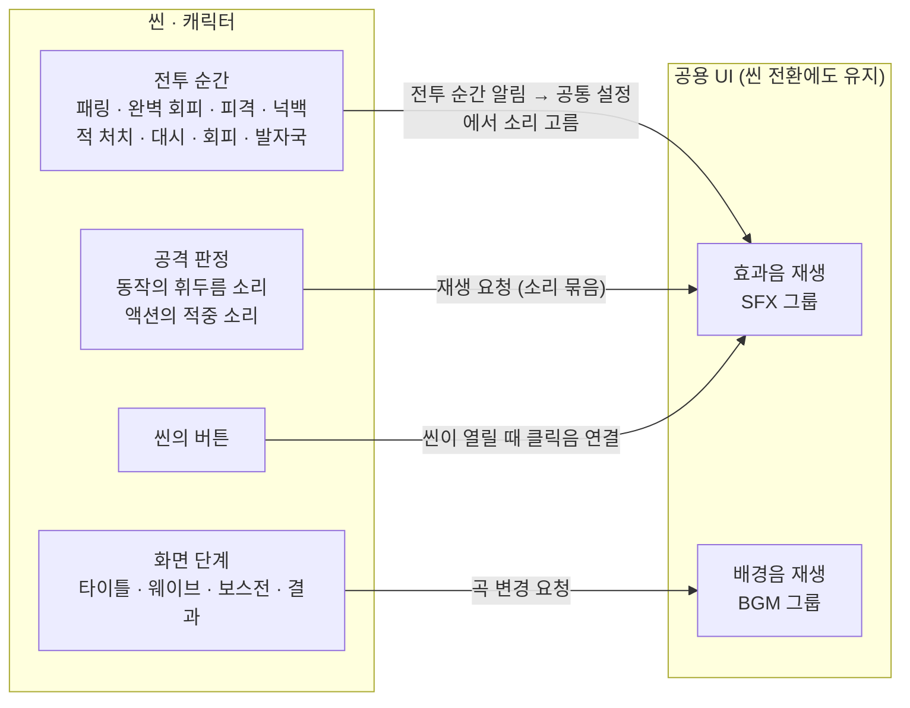
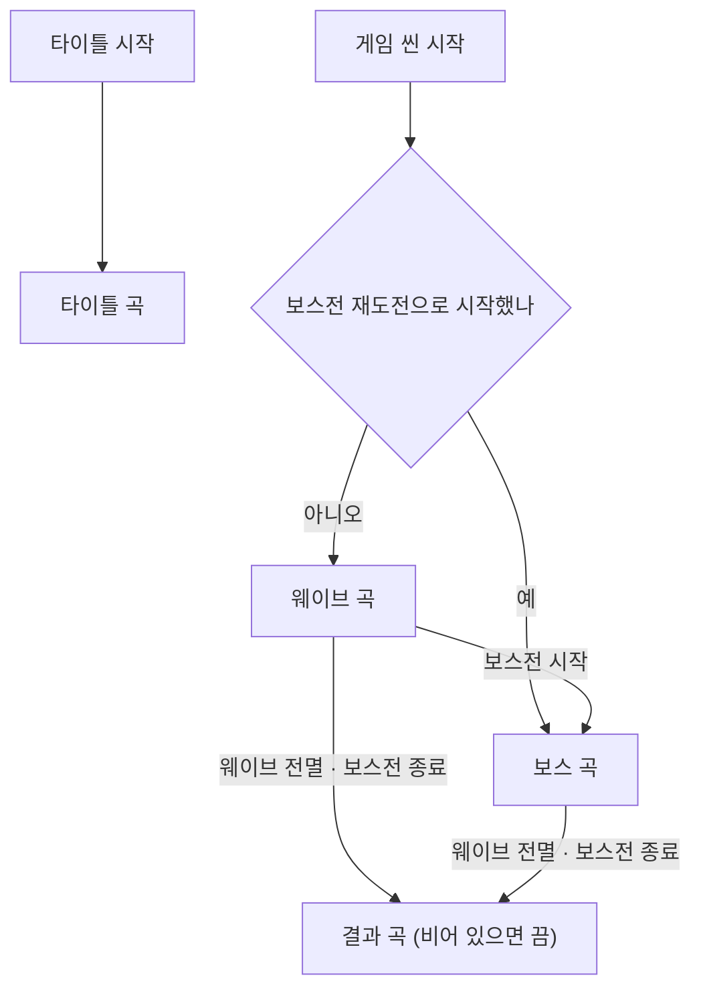

# 사운드 (효과음 · 배경음)

## 1. 개요

전투 · UI 의 순간마다 효과음을 내고, 화면(타이틀 · 웨이브 · 보스전 · 결과)마다 배경음을 바꾸는 체계다. 패링 · 대시 · 발자국 같은 공통 소리는 설정 에셋 하나에서, 휘두름 · 적중 소리는 캐릭터 · 액션마다 따로 고른다. 이미 임포트한 사운드 에셋을 그대로 연결해 쓰고, 볼륨은 설정 화면의 전체 · 배경음 · 효과음 값을 따른다.

## 2. 구성 요소

- SoundGroup : 소리 묶음 하나. 소리 목록과 볼륨. 재생할 때 목록에서 무작위로 고른다
- SfxSettings : [ScriptableObject] 공통 효과음 설정. 전투 순간마다 소리 묶음, 버튼 클릭음
- SfxPlayer : 효과음 재생. 전투 순간 알림 · 재생 요청을 받아 내고, 씬의 모든 버튼에 클릭음을 연결한다 (공용 UI)
- SfxRequest : 소리를 직접 들고 있는 쪽(액션)의 재생 요청 알림
- BgmPlayer : 배경음 재생. 화면별 곡, 두 AudioSource 로 크로스페이드 (공용 UI)
- BgmRequest : 곡 종류(타이틀 · 웨이브 · 보스 · 결과)와 곡 변경 요청 알림
- BgmCue : 씬이 시작될 때 정한 곡을 요청한다 (타이틀)
- GameBgm : 게임 흐름 알림에 맞춰 곡을 요청한다 (게임 씬)

## 3. 동작 원리

### 소리가 나는 길

- 소리를 내는 쪽은 알림만 보내고, 공용 UI 의 재생 기능이 받아서 낸다. 소리를 내는 쪽이 재생 기능을 몰라도 되고, 공용 UI 가 없는 테스트 씬에서도 오류 없이 소리만 나지 않는다.
- 재생 기능은 씬 전환에도 유지되는 공용 UI 에 하나만 둔다. 볼륨은 AudioMixer 의 BGM · SFX 그룹을 거쳐 설정 화면 값이 반영된다. (공용 UI 문서)
- 소리 묶음은 목록에서 무작위로 하나를 골라 낸다. 같은 순간이 반복될 때 소리가 섞여 나와 반복감이 줄어든다. 목록이 비어 있으면 소리를 내지 않아, 원하는 곳부터 채울 수 있다.

### 효과음

| 소리 | 둘 곳 | 나는 때 |
|---|---|---|
| 휘두름(시전) 소리 | 액션의 동작마다 | 그 동작에서 처음 판정하는 순간에 한 번. 적이 없어도 낸다 |
| 적중 소리 | 액션마다 | 적에게 대미지를 준 판정마다 한 번 |
| 공통 소리 | 공통 효과음 설정 | 패링 시작 · 성공, 완벽 회피, 피격 · 넉백, 적 처치, 대시 · 회피, 발자국 (조작 캐릭터 기준), 콤보 스킬 선택 화면 열림 |
| 버튼 클릭음 | 공통 효과음 설정 | 모든 버튼을 누를 때 |

- 공통 소리는 순간마다 기본 소리에 추가 겹을 더할 수 있고, 모두 동시에 낸다. 패링처럼 금속 충돌 · 저음 폭발 · 쇠 울림을 겹쳐 묵직하게 만들기 위해서다. 겹마다 목록에서 무작위로 고르고 볼륨을 따로 정한다. 겹을 고를 때는 확인용 겹쳐 듣기 기능으로 미리 들어 본다.
- 휘두름 · 적중 소리는 캐릭터 · 기술마다 달라 액션 데이터에 둔다. 공통 적중 소리는 두지 않는다. 액션 소리와 겹쳐 뭉개지지 않게 하기 위해서다. (사용자 결정)
- 휘두름 소리는 판정 시작 이벤트(없으면 강타 끝) 순간에 낸다. 클립에 이미 찍어 둔 이벤트라 칼이 나가는 순간과 맞고, 새 이벤트를 찍지 않아도 된다. 다단 히트로 판정이 여러 번 와도 한 동작에서 한 번이다.
- 발자국은 걷기 · 달리기 클립의 발이 땅에 닿는 프레임에 찍은 이벤트로 낸다. 퇴장하며 달려 나가는 캐릭터는 내지 않는다.
- 버튼 클릭음은 씬이 열릴 때마다 그 씬의 모든 버튼(꺼진 메뉴 안의 버튼 포함)에 자동으로 연결한다. 공용 UI 자신의 버튼은 시작할 때 한 번 연결한다. 버튼마다 컴포넌트를 붙이지 않아도 되고, 버튼의 실제 클릭 판정을 그대로 쓴다.
- 모두 위치와 상관없는 2D 소리로, 하나의 AudioSource 에서 겹쳐 낸다. 카메라 하나로 보는 3인칭 전투라 거리감이 필요한 소리가 아직 없다.

### 배경음

- 곡이 바뀌면 새 곡은 0 에서 올리고 이전 곡은 지금 크기에서 내리며 겹쳐 넘긴다. 다 내리면 이전 곡을 멈춘다. 바뀌는 도중 또 바뀌면 올라가던 곡을 이전 곡으로 보고 그 크기부터 내린다.
- 이미 같은 곡이 나오고 있으면 처음부터 다시 틀지 않는다. 재시작 · 재도전으로 씬을 다시 불러와도 같은 곡이 끊기지 않게 하기 위해서다. 재생 기능이 공용 UI 에 있어 씬이 바뀌어도 곡이 이어진다.
- 실제 시간으로 넘겨 히트스톱 · 일시정지와 상관없이 진행된다. 일시정지 중에도 배경음은 나온다.
- 콤보 스킬 선택 화면이 열려 있는 동안 배경음을 낮추고 먹먹하게(높은 소리를 깎음) 만들고, 닫히면 원래대로 돌린다. 시간이 멈춘 듯한 연출과 선택 화면 · 효과음이 앞으로 나오게 하기 위해서다. 재생 속도를 늦추는 방식은 음이 함께 내려가 호불호가 커서 쓰지 않았다. (사용자 결정)
    - 먹먹함은 배경음 AudioSource 에 Audio Low Pass Filter 를 붙였을 때만 적용한다.
    - 바뀌는 시간도 실제 시간으로 재서, 느려진 게임 시간에 영향받지 않는다.
    - 완벽 회피 슬로모션에는 넣지 않았다. 자주 · 짧게 일어나 배경음이 계속 바뀌면 산만하기 때문이다.
- 게임 씬의 곡 요청은 게임 흐름의 알림(보스전 시작 · 웨이브 전멸 · 보스전 종료)을 받아 한다. 시작할 때는 지금 단계를 보고 정해, 보스전 재도전으로 다시 시작해도 바로 보스 곡이 나온다.

## 4. 구현 과정

- 활용한 기능 :
    - AudioSource `PlayOneShot` : 효과음을 한 AudioSource 에서 겹쳐 낸다.
    - AudioSource 두 개 · 볼륨 보간 : 배경음 크로스페이드
    - AudioMixer 그룹(BGM · SFX) 출력 : 설정 화면 볼륨 반영
    - 애니메이션 이벤트 : 발자국
    - `SceneManager.sceneLoaded` · Button `onClick` : 씬이 열릴 때 버튼에 클릭음 연결
    - ScriptableObject : 공통 효과음 설정, 액션 데이터의 소리 칸
- 구현 과정 :
    1. 공통 효과음 설정 · 재생과 버튼 클릭음을 만들었다. 소리를 붙일 순간이 모자라 일반 적중 · 피격 · 적 처치 순간을 전투 순간 알림에 더했다.
    2. 버튼 클릭음은 버튼마다 컴포넌트를 붙이는 방식, 씬이 열릴 때 모든 버튼에 자동 연결하는 방식, 입력 모듈의 클릭을 직접 감시하는 방식을 비교해, 붙이는 수고가 없고 실제 클릭 판정을 쓰는 자동 연결로 정했다. (사용자 결정)
    3. 캐릭터 · 액션마다 다른 소리가 필요해 소리 묶음을 따로 떼고, 동작에 휘두름 소리 · 액션에 적중 소리 칸을 두었다. 공통 적중 소리는 빼고 대시 · 회피 · 발자국을 공통 소리로 더했다. (사용자 결정)
    4. 발자국은 이동 거리 기준과 클립 이벤트를 비교해, 발과 정확히 맞는 클립 이벤트로 정했다. 걷기 · 달리기를 섞는 구간에서 두 클립 이벤트가 겹치는지는 들어 보고 판단하기로 했다. (사용자 결정)
    5. 배경음 재생 · 크로스페이드와 화면별 곡을 만들었다.
- 주요 결정과 이유 :
    - 재생 기능은 공용 UI 에 둔다. 배경음은 씬이 바뀌어도 곡을 이어야 하고, 효과음은 타이틀 · 게임 씬 모두에서 같은 설정을 쓰기 때문이다.
    - 소리를 내는 쪽은 알림만 보낸다. 전투 연출 알림과 같은 방식이라, 캐릭터 · 씬이 재생 기능을 몰라도 된다.
    - 음원 선택 · 볼륨 조절은 사용자가 직접 듣고 정한다. (사운드 컨벤션)

## 5. 기존 방식과 비교

- 필요하게 된 과정 : 기획서에서 "기능 구현 때는 사운드 재생 지점만 만들어 두고 실제 사운드는 나중에 넣는다" 로 정해, #55 에서 전투 순간 알림을 만들어 두었다. 시연 빌드에 소리가 없어, 카메라 워크 · 타격 이펙트보다 먼저 배경음 · 효과음을 넣기로 했다. (11.18 사용자 결정)

### 미정 · 미검증 항목

- 기합 소리(캐릭터 목소리) : 계획은 있으나 에셋이 없고 일정이 미정
- 걷기 · 달리기를 섞는 구간에서 발자국 소리 겹침 (들어 보고 판단)
- 결과 화면 곡 (지금은 비우면 끔)
- 적 쪽 소리(공격 휘두름 · 예고 · 피격), 보스 등장 소리
- 실행 중 새로 만드는 버튼의 클릭음 (지금은 그런 버튼이 없음)
