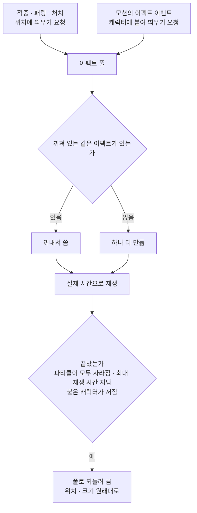
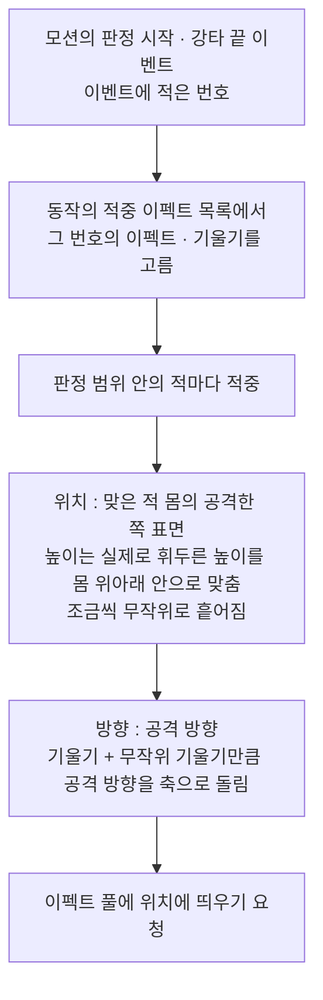
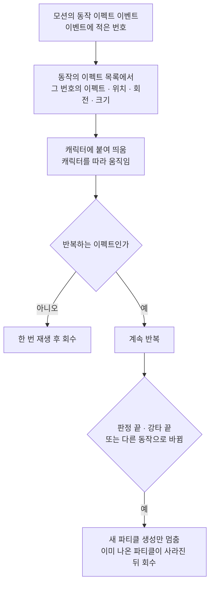
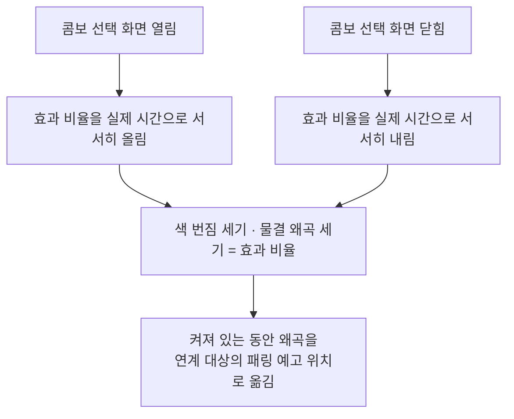

# 전투 이펙트 : 적중 · 동작 · 패링 · 처치 이펙트와 콤보 선택 · 완벽 회피 · 그로기 연출

## 1. 개요

공격이 적에게 닿는 순간, 캐릭터가 휘두르는 동안, 패링 · 처치 순간에 이펙트를 띄워 타격감을 더하는 체계다. 화면 흔들림 · 대미지 숫자에만 의존하던 타격감에 "무엇으로 어떻게 맞았는지" 가 보이는 이펙트를 더한다.

이펙트는 히트스톱 · 히트렉 · 콤보 선택처럼 게임 시간이 멈추거나 느려지는 순간에도 실제 속도로 재생된다. 콤보 선택 화면 · 완벽 회피 · 그로기 같은 전투 상황도 화면 효과 · 잔상 · 막대 색으로 눈에 띄게 보여 준다. 레퍼런스는 젠레스 존 제로다.

## 2. 구성 요소

- BattleEffect : 이펙트 재생 요청을 알리는 공용 알림. 위치에 띄우기 · 캐릭터에 붙여 띄우기 · 붙어서 반복 중인 이펙트 멈추기 세 가지를 알린다
- BattleEffectPool : 요청을 받아 이펙트를 미리 만들어 둔 것에서 꺼내 띄우고, 끝나면 다시 넣어 두는 이펙트 풀. 실제 시간으로 재생한다
- HitEffectSetting : 적중 이펙트 한 칸. 띄울 이펙트 · 기울기 · 무작위 기울기
- MotionEffectSetting : 동작 이펙트 한 칸. 띄울 이펙트 · 캐릭터 기준 위치 · 회전 · 크기
- ActionStep : 동작 하나의 값. 적중 이펙트 목록 · 동작 이펙트 목록 · 첫 타격에만 히트렉 옵션을 가진다 (이펙트 관련 역할)
- PlayerAttackJudge : 맞은 적마다 적중 이펙트를 요청한다 (이펙트 관련 역할)
- PlayerAnimationEventRelay · PlayerController : 모션의 이펙트 이벤트로 동작 이펙트를 띄우고, 판정 끝 · 강타 끝 · 동작이 바뀔 때 반복 이펙트를 멈춘다 (이펙트 관련 역할)
- PlayerParryState : 패링 성공마다 패링 이펙트를 요청한다 (이펙트 관련 역할)
- CommonCharacterSettings : 패링 이펙트 · 적중 이펙트 흩어짐 범위 같은 모든 캐릭터 공통 값 (이펙트 관련 역할)
- EnemyDissolve : 처치된 적의 몸을 녹여 없애고, 녹기 시작할 때 처치 이펙트를 띄운다
- ComboSelectScreenEffect : 콤보 선택 화면이 열려 있는 동안 색 번짐 · 물결 왜곡을 서서히 켜고 끈다
- PerfectDodgeAfterimage : 완벽 회피 때 캐릭터 잔상을 연속으로 남겼다가 흐리게 지운다
- EnemyGauge : 적 바. 그로기 직전 깜빡임과 그로기 중 네온색 순환 (이펙트 관련 역할, 자세한 내용은 전투 HUD 문서)

## 3. 동작 원리

### 이펙트 요청과 풀

- 이펙트를 띄우는 쪽(공격 판정 · 패링 · 적)은 풀을 몰라도 되고 "이 이펙트를 여기에 띄워 줘" 라고 알리기만 한다. 풀이 없는 시험 씬에서는 오류 없이 이펙트만 나오지 않는다.
- 타격처럼 이펙트가 자주 나오는 순간에 매번 만들고 지우지 않도록, 같은 이펙트를 꺼 두었다가 다시 쓴다.
- 임포트한 이펙트 에셋은 게임 시간으로 재생하게 만들어져 있다. 원본은 그대로 두고, 풀이 만든 복사본만 실제 시간으로 재생하도록 바꾼다. 그래서 히트스톱 · 히트렉 · 콤보 선택 중에도 이펙트는 멈추지 않는다.
- 위치에 띄운 이펙트는 한 번 재생하고 끝난다. 캐릭터에 붙여 띄운 이펙트는 캐릭터를 따라 움직이고, 캐릭터가 교체로 퇴장하면 바로 회수된다.

### 적중 이펙트 : 휘두르기마다 고르기

- 한 액션 안에서도 주먹 · 발차기 · 방패 치기처럼 타격 방식이 다르므로, 휘두르기마다 맞는 이펙트를 고른다. (사용자 결정)
- 베기는 휘두르기마다 베는 방향과 각도가 다르다. 같은 베기 이펙트를 기울기만 바꿔 가로 · 세로 · 대각으로 맞춘다. (사용자 결정)
- 모션의 판정 시작 · 강타 끝 이벤트에 적은 번호로 목록에서 고른다. 번호를 적지 않은 이벤트는 목록의 첫 이펙트를 쓴다. 판정 구간의 다단 히트는 구간을 연 판정 시작의 이펙트를 쓴다.
- 목록을 비워 둔 동작이나 비워 둔 칸은 적중 이펙트를 띄우지 않는다.
- 높이는 동작의 판정 범위가 실제로 휘두르는 높이를 쓴다. 맞은 적 몸의 중심 높이를 쓰면 큰 적(보스)을 아래에서 때려도 이펙트가 공중에 뜨기 때문이다.
- 펀치 러시처럼 한 구간에서 여러 번 맞는 공격은 위치와 기울기가 매번 조금씩 달라져, 같은 이펙트가 한 자리에 겹쳐 보이지 않는다.
- 처치되는 적도 마지막 타격이라 적중 이펙트를 띄운다.

### 동작 이펙트 : 캐릭터를 따라가는 이펙트와 반복 멈춤

- 베기 궤적 · 방패 치기처럼 캐릭터 동작에 붙는 이펙트는 모션의 이벤트 시점에 띄운다. 한 동작 안에서 여러 번 띄울 수 있다.
- 위치 · 회전 · 크기는 캐릭터 기준 값이라, 동작마다 Scene 창에서 보며 맞춘 값을 그대로 쓴다.
- 연타의 먼지처럼 반복하는 이펙트는 동작이 이어지는 동안 계속 나온다. 판정 끝 · 강타 끝 이벤트나 다른 동작으로 넘어가면 새로 나오는 것만 멈추고, 이미 나온 파티클은 자연스럽게 사라진다.
- 멈춤은 그 이펙트를 띄운 동작에서 온 이벤트에만 반응한다. 다음 동작으로 섞여 넘어가는 동안 앞 동작의 이벤트가 와도 다음 동작의 이펙트를 끄지 않는다.

### 패링 · 처치 이펙트

- 패링 이펙트 : 패링 성공마다 패링한 캐릭터와 적 사이, 무기 높이에 공통 이펙트가 뜬다. 연속 패링도 성공마다 뜬다.
- 처치 연출 : 시체가 사라지기 정해진 시간 전부터 몸이 녹아 없어지고(디졸브), 녹기 시작할 때 처치 이펙트가 그 자리에 뜬다. 처치 이펙트는 적에게 붙지 않아 적이 사라진 뒤에도 끝까지 재생된다.
    - 녹는 속도는 적 전용 시간을 따라, 슬로모션 · 필살기 연출 동안 함께 느려지거나 멈춘다.
    - 디졸브 재질을 넣지 않은 적은 몸이 녹지 않고 그대로 사라지며, 처치 이펙트는 같은 때에 뜬다.

### 콤보 선택 화면 효과

- 콤보 선택 중에는 게임 시간이 느려지므로, 켜지고 꺼지는 속도는 실제 시간으로 잰다. 연계로 선택이 다시 열리면 그 자리에서 다시 켜진다.
- 물결 왜곡은 화면을 읽어 연계 대상에서 물결이 퍼지듯 일그러뜨린다.
- 왜곡은 연계 대상의 패링 예고 위치에 띄운다. 록온 위치는 머리 쪽이라 왜곡이 화면 위로 치우쳐 어색해 보이고, 패링 예고 위치는 몸 중심에 가까워 "이 적과 연계한다" 는 느낌이 잘 살기 때문이다. (사용자 결정) 예고 위치가 없는 적은 적 위치에 띄운다.
- 효과가 꺼져 있는 동안은 왜곡을 그리지 않아, 평소에 화면을 한 번 더 그리지 않는다.

### 완벽 회피 잔상

- 완벽 회피 순간부터 정해진 시간 동안, 일정한 간격으로 조작 캐릭터의 그 순간 모습(몸 · 무기)을 잔상으로 남긴다. 잔상은 정해진 시간에 걸쳐 흐려지며 사라진다.
- 잔상은 실제 시간으로 흘러, 슬로모션 중에도 같은 간격 · 같은 속도로 남고 사라진다.
- 잔상마다 오브젝트를 만들지 않고 그 순간의 자세만 기억해 두었다가 직접 그린다. 다 사라진 잔상은 다음 잔상에 다시 쓴다.
- 캐릭터가 교체로 퇴장하면 남은 잔상을 바로 지운다.

### 그로기 막대

- 그로기 게이지가 가득 차기 직전에는 막대가 원래 색과 흰색 사이로 깜빡여, 곧 그로기가 된다는 것을 알린다.
- 그로기 중에는 막대가 네온색과 흰색을 빠르게 오가며 바뀐다. 남은 연계를 다 쓴 그로기는 정한 한 가지 색으로 보여 준다.
- 둘 다 실제 시간으로 흘러 히트렉 · 콤보 선택 중에도 같은 속도로 바뀐다.

### 항상 앞에 그리는 표시

- 패링 예고 표시와 록온 표시는 적 몸에 가려지지 않도록 항상 앞에 그린다.
- 두 표시를 전용 Layer 에 두고, 렌더러 설정에서 그 Layer 만 깊이와 상관없이 마지막에 다시 그린다.

## 4. 구현 과정

- 활용한 기능 :
    - `ParticleSystem` : 이펙트 재생. 풀이 만든 복사본은 `useUnscaledTime` 으로 실제 시간에 재생하고, 끝나도 스스로 지우지 않게 바꾼다. 반복 멈춤은 `Stop` 의 새 파티클 생성만 멈추는 방식을 쓴다.
    - `Animator` 의 실제 시간 갱신 : 메시를 움직이는 이펙트도 실제 시간으로 재생한다.
    - 애니메이션 이벤트의 Int 값 : 적중 · 동작 이펙트 목록에서 몇 번째를 쓸지 모션에서 고른다.
    - `MaterialPropertyBlock` : 디졸브 녹는 정도 · 잔상 흐려짐 · 왜곡 세기를 Renderer 마다 따로 넣어, 같은 재질을 쓰는 다른 오브젝트와 재질 에셋은 바뀌지 않는다.
    - `SkinnedMeshRenderer.BakeMesh` · `Graphics.RenderMesh` : 잔상의 순간 자세를 구워 두고 오브젝트 없이 직접 그린다.
    - URP `Volume` (Chromatic Aberration) : 콤보 선택 중 색 번짐.
    - Shader Graph : 물결 왜곡. 중심에서 거리에 따라 퍼지는 사인 물결로 화면 색을 읽는 위치를 밀어 일그러뜨린다. URP 의 Opaque Texture 를 켜서 화면 색을 읽는다.
    - URP Renderer Feature `Render Objects` : 전용 Layer 를 깊이 검사 없이 마지막에 다시 그려 항상 앞에 보이게 한다.
    - `RawImage` · `Gradient` : 그로기 막대 색. 네온 순환은 단계가 끊기는 그라데이션으로 색이 부드럽게 섞이지 않고 또렷하게 바뀐다.
- 구현 과정 :
    1. 이펙트 재생 요청과 이펙트 풀을 만들고, 액션마다 고른 적중 이펙트를 맞은 적마다 띄웠다. 풀이 만든 복사본만 실제 시간으로 재생하게 바꿨다.
    2. 모션의 이펙트 이벤트로 동작 이펙트를 캐릭터에 붙여 띄웠다. 동작마다 이펙트 목록(위치 · 회전 · 크기)을 둔다.
    3. 패링 성공 이펙트, 처치 디졸브와 처치 이펙트를 넣었다.
    4. 콤보 선택 화면 효과(색 번짐 · 왜곡), 완벽 회피 연속 잔상, 그로기 막대 색, 패링 예고 십자 이펙트(가능 · 불가 색별)를 넣었다.
    5. 재검토 : 큰 적을 때리면 적중 이펙트가 공중에 떠서, 높이를 판정 범위가 휘두르는 높이로 바꾸고 몸 위아래 안으로 맞췄다. 같은 자리에 겹치지 않게 무작위로 흩었다.
    6. 재검토 : 적중 이펙트를 액션 단위에서 휘두르기 단위로 옮겼다. 판정 시작 · 강타 끝 이벤트의 번호로 고르고, 휘두르기마다 기울기를 정한다. 액션의 적중 이펙트 칸은 없앴다.
    7. 재검토 : 연타 먼지처럼 반복하는 동작 이펙트를 끝 이벤트 · 동작 변경 때까지 유지하고 멈추게 했다.
    8. 재검토 : 첫 타격에만 히트렉을 거는 옵션을 넣었다 (공격 문서).
    9. 재검토 : 패링 예고 · 록온 표시를 항상 앞에 그리게 했다. 콤보 선택 왜곡을 물결 모양으로 바꾸고 연계 대상의 패링 예고 위치에 띄웠다. 그로기 막대를 무지개 흐름에서 깜빡임 · 네온 순환으로 바꿨다.
- 주요 선택 이유 :
    - 이펙트 재생을 공용 알림으로 한 것은 효과음 재생 요청과 같은 방식으로 맞추고, 띄우는 쪽이 풀에 묶이지 않게 하기 위해서다.
    - 원본 이펙트 에셋을 고치지 않고 복사본만 바꾼 것은, 임포트한 에셋을 그대로 두고 다른 곳에서도 쓸 수 있게 하기 위해서다.
    - 적중 이펙트를 휘두르기 단위로 옮긴 이유는 위 `적중 이펙트` 에 적었다. (사용자 결정)

### 참고 레퍼런스

- 젠레스 존 제로 : 그로기 직전 막대 깜빡임 · 그로기 중 네온색 순환, 콤보 선택 화면의 화면 효과, 네온 위주 색감

## 5. 기존 방식과 비교

- 필요하게 된 과정 : 카메라 워크(#67)까지 끝났지만 타격 · 패링 순간에 이펙트가 없어 타격감이 화면 흔들림과 숫자에만 의존했다. 콤보 스킬 선택 화면 효과는 카메라 워크에서 이 작업으로 넘어왔고, 패링 예고 · 록온 표시는 임시 오브젝트였다. (#72)
- 계획에서 바뀐 점 (#72 재검토) :
    - 기존 : 적중 이펙트를 액션마다 하나 골랐다.
    - 변경 : 동작의 휘두르기마다 이펙트와 기울기를 고른다. 한 액션 안의 다른 타격 방식과 베는 방향에 맞출 수 있다.
    - 기존 : 콤보 선택 화면 효과로 방사형 블러를 계획했다.
    - 변경 : 연계 대상에서 퍼지는 물결 왜곡을 쓴다. 회오리처럼 보이던 왜곡을 물결 모양으로 바꿨다.
    - 기존 : 그로기 중 막대가 무지개 그라데이션으로 흘렀다.
    - 변경 : 그로기 직전 흰색 깜빡임, 그로기 중 네온색 · 흰색 빠른 순환으로 바꿨다.
    - 기존 : 반복하는 동작 이펙트도 한 번 재생 후 끝났다.
    - 변경 : 반복 이펙트는 끝 이벤트 · 동작 변경 때까지 유지된다.
    - 개선된 점 : 맞힌 방식과 방향이 이펙트로 보이고, 그로기 · 연계 대상 같은 전투 상황이 화면에서 바로 읽힌다.

### 미정 · 미검증 항목

- 적중 이펙트 · 대미지 숫자 최적화 : 필살기 한 번에 많은 이펙트가 만들어진다. 별도 Issue 로 진행한다
- 툰 계열 셰이더 통일 : 기준 셰이더를 정한 뒤 디졸브 · 왜곡 셰이더를 함께 다시 본다
- 적 착지 지점 · 돌진 범위 표시 : 몬스터 제작 때 진행
- 필살기 Timeline 연출 : 이후 연출 작업
