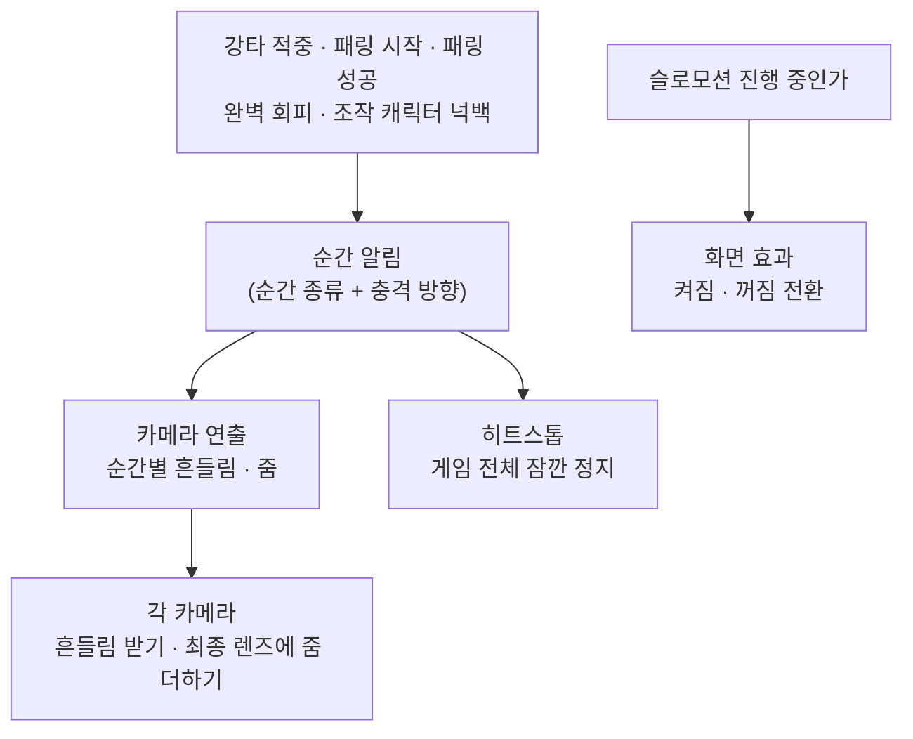

# 전투 연출 : 카메라 흔들림 · 줌 · 히트스톱 · 슬로모션 화면 효과

## 1. 개요

강타 적중 · 패링 · 완벽 회피 · 넉백 같은 전투의 중요한 순간에 카메라와 화면, 게임 시간이 함께 반응해 타격감을 주는 연출 체계다. 순간마다 흔들림 · 줌 · 정지 · 화면 색을 다르게 조합해, 같은 "반응" 이라도 맞았다 · 막았다 · 피했다가 다르게 느껴지게 한다. 카메라 워크 · 이펙트 · 효과음 같은 이후 연출 작업이 같은 순간 알림을 함께 쓰는 기반이다.

## 2. 구성 요소

- BattleFeedback : 전투 연출이 반응할 순간(강타 적중 · 패링 시작 · 패링 성공 · 완벽 회피 · 넉백)과 충격 방향을 알리는 공용 알림
- CameraImpactFeedback : 순간 알림을 받아 카메라 흔들림을 내고, 순간별 줌(FOV) 변화량을 만드는 카메라 연출 기능
- CameraFovOffset : 카메라 연출 기능의 줌 변화량을 각 Cinemachine 카메라의 최종 렌즈에 더하는 확장 기능
- BattleHitStop : 순간 알림을 받아 게임 전체를 아주 잠깐 멈추는 히트스톱 기능 (지금은 패링 성공)
- SlowMotionScreenEffect : 완벽 회피 슬로모션 동안 화면 효과 Volume 을 켜고 끄는 기능

## 3. 동작 원리

| 순간 | 흔들림 | 줌 | 히트스톱 | 화면 효과 |
|---|---|---|---|---|
| 강타 적중 | 무작위 방향 | 없음 | 없음 | 없음 |
| 패링 시작 | 없음 | 짧은 줌 인 | 없음 | 없음 |
| 패링 성공 | 공격이 들어온 방향으로 반동 | 짧은 줌 인 | 있음 | 없음 |
| 완벽 회피 | 없음 | 줄었다 늘어남 | 없음 | 슬로모션 동안 켜짐 |
| 넉백 (조작 캐릭터) | 무작위 방향 | 없음 | 없음 | 없음 |

### 순간 알림

- 플레이어 쪽(공격 판정 · 패링 · 피격 · 슬로모션)은 순간이 일어났다는 것만 알리고, 카메라 · 히트스톱 등 반응하는 쪽이 각자 받는다. 반응하는 쪽은 씬에 하나 있고 알리는 쪽은 캐릭터마다 있어, 서로 몰라도 되게 하기 위해서다.
- 강타는 한 번의 판정에서 여러 적을 맞혀도 한 번만 알린다. 범위 공격에서 흔들림이 겹쳐 커지지 않게 하기 위해서다. 어느 캐릭터의 강타든 알린다.
- 넉백은 조작 중인 캐릭터일 때만 알린다. 퇴장 중인 이전 캐릭터가 넉백될 때 화면이 흔들리면 어색하기 때문이다.
- 패링 성공은 캐릭터가 밀려나는 방향(적 → 캐릭터)을 함께 알린다.

### 카메라 흔들림

- 흔드는 순간마다 Cinemachine Impulse Source 를 하나씩 두고, 흔들림 모양 · 길이 · 세기를 각 Source 에서 정한다. 연결하지 않은 순간은 흔들지 않는다.
- 방향은 코드가 정한다. 방향이 없는 순간은 매번 화면 기준 상하좌우의 무작위 방향이고, 패링은 공격이 들어온 방향으로 반동한다.
- 카메라는 보통 캐릭터 뒤에서 적 쪽을 보므로, 적 → 캐릭터 방향은 대부분 카메라의 깊이 방향이다. 깊이 방향 흔들림은 화면에서 거의 보이지 않아, 깊이 성분을 세로로 옮긴다. 정면에서 막으면 아래로 눌리고, 옆에서 막으면 좌우로 밀린다.
- 흔들림은 Source 오브젝트 위치가 아닌 카메라 위치에서 낸다. Source 를 어디에 두든 거리 때문에 약해지지 않게 하기 위해서다.
- 각 Cinemachine 카메라(일반 · 록온)의 Impulse Listener 가 화면 기준으로 받고, Listener 의 반응 설정(Noise)으로 충격 뒤 불규칙한 떨림을 더해 정해진 곡선을 따르는 느낌을 줄인다.

### 줌 (FOV)

- 순간마다 변화량 · 길이 · 곡선을 정하고, 곡선대로 FOV 변화량을 만든다. 곡선이 0 에서 시작해 0 으로 끝나면 원래 FOV 로 돌아온다.
- 변화량은 카메라에 설정한 FOV 를 바꾸지 않고, 각 Cinemachine 카메라의 최종 렌즈에만 더한다. 그래서 효과가 끝나면 항상 원래 FOV 로 돌아오고, 카메라 사이 전환이나 이후 카메라 워크에서 FOV 를 바꿔도 충돌하지 않는다.
- 새 효과가 오면 진행 중인 효과를 끊고 새로 시작한다. 패링 시작 줌 중에 패링에 성공하면 성공 줌으로 이어진다.
- 실제 시간으로 흘러 히트스톱 정지 중에도 진행된다.

### 히트스톱

- 패링 성공 순간 게임 전체 시간을 아주 잠깐 0 으로 했다가 되돌린다. 화면 전체가 멈추며 "막았다" 는 느낌을 주는 레퍼런스의 패링 연출을 따랐다.
- 정지 시간은 실제 시간으로 잰다. 정지 중 다시 걸리면 남은 시간과 새 시간 중 긴 쪽으로 이어 가고, 되돌릴 시간 배율은 처음 멈출 때의 값을 쓴다.
- 정지 중에 다른 기능(콤보 선택 감속 등)이 시간 배율을 바꿨으면 그 값을 덮어쓰지 않는다.
- 정지 중에도 흔들림 · 줌이 보이도록 Cinemachine Brain 과 Impulse 가 게임 시간 배율을 무시하게 했다. 그래서 콤보 선택 감속 중에도 카메라 이동 · 전환은 원래 속도로 움직인다.

### 슬로모션 화면 효과

- 완벽 회피 슬로모션이 켜져 있는 동안 화면 효과 Volume 의 Weight 를 1 로, 끝나면 0 으로 서서히 바꾼다. 회피 반격으로 일찍 끝나도 같은 방식으로 사라진다.
- 효과는 URP Volume 의 Vignette 하나로 만든다. 가장자리로 갈수록 화면 색에 어두운 파랑을 곱해, 맨 가장자리는 검정에 가깝고 안쪽은 파란 기운, 중앙은 원래 화면이 된다.
- 슬로모션은 적만 느려지고 히트스톱 · 콤보 선택은 게임 시간을 바꾸므로, 효과의 전환은 실제 시간으로 잰다.

## 4. 구현 과정

- 활용한 기능 :
    - Cinemachine Impulse Source · Impulse Listener (반응 설정 Noise 포함) : 순간별 흔들림과 화면 기준 방향 처리
    - Cinemachine 확장 기능(Extension) : 각 카메라의 최종 렌즈에 줌 변화량을 더함
    - Cinemachine Brain · Impulse 의 게임 시간 무시 설정 : 히트스톱 정지 중에도 카메라 연출 진행
    - `Time.timeScale` · `Time.unscaledDeltaTime` : 히트스톱 정지와 실제 시간 측정
    - URP Volume (Vignette · Color Adjustments) : 슬로모션 화면 효과
    - AnimationCurve : 순간별 줌 곡선
- 구현 과정 :
    1. 강타 적중 · 패링 성공 · 완벽 회피 · 넉백을 알리는 공용 순간 알림을 만들고, 각 발생 지점에서 알리게 했다. 강타는 판정마다 한 번, 넉백은 조작 캐릭터만 알린다.
    2. 처음에는 Impulse Source 하나에 순간별 세기만 다르게 줬으나, 흔들림이 정해진 방향이라 인위적이었다. 순간마다 Source 를 따로 두어 모양 · 길이 · 세기를 Source 에서 정하고, 코드는 방향만 정하게 바꿨다. 완벽 회피는 흔들림이 어울리지 않아 뺐다.
    3. 패링 반동이 화면에서 보이지 않는 문제를 찾았다. 반동 방향이 카메라 깊이 방향이라 거의 보이지 않았던 것으로, 깊이 성분을 세로로 옮겨 해결했다. 테스트 중 세기를 크게 올렸을 때 카메라가 멀리 밀렸다 돌아온 것은, 수정 전 코드가 아직 컴파일되지 않은 상태였던 것으로 확인했다.
    4. 패링 · 완벽 회피의 줌을 순간별 곡선으로 만들고, 카메라 FOV 를 직접 바꾸지 않고 최종 렌즈에만 더하는 확장 기능으로 적용했다. 이후 패링 시작 순간에도 줌을 추가했다.
    5. 패링 성공 히트스톱을 게임 전체 정지로 만들고, 정지 중에도 흔들림 · 줌이 보이게 카메라 쪽이 게임 시간을 무시하게 했다.
    6. 슬로모션 임시 표시 오브젝트를 지우고 Volume 화면 효과로 바꿨다. 처음에는 화면 전체가 파랗게 보여, Vignette 색으로 가장자리만 물들게 바꿨다.
- 주요 결정과 이유 :
    - 흔들림 · 줌 · 페이드 값은 공통 설정 에셋이 아닌 카메라 · Volume 쪽 컴포넌트에 둔다. 지금은 플레이하며 보고 맞추는 단계라 씬에서 바로 조절하는 편이 빠르고, 캐릭터 공통 설정에 카메라 값이 섞이지 않게 하기 위해서다. 전투 씬이 여러 개가 되면 카메라 설정 에셋을 따로 만들어 옮긴다. (사용자 결정)
    - 순간별 흔들림은 Impulse Source 를 순간마다 하나씩 둔다. Cinemachine 의 기존 편집 화면(모양 · 사용자 곡선 · 길이)을 그대로 쓰고, 같은 칸을 코드에 다시 만들지 않기 위해서다. (사용자 결정)
    - 강타 · 넉백은 무작위 방향, 패링은 공격 방향 반동으로 나눴다. 패링은 "막았다" 는 느낌을 위해 방향이 있는 반동이 맞다고 보았다. (사용자 결정)
    - 완벽 회피는 흔들지 않고 줄었다 늘어나는 줌으로 표현한다. 흔들림은 "맞았다" 는 신호라 "휙 지나갔다" 는 느낌과 맞지 않기 때문이다. (사용자 결정)
    - 패링 히트스톱은 게임 전체 정지로 했다. 적은 개별로 멈추는 기능이 없고, 만들려면 적 시간 흐름 전체를 손봐야 한다. 패링은 원래 화면 전체가 멈추는 큰 순간이라 전체 정지가 레퍼런스와도 가깝다. (사용자 결정)
    - 화면 효과는 Vignette 하나로 근사했다. Vignette 는 한 Profile 에 하나만 넣을 수 있고, Volume 을 여러 개 켜도 같은 효과는 값이 섞일 뿐 겹쳐 그려지지 않는다. 가장자리 색과 안쪽 색을 따로 정하려면 화면 덮개 이미지나 전용 셰이더가 필요해, 지금은 Vignette 색으로 충분하다고 정했다. (사용자 결정)

### 참고 레퍼런스

- 젠레스 존 제로 (사용자의 직접 플레이 경험) : 패링 순간의 정지 · 충격감, 완벽 회피 연출

## 5. 기존 방식과 비교

- 기존 방식 : 전투 순간에 카메라 · 화면 반응이 없었다. 완벽 회피 슬로모션은 플레이어 위치에 임시 표시 오브젝트를 만들었다 지우는 것으로만 보였다.
- 달라진 점 : 강타 · 패링 · 완벽 회피 · 넉백마다 흔들림 · 줌 · 히트스톱 · 화면 효과가 순간에 맞게 조합되어 나온다. 임시 표시는 지웠다.
- 개선된 점 : 맞았다 · 막았다 · 피했다가 화면으로 구분되어 보이고, 이후 연출 작업이 같은 순간 알림을 받아 붙일 수 있다.
- 필요하게 된 과정 : 11.19 이펙트 · 카메라 워크 일정에 앞서, 이미 만든 전투 순간에 타격감이 없어 첫 연출 묶음(카메라 · 화면)으로 만들었다. 카메라 워크 방향은 "카메라 워킹 · Impulse 먼저, 필살기 컷신은 그 뒤" 로 정해져 있었다.

### 미정 · 미검증 항목

- 패링 흔들림 세기 : 지금은 미묘하게 느껴져, 카메라 워크(구도)를 추가한 뒤 다시 본다
- 전투 구도 카메라 : 패링 동안 아래에서 올려다보는 구도 유지(추격 공격이 끝날 때까지), 콤보 선택 화면 줌 인, 스킬별 구도. 공용 구도 카메라 몇 개를 두고 상황 · 스킬이 구도를 고르며, 필살기는 Timeline 으로 컷을 짜는 방향 (카메라 워크 일정)
- 콤보 스킬 블러 · 겹침 효과 (방사형 블러 · 잔상 · 색 번짐, 카메라 워크 일정 때 콤보 선택 줌과 함께)
- 대시 등 다른 화면 효과 : 효과마다 Volume 을 따로 두고, 두 번째 효과가 생길 때 켜고 끄는 기능을 상황 목록 방식으로 넓힌다
- 일반 타격 시 맞은 적 히트스톱 : 지금은 플레이어만 멈춘다. 적 개별 정지 기능이 필요해 별도 작업으로 검토
- 록온 카메라가 늦게 따라오는 느낌 : 록온 카메라의 위치 · 회전 감쇠 설정 조절로 먼저 확인 (설정값 작업)
- 타격 · 패링 효과음, 대미지 숫자 (묶음 B, 같은 순간 알림 재사용)
