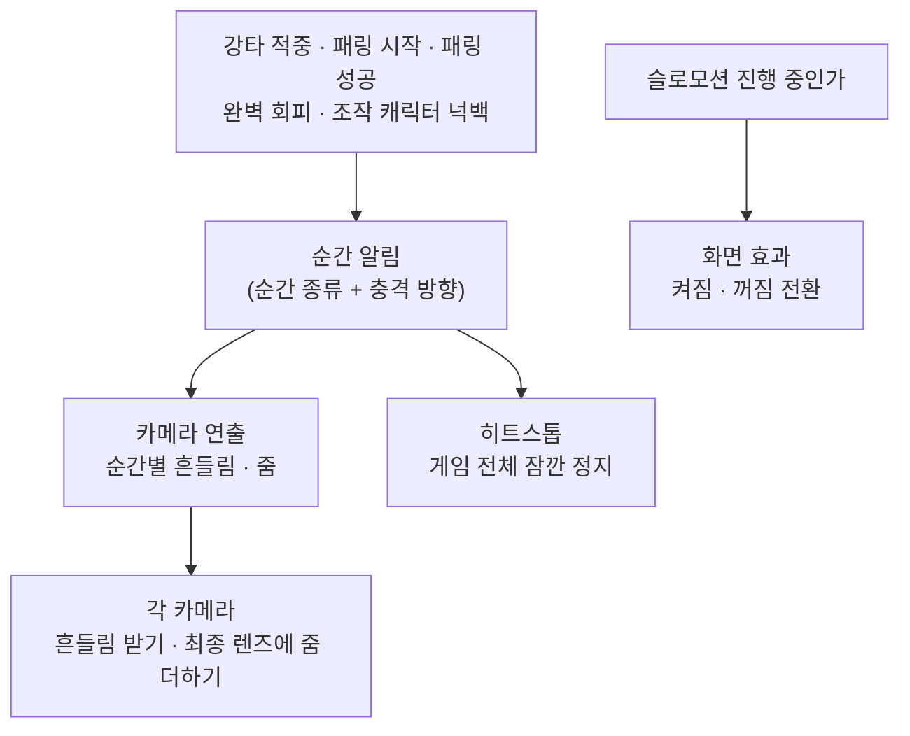
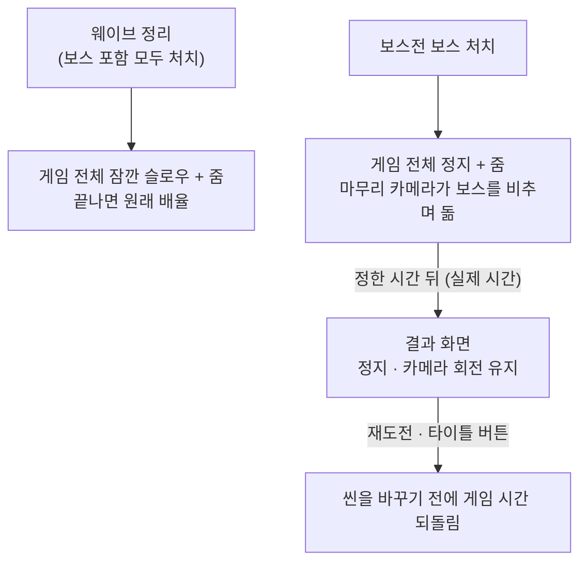
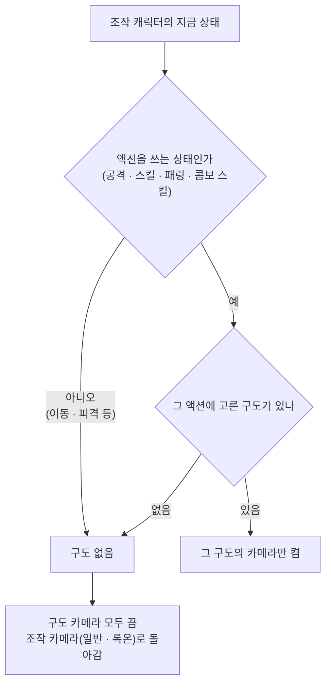
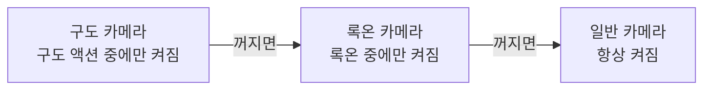
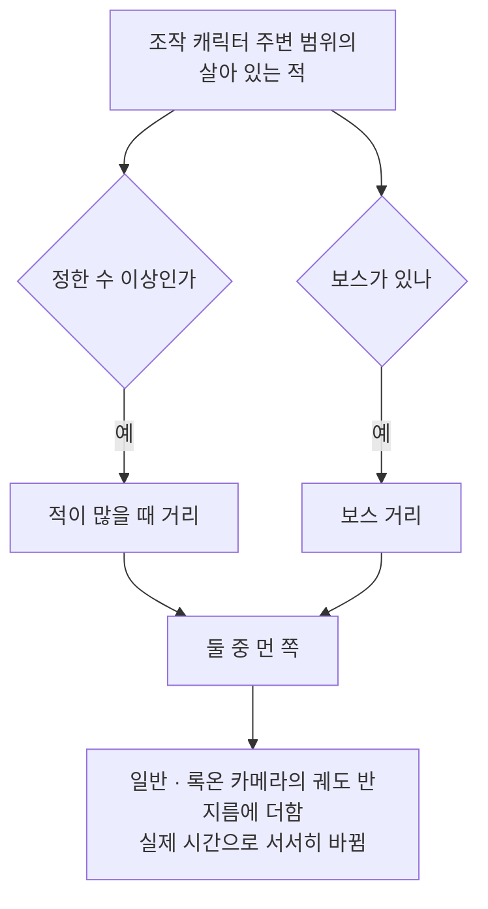

# 전투 연출 : 카메라 흔들림 · 줌 · 구도 · 거리 · 히트스톱 · 슬로모션 화면 효과

## 1. 개요

강타 적중 · 패링 · 완벽 회피 · 넉백 같은 전투의 중요한 순간에 카메라와 화면, 게임 시간이 함께 반응해 타격감을 주는 연출 체계다. 순간마다 흔들림 · 줌 · 정지 · 화면 색을 다르게 조합해, 같은 "반응" 이라도 맞았다 · 막았다 · 피했다가 다르게 느껴지게 한다. 카메라 워크 · 이펙트 · 효과음 같은 이후 연출 작업이 같은 순간 알림을 함께 쓰는 기반이다.

(#67) 카메라 워크를 더했다. 패링 · 스킬 · 콤보 스킬은 액션마다 고른 공용 구도 카메라로 보여 주고, 콤보 선택 화면 · 완벽 회피 슬로모션 동안은 줌 인을 유지한다. 적이 많거나 보스와 싸우면 카메라가 뒤로 빠져 화면에 다 담고, 바닥 · 벽에 카메라가 묻히지 않는다.

## 2. 구성 요소

- BattleFeedback : 전투 연출이 반응할 순간과 충격 방향, 플레이어가 적에게 준 대미지를 알리는 공용 알림. 순간은 강타 적중 · 패링 시작 · 패링 성공 · 완벽 회피 · 넉백, (#63) 일반 적중 · 피격 · 적 처치 · 대시 · 회피 · 발자국, (#68) 패링 예고
- CameraImpactFeedback : 순간 알림을 받아 카메라 흔들림을 내고, 순간 줌과 (#67) 상황 유지 줌을 더한 줌(FOV) 변화량을 만드는 카메라 연출 기능
- CameraFovOffset : 카메라 연출 기능의 줌 변화량을 각 Cinemachine 카메라의 최종 렌즈에 더하는 확장 기능
- CameraShotDirector : (#67) 조작 캐릭터가 지금 쓰는 액션의 구도를 읽어, 그 구도의 카메라만 켜는 구도 카메라 기능
- CombatDistance : (#67) 조작 캐릭터 주변의 적 수와 보스 여부로 일반 · 록온 카메라의 거리를 늘리고 줄이는 전투 거리 기능
- ActionData : 액션 하나의 값. (#67) 이 액션을 쓰는 동안의 카메라 구도를 고른다 (전투 연출 관련 역할)
- BattleHitStop : 순간 알림을 받아 게임 전체를 아주 잠깐 멈추는 히트스톱 기능 (지금은 패링 성공)
- BattleFinisher : (#67) 마지막 일격 기능. 웨이브 마지막 적 처치에 게임 전체 슬로우, 보스 처치에 게임 전체 정지와 보스 마무리 카메라, 정지가 끝나면 알림
- EnemyClock : (#67) 적 하나의 시간. 맞은 적 하나만 멈추는 히트스톱을 맡는다 (적 공통 규칙 문서)
- SlowMotionScreenEffect : 완벽 회피 슬로모션 동안 화면 효과 Volume 을 켜고 끄는 기능

## 3. 동작 원리

| 순간 | 흔들림 | 줌 | 히트스톱 | 화면 효과 |
|---|---|---|---|---|
| 강타 적중 | 무작위 방향 | 없음 | 없음 | 없음 |
| 패링 시작 | 없음 | 짧은 줌 인 | 없음 | 없음 |
| 패링 성공 | 공격이 들어온 방향으로 반동 | 짧은 줌 인 | 있음 | 없음 |
| 완벽 회피 | 없음 | (#67) 슬로모션 동안 줌 인 유지 | 없음 | 슬로모션 동안 켜짐 |
| (#67) 콤보 선택 화면 | 없음 | 열려 있는 동안 줌 인 유지 | 없음 | 없음 |
| (#67) 일반 · 강타 적중 | (강타만 무작위) | 없음 | 맞은 적만 정지 | 없음 |
| (#67) 웨이브 마지막 적 처치 | 없음 | 줌 인 뒤 복귀 | 게임 전체 잠깐 슬로우 | 없음 |
| (#67) 보스 처치 | 없음 | 줌 인 유지 · 마무리 카메라 | 게임 전체 정지 (결과 화면 동안 유지) | 없음 |
| (#67) 판 실패 (전멸 · 시간 초과) | 없음 | 조금 줌 인 유지 | 없음 | 없음 |
| 넉백 (조작 캐릭터) | 무작위 방향 | 없음 | 없음 | 없음 |

### 순간 알림

- 플레이어 쪽(공격 판정 · 패링 · 피격 · 슬로모션)은 순간이 일어났다는 것만 알리고, 카메라 · 히트스톱 등 반응하는 쪽이 각자 받는다. 반응하는 쪽은 씬에 하나 있고 알리는 쪽은 캐릭터마다 있어, 서로 몰라도 되게 하기 위해서다.
- 강타는 한 번의 판정에서 여러 적을 맞혀도 한 번만 알린다. 범위 공격에서 흔들림이 겹쳐 커지지 않게 하기 위해서다. 어느 캐릭터의 강타든 알린다.
- 넉백은 조작 중인 캐릭터일 때만 알린다. 퇴장 중인 이전 캐릭터가 넉백될 때 화면이 흔들리면 어색하기 때문이다.
- 패링 성공은 캐릭터가 밀려나는 방향(적 → 캐릭터)을 함께 알린다.
- (#63) 효과음을 붙이며 순간을 늘렸다. 카메라 · 히트스톱은 새 순간에 반응하지 않고, 효과음만 반응한다. (사운드 문서)
    - 일반 적중 : 강타처럼 한 번의 판정에 한 번
    - 피격 · 대시 · 회피 · 발자국 : 조작 중인 캐릭터일 때만. 발자국은 걷기 · 달리기 클립의 이벤트가 알린다
    - 적 처치 : 적이 처치되는 순간
    - 콤보 스킬 선택 화면 열림 · 닫힘 : 연계마다 선택 화면이 열리고 닫히는 순간. 배경음이 선택 중 낮아지고 먹먹해지는 데 쓴다
- (#68) 패링 예고 : 적의 패링할 수 있는 동작이 패링 가능 시간을 여는 순간. 연속 패링 중에도 동작마다 알린다. 적 쪽이 알리는 첫 순간이며, 효과음만 반응한다.
- 새 순간은 목록의 맨 뒤에 더한다. 효과음 설정 에셋이 순간을 번호로 저장해서, 중간에 끼우면 저장된 값이 다른 순간을 가리킨다.
- 발자국은 아주 자주 와서 에디터 로그를 남기지 않는다.
- (#63) 대미지 알림 : 플레이어 공격이 적에게 대미지를 줄 때마다 맞은 적 · 대미지 · 강타 여부를 알린다. 순간 알림과 달리 적마다 알린다. 대미지 숫자 표시가 쓴다. (전투 HUD 문서)

### 카메라 흔들림

- 흔드는 순간마다 Cinemachine Impulse Source 를 하나씩 두고, 흔들림 모양 · 길이 · 세기를 각 Source 에서 정한다. 연결하지 않은 순간은 흔들지 않는다.
- 방향은 코드가 정한다. 방향이 없는 순간은 매번 화면 기준 상하좌우의 무작위 방향이고, 패링은 공격이 들어온 방향으로 반동한다.
- 카메라는 보통 캐릭터 뒤에서 적 쪽을 보므로, 적 → 캐릭터 방향은 대부분 카메라의 깊이 방향이다. 깊이 방향 흔들림은 화면에서 거의 보이지 않아, 깊이 성분을 세로로 옮긴다. 정면에서 막으면 아래로 눌리고, 옆에서 막으면 좌우로 밀린다.
- 흔들림은 Source 오브젝트 위치가 아닌 카메라 위치에서 낸다. Source 를 어디에 두든 거리 때문에 약해지지 않게 하기 위해서다.
- 각 Cinemachine 카메라(일반 · 록온)의 Impulse Listener 가 화면 기준으로 받고, Listener 의 반응 설정(Noise)으로 충격 뒤 불규칙한 떨림을 더해 정해진 곡선을 따르는 느낌을 줄인다.

### 줌 (FOV)

- 순간마다 변화량 · 길이 · 곡선을 정하고, 곡선대로 FOV 변화량을 만든다. 곡선이 0 에서 시작해 0 으로 끝나면 원래 FOV 로 돌아온다.
- 변화량은 카메라에 설정한 FOV 를 바꾸지 않고, 각 Cinemachine 카메라의 최종 렌즈에만 더한다. 그래서 효과가 끝나면 항상 원래 FOV 로 돌아오고, 카메라 사이 전환이나 이후 카메라 워크에서 FOV 를 바꿔도 충돌하지 않는다.
- 새 효과가 오면 진행 중인 효과를 끊고 새로 시작한다. 패링 시작 줌 중에 패링에 성공하면 성공 줌으로 이어진다.
- 실제 시간으로 흘러 히트스톱 정지 중에도 진행된다.
- (#67) 상황 유지 줌 : 콤보 선택 화면이 열려 있는 동안 · 완벽 회피 슬로모션이 이어지는 동안 서서히 줌 인하고, 끝나면 서서히 원래 FOV 로 돌아온다.
    - 순간 줌은 정해진 길이로 끝나지만, 이 두 상황은 길이가 매번 달라 상황이 이어지는 동안 유지한다.
    - 두 상황이 겹치면 더 많이 당기는 쪽을 쓴다. 순간 줌과는 더해져 겹쳐도 어긋나지 않는다.
    - 슬로모션 · 콤보 선택 감속과 상관없이 실제 시간으로 바뀐다.
    - 일반 · 록온 · 구도 카메라 모두 같은 값을 받으므로, 록온 중이나 구도 중에도 같은 줌이 나온다.

### 히트스톱

- 패링 성공 순간 게임 전체 시간을 아주 잠깐 0 으로 했다가 되돌린다. 화면 전체가 멈추며 "막았다" 는 느낌을 주는 레퍼런스의 패링 연출을 따랐다.
- 정지 시간은 실제 시간으로 잰다. 정지 중 다시 걸리면 남은 시간과 새 시간 중 긴 쪽으로 이어 가고, 되돌릴 시간 배율은 처음 멈출 때의 값을 쓴다.
- 정지 중에 다른 기능(콤보 선택 감속 등)이 시간 배율을 바꿨으면 그 값을 덮어쓰지 않는다.
- 정지 중에도 흔들림 · 줌이 보이도록 Cinemachine Brain 과 Impulse 가 게임 시간 배율을 무시하게 했다. 그래서 콤보 선택 감속 중에도 카메라 이동 · 전환은 원래 속도로 움직인다.
- (#67) **맞은 적 히트스톱** : 반응하는 타격(경직 · 히트렉을 거는 타격)에 맞은 적은 그 동작의 히트렉 시간만큼 그 적만 멈춘다. 다른 적과 플레이어는 그대로다.
    - 새 값을 두지 않고 플레이어 히트렉 시간을 그대로 써, 플레이어와 맞은 적이 함께 멈췄다 함께 풀린다. (사용자 결정)
    - 경직을 먼저 건 뒤 멈춰, 맞는 모션의 첫 자세에서 멈췄다가 이어진다. 경직 저항으로 경직되지 않는 적(보스 등)도 멈춰, 경직이 없어도 맞는 순간의 손맛이 난다.
    - 그 타격으로 처치된 적은 멈추지 않는다. 히트렉이 0 인 동작, "첫 타격에만 반응" 동작의 두 번째 타격부터는 멈추지 않는다.
    - 적 하나만 멈추는 방법(적 하나의 시간)은 적 공통 규칙 문서에 적었다.

### 마지막 일격 (#67)

- 웨이브 : 마지막 적을 처치하면 게임 전체가 정한 시간 동안 느려지고 줌이 들어간다. 다음 웨이브는 평소처럼 나온다.
- 보스 : 처치 순간 게임 전체를 멈추고, 보스 마무리 카메라(가장 높은 우선순위)를 켠다. 마무리 카메라는 처치된 보스를 따라가며 바라보고, 지금 화면이 보던 쪽에서 출발해 보스 주위를 천천히 돈다. 정한 시간이 지나면 결과 화면이 뜬다. (젠레스 존 제로 레퍼런스, 사용자 결정)
    - 결과 화면이 뜬 뒤에도 멈춘 채로 두고, 남은 적도 죽이지 않고 그대로 멈춰 둔다. 결과 화면의 버튼이 씬을 바꾸기 전에 게임 시간을 되돌린다. (게임 흐름 문서)
    - 마무리 카메라는 지금은 Cinemachine 카메라 하나로 확인하고, 필살기 Timeline 작업 때 컷 연출로 바꾼다. (사용자 결정)
- 길이와 카메라 회전은 실제 시간으로 잰다. 시간 배율을 바꾼 채 게임 시간으로 재면 느린 만큼 길어지고, 멈추면 끝나지 않기 때문이다.
- 웨이브 슬로우 중 다른 기능(콤보 선택 등)이 시간 배율을 바꿨으면 그 값을 덮어쓰지 않는다. (히트스톱과 같은 규칙)
- 줌은 순간 알림(웨이브 마무리 · 보스 마무리)을 받은 카메라 연출 기능이 낸다. 줌 길이는 슬로우 시간 · 결과 화면까지의 시간에 맞춘다.

### 판 실패 (#67)

- 전멸 · 시간 초과로 판이 끝나면 판 실패 순간을 알린다. 카메라 연출 기능은 조금 줌 인한 채 씬이 바뀔 때까지 유지한다. 유지 줌과 같은 방식이라 실제 시간으로 서서히 들어간다.
- 판이 끝나면 키 입력과 마우스 카메라 입력이 막히고, 플레이어는 적 공격에 맞지 않는다. 전멸이면 마지막 캐릭터가 쓰러진 채 남고, 시간 초과는 쓰러지지 않는다. (파티 · 게임 흐름 문서)

### 슬로모션 화면 효과

- 완벽 회피 슬로모션이 켜져 있는 동안 화면 효과 Volume 의 Weight 를 1 로, 끝나면 0 으로 서서히 바꾼다. 회피 반격으로 일찍 끝나도 같은 방식으로 사라진다.
- 효과는 URP Volume 의 Vignette 하나로 만든다. 가장자리로 갈수록 화면 색에 어두운 파랑을 곱해, 맨 가장자리는 검정에 가깝고 안쪽은 파란 기운, 중앙은 원래 화면이 된다.
- 슬로모션은 적만 느려지고 히트스톱 · 콤보 선택은 게임 시간을 바꾸므로, 효과의 전환은 실제 시간으로 잰다.

### 전투 구도 (#67)

- 공용 구도 카메라(올려다보기 · 측면 · 정면 근접)를 씬에 두고, 액션 데이터는 그중 하나를 고른다. 액션 데이터는 에셋이라 씬의 카메라를 직접 가리킬 수 없어, 구도 종류만 고르고 실제 카메라는 구도 카메라 기능이 정한다.
- 구도 카메라 기능은 매 프레임 조작 캐릭터가 지금 쓰는 액션의 구도를 읽어, 바뀌었을 때만 카메라를 켜고 끈다. 구도가 바뀌는 시점을 따로 알리지 않아도, 상태가 바뀌면 구도도 따라 바뀐다.
- 패링 : 패링 액션(준비 · 반응)과 추격 액션에 같은 올려다보기 구도를 고른다. 반응에서 추격으로 넘어가는 것은 같은 프레임 안이라, 패링 시작부터 추격이 끝날 때까지 구도가 끊기지 않는다. 추격 없이 끝나거나 패링에 실패해 이동으로 돌아가면 바로 조작 카메라로 돌아온다.
- 스킬 · 콤보 스킬 : 액션마다 고른 구도로 보여 준다. 콤보 스킬을 다음 캐릭터가 이어받으면 조작 캐릭터가 바뀌므로, 이어받은 캐릭터의 콤보 스킬 구도로 넘어간다.
- 필살기 : 구도를 읽지 않는다. 필살기 카메라는 Timeline 연출 작업 때 함께 정한다. (사용자 결정)
- 구도 카메라도 Impulse Listener 와 줌 확장 기능을 가져, 구도 중에도 흔들림 · 줌이 나온다. 따라갈 대상은 교체할 때 일반 · 록온 카메라와 함께 새 캐릭터로 바뀐다.

### 카메라 우선순위 (#67)

- 카메라 전환은 모두 카메라를 켜고 끄는 방식이고, 켜져 있는 카메라 중 Priority 가 가장 높은 카메라가 화면을 맡는다. 우선순위는 구도 → 록온 → 일반 순서로 둔다.
- Priority 가 같으면 Cinemachine 은 가장 나중에 켜진 카메라를 쓴다. 우선순위를 나눠 두면 켜고 끄는 순서와 상관없이 항상 지금 상황의 카메라가 화면을 맡는다.
- 록온 중에 패링하면 구도 카메라가 맡고, 패링이 끝나면 록온 카메라로, 록온을 풀면 일반 카메라로 돌아온다.

### 전투 거리 (#67)

- 적이 많거나 보스처럼 큰 적이 있으면 카메라가 조금 뒤로 빠져 화면에 다 담고, 상황이 끝나면 돌아온다.
- 거리는 궤도 반지름에 더한다. 마우스 휠 확대 · 축소는 반지름에 곱하는 배율이라, 사용자가 맞춘 확대 · 축소와 함께 적용된다.
- 콜라이더가 여러 개인 적도 한 번만 센다.
- 구도 카메라에는 적용하지 않는다. 구도는 짧게 나오는 연출이라 정해 둔 자리를 유지한다.

### 바닥 · 벽 가림 (#67)

- 바닥 : Cinemachine `Decollider` 의 지형 처리로 카메라를 바닥 위로 들어 올린다. 카메라를 아래로 내려도 바닥 밑으로 내려가지 않는다. 장애물 검사(`Deoccluder`)로 처리하면 카메라가 캐릭터 쪽으로 당겨지기만 해 발밑에 붙는 화면이 되므로, 바닥은 들어 올리는 방식을 쓴다.
- 벽 : Cinemachine `Deoccluder` 가 벽 Layer 를 장애물로 보고, 벽이 캐릭터를 가리면 카메라를 앞으로 당긴다.
- 바닥 · 벽은 전용 Layer 로 나뉘어 있어, 두 기능에 각각 그 Layer 를 지정한다. 플레이어 · 적 Layer 는 예전처럼 장애물에서 뺀다.

## 4. 구현 과정

- 활용한 기능 :
    - Cinemachine Impulse Source · Impulse Listener (반응 설정 Noise 포함) : 순간별 흔들림과 화면 기준 방향 처리
    - Cinemachine 확장 기능(Extension) : 각 카메라의 최종 렌즈에 줌 변화량을 더함
    - Cinemachine Brain · Impulse 의 게임 시간 무시 설정 : 히트스톱 정지 중에도 카메라 연출 진행
    - `Time.timeScale` · `Time.unscaledDeltaTime` : 히트스톱 정지와 실제 시간 측정
    - URP Volume (Vignette · Color Adjustments) : 슬로모션 화면 효과
    - AnimationCurve : 순간별 줌 곡선
    - (#67) Cinemachine `Follow`(Lock To Target With World Up) · `Rotation Composer` : 캐릭터가 보는 방향 기준으로 자리를 잡는 구도 카메라
    - (#67) Cinemachine Camera Priority : 구도 · 록온 · 일반 카메라의 화면 우선순위
    - (#67) Cinemachine `Orbital Follow` 의 궤도 반지름 : 전투 거리 조절
    - (#67) Cinemachine `Decollider`(지형 처리) · `Deoccluder` : 바닥 위 유지와 벽 가림 처리
    - (#67) `Physics.OverlapSphereNonAlloc` : 조작 캐릭터 주변의 적 세기
- 구현 과정 :
    1. 강타 적중 · 패링 성공 · 완벽 회피 · 넉백을 알리는 공용 순간 알림을 만들고, 각 발생 지점에서 알리게 했다. 강타는 판정마다 한 번, 넉백은 조작 캐릭터만 알린다.
    2. 처음에는 Impulse Source 하나에 순간별 세기만 다르게 줬으나, 흔들림이 정해진 방향이라 인위적이었다. 순간마다 Source 를 따로 두어 모양 · 길이 · 세기를 Source 에서 정하고, 코드는 방향만 정하게 바꿨다. 완벽 회피는 흔들림이 어울리지 않아 뺐다.
    3. 패링 반동이 화면에서 보이지 않는 문제를 찾았다. 반동 방향이 카메라 깊이 방향이라 거의 보이지 않았던 것으로, 깊이 성분을 세로로 옮겨 해결했다. 테스트 중 세기를 크게 올렸을 때 카메라가 멀리 밀렸다 돌아온 것은, 수정 전 코드가 아직 컴파일되지 않은 상태였던 것으로 확인했다.
    4. 패링 · 완벽 회피의 줌을 순간별 곡선으로 만들고, 카메라 FOV 를 직접 바꾸지 않고 최종 렌즈에만 더하는 확장 기능으로 적용했다. 이후 패링 시작 순간에도 줌을 추가했다.
    5. 패링 성공 히트스톱을 게임 전체 정지로 만들고, 정지 중에도 흔들림 · 줌이 보이게 카메라 쪽이 게임 시간을 무시하게 했다.
    6. 슬로모션 임시 표시 오브젝트를 지우고 Volume 화면 효과로 바꿨다. 처음에는 화면 전체가 파랗게 보여, Vignette 색으로 가장자리만 물들게 바꿨다.
    7. (#67) 액션 데이터에 구도 선택을 넣고, 상태마다 지금 쓰는 액션을 알려 주게 해 구도 카메라 기능이 읽게 했다. 처음에는 공격 · 패링 상태만 액션을 알려 콤보 스킬에서 구도가 나오지 않았다. 콤보 스킬은 공격 상태가 아닌 전용 상태에서 실행되기 때문이었고, 그 상태도 액션을 알리게 해 해결했다. 필살기 상태도 같은 이유로 빠져 있었으나 Timeline 작업 때 보기로 했다.
    8. (#67) 콤보 선택 줌과 완벽 회피 줌을 같은 유지 줌으로 만들었다. 완벽 회피의 기존 순간 줌(줌 인 뒤 줌 아웃)은 유지 줌과 섞이면 어색해 없앴다.
    9. (#67) 전투 거리를 궤도 반지름에 더하는 방식으로 만들었다. 거리 배율 축은 마우스 휠 확대 · 축소가 이미 쓰고 있어, 반지름에 더해야 둘이 함께 동작한다.
    10. (#67) 카메라를 내리면 바닥 밑이 보이는 문제가 나왔다. 장애물 검사가 기본 Layer 만 보고 있어 바닥 · 벽 Layer 를 장애물로 보지 않았던 것으로, 바닥은 Decollider 의 지형 처리로, 벽은 Deoccluder 에 벽 Layer 를 더해 해결했다.
    11. (#67) 일시정지 뒤 카메라가 멈추고 록온 카메라가 풀리는 문제가 나왔다. 원인은 일시정지 연결이 잘못된 것과 카메라 우선순위가 같았던 것이다. (공용 UI 문서) 록온 카메라의 우선순위를 일반 카메라보다 높여, 켜는 순서와 상관없이 록온 중에는 록온 카메라가 화면을 맡게 했다.
    12. (#67) 패링 흔들림 세기와 록온 카메라의 회전 · 위치 감쇠를 플레이하며 다시 맞췄다. (사용자 조정)
- 주요 결정과 이유 :
    - 흔들림 · 줌 · 페이드 값은 공통 설정 에셋이 아닌 카메라 · Volume 쪽 컴포넌트에 둔다. 지금은 플레이하며 보고 맞추는 단계라 씬에서 바로 조절하는 편이 빠르고, 캐릭터 공통 설정에 카메라 값이 섞이지 않게 하기 위해서다. 전투 씬이 여러 개가 되면 카메라 설정 에셋을 따로 만들어 옮긴다. (사용자 결정)
    - 순간별 흔들림은 Impulse Source 를 순간마다 하나씩 둔다. Cinemachine 의 기존 편집 화면(모양 · 사용자 곡선 · 길이)을 그대로 쓰고, 같은 칸을 코드에 다시 만들지 않기 위해서다. (사용자 결정)
    - 강타 · 넉백은 무작위 방향, 패링은 공격 방향 반동으로 나눴다. 패링은 "막았다" 는 느낌을 위해 방향이 있는 반동이 맞다고 보았다. (사용자 결정)
    - 완벽 회피는 흔들지 않고 줌으로 표현한다. 흔들림은 "맞았다" 는 신호라 "휙 지나갔다" 는 느낌과 맞지 않기 때문이다. (사용자 결정) (#67) 줌은 슬로모션 동안 유지하는 줌 인으로 바꿨다.
    - (#67) 구도는 공용 구도 카메라 몇 개를 두고 액션이 고르는 방식으로 했다. 액션마다 카메라를 따로 만들지 않고, 해 보면서 구도를 더하거나 줄인다. (사용자 결정)
    - (#67) 전투 거리 · 장애물 처리는 레퍼런스에 있는데 없던 연출이라 이번 카메라 워크에 넣었다. (사용자 결정)
    - 패링 히트스톱은 게임 전체 정지로 했다. 적은 개별로 멈추는 기능이 없고, 만들려면 적 시간 흐름 전체를 손봐야 한다. 패링은 원래 화면 전체가 멈추는 큰 순간이라 전체 정지가 레퍼런스와도 가깝다. (사용자 결정)
    - 화면 효과는 Vignette 하나로 근사했다. Vignette 는 한 Profile 에 하나만 넣을 수 있고, Volume 을 여러 개 켜도 같은 효과는 값이 섞일 뿐 겹쳐 그려지지 않는다. 가장자리 색과 안쪽 색을 따로 정하려면 화면 덮개 이미지나 전용 셰이더가 필요해, 지금은 Vignette 색으로 충분하다고 정했다. (사용자 결정)

### 참고 레퍼런스

- 젠레스 존 제로 (사용자의 직접 플레이 경험) : 패링 순간의 정지 · 충격감, 완벽 회피 연출, (#67) 패링 · 스킬 구도, 전투 거리 자동 조절, 장애물 가림 처리

## 5. 기존 방식과 비교

- 기존 방식 : 전투 순간에 카메라 · 화면 반응이 없었다. 완벽 회피 슬로모션은 플레이어 위치에 임시 표시 오브젝트를 만들었다 지우는 것으로만 보였다.
- 달라진 점 : 강타 · 패링 · 완벽 회피 · 넉백마다 흔들림 · 줌 · 히트스톱 · 화면 효과가 순간에 맞게 조합되어 나온다. 임시 표시는 지웠다.
- 개선된 점 : 맞았다 · 막았다 · 피했다가 화면으로 구분되어 보이고, 이후 연출 작업이 같은 순간 알림을 받아 붙일 수 있다.
- 필요하게 된 과정 : 11.19 이펙트 · 카메라 워크 일정에 앞서, 이미 만든 전투 순간에 타격감이 없어 첫 연출 묶음(카메라 · 화면)으로 만들었다. 카메라 워크 방향은 "카메라 워킹 · Impulse 먼저, 필살기 컷신은 그 뒤" 로 정해져 있었다.
- 사운드 · 대미지 숫자 작업(#63)에서 달라진 점 :
    - 기존 : 순간은 강타 적중 · 패링 시작 · 패링 성공 · 완벽 회피 · 넉백 다섯 가지였고, 대미지 알림이 없었다.
    - 변경 : 일반 적중 · 피격 · 적 처치 · 대시 · 회피 · 발자국 순간과 대미지 알림을 더했다. 효과음과 대미지 숫자가 같은 알림을 받는다.
- 패링 예고음 작업(#68)에서 달라진 점 :
    - 기존 : 패링 예고는 화면 표시로만 알렸다.
    - 변경 : 패링 예고 순간을 더해 효과음으로도 알린다. 화면 표시를 놓쳐도 패링 타이밍을 알 수 있다.
- 카메라 워크 작업(#67)에서 달라진 점 :
    - 기존 : 패링 · 스킬도 일반 조작 카메라로 보였다. 완벽 회피는 짧은 순간 줌(줌 인 뒤 줌 아웃)만 있었고, 콤보 선택 화면에는 카메라 반응이 없었다. 카메라 거리는 상황과 상관없이 같았고, 카메라를 내리면 바닥 밑이 보였다. 패링 흔들림이 미묘하고 록온 카메라가 딱딱하게 따라왔다.
    - 변경 : 패링 · 스킬 · 콤보 스킬은 액션이 고른 공용 구도로 보이고, 콤보 선택 · 완벽 회피 슬로모션 동안 줌 인이 유지된다. 적이 많거나 보스가 있으면 카메라가 뒤로 빠지고, 바닥 위를 유지하며 벽에 가리지 않는다. 흔들림 · 감쇠를 다시 맞췄다.
    - 개선된 점 : 패링 · 스킬 같은 큰 순간이 화면 구도로 구분되고, 새 스킬은 구도만 골라 연출을 붙일 수 있다.
- 카메라 워크 두 번째 작업(#67)에서 달라진 점 :
    - 기존 : 일반 타격에는 플레이어만 멈추고 맞은 적은 멈추지 않았다. 적은 개별로 멈출 수 없어 히트스톱은 게임 전체 정지(패링)뿐이었다. 웨이브 · 보스 처치와 판 실패에 연출이 없었다.
    - 변경 : 맞은 적만 플레이어 히트렉과 같은 시간만큼 멈춘다. 웨이브 마지막 적은 슬로우 + 줌, 보스 처치는 정지 + 마무리 카메라 뒤 결과 화면, 판 실패는 줌 인 유지가 나온다. 순간 알림에 웨이브 마무리 · 보스 마무리 · 판 실패를 더했다(목록 맨 뒤).
    - 개선된 점 : 경직되지 않는 적도 맞는 손맛이 나고, 판의 끝이 화면으로 분명하게 보인다.

### 미정 · 미검증 항목

- 필살기 카메라 : Timeline 연출 작업 때 함께 정한다 (구도 선택은 읽지 않음)
- 콤보 스킬 블러 · 겹침 효과 (방사형 블러 · 잔상 · 색 번짐) : 타격 이펙트 작업으로 미룸
- 대시 등 다른 화면 효과 : 효과마다 Volume 을 따로 두고, 두 번째 효과가 생길 때 켜고 끄는 기능을 상황 목록 방식으로 넓힌다
- 보스 마무리 카메라의 장애물 처리 : 벽 근처에서 보스를 잡으면 카메라가 벽에 묻힐 수 있음 (필요하면 Deoccluder · Decollider 추가)
- 판 실패 · 마지막 일격 효과음 : 순간 알림은 있으나 효과음은 아직 연결하지 않음 (사운드 보강 때)
- 구도 카메라의 장애물 처리 : 구도 카메라에는 장애물 검사를 붙이지 않아, 벽 가까이에서 구도가 가려지는지 미검증
- 보스 등장 구도 : 나중에 연출 작업 때 컷신 추가와 함께 검토
