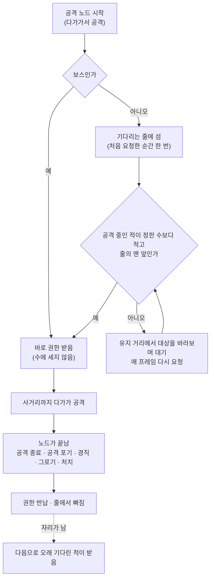
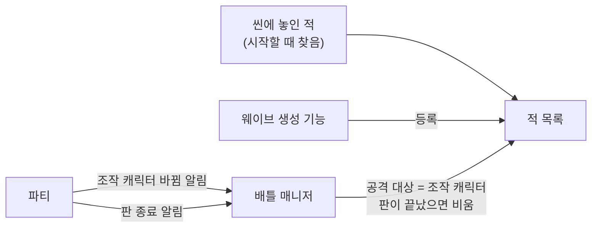
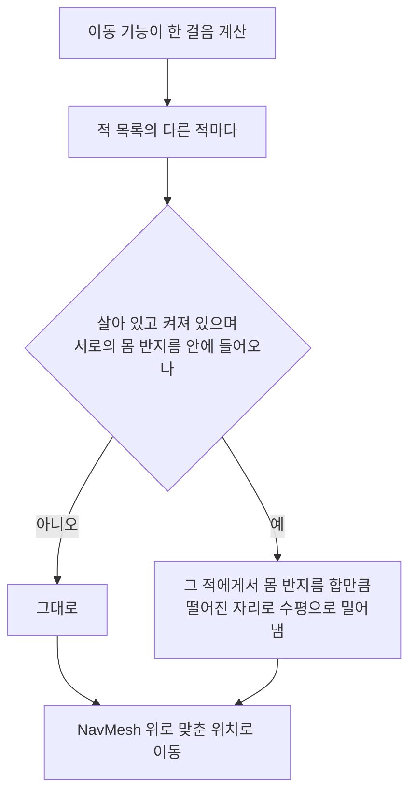

# 전투 공용 적 관리 (공격 권한 · 공격 대상 · 겹침 방지)

## 1. 개요

다가가서 공격하는 적의 수를 정해진 수만큼으로 제한하고, 나머지 적은 거리를 둔 채 차례를 기다리게 하는 전투 공용 규칙이다. 적의 공격 쿨타임을 줄여도 한꺼번에 몰려와 동시에 때리지 않아 압박이 일정하게 유지되고, 이동 중 적끼리 몸이 포개지지 않는다. 적 목록 · 공격 대상 지정 · 적 공격 판정 Layer 처럼 전투에 하나뿐인 적 쪽 값도 이 기능 한 곳이 맡는다. 액션 게임에서 흔히 쓰는 방식을 적용했다.

## 2. 구성 요소

- BattleManager : 전투에 하나 있는 적 쪽 공용 기능. 적 목록 · 공격 대상 지정 · 근접 공격 권한 · 적 공격 판정 Layer 를 맡는다
- AttackTargetAction : [행동 그래프 행동] 공격 권한을 받아 다가가 공격하는 노드. 권한이 없으면 기다리고, 노드가 끝나면 권한을 반납한다 (적 행동 문서)
- EnemyMovement : 한 걸음 옮기기 전에 다른 적의 몸과 겹치지 않게 밀어낸다 (적 행동 문서)
- EnemyController : 등록될 때 배틀 매니저를 받아 두고, 적의 다른 기능이 이곳을 거쳐 묻는다 (적 공통 규칙 문서)
- PlayerParty : 조작 캐릭터가 바뀔 때와 판이 끝날 때 알리기만 한다 (파티 문서)
- WaveSpawner : 생성한 적을 배틀 매니저에 등록한다

## 3. 동작 원리

### 공격 권한

- 권한은 다가가서 공격하는 노드만 요청한다. 사거리 밖에서 바로 쓰는 공격(원거리 노드)은 요청하지 않는다. 그래서 원거리 공격만 쓰는 적은 따로 표시하지 않아도 제한을 받지 않는다.
- 보스는 등급으로 빼서 언제든 공격하고, 동시 공격 수에도 세지 않는다.
- 기다리는 적은 처음 요청한 순서대로 줄을 선다. 자리가 나면 가장 오래 기다린 적이 먼저 받는다. 같은 적만 계속 공격하지 않게 하기 위해서다.
- 기다리는 동안은 지금 서 있는 방향 그대로 유지 거리 원 위의 자리로 가서 대상을 바라본다. 거리가 맞으면 제자리에서 몸만 돌린다.
- 반납은 노드가 끝나는 한 곳에서만 한다. 공격을 마쳤을 때, 공격을 포기했을 때, 경직 · 그로기 · 처치로 행동이 끊겼을 때가 모두 이곳을 지나므로 반납이 빠지지 않는다.
- 공격 뒤 기다리는 시간은 권한을 반납한 뒤라, 그동안 다른 적이 다가와 공격할 수 있다.
- 동시 공격 수는 Inspector 값 하나로 정하고, 실행 중에 바꿔도 바로 적용된다.

### 공격 대상 지정

- 적이 노리는 플레이어는 행동 그래프 Blackboard 의 공격 대상 값이다. 배틀 매니저가 등록할 때 넣고, 교체되거나 판이 끝나면 목록의 모든 적에게 다시 넣는다.
- 파티는 "바뀌었다", "끝났다" 는 것만 알린다. 파티가 적을 몰라도 되게 하기 위해서다.
- 처치된 적은 시체가 꺼질 뿐 사라지지 않아 목록에 남겨 둔다. 꺼진 행동 그래프에 값을 넣어도 문제가 없다. 다시 등록하면 목록에 또 넣지 않고 공격 대상만 새로 넣어, 적을 다시 꺼내 쓰는 경우(풀링)도 같은 방법으로 등록한다.
- 이미 시작한 공격은 공격을 시작할 때 정한 대상으로 끝까지 시전한다. (적 공격 문서)

### 겹침 방지

- 한 걸음 옮기기 직전에 다른 적과 겹치는지 보고, 들어간 만큼 바깥으로 밀어낸다. 다가가던 방향의 겹친 성분만 빠지므로, 앞을 막은 적을 옆으로 미끄러지며 돌아간다.
- 서 있는 적은 밀리지 않고 움직이는 쪽만 비켜 간다.
- 몸 반지름은 각 적이 시작할 때 몸통 콜라이더로 재 둔 값을 쓴다. 시체 · 꺼진 적은 막지 않는다.
- 공격 중 대상 따라가기도 같은 이동을 쓰므로 함께 적용된다.

## 4. 구현 과정

- 활용한 기능 : Unity Behavior (행동 그래프 Blackboard · 노드가 끝날 때 부르는 정리 단계), NavMesh 위치 맞춤, C# 이벤트
- 구현 과정 :
    1. 파티가 맡던 적 목록과 공격 대상 지정을 배틀 매니저로 옮겼다. 파티는 조작 캐릭터 변경과 판 종료를 알리기만 한다.
    2. 적마다 따로 들던 적 공격 판정 Layer 를 배틀 매니저의 공용 값 하나로 모았다. 적의 대상은 플레이어뿐이라 적마다 둘 이유가 없었다.
    3. 다가가서 공격하는 노드에 권한 요청과 대기를 넣고, 노드가 끝나는 단계에서 권한을 반납하게 했다.
    4. 다가가는 시간이 상한을 넘으면 사거리 밖 공격(추격 공격)을 하고, 없으면 포기해 권한을 내놓게 했다. (적 행동 문서)
    5. 적 이동에 한 걸음마다 다른 적과의 겹침을 밀어내는 처리를 넣었다.
- 주요 결정과 이유 :
    - 원거리 적 구분은 적 데이터에 값을 새로 두지 않고 노드로 한다. 다가가는 공격만 권한을 요청하게 하면, 원거리 노드로 쏘는 공격은 저절로 제한에서 빠진다. 앞으로 추가할 원거리 적도 그래프 구성만으로 맞춰진다.
    - 원거리 적이 플레이어가 파고들어 근접 공격을 할 때는 권한을 받는다. 그때는 다가가서 공격하는 적과 같기 때문이다.
    - 겹침 검사는 물리 검사 대신 적 목록과 몸 반지름 비교로 했다. Layer 설정이 필요 없고, 시체 · 꺼진 적을 바로 거를 수 있으며, 물리 쿼리 없이 처리된다.
    - 적끼리 피하는 기능(NavMeshAgent 회피)은 쓰지 않는다. 이동을 Agent 에 맡기지 않고 적 전용 시간에 맞춰 직접 하기 때문이다. (적 행동 문서)
    - 연속 패링 패턴 알림, 웨이브의 처치 집계, 카메라의 전투 거리 판단은 배틀 매니저로 옮기지 않았다. 각자 맡은 기능 안에서 끝나는 일이라서다.

## 5. 기존 방식과 비교

- 기존 방식 : 근접 적이 모두 플레이어 위치로 한꺼번에 몰려와 동시에 공격했다. 이동에 적끼리 피하는 처리가 없어 다가가는 동안과 공격 중에 몸이 포개졌다. 적 목록과 공격 대상은 파티가, 판정 Layer 는 적마다 들었다.
- 달라진 점 : 정해진 수의 적만 다가가 공격하고, 나머지는 유지 거리에서 차례를 기다린다. 공격이 끝나거나 끊기면 다음 적이 온다. 이동할 때 다른 적을 비켜 간다. 적 쪽 공용 값은 배틀 매니저 한 곳에 있다.
- 개선된 점 : 공격 쿨타임을 줄여도 동시에 맞는 공격 수가 늘지 않아 난이도를 조정하기 쉽다. 적이 겹쳐 보이지 않는다. 파티가 적을 몰라도 된다.

### 미정 · 미검증 항목

- 플레이 검수 (동시 공격 수 제한, 대기, 반납 뒤 다음 적, 교체 뒤 대상 전환, 겹침 방지, 슬로모션) : 미검증
- 완전히 같은 자리에 겹친 적은 밀 방향이 없어 그대로 둔다
