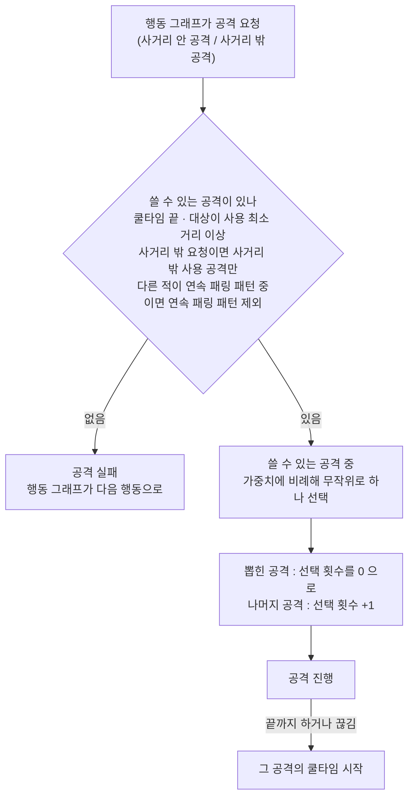
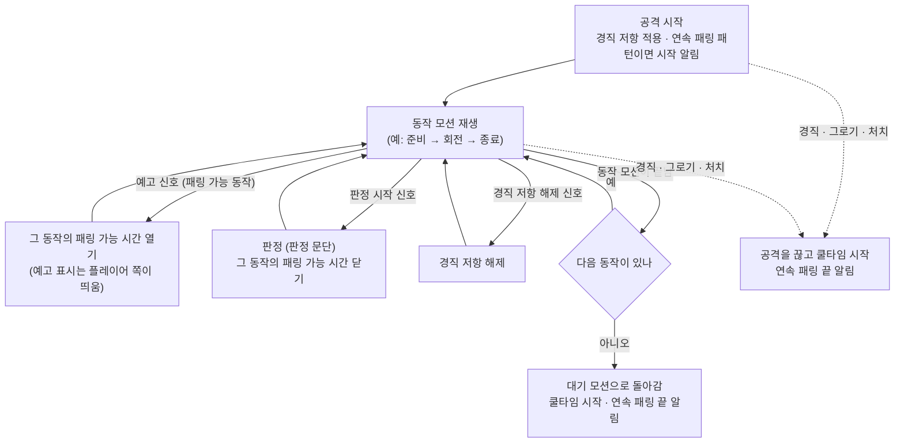
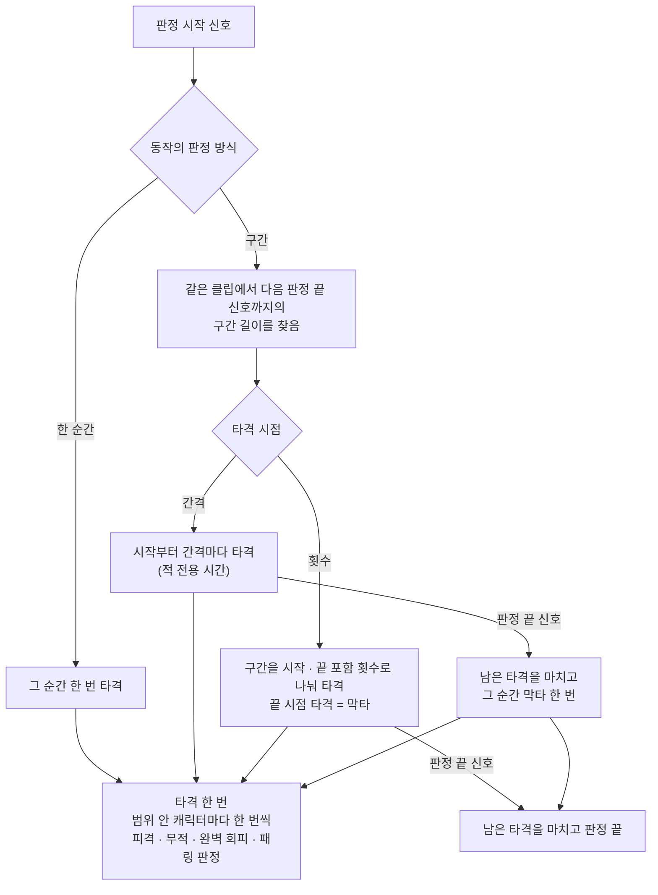
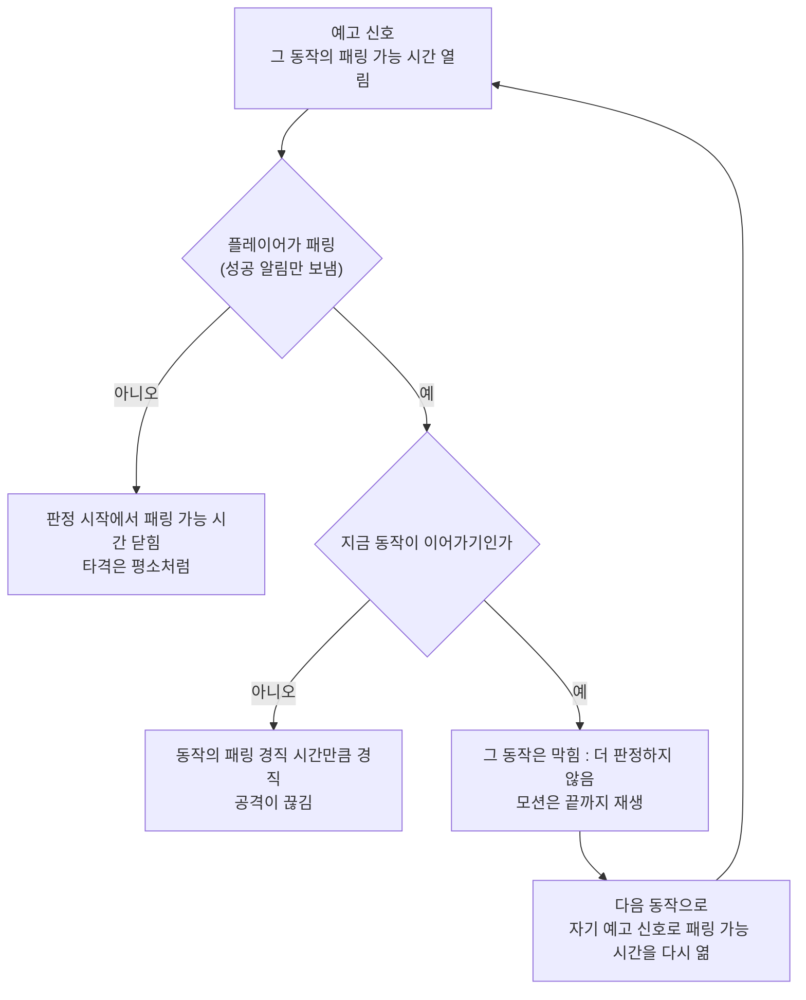

# 적 공격

## 1. 개요

일반 적 · 엘리트 · 보스가 함께 쓰는 공격 체계다. 공격 하나는 공격 데이터 에셋 하나이고, 여러 동작(모션)으로 이루어진다. 적은 적 데이터의 공격 목록 중 쿨타임이 끝나고 거리 조건이 맞는 공격을, 오래 쓰지 않은 공격일수록 잘 뽑히게 골라 쓴다. 예고 · 판정 · 경직 저항 시점은 모션에 찍은 신호로 정해, 공격의 박자와 패링 · 반격 타이밍을 애니메이션에 맞춰 조정한다. 같은 모션도 동작 설정만 바꿔 단타 · 연타 · 범위형 공격으로 만들 수 있고, 연타 공격 안에서 완벽 회피 · 반격을 반복하거나 패링을 이어서 받아치는(연속 패링) 패턴을 만든다.

## 2. 구성 요소

- EnemyAttacker : 공격 선택, 동작별 모션 재생, 회전 · 대상 따라가기, 예고 · 패링 가능 시간, 타격 시점별 판정 · 막타, 패링 알림 처리(경직 · 이어가기), 연속 패링 패턴 알림, 공격 중 경직 저항, 끊김 처리
- EnemyAttackData : [ScriptableObject] 공격 하나의 공통 값 (선택 · 회전 · 도약 · 위력 · 경직 저항 · 완벽 회피 · 플레이어 반응)과 동작 목록
- EnemyAttackStep : 동작 하나의 값 (Animator 상태, 판정 방식 · 타격 시점, 막타 반응, 판정 범위, 대상 따라가기 · 바라보기, 패링 가능 · 패링 경직 · 이어가기)
- HitShape · HitRange : 플레이어와 함께 쓰는 판정 범위 모양과 범위 찾기 · 그리기 (상자 · 구 · 캡슐 · 부채꼴)
- EnemyAnimationEventRelay : 적 외형에서 받은 애니메이션 신호를 공격 기능으로 넘기는 기능
- EnemyAnimationEventType : 적 공격 모션에 찍는 신호의 종류
- EnemyAnimation : 공격 동작 모션 재생과 재생 완료 확인 (공격 관련 역할)
- EnemyMovement : 대상 따라가기 이동. 공격 중에는 대기 모션으로 바꾸지 않고 이동만 멈춘다 (공격 관련 역할)
- ParryWindow : 패링 가능 시간을 연 적 목록과 연속 패링 패턴 중인 적 목록. 열릴 때 · 닫힐 때 알린다 (공격 관련 역할)
- IEnemyParryable : 패링할 수 있는 적의 약속. 패링 성공 알림을 받는다

## 3. 동작 원리

### 공격 선택

- 공격 목록은 적 데이터 에셋에 있다. 같은 공격 에셋을 여러 적이 함께 쓸 수 있다.
- 가중치 = 기본 가중치 + 증가량 × (마지막으로 쓴 뒤 다른 공격이 뽑힌 횟수)
- 오래 쓰지 않은 공격일수록 가중치가 커져 잘 뽑힌다. 같은 공격이 연달아 나오는 일이 줄어든다.
- 쿨타임은 공격이 끝나거나 끊긴 시점부터 적 전용 시간으로 흐른다.
- 다른 적이 이미 연속 패링 패턴 중이면 연속 패링 패턴은 고르지 않는다. 여러 적이 동시에 하면 패링 대상 고르기와 순간 이동 · 카메라가 적 사이를 오가며 어지럽게 바뀌기 때문이다. (#63 뒤 사용자 요청) 다른 공격은 그대로 고를 수 있다.
- **거리 조건**
    - 공격마다 사용 최소 거리를 둔다. 대상이 그보다 가까우면 고르지 않는다. 멀리 있을 때만 쓰는 공격(도약 등)에 쓴다.
    - 공격마다 사거리 밖에서도 쓸 수 있는지 정한다. 대상이 공격 사거리 밖일 때는 다가가기 전에 이 공격들 중에서만 고른다. (적 도약 · 돌진 문서)
    - 사거리 밖에서 쓸 수 있는 공격도 사거리 안에서는 일반 공격과 함께 고른다.

### 공격 진행

- **동작** : 공격 데이터의 동작 목록 순서대로 Animator 상태를 재생한다. 각 상태가 끝까지 재생되면 다음 동작으로 넘어간다. 같은 상태를 여러 번 적어 반복할 수도 있다.
- **회전** : 공격을 시작해 첫 판정이 오기 전까지는 공격마다 정한 회전 속도로 대상 쪽으로 돈다. 그 뒤에는 방향을 고정한다. 끝까지 따라 돌면 피하기 어려워서다.
    - 대상 바라보기를 켠 동작은 그 동작 동안 계속 대상 쪽으로 돈다. 돌진처럼 끝까지 대상을 향해야 하는 동작에 쓴다.
    - 대상은 공격을 시작할 때 정해 끝까지 쓴다. 파티 전투에서 공격 중에 교체되어도 진행 중인 공격은 이전 캐릭터의 위치로 시전하고, 다음 공격부터 새 캐릭터를 노린다. (파티 문서)
- **대상 따라가기** : 따라가기를 켠 동작은 그 동작 동안 이동 모션 없이 대상 쪽으로 움직인다. 속도는 적 이동 속도에 곱하는 배율이다. 서로의 몸 반지름이 닿으면 멈춘다.
    - 회전 공격처럼 모션은 제자리에서 돌고 몸은 대상에게 다가가야 하는 공격에 쓴다.
    - 따라가는 동안은 이동 기능이 몸을 돌린다. 멈출 때는 대기 모션으로 바꾸지 않는다. 바꾸면 재생 중인 공격 모션이 끊겨 공격이 끝나지 않기 때문이다.
- **경직 저항** : 공격을 시작할 때 그 공격의 경직 저항을 적용한다.
    - 기본은 첫 판정에서 해제해, 판정 뒤 빈틈에 반격으로 끊을 수 있다.
    - 공격마다 경직 저항 해제 신호까지 유지하도록 정할 수 있다. 신호가 없으면 공격이 끝날 때까지 유지한다.
- **끊김** : 경직 · 그로기 · 처치되면 공격을 끊는다. 끊긴 공격도 쓴 것으로 보고 쿨타임을 시작한다. 행동 그래프의 공격 노드는 실패로 끝난다.

### 판정

- **타격마다 판정** : 타격 시점마다 범위 안의 캐릭터를 모두 다시 판정한다. 한 타격 안에서는 콜라이더가 여러 개인 캐릭터도 한 번만 맞는다.
    - 그래서 연타 공격 하나 안에서 타격마다 피격 · 완벽 회피 · 패링이 따로 일어난다. 완벽 회피 → 회피 반격 → 아직 공격 중 → 다시 완벽 회피를 반복할 수 있다. (피격 문서)
    - 같은 모션도 한 순간 판정이면 단타, 구간 판정이면 연타가 된다.
- **(#67) 패링하는 캐릭터 먼저** : 한 타격에서 범위 안의 캐릭터를 먼저 모두 모은 뒤, 패링할 수 있는 캐릭터가 있으면 그 캐릭터를 먼저 판정한다. 패링이 성립해 공격이 끊기거나 그 동작이 막히면, 남은 캐릭터는 이 타격으로 맞지 않는다. 패링할 캐릭터가 없으면 모은 순서대로 판정한다.
    - 모은 순서대로만 판정하면, 지원 공격 때 퇴장하는 이전 캐릭터가 먼저 맞은 뒤 패링이 성립해 "막아 줬다" 는 느낌이 나지 않았기 때문이다. (사용자 결정, 젠레스 존 제로 레퍼런스)
    - 패링 성공 직후 다른 적의 공격에도 파티가 맞지 않게 하는 무적은 파티 문서에 적었다.
- **판정 끝 신호가 없을 때** : 간격 방식은 동작이 끝날 때까지 간격마다 타격하고 막타는 없다. 횟수 방식은 시작 시점에 한 번만 타격하고, 에디터에서 경고로 알린다.
- **막타** : 간격 방식은 판정 끝 순간의 타격, 횟수 방식은 마지막 타격이다. 동작이 막타 반응을 정하면 막타만 그 반응(예 : 넉백)으로 맞는다. 밀림 · 넉백 값은 공격 공통 값을 쓴다. 한 순간 판정에는 막타 반응을 쓰지 않는다.
- 플레이어가 맞았을 때의 반응(피격 · 큰 피격 · 넉백)과 완벽 회피는 공격마다 정하고 피격 문서의 규칙을 따른다.

### 판정 범위

- 판정 범위 모양은 플레이어 공격과 함께 쓴다. 동작마다 모양을 고른다.

| 모양 | 정하는 값 | 쓰임 |
|---|---|---|
| 상자 | 중심 · 크기 | 앞쪽 직사각형 범위 |
| 구 | 중심 · 반지름 | 주변 둥근 범위 |
| 캡슐 | 중심 · 반지름 · 길이 | 앞으로 긴 찌르기 · 돌진 |
| 부채꼴 | 중심 · 반지름 · 각도 · 안쪽 반지름 · 높이 | 휘두르기(각도), 반원(각도 절반), 도넛형(안쪽 반지름) |

- 부채꼴은 바깥 반지름의 구로 먼저 찾은 뒤, 각 대상 경계의 중심으로 정면 기준 수평 각도와 안쪽 반지름을 거르고, 경계의 위아래가 높이 범위에 걸치는지 본다.
- 높이 제한은 부채꼴에만 있다. 상자 · 캡슐은 모양 자체에 높이가 있기 때문이다.
- 대상 위치 기준의 장판형 범위는 넣지 않았다. 투사체 공격에서 다룬다.
- 적을 선택하면 Scene 창에 동작별 범위가 그려진다. 패링 가능 동작은 노란색, 나머지는 빨간색이다.

### 패링과 연속 패링

- 플레이어는 패링 성공 알림만 보낸다. 경직할지 공격을 이어갈지는 적이 지금 동작 설정으로 정한다.
- 경직은 패링당한 공격의 저항 레벨을 경직 레벨로 건다. 레벨이 같으면 경직되므로 패링 성공은 항상 경직을 건다.
- 이어가기 동작은 패링당해도 공격을 끊지 않는다. 막힌 동작은 더 판정하지 않고 끝까지 재생된 뒤, 평소처럼 다음 동작으로 넘어간다. 공격이 이어지는 흐름을 패링이 끊지 않게 하기 위해서다.
- 패링 가능 시간은 동작마다 연다. 이어지는 동작도 패링하게 하려면 그 동작 클립에 예고 신호를 넣는다.
- 그로기 · 필살기 게이지 · 패링 추격은 패링할 때마다 플레이어 쪽에서 얻는다. 이어지는 공격 중 추격을 쓸지 다음 패링을 할지는 플레이어가 고른다. (피격 문서)
- **연속 패링 패턴 알림** : 이어가기 동작이 하나라도 있는 공격을 시작하면 적이 공용 패링 목록에 시작을 알리고, 공격이 끝나거나 끊기면(마지막 패링 경직 · 그로기 · 처치 · 공격 끝) 끝을 알린다. 패턴 중에는 플레이어가 대기 캐릭터 없이도 필드의 파티원으로 다시 패링할 수 있다. (파티 문서)
- 적은 예고 위치만 알려 주고, 예고 표시는 플레이어 쪽이 띄운다. 예고 위치는 록온 표시와 겹치지 않게 적 안에 따로 둔다.
- (#72) 예고 표시는 십자 이펙트로, 패링 가능(대기 캐릭터 있음) · 불가 색별로 따로 만든다. 적 몸에 가려지지 않게 항상 앞에 그린다. (전투 이펙트 문서)

### 애니메이션 신호

| 신호 | 넣는 곳 | 하는 일 |
|---|---|---|
| 예고 | 패링 가능 동작의 판정 시작보다 앞 | 그 동작의 패링 가능 시간 시작 (예고 표시는 플레이어 쪽) |
| 판정 시작 | 실제로 때리는 동작 | 한 순간 판정 · 구간 판정 시작 |
| 판정 끝 | 구간 판정 동작에서 판정을 끝낼 지점 | 남은 타격을 마치고 간격 방식은 막타 |
| 경직 저항 해제 | 저항을 유지할 공격의 원하는 지점 | 공격 중 경직 저항 해제 |
| 이동 시작 · 목표 고정 · 이동 종료 | 도약 · 돌진 공격의 모션 | 공격 중 목표 지점으로 이동 (적 도약 · 돌진 문서) |

- 애니메이션 신호는 Animator 가 붙은 적 외형에서 발생하므로, 외형에 붙은 중계 기능이 공격 기능으로 넘긴다.
- 동작이 바뀌며 이전 모션과 섞이는 동안에는 이전 모션의 신호도 발생한다. 신호가 어느 Animator 상태에서 왔는지 함께 넘겨, 지금 동작의 신호만 처리한다.
- 구간 길이는 판정 시작 신호가 오는 순간 같은 클립의 다음 판정 끝 신호를 찾아 정한다. 적 모션은 적 전용 시간으로 재생되므로 클립 시간이 곧 적 전용 시간이다.

### 모션 속도 조절

- 선딜만 길게 하고 공격 동작은 그대로 두고 싶을 때는 코드를 고치지 않고 에디터에서 조절한다.
    - 클립 Import 설정의 Curves 로 속도 곡선을 만들고, 같은 이름의 Animator 파라미터를 공격 상태의 속도 배율로 쓴다. 선딜 구간만 느리게 재생된다.
    - 동작이 나뉜 공격은 준비 동작 상태의 재생 속도만 낮춰도 된다.
- 신호는 클립의 시간 위치에 붙어 있으므로, 재생 속도를 바꿔도 같은 동작 지점에서 발생한다.

## 4. 구현 과정

- 활용한 기능 :
    - ScriptableObject : 공격 하나를 에셋 하나로 두고, 적 데이터가 공격 목록으로 가진다.
    - Animation Event : 예고 · 판정 시작 · 판정 끝 · 경직 저항 해제 시점을 모션의 프레임에 찍는다. 판정 시작 신호의 클립 정보로 같은 클립의 판정 끝 시점을 읽는다.
    - Animator 상태 직접 재생 : 공통 Animator 에 공격 슬롯 상태를 두고, 코드가 동작 목록 순서대로 재생한다. 나가는 전이선은 두지 않는다.
    - Animator Override Controller : 적마다 공격 슬롯에 자기 클립을 끼운다.
    - Animation Curve (Import 설정의 Curves) · 상태 속도 배율 : 선딜 구간만 느리게 재생한다.
    - `Physics.OverlapSphere` · `OverlapBox` · `OverlapCapsule` : 판정 범위 안의 플레이어를 찾는다. 부채꼴은 구로 찾은 뒤 각도 · 거리 · 높이로 거른다.
    - ModelImporter (에디터) : 일회용 변환 도구가 적 클립의 신호 이름을 일괄로 바꿨다.
- 구현 과정 :
    1. 더미 적 공격 기능의 판정 · 패링 · 끊김 규칙을 새 공격 기능으로 옮겼다. 시간으로 진행하던 예고 · 판정 대기는 모션과 신호로 바꿨다.
    2. 쿨타임과 누적 가중치로 공격을 고르게 했다.
    3. 공격 하나를 여러 단계 모션으로 나눠 순서대로 재생하게 했다.
    4. 회전 공격이 공격 도중 끊기는 문제가 있어, 공격마다 경직 저항 해제 신호까지 유지할 수 있게 했다.
    5. 회전 공격이 타격 신호 순간에만 맞는 문제가 있어, 단계가 끝날 때까지 판정하는 지속 판정을 추가했다.
    6. 패링 공격의 예고를 준비 모션의 예고 신호에서 시작하게 했다.
    7. 일반 적이 완성된 뒤 더미 적 전용 예고 설정을 삭제했다.
    8. 보스 공격을 붙이며 공격마다 사용 최소 거리와 사거리 밖 사용 여부를 추가했다.
    9. 도약 · 돌진처럼 공격 중 이동하는 공격을 위해 이동 신호를 추가했다.
    10. (#52) Prefab 안의 공격 목록을 공격 데이터 에셋과 동작 목록으로 옮겼다. 일회용 변환 도구로 기존 공격과 클립 신호(타격 → 판정 시작)를 옮긴 뒤 도구를 지웠다. 씬에서 엘리트만 공격을 덮어쓰고 있어 엘리트 전용 공격 에셋을 따로 만들었다.
    11. (#52) 판정 범위 모양을 플레이어와 함께 쓰는 곳으로 모으고 부채꼴 · 도넛형 · 높이 제한을 추가했다. 판정 끝 신호를 추가했다.
    12. (#52) 타격 시점(간격 · 횟수)마다 판정하고 막타 반응을 추가했다. 공격 중 대상 따라가기 · 바라보기를 추가했다.
    13. (#52) 따라가기를 켠 회전 공격이 끝나지 않고 패링도 되지 않는 문제가 있었다. 이동을 멈출 때 대기 모션으로 바꾸면서 공격 모션이 끊긴 것이 원인이었다. 공격 중에는 대기 모션으로 바꾸지 않고 이동만 멈추게 했다.
    14. (#52) 패링을 플레이어가 직접 경직시키던 방식에서, 적에게 알리고 적이 경직 · 이어가기를 정하는 방식으로 바꿨다. 처음에는 이어가기 동작이 패링되면 지금 동작을 끊고 다음으로 건너뛰었는데, 공격 흐름이 끊겨 막힌 동작을 끝까지 재생하는 방식으로 바꿨다. 연속 패링 패턴 시작 · 끝 알림을 추가했다.
- 주요 결정과 이유 :
    - 공격 동작은 전이선이 아니라 코드가 재생한다. 공격마다 동작 수가 달라도 같은 방식으로 다루고, 끝나는 시점을 코드가 알기 위해서다.
    - 오래 쓰지 않은 공격일수록 잘 뽑히게 했다. 패턴이 단조롭지 않게 하기 위해서다.
    - 예고 · 판정 · 저항 해제를 시간 값이 아니라 신호로 정한다. 모션을 바꾸거나 속도를 조절해도 박자가 어긋나지 않는다.
    - (#52) 공격 값을 공통과 동작으로 나눴다. 위력 · 반응처럼 공격 전체에 같은 값과, 모션마다 다른 판정 · 범위 · 패링 값을 나누면 같은 모션도 설정만 바꿔 다른 공격으로 쓸 수 있다. 플레이어 액션 데이터와 같은 나눔이다.
    - (#52) 판정은 타격 시점마다 다시 한다. 한 공격 안에서 완벽 회피 · 반격을 반복하는 흐름을 만들기 위해서다.
    - (#52) 회전 속도는 공격마다, 판정 Layer 는 적마다 둔다. 판정 Layer 를 공용 값으로 옮길지는 나중에 다시 본다.
    - (#52) 판정 범위 코드를 플레이어와 함께 쓴다. 모양을 늘릴 때 한 곳만 고치면 된다.
    - (#52) 연속 패링 알림은 이미 있는 공용 패링 목록에 둔다. 적과 플레이어가 서로를 몰라도 되고, 나중에 전투 관리 기능이 생기면 그쪽으로 옮길 수 있다.

### 참고 레퍼런스

- 젠레스 존 제로 : 연속 패링(이어지는 공격을 패링으로 계속 받아치는 패턴)
- 플레이어 액션 데이터 구조 (프로젝트 내부) : 공격 공통 값과 동작 목록의 나눔

## 5. 기존 방식과 비교

- 기존 방식 :
    - 시험용 더미 적이 공격 목록을 순서대로 반복했다.
    - 예고는 정해진 시간 동안 몸 색 · 크기를 바꿔 보여주고, 예고가 끝난 뒤 정해진 대기 시간이 지나면 한 번 판정했다.
- 달라진 점 :
    - 쿨타임과 누적 가중치로 공격을 고르고, 공격은 여러 모션으로 이루어지며 시점을 모션 신호로 정한다.
- 보스 작업에서 달라진 점 : 거리 조건(사용 최소 거리, 사거리 밖 사용)과 공격 중 이동 신호가 생겼다.
- 파티 전투 작업(#41)에서 달라진 점 : 범위 안의 캐릭터마다 한 번씩 판정하고, 예고 표시는 플레이어 쪽이 띄운다.
- 적 공격 데이터 작업(#52)에서 달라진 점 :

| 항목 | 기존 | 현재 |
|---|---|---|
| 공격 값 | 적 Prefab 안의 공격 목록 | 공격 데이터 에셋 + 동작 목록, 적 데이터가 목록을 가짐 |
| 판정 범위 | 구 하나 | 상자 · 구 · 캡슐 · 부채꼴(반원 · 도넛형 · 높이), 동작마다 |
| 판정 횟수 | 공격 한 번에 캐릭터마다 한 번 | 타격 시점마다 다시 판정 (한 순간 · 간격 · 횟수) |
| 지속 판정 | 타격 신호부터 단계 끝까지 | 판정 시작 ~ 판정 끝 신호 구간, 막타 반응 |
| 공격 중 이동 | 도약 · 돌진만 | 동작마다 대상 따라가기 · 바라보기 |
| 패링 성공 | 플레이어가 적을 경직, 공격 끊김 | 적에게 알림, 동작 설정으로 경직 / 이어가기 (연속 패링) |
| 패링 가능 시간 | 공격의 첫 판정까지 한 번 | 동작마다 예고 신호로 다시 엶 |
| 패링 판정 순서 (#67) | 범위 안 캐릭터를 콜라이더 순서대로 | 패링할 수 있는 캐릭터를 먼저, 성립하면 그 타격은 아무도 맞지 않음 |

- 개선된 점 :
    - 같은 공격을 여러 적이 쓰고, 한 곳에서 조정한다.
    - 같은 모션을 설정만 바꿔 단타 · 연타 · 범위형으로 만든다.
    - 연타 안의 반복 완벽 회피와 연속 패링 패턴을 만들 수 있다.

### 미정 · 미검증 항목

- 회피 전용 공격의 예고 표시
- 판정 범위 모양 그림 (모든 모양을 함께 그릴지 다음 문서 작업 때 정함)
- 대상 위치 기준 장판형 범위 (투사체 공격 작업 때)
- 판정 Layer 를 공용 값으로 옮길지 (나중에 검토)
- 엘리트만의 공격 패턴
