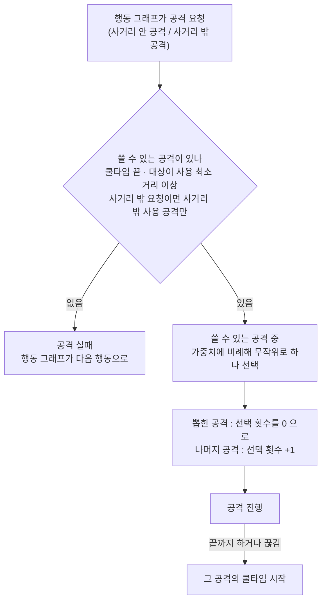
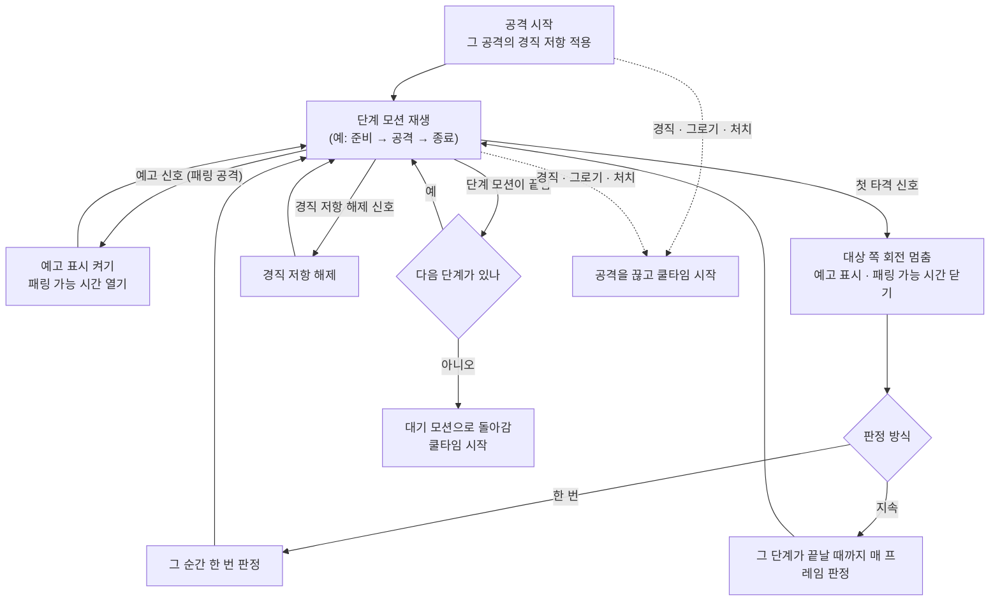

# 적 공격

## 1. 개요

일반 적 · 엘리트 · 보스가 함께 쓰는 공격 체계다. 적은 공격 목록 중 쿨타임이 끝나고 거리 조건이 맞는 공격을, 오래 쓰지 않은 공격일수록 잘 뽑히게 골라 쓴다. 공격 하나는 여러 단계의 모션으로 이루어지고, 예고 · 판정 · 경직 저항 시점은 모션에 찍은 신호로 정한다. 그래서 공격의 박자와 패링 · 반격 타이밍을 애니메이션에 맞춰 조정할 수 있다.

## 2. 구성 요소

- EnemyAttacker : 공격 선택, 단계별 모션 재생, 예고 · 패링 가능 시간, 판정, 공격 중 경직 저항, 끊김 처리
- EnemyAttackSetting : 공격 하나의 설정 묶음 (단계별 모션, 쿨타임, 선택 가중치, 사용 거리 조건, 도약 · 돌진 높이 · 지나치는 거리, 패링 여부, 경직 저항, 판정 범위 · 방식, 위력, 플레이어 반응)
- EnemyAnimationEventRelay : 적 외형에서 받은 애니메이션 신호를 공격 기능으로 넘기는 기능
- EnemyAnimationEventType : 적 공격 모션에 찍는 신호의 종류
- EnemyAnimation : 공격 단계 모션 재생과 재생 완료 확인 (공격 관련 역할)
- ParryWindow : 패링 가능 시간을 연 적 목록 (공격 관련 역할)

## 3. 동작 원리

### 공격 선택

- 가중치 = 기본 가중치 + 증가량 × (마지막으로 쓴 뒤 다른 공격이 뽑힌 횟수)
- 오래 쓰지 않은 공격일수록 가중치가 커져 잘 뽑힌다. 같은 공격이 연달아 나오는 일이 줄어든다.
- 쿨타임은 공격이 끝나거나 끊긴 시점부터 적 전용 시간으로 흐른다.
- **거리 조건**
    - 공격마다 사용 최소 거리를 둔다. 대상이 그보다 가까우면 고르지 않는다. 멀리 있을 때만 쓰는 공격(도약 등)에 쓴다.
    - 공격마다 사거리 밖에서도 쓸 수 있는지 정한다. 대상이 공격 사거리 밖일 때는 다가가기 전에 이 공격들 중에서만 고른다. (적 도약 · 돌진 문서)
    - 사거리 밖에서 쓸 수 있는 공격도 사거리 안에서는 일반 공격과 함께 고른다.

### 공격 진행

- **단계** : 공격 하나에 쓸 Animator 상태를 순서대로 적는다. 각 상태가 끝까지 재생되면 다음 상태로 넘어간다. 같은 상태를 여러 번 적어 반복할 수도 있다.
- **회전** : 공격을 시작해 첫 타격 신호가 오기 전까지는 대상 쪽으로 돈다. 그 뒤에는 방향을 고정한다. 끝까지 따라 돌면 피하기 어려워서다.
- **판정** : 적 앞쪽의 구 범위 안에 플레이어가 있으면 맞힌다. 플레이어는 공격 한 번에 한 번만 맞는다.
    - 한 번 판정 : 첫 타격 신호 순간 한 번 판정한다.
    - 지속 판정 : 타격 신호부터 그 단계가 끝날 때까지 매 프레임 판정한다. 회전 공격처럼 휘두르는 내내 닿으면 맞아야 하는 공격에 쓴다. 반복되는 단계마다 타격 신호를 찍으면 단계가 바뀌어도 판정이 이어진다.
- **패링 공격** : 예고 신호에서 예고 표시를 켜고 패링 가능 시간을 연다. 첫 타격 신호에서 둘 다 닫는다. 예고가 나오는 시점은 신호를 찍는 프레임으로 조정한다.
    - 예고 신호는 패링 공격의 준비 단계 모션에 넣는다. 신호 없이 타격에 도달하면 패링할 수 없으므로, 에디터에서 경고로 알린다.
    - 예고 표시는 적 안에 따로 둔 위치에 만든다. 록온 표시와 겹치지 않게 하기 위해서다.
- **경직 저항** : 공격을 시작할 때 그 공격의 경직 저항을 적용한다.
    - 기본은 첫 타격 신호에서 해제해, 판정 뒤 빈틈에 반격으로 끊을 수 있다.
    - 공격마다 경직 저항 해제 신호까지 유지하도록 정할 수 있다. 회전 공격처럼 공격 도중 끊기지 않아야 하는 공격은 종료 단계 모션에 해제 신호를 넣는다. 신호가 없으면 공격이 끝날 때까지 유지한다.
- **끊김** : 경직 · 그로기 · 처치되면 공격을 끊는다. 끊긴 공격도 쓴 것으로 보고 쿨타임을 시작한다. 행동 그래프의 공격 노드는 실패로 끝난다.
- 플레이어가 맞았을 때의 반응(피격 · 큰 피격 · 넉백), 완벽 회피, 패링은 공격 설정마다 정하고 피격 문서의 규칙을 따른다.

### 애니메이션 신호

| 신호 | 넣는 곳 | 하는 일 |
|---|---|---|
| 예고 | 패링 공격의 준비 단계 | 예고 표시 · 패링 가능 시간 시작 |
| 타격 | 실제로 때리는 단계 | 판정 (지속 판정이면 그 단계 끝까지) |
| 경직 저항 해제 | 저항을 유지할 공격의 원하는 지점 | 공격 중 경직 저항 해제 |
| 이동 시작 · 목표 고정 · 이동 종료 | 도약 · 돌진 공격의 모션 | 공격 중 목표 지점으로 이동 (적 도약 · 돌진 문서) |

- 애니메이션 신호는 Animator 가 붙은 적 외형에서 발생하므로, 외형에 붙은 중계 기능이 공격 기능으로 넘긴다.
- 단계가 바뀌며 이전 모션과 섞이는 동안에는 이전 모션의 신호도 발생한다. 신호가 어느 Animator 상태에서 왔는지 함께 넘겨, 지금 단계의 신호만 처리한다.

### 모션 속도 조절

- 선딜만 길게 하고 공격 동작은 그대로 두고 싶을 때는 코드를 고치지 않고 에디터에서 조절한다.
    - 클립 Import 설정의 Curves 로 속도 곡선을 만들고, 같은 이름의 Animator 파라미터를 공격 상태의 속도 배율로 쓴다. 선딜 구간만 느리게 재생된다.
    - 단계가 나뉜 공격은 준비 단계 상태의 재생 속도만 낮춰도 된다.
- 신호는 클립의 시간 위치에 붙어 있으므로, 재생 속도를 바꿔도 같은 동작 지점에서 발생한다.

## 4. 구현 과정

- 활용한 기능 :
    - Animation Event : 예고 · 타격 · 경직 저항 해제 시점을 모션의 프레임에 찍는다.
    - Animator 상태 직접 재생 : 공통 Animator 에 공격 슬롯 상태를 두고, 코드가 공격 설정에 적힌 순서대로 재생한다. 나가는 전이선은 두지 않는다.
    - Animator Override Controller : 적마다 공격 슬롯에 자기 클립을 끼운다.
    - Animation Curve (Import 설정의 Curves) · 상태 속도 배율 : 선딜 구간만 느리게 재생한다.
    - `Physics.OverlapSphere` : 타격 순간 적 앞쪽 구 범위의 플레이어를 찾는다. 적을 선택하면 Scene 창에 공격별 범위가 보이고, 패링 공격은 노란색, 나머지는 빨간색이다.
    - `[Serializable]` 설정 묶음 : 공격 하나의 값을 Inspector 에 펼쳐, 공격 목록에 같은 형태로 적는다.
- 구현 과정 :
    1. 더미 적 공격 기능의 판정 · 패링 · 끊김 규칙을 새 공격 기능으로 옮겼다. 시간으로 진행하던 예고 · 판정 대기는 모션과 신호로 바꿨다.
    2. 쿨타임과 누적 가중치로 공격을 고르게 했다.
    3. 공격 하나를 여러 단계 모션으로 나눠 순서대로 재생하게 했다. 준비 → 공격 → 종료처럼 나뉜 회전 공격을 하나의 공격으로 다룬다.
    4. 회전 공격이 공격 도중 끊기는 문제가 있었다. 경직 저항이 첫 타격 신호에서 풀리기 때문이었다. 공격마다 경직 저항 해제 신호까지 유지할 수 있게 했다.
    5. 회전 공격이 타격 신호 순간에만 맞는 문제가 있어, 단계가 끝날 때까지 판정하는 지속 판정을 추가했다.
    6. 패링 공격의 예고를 공격 시작이 아니라 준비 모션의 예고 신호에서 시작하게 했다. 시간 값으로 조정하던 방식은 신호 프레임으로 같은 조정을 할 수 있어 삭제했다.
    7. 일반 적이 완성된 뒤 더미 적 전용 예고 설정(색 · 크기 · 예고 시간)을 삭제했다.
    8. 보스 공격을 붙이며 공격마다 사용 최소 거리와 사거리 밖 사용 여부를 추가했다. 멀리 있을 때만 쓰는 도약과, 가까이서도 멀리서도 쓰는 돌진을 같은 선택 규칙 안에서 고른다.
    9. 도약 · 돌진처럼 공격 중 이동하는 공격을 위해 이동 신호를 추가했다. 이동은 따로 만든 도약 기능이 맡고, 공격 기능은 신호만 넘긴다.
- 주요 결정과 이유 :
    - 공격 단계는 전이선이 아니라 코드가 재생한다. 공격마다 단계 수가 달라도 같은 방식으로 다루고, 끝나는 시점을 코드가 알기 위해서다.
    - 오래 쓰지 않은 공격일수록 잘 뽑히게 했다. 안 했던 행동이 나올 확률을 높여 패턴이 단조롭지 않게 하기 위해서다. 시간 대신 선택 횟수를 기준으로 했다.
    - 모든 공격이 쿨타임이면 공격 노드가 실패해 거리 유지부터 다시 한다. 따로 기다리는 처리를 두지 않아도 자연스럽게 기다린다.
    - 모션은 루트 모션 없이 제자리에서 재생한다. 이동은 행동 그래프와 이동 기능이 맡는다.
    - 예고 · 저항 해제를 시간 값이 아니라 신호로 정한다. 모션을 바꾸거나 속도를 조절해도 신호가 모션과 함께 움직여 박자가 어긋나지 않는다.

## 5. 기존 방식과 비교

- 기존 방식 :
    - 시험용 더미 적이 공격 목록을 순서대로 반복했다.
    - 예고는 정해진 시간 동안 몸 색 · 크기를 바꿔 보여주고, 예고가 끝난 뒤 정해진 대기 시간이 지나면 한 번 판정했다.
    - 패링 가능 시간은 예고 시작부터 판정까지 열렸다.
- 달라진 점 :
    - 쿨타임과 누적 가중치로 공격을 고른다.
    - 공격은 여러 단계 모션으로 이루어지고, 예고 · 판정 · 경직 저항 해제를 모션 신호로 정한다.
    - 예고는 적 안에 따로 둔 예고 표시로 보여준다. 패링 가능 시간은 예고 신호부터 첫 타격까지 열린다.
    - 판정을 한 번 또는 단계 끝까지로 정할 수 있다.
    - 공격 중 경직 저항을 첫 타격 또는 저항 해제 신호까지로 정할 수 있다.
- 개선된 점 :
    - 공격의 박자가 모션과 맞는다.
    - 회전 공격처럼 길게 휘두르는 공격을 공격 도중 끊기지 않고, 휘두르는 내내 맞게 만들 수 있다.
    - 패턴이 단조롭지 않다.
- 보스 작업에서 달라진 점 :
    - 기존에는 쿨타임과 가중치만으로 공격을 골랐다. 이제 거리 조건(사용 최소 거리, 사거리 밖 사용)도 함께 본다.
    - 기존 공격은 제자리에서만 재생됐다. 이제 이동 신호로 공격 중 목표 지점까지 이동하는 공격을 만들 수 있다.

### 미정 · 미검증 항목

- 예고 표시 이펙트 (지금은 임시 오브젝트)
- 한 공격에서 여러 번 맞히는 공격 (지금은 공격 한 번에 한 번만 맞음)
- 엘리트 공격
- 회피 전용(빨간색) 예고 표시 (지금은 패링 공격 예고만 있음)
- 공격 판정 방식 정리 (적 데이터 정리 때)
