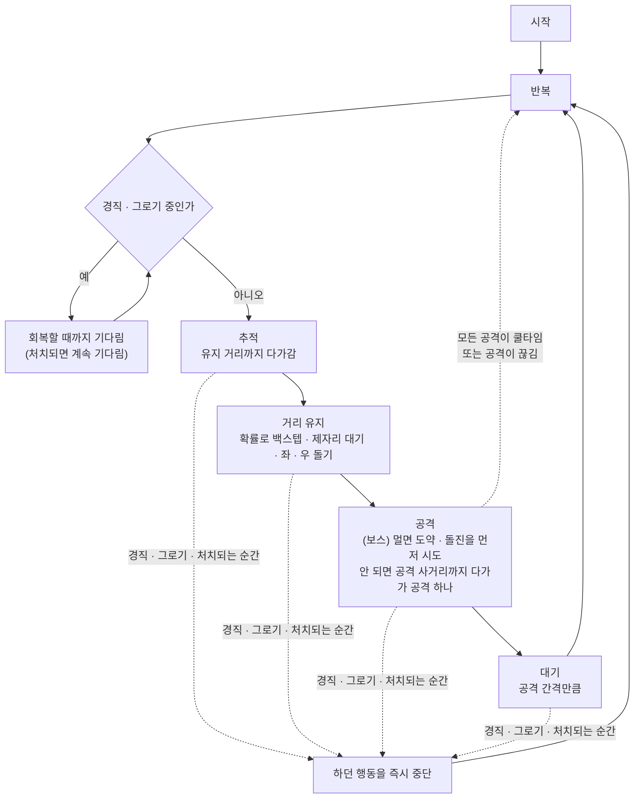
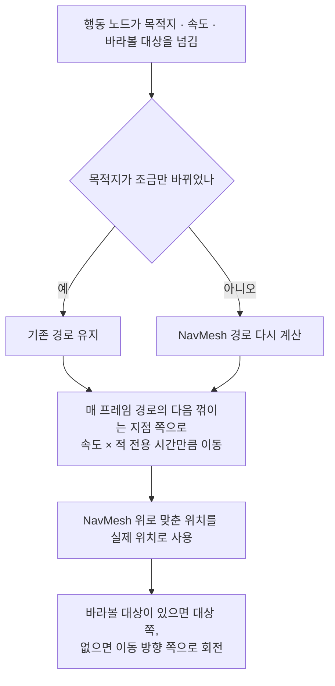

# 적 행동 (행동 그래프 · 이동)

## 1. 개요

일반 적 · 보스가 플레이어를 추적하고, 거리를 유지하며 좌 · 우로 돌거나 백스텝하거나 제자리에서 기다리다가, 다가가 공격하고, 잠시 기다리는 흐름을 반복하게 하는 행동 체계다. 보스는 같은 흐름에서 공격을 고를 때 플레이어가 멀면 도약 · 돌진 공격을 먼저 시도한다. 플레이어처럼 입력에 따라 행동이 급변하지 않고, 적의 공격 방식을 정해진 행동 패턴으로 보여주기 위해 만들었다. 경직 · 그로기 · 처치 중에는 하던 행동을 바로 멈추고, 회복하면 처음부터 다시 판단한다.

## 2. 구성 요소

- ChaseTargetAction : [행동 그래프 행동] 대상에게 유지 거리까지 다가가는 노드
- KeepDistanceAction : [행동 그래프 행동] 확률에 따라 백스텝하거나, 제자리에서 기다리거나, 정해진 시간 동안 대상 둘레를 도는 노드
- AttackTargetAction : [행동 그래프 행동] 공격 사거리까지 다가가 공격 하나를 하고, 끝나면 성공하는 노드
- RangedAttackAction : [행동 그래프 행동] 대상이 공격 사거리 밖이면 사거리 밖에서 쓸 수 있는 공격을 바로 하고, 쓸 수 없으면 바로 실패하는 노드 (적 도약 · 돌진 문서)
- EnemyWaitAction : [행동 그래프 행동] 공격 뒤 적 전용 시간으로 기다리는 노드
- WaitUntilRecoveredAction : [행동 그래프 행동] 경직 · 그로기가 끝날 때까지 기다리는 노드
- IsRestrictedCondition : [행동 그래프 조건] 경직 · 그로기 · 처치 중인지 판단하는 조건
- EnemyMovement : 경로 계산과 적 전용 시간에 맞춘 이동 · 회전
- EnemyBehaviorSetting : 행동 그래프 노드가 읽는 조정값 (달리기 속도 배율, 유지 거리, 도는 속도, 거리 유지 시간, 백스텝 확률 · 속도 배율, 제자리 대기 확률, 공격 사거리, 공격 간격)
- EnemyAnimation : 달리기 · 방향 이동 · 대기 · 백스텝 모션 재생 (행동 관련 역할)

## 3. 동작 원리

### 행동 흐름

- 경직 · 그로기 · 처치되면 Abort 로 하던 이동 · 공격을 바로 끊는다. 이동 기능도 같은 순간 스스로 멈춰, 그래프가 끊기기 전 한 프레임도 움직이지 않는다.
- 반복의 맨 앞에서 회복을 기다리므로, 회복하면 추적부터 다시 판단한다. 처치된 적은 여기서 계속 기다려 이후 행동을 하지 않는다.
- 쓸 수 있는 공격이 모두 쿨타임이면 공격 노드가 실패하고 처음부터 다시 돈다. 그래서 따로 기다리는 처리 없이 거리 유지를 반복하며 자연스럽게 기다린다.
- 대기는 Unity 기본 Wait 노드 대신 적 전용 시간으로 기다리는 노드를 쓴다. 기본 노드는 슬로모션 · 필살기 연출에 느려지지 않기 때문이다.
- **보스 그래프**
    - 일반 적과 같은 흐름에서 공격 자리만 다르다. `Try In Order` 아래에 원거리 공격 노드, 다가가서 공격하는 노드 순서로 둔다.
    - 대상이 멀고 도약 · 돌진을 쓸 수 있으면 바로 쓰고, 쓸 수 없으면(쿨타임 · 거리 조건) 원거리 공격 노드가 실패해 다가가서 공격한다.
    - 원거리 조건은 공격을 고르는 순간에만 본다. 보스도 기존 주기(추적 → 거리 유지 → 공격 → 대기)를 그대로 따른다.

### 거리 유지

- 거리 유지를 시작할 때 확률을 한 번 뽑아, 백스텝 · 제자리 대기 · 좌 · 우 돌기 중 하나를 한다. 뽑은 값이 백스텝 확률 구간이면 백스텝, 그다음 대기 확률 구간이면 제자리 대기, 나머지는 좌 · 우 돌기다.
- 좌 · 우 돌기와 제자리 대기는 대상을 바라보며 움직이므로 방향 이동 모션을 쓴다. 실제로 움직인 방향을 적이 바라보는 방향 기준으로 바꿔 앞 · 뒤 · 좌 · 우 걸음과 제자리 모션을 섞는다. 옆으로 돌 때는 옆걸음, 거리를 맞출 때는 앞 · 뒤 걸음, 멈춰 있으면 제자리 모션이 나온다.
- **좌 · 우 돌기**
    - 정해진 최소 ~ 최대 시간 사이에서 매번 무작위로 정한 시간 동안 돈다. 도는 방향도 시작할 때마다 무작위로 정한다.
    - 목표 지점은 대상을 중심으로 한 유지 거리 원 위에서, 지금 위치보다 도는 방향으로 조금 앞선 지점이다. 목표가 계속 앞서 가므로 원을 따라 돌게 된다.
    - 원보다 멀어지거나 가까워지면 원 쪽 목표로 다가가거나 물러나며 거리를 맞춘다. 허용 범위보다 많이 멀어지면 추적 속도로, 그 밖에는 도는 속도로 움직인다.
    - 도는 동안 계속 대상을 바라본다.
- **백스텝**
    - 대상을 바라본 채 백스텝 모션을 재생하며 대상 반대쪽으로 물러난다. 백스텝 모션이 끝나면 멈추고 다음 행동(공격)으로 넘어간다.
    - 물러나는 속도는 추적 속도에 배율을 곱해 정한다. 물러나는 거리는 속도와 모션 길이로 정해진다.
    - 이동 기능이 이동 모션을 재생하지 않고 이동만 하게 해, 백스텝 모션이 그대로 보인다.
    - 적의 Animator 에 백스텝 상태가 없으면 좌 · 우 돌기로 대신한다. 끝나지 않는 모션을 기다리며 멈춰 있지 않게 하기 위해서다.
- **제자리 대기**
    - 거리 유지 시간 동안 움직이지 않고 대상 쪽으로 몸만 돌린다. 시간은 좌 · 우 돌기와 같은 거리 유지 시간을 쓴다.
    - 기다리는 동안 대상이 다가오거나 멀어져도 거리를 맞추지 않는다.
    - 이동 기능에 지금 위치를 목적지로, 속도 없이 넘겨 대상 쪽으로 도는 처리만 쓴다. 회전 기능을 따로 만들지 않았다.

### 이동

- NavMeshAgent 는 경로 계산에만 쓰고, 실제 이동 · 회전은 이동 기능이 직접 한다. Agent 가 스스로 움직이면 가속도 설정의 영향을 받고 적 전용 시간을 따르지 않기 때문이다.
- 가속 없이 바로 정한 속도로 움직이고, 경로의 꺾이는 지점을 지나치지 않는다.
- 이동을 시작하면 이동 모션, 멈추면 대기 모션을 재생한다. 경직 · 그로기 · 처치 중에는 반응 모션을 덮지 않는다.
    - 바라볼 대상 없이 이동 방향을 보고 움직이면(추적 · 공격 접근) 달리기 모션을 쓴다. 이때 속도는 추적 속도에 달리기 배율을 곱한다.
    - 바라볼 대상을 넘기면(거리 유지) 방향 이동 모션을 쓴다. 바라보는 방향과 움직이는 방향이 달라지기 때문이다.
    - 어느 모션을 쓸지는 바라볼 대상이 있는지로 정한다. 이동 요청에 이미 있는 값이라 옵션을 따로 두지 않았다.
- 모든 모션은 루트 모션 없이 제자리에서 재생하고, 이동은 코드가 맡는다.

## 4. 구현 과정

- 활용한 기능 :
    - Unity Behavior (행동 그래프) : 추적 · 거리 유지 · 공격 · 대기를 그래프 노드로 놓고 Repeat · Sequence 로 순서를 정한다. 직접 만든 행동 · 조건 노드는 노드 설명(이름 · 문장 · 분류)을 붙여 그래프 편집기에서 고를 수 있게 했다.
    - Abort 모디파이어 : 경직 · 그로기 · 처치 조건이 참이 되는 순간 하던 행동 묶음을 끊는다.
    - Blackboard : 추적 대상처럼 실행 중에 바뀌는 값을 둔다. 사람이 조정하는 값은 Inspector 의 행동 설정에 둔다.
    - NavMesh · NavMeshAgent : 경로만 계산하고, Agent 의 위치 맞춤으로 실제 이동이 NavMesh 밖으로 나가지 않게 한다.
- 구현 과정 :
    1. 행동 설정과 추적 · 거리 유지 · 대기 노드, 회복 대기 노드와 행동 불가 조건을 만들어 그래프를 구성했다.
    2. 이동은 Agent 에게 맡기지 않고 경로 계산만 쓰고, 이동 · 회전은 적 전용 시간에 맞춰 직접 하게 했다.
    3. 거리 유지는 대상 둘레의 원 위에서 앞선 지점을 목표로 삼아, 거리를 맞추면서 도는 동작을 하나의 규칙으로 만들었다.
    4. 일반 적 공격을 붙이며 공격 노드를 추가했다. (적 공격 문서)
    5. 적 모션은 루트 모션을 끄고 제자리에서 재생하기로 정했다. 이동은 모두 코드가 맡는다.
    6. 거리 유지 중 확률로 백스텝하는 패턴을 추가했다. 이동 기능에 이동 모션 없이 이동만 하는 방법을 더했다.
    7. 보스 에셋에 좌 · 우 걸음 모션이 있어, 거리 유지 이동을 방향 이동 모션(Blend Tree)으로 바꿨다. 추적 모션은 달리기로 분리했다. 좌 · 우 걸음이 없는 일반 적은 방향 이동 자리에 전진 모션을 끼운다.
    8. 거리 유지 중 제자리에서 기다리는 패턴을 추가했다. 방향 이동 모션의 제자리 자리에 대기 모션을 넣어, 멈춰 있을 때 따로 처리하지 않아도 대기 모션이 나온다.
    9. 추적 · 공격 접근 속도에만 곱하는 달리기 배율을 추가했다.
    10. 보스 그래프를 만들고 공격 자리에서 원거리 공격을 먼저 시도하게 했다. (적 도약 · 돌진 문서)
- 주요 결정과 이유 :
    - 적 AI 는 플레이어처럼 직접 짠 상태 대신 행동 그래프로 만들었다.
        - 일반 적은 플레이어와 달리 입력에 따라 행동이 급변하지 않고, 적의 공격 방식을 행동 패턴으로 보여주기 위해서다.
        - 그래프에서 흐름을 눈으로 보며 순서를 바꾸기 쉽다.
        - 적 종류(일반 · 엘리트 · 보스)마다 그래프만 바꿔 행동을 다르게 할 수 있다.
        - Unity 공식 도구를 써 보기 위해서다.
    - 배회는 따로 노드를 두지 않고, 유지 거리까지 이동과 좌 · 우 돌기로 표현했다.
    - 백스텝을 추가했다. 가까워질수록 이동 · 공격 패턴이 단조로워졌기 때문이다.
    - 백스텝 여부는 거리 유지를 시작할 때 한 번만 뽑는다. 거리 유지에 필요한 값이 이미 행동 설정에 있어, 백스텝을 위한 거리 조건을 따로 두지 않았다.
    - 방향 이동은 상태를 방향마다 나누지 않고 Blend Tree 하나로 만들었다. 거리를 맞추며 앞뒤로 조금씩 움직이는 동작과 제자리 대기까지 한 틀에서 자연스럽게 섞기 위해서다.
    - 달리기 배율은 이동 속도 자체를 올리지 않고 추적 · 공격 접근에만 곱한다. 이동 속도는 백스텝 속도와 거리 유지 중 따라붙는 속도의 기준이기도 해서, 그 둘은 그대로 두기 위해서다.
    - 제자리 대기 시간은 새 값을 두지 않고 거리 유지 시간을 그대로 쓴다.

### 참고 레퍼런스

- [Unity Behavior 공식 문서](https://docs.unity3d.com/Packages/com.unity.behavior@1.0/manual/index.html) : 행동 그래프 구성, 직접 만든 행동 · 조건 노드 작성, Abort · Repeat 사용

## 5. 기존 방식과 비교

- 필요하게 된 과정 : 기획서 코어 전투 5묶음의 첫 단계다. 지금까지는 제자리에서 정해진 순서로 공격만 반복하는 시험용 더미 적으로 플레이어 기능을 확인했다. 실제 전투처럼 움직이며 거리를 재고 공격하는 적이 있어야 타겟팅 · 회피 · 패링 · 콤보 스킬을 실제 전투 흐름에서 확인할 수 있어 만들었다.
- 보스 작업에서 달라진 점 :
    - 기존에는 이동 모션 하나로 추적과 거리 유지를 모두 보여줬다. 이제 추적은 달리기, 거리 유지는 방향 이동 모션으로 나뉘어 옆으로 돌 때 옆걸음이 나온다.
    - 거리 유지에 제자리 대기가 추가되어 움직임이 단조롭지 않다.
    - 보스는 같은 흐름에서 멀리 있는 플레이어에게 도약 · 돌진으로 압박한다.

### 미정 · 미검증 항목

- 여러 마리가 나올 때 적끼리 피하는 처리 (웨이브 단계에서 검토)
- 엘리트의 행동 그래프
- 보스 등장 공격 (보스전 흐름을 본 뒤 결정)
- 거리 유지 그림에 제자리 대기 미반영
