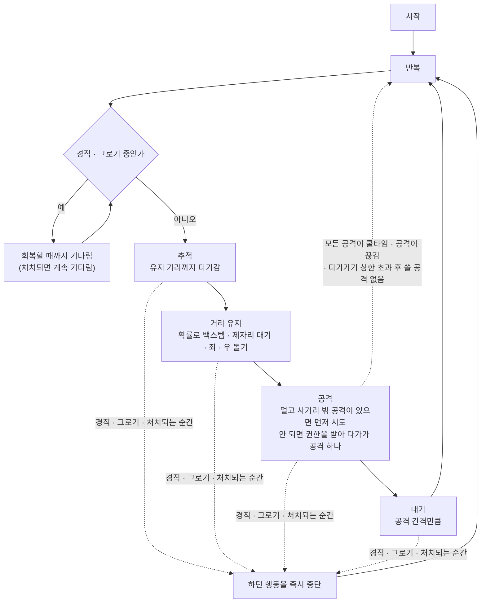
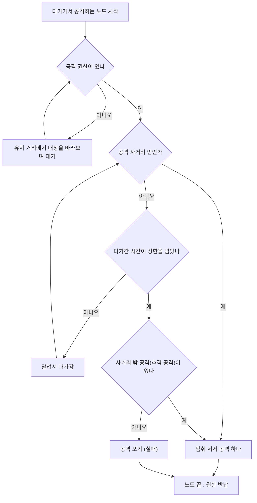
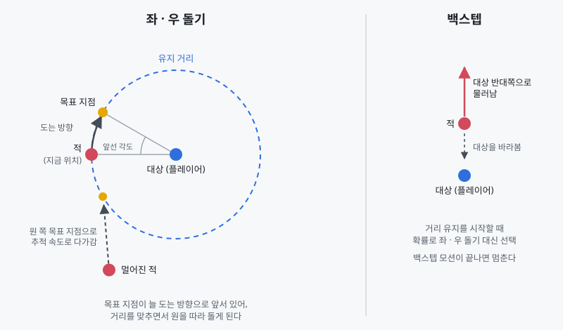
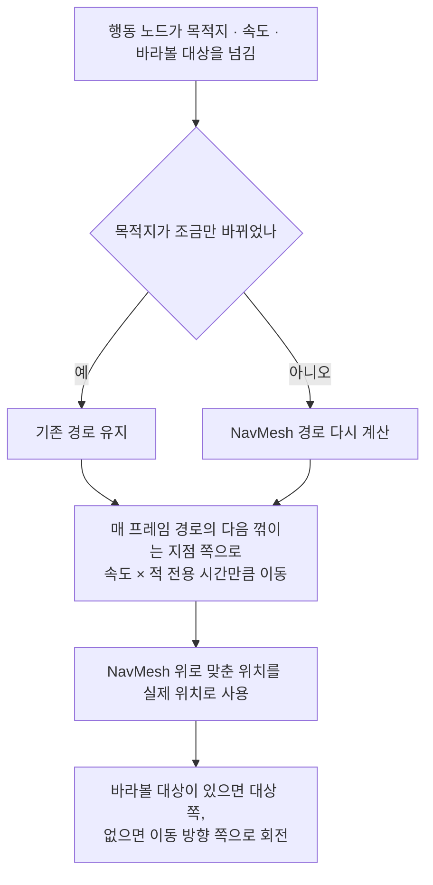

# 적 행동 (행동 그래프 · 이동)

## 1. 개요

일반 적 · 보스가 플레이어를 추적하고, 거리를 유지하며 좌 · 우로 돌거나 백스텝하거나 제자리에서 기다리다가, 다가가 공격하고, 잠시 기다리는 흐름을 반복하게 하는 행동 체계다. 일반 · 엘리트 · 보스가 행동 그래프 하나를 함께 쓰고, 어떤 공격을 언제 쓸지는 적 데이터 · 공격 데이터로 판단한다. 공격을 고를 때 플레이어가 멀고 사거리 밖 공격(도약 · 돌진)이 있으면 먼저 시도한다. 다가가서 공격하려면 전투 공용 기능에게 공격 권한을 받아야 하고, 권한이 없으면 거리를 두고 차례를 기다린다. 플레이어처럼 입력에 따라 행동이 급변하지 않고, 적의 공격 방식을 정해진 행동 패턴으로 보여주기 위해 만들었다. 경직 · 그로기 · 처치 중에는 하던 행동을 바로 멈추고, 회복하면 처음부터 다시 판단한다.

## 2. 구성 요소

- ChaseTargetAction : [행동 그래프 행동] 대상에게 유지 거리까지 다가가는 노드
- KeepDistanceAction : [행동 그래프 행동] 확률에 따라 백스텝하거나, 제자리에서 기다리거나, 정해진 시간 동안 대상 둘레를 도는 노드
- AttackTargetAction : [행동 그래프 행동] 공격 권한을 받아 공격 사거리까지 다가가 공격 하나를 하고, 끝나면 성공하는 노드. 권한이 없으면 유지 거리에서 기다리고, 다가가는 시간이 상한을 넘으면 사거리 밖 공격을 하거나 포기한다. 노드가 끝나면 권한을 반납한다 (전투 공용 적 관리 문서)
- RangedAttackAction : [행동 그래프 행동] 대상이 공격 사거리 밖이면 사거리 밖에서 쓸 수 있는 공격을 바로 하고, 쓸 수 없으면 바로 실패하는 노드 (적 도약 · 돌진 문서)
- EnemyWaitAction : [행동 그래프 행동] 공격 뒤 적 전용 시간으로 기다리는 노드
- WaitUntilRecoveredAction : [행동 그래프 행동] 경직 · 그로기가 끝날 때까지 기다리는 노드
- IsRestrictedCondition : [행동 그래프 조건] 경직 · 그로기 · 처치 중인지 판단하는 조건
- EnemyMovement : 경로 계산과 적 전용 시간에 맞춘 이동 · 회전, 다른 적과의 겹침 방지. 멈출 때 대기 모션으로 바꿀지 고를 수 있다 (공격 중 대상 따라가기는 바꾸지 않음, 적 공격 문서). 대상 쪽으로 도는 처리는 공격 기능도 함께 쓴다
- EnemyData : 행동 그래프 노드 · 이동이 읽는 조정값 (이동 · 회전 속도, 경로 재계산 거리, 달리기 속도 배율, 유지 거리, 도는 속도, 거리 유지 시간, 백스텝 확률 · 속도 배율, 제자리 대기 확률, 공격 사거리, 다가가기 상한 시간, 공격 간격)을 가진 적 데이터 에셋. 노드는 적의 대표 기능(EnemyController)을 거쳐 읽는다 (적 공통 규칙 문서)
- EnemyAnimation : 달리기 · 방향 이동 · 대기 · 백스텝 모션 재생 (행동 관련 역할)

## 3. 동작 원리

### 행동 흐름

- 추적 · 거리 유지 · 공격의 대상은 Blackboard 의 공격 대상 값이다. 전투 공용 기능(배틀 매니저)이 등록할 때와 교체 · 판 종료 때 이 값을 조작 중인 캐릭터로 바꾼다. (전투 공용 적 관리 문서) 공격 중에 바뀌어도 진행 중인 공격은 시작할 때 정한 대상으로 끝까지 시전한다. (파티 문서)
- 경직 · 그로기 · 처치되면 Abort 로 하던 이동 · 공격을 바로 끊는다. 이동 기능도 같은 순간 스스로 멈춰, 그래프가 끊기기 전 한 프레임도 움직이지 않는다.
- 반복의 맨 앞에서 회복을 기다리므로, 회복하면 추적부터 다시 판단한다. 처치된 적은 여기서 계속 기다려 이후 행동을 하지 않는다.
- 쓸 수 있는 공격이 모두 쿨타임이면 공격 노드가 실패하고 처음부터 다시 돈다. 그래서 따로 기다리는 처리 없이 거리 유지를 반복하며 자연스럽게 기다린다.
- 대기는 Unity 기본 Wait 노드 대신 적 전용 시간으로 기다리는 노드를 쓴다. 기본 노드는 슬로모션 · 필살기 연출에 느려지지 않기 때문이다.
- **공용 그래프 (#92)**
    - 일반 · 엘리트 · 보스가 같은 그래프를 쓴다. 공격 자리는 `Try In Order` 아래에 원거리 공격 노드, 다가가서 공격하는 노드 순서로 둔다.
    - 대상이 멀고 사거리 밖 공격(도약 · 돌진 등)을 쓸 수 있으면 바로 쓴다. 쓸 수 없으면(쿨타임 · 거리 조건 · 그런 공격이 없음) 원거리 공격 노드가 바로 실패해 다가가서 공격한다. 사거리 밖 공격이 없는 일반 · 엘리트는 늘 다가가서 공격한다.
    - 실패한 원거리 시도는 공격 선택 가중치를 바꾸지 않아, 다음 공격 선택에 영향이 없다.
    - 원거리 조건은 공격을 고르는 순간에만 본다. 모든 적이 같은 주기(추적 → 거리 유지 → 공격 → 대기)를 따른다.
    - 원거리 적은 데이터로 만든다. 유지 거리를 길게 두고 사거리 밖에서 쓸 수 있는 공격을 주면, 유지 거리에서 원거리 노드로 쏜다. 원거리 공격이 모두 쿨타임이면 다가가는 노드도 바로 실패해 다가오지 않고 거리 유지로 돌아간다. 플레이어가 공격 사거리 안까지 파고들면 다가가는 노드로 근접 공격을 한다.

### 공격 권한과 다가가기 상한 (#92)

- 권한을 주고받는 규칙(동시 공격 수, 기다리는 순서, 보스 제외)은 전투 공용 적 관리 문서에 적었다.
- 기다리는 동안은 지금 서 있는 방향 그대로 유지 거리 원 위의 자리로 가서 대상을 바라본다. 거리 유지의 좌 · 우 돌기와 같은 기준으로, 많이 멀어지면 추적 속도로, 그 밖에는 도는 속도로 거리를 맞춘다.
- 다가간 시간은 권한을 받은 뒤부터 적 전용 시간으로 잰다. 기다린 시간은 넣지 않는다.
- 플레이어가 계속 도망가면 끝없이 쫓아오기만 하던 문제를 막기 위해 다가가는 시간에 상한을 두었다. 상한을 넘으면 멈춰 서서 사거리 밖 공격을 고르고, 없으면 공격을 포기해 권한을 내놓는다. 그동안 다른 적이 권한을 받을 수 있다.
- 상한을 0 으로 두면 지금처럼 끝까지 다가간다.
- 추격 공격은 따로 종류를 두지 않는다. 사거리 밖에서 쓸 수 있는 공격(돌진 · 도약 등) 에셋을 그 적의 공격 목록에 넣으면 된다.
- 포기한 적은 반복의 처음부터 다시 판단해, 추적과 거리 유지를 거친다.

### 거리 유지

- 거리 유지를 시작할 때 확률을 한 번 뽑아, 백스텝 · 제자리 대기 · 좌 · 우 돌기 중 하나를 한다. 뽑은 값이 백스텝 확률 구간이면 백스텝, 그다음 대기 확률 구간이면 제자리 대기, 나머지는 좌 · 우 돌기다.
- 좌 · 우 돌기와 제자리 대기는 대상을 바라보며 움직이므로 방향 이동 모션을 쓴다. 실제로 움직인 방향을 적이 바라보는 방향 기준으로 바꿔 앞 · 뒤 · 좌 · 우 걸음과 제자리 모션을 섞는다. 옆으로 돌 때는 옆걸음, 거리를 맞출 때는 앞 · 뒤 걸음, 멈춰 있으면 제자리 모션이 나온다.
- **좌 · 우 돌기**
    - 정해진 최소 ~ 최대 시간 사이에서 매번 무작위로 정한 시간 동안 돈다. 도는 방향도 시작할 때마다 무작위로 정한다.
    - 목표 지점은 대상을 중심으로 한 유지 거리 원 위에서, 지금 위치보다 도는 방향으로 조금 앞선 지점이다. 목표가 계속 앞서 가므로 원을 따라 돌게 된다.
    - 원보다 멀어지거나 가까워지면 원 쪽 목표로 다가가거나 물러나며 거리를 맞춘다. 허용 범위보다 많이 멀어지면 추적 속도로, 그 밖에는 도는 속도로 움직인다.
    - 도는 동안 계속 대상을 바라본다.
- **백스텝**
    - 대상을 바라본 채 백스텝 모션을 재생하며 대상 반대쪽으로 물러난다. 백스텝 모션이 끝나면 멈추고 다음 행동(공격)으로 넘어간다.
    - 물러나는 속도는 추적 속도에 배율을 곱해 정한다. 물러나는 거리는 속도와 모션 길이로 정해진다.
    - 이동 기능이 이동 모션을 재생하지 않고 이동만 하게 해, 백스텝 모션이 그대로 보인다.
    - 적의 Animator 에 백스텝 상태가 없으면 좌 · 우 돌기로 대신한다. 끝나지 않는 모션을 기다리며 멈춰 있지 않게 하기 위해서다.
- **제자리 대기**
    - 거리 유지 시간 동안 움직이지 않고 대상 쪽으로 몸만 돌린다. 시간은 좌 · 우 돌기와 같은 거리 유지 시간을 쓴다.
    - 기다리는 동안 대상이 다가오거나 멀어져도 거리를 맞추지 않는다.
    - 이동 기능에 지금 위치를 목적지로, 속도 없이 넘겨 대상 쪽으로 도는 처리만 쓴다. 회전 기능을 따로 만들지 않았다.

### 이동

- NavMeshAgent 는 경로 계산에만 쓰고, 실제 이동 · 회전은 이동 기능이 직접 한다. Agent 가 스스로 움직이면 가속도 설정의 영향을 받고 적 전용 시간을 따르지 않기 때문이다.
- 가속 없이 바로 정한 속도로 움직이고, 경로의 꺾이는 지점을 지나치지 않는다.
- 이동을 시작하면 이동 모션, 멈추면 대기 모션을 재생한다. 경직 · 그로기 · 처치 중에는 반응 모션을 덮지 않는다.
    - 바라볼 대상 없이 이동 방향을 보고 움직이면(추적 · 공격 접근) 달리기 모션을 쓴다. 이때 속도는 추적 속도에 달리기 배율을 곱한다.
    - 바라볼 대상을 넘기면(거리 유지) 방향 이동 모션을 쓴다. 바라보는 방향과 움직이는 방향이 달라지기 때문이다.
    - 어느 모션을 쓸지는 바라볼 대상이 있는지로 정한다. 이동 요청에 이미 있는 값이라 옵션을 따로 두지 않았다.
- 모든 모션은 루트 모션 없이 제자리에서 재생하고, 이동은 코드가 맡는다.
- (#92) 한 걸음 옮기기 직전에 다른 적의 몸과 겹치는지 보고, 들어간 만큼 수평으로 밀어낸다. 앞을 막은 적을 옆으로 미끄러지며 돌아가고, 서 있는 적은 밀리지 않는다. (전투 공용 적 관리 문서)
    - 밀려서 옆으로 움직일 수 있어, 방향 이동 모션은 계산한 이동 방향 대신 실제로 움직인 방향으로 고른다.
- (#92) 대상 쪽으로 천천히 도는 처리는 이동 기능 한 곳에 두고, 공격 기능도 공격마다 정한 회전 속도로 함께 쓴다.

## 4. 구현 과정

- 활용한 기능 :
    - Unity Behavior (행동 그래프) : 추적 · 거리 유지 · 공격 · 대기를 그래프 노드로 놓고 Repeat · Sequence 로 순서를 정한다. 직접 만든 행동 · 조건 노드는 노드 설명(이름 · 문장 · 분류)을 붙여 그래프 편집기에서 고를 수 있게 했다.
    - Abort 모디파이어 : 경직 · 그로기 · 처치 조건이 참이 되는 순간 하던 행동 묶음을 끊는다.
    - Blackboard : 추적 대상처럼 실행 중에 바뀌는 값을 둔다. 사람이 조정하는 값은 적 데이터 에셋에 둔다.
    - NavMesh · NavMeshAgent : 경로만 계산하고, Agent 의 위치 맞춤으로 실제 이동이 NavMesh 밖으로 나가지 않게 한다.
- 구현 과정 :
    1. 행동 설정과 추적 · 거리 유지 · 대기 노드, 회복 대기 노드와 행동 불가 조건을 만들어 그래프를 구성했다.
    2. 이동은 Agent 에게 맡기지 않고 경로 계산만 쓰고, 이동 · 회전은 적 전용 시간에 맞춰 직접 하게 했다.
    3. 거리 유지는 대상 둘레의 원 위에서 앞선 지점을 목표로 삼아, 거리를 맞추면서 도는 동작을 하나의 규칙으로 만들었다.
    4. 일반 적 공격을 붙이며 공격 노드를 추가했다. (적 공격 문서)
    5. 적 모션은 루트 모션을 끄고 제자리에서 재생하기로 정했다. 이동은 모두 코드가 맡는다.
    6. 거리 유지 중 확률로 백스텝하는 패턴을 추가했다. 이동 기능에 이동 모션 없이 이동만 하는 방법을 더했다.
    7. 보스 에셋에 좌 · 우 걸음 모션이 있어, 거리 유지 이동을 방향 이동 모션(Blend Tree)으로 바꿨다. 추적 모션은 달리기로 분리했다. 좌 · 우 걸음이 없는 일반 적은 방향 이동 자리에 전진 모션을 끼운다.
    8. 거리 유지 중 제자리에서 기다리는 패턴을 추가했다. 방향 이동 모션의 제자리 자리에 대기 모션을 넣어, 멈춰 있을 때 따로 처리하지 않아도 대기 모션이 나온다.
    9. 추적 · 공격 접근 속도에만 곱하는 달리기 배율을 추가했다.
    10. 보스 그래프를 만들고 공격 자리에서 원거리 공격을 먼저 시도하게 했다. (적 도약 · 돌진 문서)
    11. (#51) 행동 설정 기능을 지우고, 행동 조정값과 이동 조정값을 적 데이터 에셋으로 옮겼다. 노드와 이동 기능은 적의 대표 기능을 거쳐 데이터를 읽는다.
    12. (#52) 공격 중 대상 따라가기를 위해, 이동을 멈출 때 대기 모션으로 바꾸지 않는 방법을 더했다. 바꾸면 재생 중인 공격 모션이 끊기기 때문이다.
    13. (#92) 공격 노드에 공격 권한 요청 · 대기 · 반납을 넣었다. (전투 공용 적 관리 문서)
    14. (#92) 다가가는 시간에 상한을 두고, 넘으면 사거리 밖 공격을 하거나 포기하게 했다.
    15. (#92) 일반 그래프와 보스 그래프를 하나로 합쳤다. 원거리 공격 노드는 쓸 공격이 없으면 바로 실패하므로, 보스 그래프를 그대로 공용으로 쓰면 일반 · 엘리트도 기존처럼 행동한다.
    16. (#92) 이동에 다른 적과의 겹침 방지를 넣고, 대상 쪽으로 도는 처리를 공격 기능과 함께 쓰게 했다.
- 주요 결정과 이유 :
    - 적 AI 는 플레이어처럼 직접 짠 상태 대신 행동 그래프로 만들었다.
        - 일반 적은 플레이어와 달리 입력에 따라 행동이 급변하지 않고, 적의 공격 방식을 행동 패턴으로 보여주기 위해서다.
        - 그래프에서 흐름을 눈으로 보며 순서를 바꾸기 쉽다.
        - 적 종류(일반 · 엘리트 · 보스)마다 그래프만 바꿔 행동을 다르게 할 수 있다.
        - Unity 공식 도구를 써 보기 위해서다.
    - 배회는 따로 노드를 두지 않고, 유지 거리까지 이동과 좌 · 우 돌기로 표현했다.
    - 백스텝을 추가했다. 가까워질수록 이동 · 공격 패턴이 단조로워졌기 때문이다.
    - 백스텝 여부는 거리 유지를 시작할 때 한 번만 뽑는다. 거리 유지에 필요한 값이 이미 행동 설정에 있어, 백스텝을 위한 거리 조건을 따로 두지 않았다.
    - 방향 이동은 상태를 방향마다 나누지 않고 Blend Tree 하나로 만들었다. 거리를 맞추며 앞뒤로 조금씩 움직이는 동작과 제자리 대기까지 한 틀에서 자연스럽게 섞기 위해서다.
    - 달리기 배율은 이동 속도 자체를 올리지 않고 추적 · 공격 접근에만 곱한다. 이동 속도는 백스텝 속도와 거리 유지 중 따라붙는 속도의 기준이기도 해서, 그 둘은 그대로 두기 위해서다.
    - 제자리 대기 시간은 새 값을 두지 않고 거리 유지 시간을 그대로 쓴다.
    - (#92) 행동 그래프는 적 종류마다 나누지 않고 하나를 함께 쓰며, 적마다의 차이는 데이터로 정한다. 원거리 적을 추가할 예정이라, 그래프를 늘리지 않고 적 데이터 · 공격 데이터만으로 원거리 · 근접을 판단하게 하기 위해서다. 노드 하나로 판단을 숨기거나 조건 노드 · 하위 그래프로 나누는 방법도 검토했지만, 지금 노드 구성만으로 되고 흐름이 그래프에 그대로 보여 이 방법을 골랐다.
    - (#92) 다가가기 상한을 넘었는데 쓸 공격이 없으면 계속 쫓지 않고 포기한다. 권한을 내놓아 그동안 다른 적이 공격할 수 있게 하기 위해서다.

### 참고 레퍼런스

- [Unity Behavior 공식 문서](https://docs.unity3d.com/Packages/com.unity.behavior@1.0/manual/index.html) : 행동 그래프 구성, 직접 만든 행동 · 조건 노드 작성, Abort · Repeat 사용

## 5. 기존 방식과 비교

- 필요하게 된 과정 : 기획서 코어 전투 5묶음의 첫 단계다. 지금까지는 제자리에서 정해진 순서로 공격만 반복하는 시험용 더미 적으로 플레이어 기능을 확인했다. 실제 전투처럼 움직이며 거리를 재고 공격하는 적이 있어야 타겟팅 · 회피 · 패링 · 콤보 스킬을 실제 전투 흐름에서 확인할 수 있어 만들었다.
- 보스 작업에서 달라진 점 :
    - 기존에는 이동 모션 하나로 추적과 거리 유지를 모두 보여줬다. 이제 추적은 달리기, 거리 유지는 방향 이동 모션으로 나뉘어 옆으로 돌 때 옆걸음이 나온다.
    - 거리 유지에 제자리 대기가 추가되어 움직임이 단조롭지 않다.
    - 보스는 같은 흐름에서 멀리 있는 플레이어에게 도약 · 돌진으로 압박한다.
- 파티 전투 작업(#41)에서 달라진 점 : 공격 대상을 씬에서 플레이어 하나로 정해 두던 것을, 파티가 시작 · 교체할 때 조작 캐릭터로 바꾼다.
- 적 데이터 작업(#51)에서 달라진 점 : 행동 · 이동 조정값을 적마다 Inspector 의 행동 설정 · 이동 기능에 두던 것을, 적 종류마다 데이터 에셋 하나에 둔다. 같은 종류의 적은 값을 함께 쓴다.
- 근접 공격 권한 작업(#92)에서 달라진 점 :
    - 기존 : 일반 적과 보스가 그래프를 따로 썼다. 근접 적이 모두 한꺼번에 다가와 동시에 공격했고, 플레이어가 도망가면 사거리에 닿을 때까지 계속 쫓아왔다. 이동 중 적끼리 몸이 포개졌다.
    - 변경 : 모든 적이 그래프 하나를 쓴다. 공격 권한을 받은 적만 다가가 공격하고 나머지는 유지 거리에서 기다린다. 다가가는 시간이 상한을 넘으면 추격 공격을 하거나 포기한다. 이동할 때 다른 적을 비켜 간다.
    - 개선된 점 : 그래프를 하나만 고치면 모든 적에 반영되고, 원거리 적도 데이터로 만들 수 있다. 공격 쿨타임을 줄여도 동시 공격 수가 늘지 않는다.

### 미정 · 미검증 항목

- (#92) 공격 권한 대기 · 다가가기 상한 · 겹침 방지 · 공용 그래프의 플레이 검수 (미검증)
- 추적 노드는 시간 상한이 없어, 계속 도망가면 유지 거리까지는 계속 쫓아온다
- 보스 등장 공격 (보스전 흐름을 본 뒤 결정)
- 거리 유지 그림에 제자리 대기 미반영
