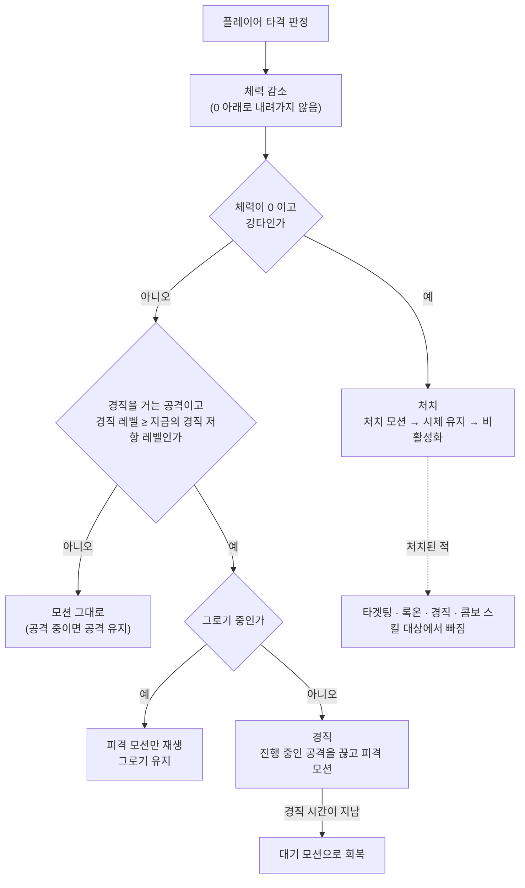
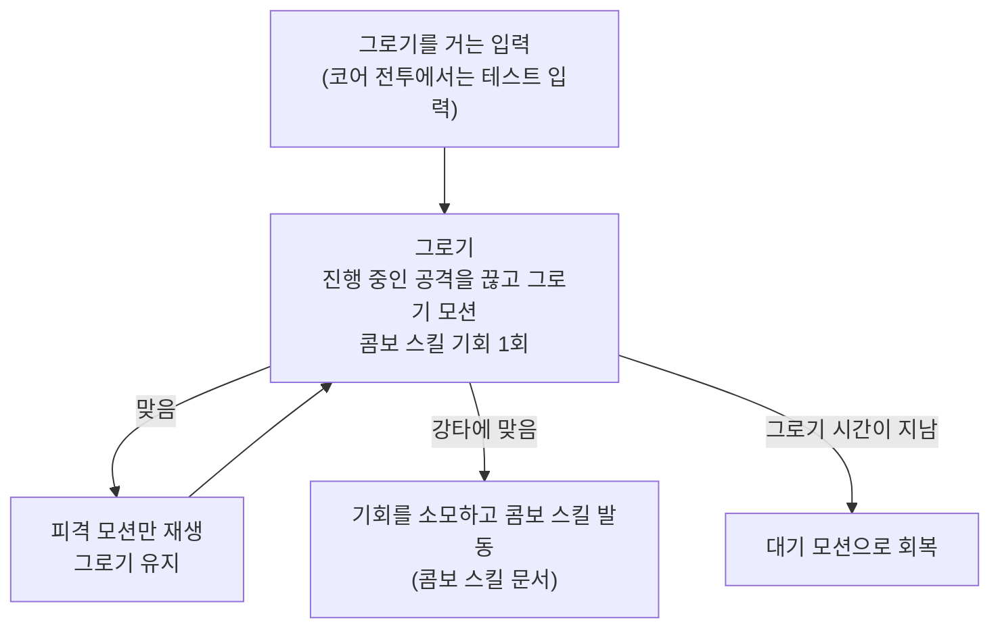

# 적 공통 규칙 (체력 · 경직 · 그로기 · 처치)

## 1. 개요

일반 적 · 엘리트 · 보스가 같은 규칙으로 맞고, 경직되고, 그로기가 되고, 처치되게 하는 공통 틀이다. 플레이어의 타격 판정 · 패링 · 순간 이동 · 타겟팅 · 필살기 · 콤보 스킬은 특정 적을 직접 알지 않고 이 공통 약속만 보고 동작한다. 체력이 0 이 되어도 적은 계속 싸우고, 강타에 맞아야만 처치되어 "체력을 깎고 강타로 마무리하는" 전투 흐름을 만든다.

## 2. 구성 요소

- IEnemyTargetable : 공격 · 록온 · 순간 이동 대상으로 고를 수 있는 적의 약속 (위치 · 생존 여부)
- IEnemyDamageable : 플레이어 공격에 맞아 체력이 줄어드는 적의 약속 (위력 · 강타 여부)
- IEnemyStaggerable : 경직되는 적의 약속 (경직 시간 · 경직 레벨)
- IEnemyGroggyable : 그로기가 되고 콤보 스킬을 받을 수 있는 적의 약속 (최대 연계 수 · 콤보 스킬 기회)
- IEnemyParryable : 패링 가능 시간을 여는 적의 약속 (위치 · 정면)
- EnemyHealth : 체력, 강타 처치, 처치 뒤 시체 유지와 비활성화
- EnemyReaction : 경직 · 그로기 상태와 시간, 경직 저항 레벨, 그로기마다 한 번의 콤보 스킬 기회, 최대 연계 수
- EnemyAnimation : 피격 · 그로기 · 처치 · 회복 모션 재생과 적 전용 시간에 맞춘 재생 속도
- EnemyTime : 적에게만 적용되는 시간 배율 (슬로모션 · 필살기 연출)
- ParryWindow : 지금 패링 가능 시간을 연 적 목록

## 3. 동작 원리

### 맞았을 때

- 체력이 0 이어도 처치되기 전까지는 살아 있는 적이다. 계속 공격하고, 대상으로 고를 수 있다.
- 체력을 0 으로 만든 타격이 강타였다면 그 자리에서 바로 처치된다.
- 경직은 경직을 거는 쪽의 경직 레벨이 적의 지금 경직 저항 레벨 이상일 때만 걸린다.
    - 지금의 경직 저항 레벨은 평소 저항 레벨과, 공격 중이면 그 공격의 저항 레벨 중 큰 값이다. 무거운 공격일수록 공격 도중 쉽게 끊기지 않게 만들 수 있다.
    - 경직이 걸리지 않으면 피격 모션도 재생하지 않아 공격 모션이 끊기지 않는다.
- 경직 중 다시 경직이 걸리면 경직 시간을 처음부터 센다.

### 그로기

- 그로기 중에는 어떤 경직으로도 그로기가 풀리지 않는다. 피격 모션(반응)과 경직 · 그로기(상태)를 나눠 다룬다.
- 그로기가 될 때마다 콤보 스킬 기회가 한 번 생긴다. 그로기 중 다시 그로기를 걸면 시간을 처음부터 세고 기회도 다시 생긴다.
- 적마다 콤보 스킬이 이어지는 최대 연계 수를 가진다. 일반 적 1, 엘리트 2 로 정했다.
- 그로기 기능이 없는 적은 그로기가 되지 않고, 콤보 스킬도 받을 수 없다.

### 적 전용 시간

- 경직 · 그로기 시간, 시체 유지 시간, 적의 이동 · 공격 · 쿨타임, 적 모션 재생 속도는 모두 적 전용 시간으로 흐른다.
- 완벽 회피 슬로모션이면 적만 느려지고, 필살기 연출 중에는 적이 멈춘다. 플레이어는 원래 속도로 움직인다.

### 모션

- 모든 적이 같은 Animator 상태 이름(대기 · 이동 · 백스텝 · 피격 · 그로기 · 처치와 공격 슬롯)을 쓰고, 적마다 Animator Override Controller 로 클립만 바꿔 끼운다.
- 경직되면 피격, 그로기가 되면 그로기, 회복하면 대기, 처치되면 처치 모션을 재생한다. 처치된 뒤에는 늦게 온 회복 알림이 와도 처치 모션을 유지한다.
- 피격이 끝난 뒤 그로기와 대기 중 어디로 돌아갈지는 Animator 의 그로기 여부 값과 전이선이 정한다.

### 처치 뒤

- 처치된 적은 시체로 남아 있다가 정해진 시간 뒤 비활성화된다.
- 파괴하지 않고 비활성화한다. 플레이어 기능이 적을 공통 약속(인터페이스)으로 들고 있어, 파괴하면 남은 참조로 접근할 때 오류가 나기 때문이다. 비활성화한 적은 이후 웨이브에서 다시 쓸 수도 있다.

## 4. 구현 과정

- 활용한 기능 :
    - C# 인터페이스 : 적이 할 수 있는 일(맞기 · 경직 · 그로기 · 패링 가능 시간 · 대상 되기)을 역할별로 나눈 약속으로 만들었다. 플레이어 기능은 이 약속만 보고, 적의 종류는 몰라도 된다.
    - Animator Override Controller : 공통 Animator 하나에 적마다 클립만 바꿔 끼운다.
    - Animator 상태 직접 재생 : 반응 모션은 전이선 대신 코드가 상태 이름으로 재생한다. 피격 뒤 복귀만 전이선과 그로기 여부 값으로 정한다.
- 구현 과정 :
    1. 플레이어 기능이 시험용 더미 적을 직접 알던 부분을 찾아, 역할별 약속 다섯 가지로 나눴다. 더미 적도 같은 약속을 따르게 해 기존 동작이 그대로인지 먼저 확인했다.
    2. 적 체력과 강타 처치를 만들고, 체력 0 이어도 공격을 계속하게 했다.
    3. 경직 · 그로기를 하나의 반응 기능으로 모으고, 그로기 중 경직은 모션만 나오게 했다.
    4. 경직 레벨과 경직 저항 레벨 비교를 추가했다. 적의 공격마다 저항 레벨을 두어 공격 중에만 저항이 올라가게 했다.
    5. 일반 적 에셋(Earth Golem)으로 프리팹을 만들고, 공통 Animator 와 Override Controller 로 피격 · 그로기 · 처치 모션을 연결했다.
    6. 콤보 스킬 연계 수를 적이 가지게 해, 같은 플레이어라도 적에 따라 연계 수가 달라지게 했다.
    7. 일반 적이 완성된 뒤 더미 적과 더미 전용 공격 설정을 삭제했다.
- 주요 결정과 이유 :
    - 체력이 0 이어도 강타로만 처치된다. 강타로 마무리하는 손맛을 전투의 목표로 두기 위해서다.
    - 약속을 하나로 묶지 않고 역할별로 나눴다. 맞기만 하는 적, 그로기가 없는 적처럼 일부 역할만 가진 적도 만들 수 있게 하기 위해서다.
    - 최대 연계 수는 플레이어가 아니라 적이 가진다. 적의 등급(일반 · 엘리트 · 보스)에 따라 연계 수가 달라지는 규칙이기 때문이다.

### 참고 레퍼런스

- 젠레스 존 제로 : 그로기 적에게 이어지는 연계 공격과, 적 등급에 따라 연계 수가 달라지는 규칙

## 5. 기존 방식과 비교

- 기존 방식 :
    - 플레이어 기능이 시험용 더미 적과 더미 적 공격 기능을 직접 찾아 썼다.
    - 더미 적은 체력이 없어 처치되지 않았고, 경직 · 그로기는 더미 적 공격 기능 안에 있었다.
    - 피격 · 그로기는 몸 색으로 표시했다.
    - 콤보 스킬 연계 수는 플레이어 쪽 설정 수였다.
- 달라진 점 :
    - 플레이어 기능은 적 공통 약속만 본다. 일반 적 · 엘리트 · 보스를 같은 방식으로 다룬다.
    - 체력과 강타 처치, 처치 모션이 생겼다.
    - 경직 레벨과 경직 저항 레벨을 비교해 경직 여부를 정한다.
    - 피격 · 그로기 · 처치는 모션으로 보여준다.
    - 최대 연계 수는 적이 정한다.
- 개선된 점 :
    - 새 적을 추가할 때 플레이어 코드를 고치지 않아도 된다.
    - 무거운 공격은 쉽게 끊기지 않고, 가벼운 공격은 끊을 수 있는 차이를 값으로 조정할 수 있다.

### 미정 · 미검증 항목

- 엘리트 · 보스 (보스는 별도 Issue, 엘리트는 시간이 나면 추가)
- 그로기 게이지 누적 (파티 전투 단계, 지금은 테스트 입력으로만 그로기)
- 적 체력 UI (UI 단계)
