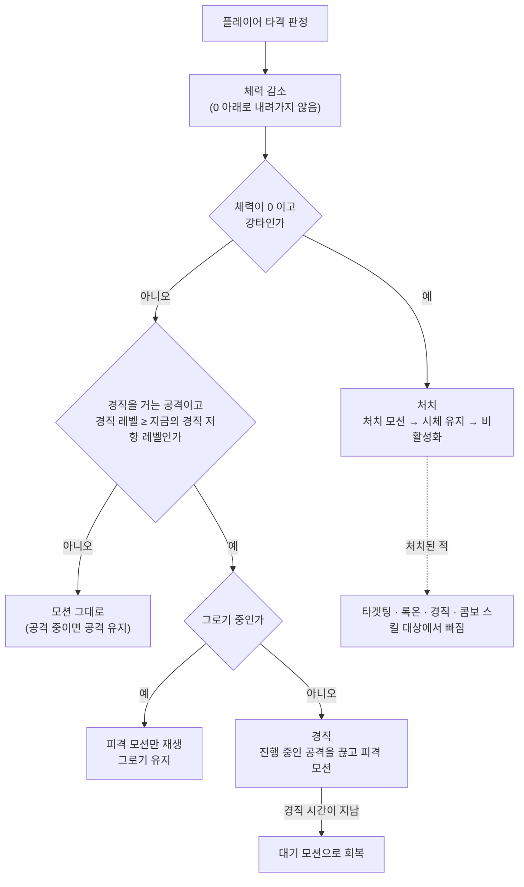
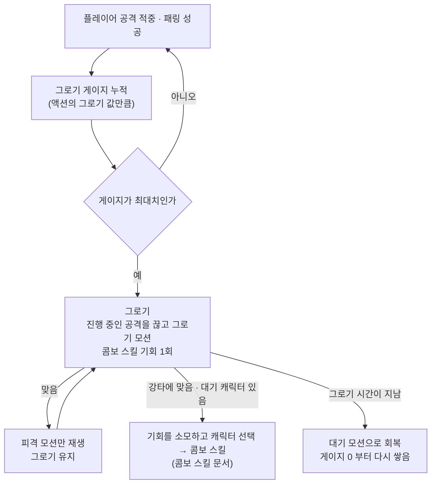

# 적 공통 규칙 (체력 · 경직 · 그로기 · 처치)

## 1. 개요

일반 적 · 엘리트 · 보스가 같은 규칙으로 맞고, 경직되고, 그로기가 되고, 처치되게 하는 공통 틀이다. 플레이어의 타격 판정 · 패링 · 순간 이동 · 타겟팅 · 필살기 · 콤보 스킬은 특정 적을 직접 알지 않고 이 공통 약속만 보고 동작한다. 체력이 0 이 되어도 적은 계속 싸우고, 강타에 맞아야만 처치되어 "체력을 깎고 강타로 마무리하는" 전투 흐름을 만든다.

## 2. 구성 요소

- IEnemyTargetable : 공격 · 록온 · 순간 이동 대상으로 고를 수 있는 적의 약속 (위치 · 생존 여부 · 몸 반지름 · 록온 표시 위치)
- IEnemyDamageable : 플레이어 공격에 맞아 체력이 줄어드는 적의 약속 (위력 · 강타 여부)
- IEnemyStaggerable : 경직되는 적의 약속 (경직 시간 · 경직 레벨)
- IEnemyGroggyable : 그로기가 되고 콤보 스킬을 받을 수 있는 적의 약속 (그로기 게이지 누적 · 그로기 중 여부 · 최대 연계 수 · 콤보 스킬 기회 · 그로기 시간 정지)
- IEnemyParryable : 패링 가능 시간을 여는 적의 약속 (위치 · 정면 · 예고 위치)
- EnemyHealth : 체력, 강타 처치, 처치 뒤 시체 유지와 비활성화, 대상 정보(몸 반지름 · 록온 표시 위치)
- EnemyReaction : 경직 · 그로기 상태와 시간, 경직 저항 레벨, 그로기 게이지, 그로기마다 한 번의 콤보 스킬 기회, 최대 연계 수
- EnemyAnimation : 피격 · 그로기 · 처치 · 회복 모션 재생과 적 전용 시간에 맞춘 재생 속도
- EnemyTime : 적에게만 적용되는 시간 배율 (슬로모션 · 필살기 연출)
- ParryWindow : 지금 패링 가능 시간을 연 적 목록. 열릴 때 · 닫힐 때 알린다

## 3. 동작 원리

### 맞았을 때

- 체력이 0 이어도 처치되기 전까지는 살아 있는 적이다. 계속 공격하고, 대상으로 고를 수 있다.
- 체력을 0 으로 만든 타격이 강타였다면 그 자리에서 바로 처치된다.
- 경직은 경직을 거는 쪽의 경직 레벨이 적의 지금 경직 저항 레벨 이상일 때만 걸린다.
    - 지금의 경직 저항 레벨은 평소 저항 레벨과, 공격 중이면 그 공격의 저항 레벨 중 큰 값이다. 무거운 공격일수록 공격 도중 쉽게 끊기지 않게 만들 수 있다.
    - 경직이 걸리지 않으면 피격 모션도 재생하지 않아 공격 모션이 끊기지 않는다.
    - 보스의 슈퍼아머는 평소 저항 레벨을 높여 표현한다. 일반 타격은 경직 레벨이 낮아 걸리지 않고, 패링 성공 · 필살기처럼 경직 레벨이 높은 공격에만 경직된다. 슈퍼아머를 위한 기능을 따로 두지 않고 기존 레벨 비교를 그대로 쓴다.
- 경직 중 다시 경직이 걸리면 경직 시간을 처음부터 센다.

### 그로기

- 그로기 게이지는 플레이어 공격이 적중할 때마다 그 액션의 그로기 값만큼, 패링에 성공하면 패링 액션의 그로기 값만큼 쌓인다. 첫 타격에만 반응하는 동작이어도 게이지는 모든 적중에서 쌓인다.
- 게이지 최대치는 적마다 정한다. 보스는 크게, 일반 적은 작게 두어 "보스를 빠르게 그로기로 만드는" 난이도를 적마다 조절한다.
- 게이지는 시간이 지나도 줄지 않는다. 그로기 중에는 더 쌓이지 않고, 그로기가 끝나면 0 부터 다시 쌓는다. 기획서 규칙을 그대로 따르고, 감소 규칙에 필요한 값을 늘리지 않기 위해서다.
- 게이지를 채운 타격이 강타라면 그 강타로 바로 캐릭터 선택이 열린다. (콤보 스킬 문서)
- 그로기 시간은 플레이어 쪽(콤보 스킬 선택)이 시키는 대로 멈춘다. 정해진 시간 동안 멈추는 정지 시간과, 켜 두는 동안 멈추는 일시 정지(캐릭터 선택 중) 두 가지다. 정지 시간을 새로 걸면 남은 정지 시간을 버리고 처음부터 센다. 멈춘 동안 남은 그로기 시간은 그대로이고, 다시 흐를 때 이어서 줄어든다.
- 그로기 게이지를 쌓을 때 "이번에 그로기가 되었는지" 를 돌려준다. 그로기를 쌓은 플레이어 쪽 기능이 이것을 보고 그로기 진입 순간의 정지 시간을 걸게 한다. 언제 멈출지는 파티 상황(대기 캐릭터가 있는지)에 따라 달라서, 적은 파티를 몰라도 되게 했다.
- 실행 중에는 적의 Inspector 에서 현재 체력 · 그로기 게이지를 볼 수 있다. 화면 표시는 UI 단계에서 만든다.
- 그로기 중에는 어떤 경직으로도 그로기가 풀리지 않는다. 피격 모션(반응)과 경직 · 그로기(상태)를 나눠 다룬다.
- 그로기가 될 때마다 콤보 스킬 기회가 한 번 생긴다.
- 적마다 콤보 스킬이 이어지는 최대 연계 수를 가진다. 일반 적 1, 엘리트 2, 보스 3 으로 정했다.
- 그로기 기능이 없는 적은 그로기가 되지 않고, 콤보 스킬도 받을 수 없다.

### 대상 정보

- 대상으로 고를 수 있는 적은 위치 · 생존 여부와 함께 몸 반지름과 록온 표시 위치를 알려준다. 플레이어의 순간 이동 · 공격 정지 거리 · 록온 표시가 이 값을 쓴다.
- 몸 반지름은 시작할 때 적의 콜라이더로 한 번 재 둔다. 공격할 때마다 재면 도약 · 연출 중 콜라이더가 꺼진 순간 반지름이 0 이 되어 몸 안으로 파고들기 때문이다. 재는 방법은 그대로라 멈추는 거리는 이전과 같다.
- 록온 표시 위치는 몬스터 Prefab 의 머리 · 가슴 등에 둔 빈 자식 오브젝트로 정한다. Scene 창에서 보며 정할 수 있고, 뼈 아래에 두면 모션을 따라 움직인다. 정하지 않은 적은 플레이어 쪽 기본 높이에 띄운다.
- 대상 정보는 체력 기능이 함께 알려준다. 대상 약속을 이미 체력 기능이 맡고 있어, 적 Prefab 에 기능을 더 붙이지 않아도 되기 때문이다.
- 패링 공격을 하는 적은 예고 위치도 알려준다. 패링 가능 시간이 열리고 닫힐 때 공통 목록이 알리고, 플레이어 쪽이 이 위치에 예고 표시를 띄운다. 적은 표시의 색(패링 가능 · 불가)을 몰라도 된다. (파티 문서)

### 공격 대상

- 적이 노리는 플레이어는 행동 그래프 Blackboard 의 공격 대상 값이다. 파티 전투에서는 파티가 시작할 때와 교체할 때 이 값을 조작 중인 캐릭터로 바꾼다. (적 행동 문서 · 파티 문서)
- 적 공격은 범위 안의 플레이어 캐릭터마다 한 번씩 판정한다. 필드에 캐릭터가 여럿이면 각자 따로 맞는다. (적 공격 문서)

### 적 전용 시간

- 경직 · 그로기 시간, 시체 유지 시간, 적의 이동 · 공격 · 쿨타임, 적 모션 재생 속도는 모두 적 전용 시간으로 흐른다.
- 완벽 회피 슬로모션이면 적만 느려지고, 필살기 연출 중에는 적이 멈춘다. 플레이어는 원래 속도로 움직인다.

### 모션

- 모든 적이 같은 Animator 상태 이름(대기 · 달리기 · 방향 이동 · 백스텝 · 피격 · 그로기 · 처치와 공격 슬롯)을 쓰고, 적마다 Animator Override Controller 로 클립만 바꿔 끼운다.
- 경직되면 피격, 그로기가 되면 그로기, 회복하면 대기, 처치되면 처치 모션을 재생한다. 처치된 뒤에는 늦게 온 회복 알림이 와도 처치 모션을 유지한다.
- 피격이 끝난 뒤 그로기와 대기 중 어디로 돌아갈지는 Animator 의 그로기 여부 값과 전이선이 정한다.

### 처치 뒤

- 처치된 적은 시체로 남아 있다가 정해진 시간 뒤 비활성화된다.
- 파괴하지 않고 비활성화한다. 플레이어 기능이 적을 공통 약속(인터페이스)으로 들고 있어, 파괴하면 남은 참조로 접근할 때 오류가 나기 때문이다. 비활성화한 적은 이후 웨이브에서 다시 쓸 수도 있다.

## 4. 구현 과정

- 활용한 기능 :
    - C# 인터페이스 : 적이 할 수 있는 일(맞기 · 경직 · 그로기 · 패링 가능 시간 · 대상 되기)을 역할별로 나눈 약속으로 만들었다. 플레이어 기능은 이 약속만 보고, 적의 종류는 몰라도 된다.
    - Animator Override Controller : 공통 Animator 하나에 적마다 클립만 바꿔 끼운다.
    - Animator 상태 직접 재생 : 반응 모션은 전이선 대신 코드가 상태 이름으로 재생한다. 피격 뒤 복귀만 전이선과 그로기 여부 값으로 정한다.
- 구현 과정 :
    1. 플레이어 기능이 시험용 더미 적을 직접 알던 부분을 찾아, 역할별 약속 다섯 가지로 나눴다. 더미 적도 같은 약속을 따르게 해 기존 동작이 그대로인지 먼저 확인했다.
    2. 적 체력과 강타 처치를 만들고, 체력 0 이어도 공격을 계속하게 했다.
    3. 경직 · 그로기를 하나의 반응 기능으로 모으고, 그로기 중 경직은 모션만 나오게 했다.
    4. 경직 레벨과 경직 저항 레벨 비교를 추가했다. 적의 공격마다 저항 레벨을 두어 공격 중에만 저항이 올라가게 했다.
    5. 일반 적 에셋(Earth Golem)으로 프리팹을 만들고, 공통 Animator 와 Override Controller 로 피격 · 그로기 · 처치 모션을 연결했다.
    6. 콤보 스킬 연계 수를 적이 가지게 해, 같은 플레이어라도 적에 따라 연계 수가 달라지게 했다.
    7. 일반 적이 완성된 뒤 더미 적과 더미 전용 공격 설정을 삭제했다.
    8. (#39) 테스트 입력으로만 걸던 그로기를 그로기 게이지로 바꾸고, 공격 적중 · 패링 성공으로 쌓이게 했다. 몸 반지름과 록온 표시 위치를 적이 알려주게 했다.
- 주요 결정과 이유 :
    - 체력이 0 이어도 강타로만 처치된다. 강타로 마무리하는 손맛을 전투의 목표로 두기 위해서다.
    - 약속을 하나로 묶지 않고 역할별로 나눴다. 맞기만 하는 적, 그로기가 없는 적처럼 일부 역할만 가진 적도 만들 수 있게 하기 위해서다.
    - 최대 연계 수는 플레이어가 아니라 적이 가진다. 적의 등급(일반 · 엘리트 · 보스)에 따라 연계 수가 달라지는 규칙이기 때문이다.

### 참고 레퍼런스

- 젠레스 존 제로 : 그로기 적에게 이어지는 연계 공격과, 적 등급에 따라 연계 수가 달라지는 규칙

## 5. 기존 방식과 비교

- 기존 방식 :
    - 플레이어 기능이 시험용 더미 적과 더미 적 공격 기능을 직접 찾아 썼다.
    - 더미 적은 체력이 없어 처치되지 않았고, 경직 · 그로기는 더미 적 공격 기능 안에 있었다.
    - 피격 · 그로기는 몸 색으로 표시했다.
    - 콤보 스킬 연계 수는 플레이어 쪽 설정 수였다.
- 달라진 점 :
    - 플레이어 기능은 적 공통 약속만 본다. 일반 적 · 엘리트 · 보스를 같은 방식으로 다룬다.
    - 체력과 강타 처치, 처치 모션이 생겼다.
    - 경직 레벨과 경직 저항 레벨을 비교해 경직 여부를 정한다.
    - 피격 · 그로기 · 처치는 모션으로 보여준다.
    - 최대 연계 수는 적이 정한다.
- 개선된 점 :
    - 새 적을 추가할 때 플레이어 코드를 고치지 않아도 된다.
    - 무거운 공격은 쉽게 끊기지 않고, 가벼운 공격은 끊을 수 있는 차이를 값으로 조정할 수 있다.
- 파티 전투 작업(#41)에서 달라진 점 :
    - 기존 : 적이 예고 표시를 직접 들고 켜고 껐다. 공격 대상은 씬에서 정한 플레이어 하나였고, 적 공격은 한 명만 맞혔다.
    - 변경 : 적은 예고 위치만 알려 주고 패링 가능 시간이 열리고 닫힐 때 공통 목록이 알린다. 공격 대상은 파티가 조작 캐릭터로 바꾸고, 공격은 캐릭터마다 한 번씩 판정한다.
- 콤보 스킬 이어받기 작업(#45)에서 달라진 점 :
    - 기존 : 그로기 시간은 멈추지 않고 줄기만 했다. 그로기 게이지를 쌓아도 그로기가 되었는지 알려주지 않았다.
    - 변경 : 플레이어 쪽이 정지 시간 · 일시 정지로 그로기 시간을 멈출 수 있고, 그로기 게이지를 쌓을 때 이번에 그로기가 되었는지 돌려준다.

### 미정 · 미검증 항목

- 엘리트 (시간이 나면 추가)
- 필살기로도 경직되지 않는 보스 패턴 (아이디어, 나중에 확인)
- 공통 Animator 에 슬롯이 늘어나면서, 쓰지 않는 슬롯도 모든 적에게 생김 (적 데이터 정리 때 검토)
- 그로기 시간 특수 스킬 증가 · 최대 시간 (스킬 입력 작업 때). 정지 규칙은 #45 에서 만들었다
- 그로기 남은 시간 Inspector 확인 칸 (지금은 그로기 게이지만 보임)
- 그로기 게이지 화면 표시 (UI 단계)
- 웨이브로 생기는 적의 공격 대상 등록 (지금은 교체할 때 씬의 적을 찾아 바꿈, 전투 흐름 단계에서 생성할 때 등록하는 방식으로 바꿈)
- 적 체력 UI (UI 단계)
