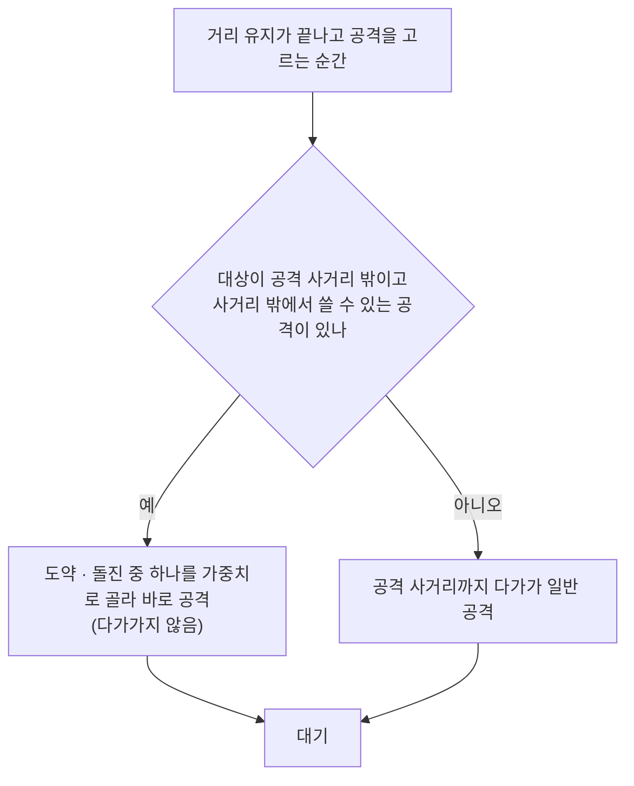
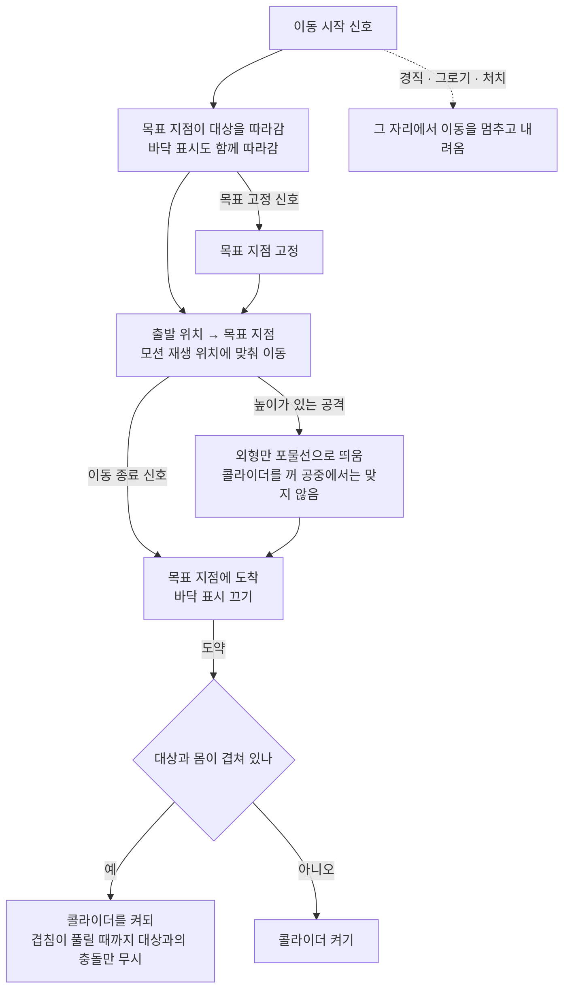

# 적 도약 · 돌진

## 1. 개요

멀리 떨어진 대상에게 뛰어올라 내려찍거나, 직선으로 달려와 대상을 지나쳐 가는 이동 공격이다. 보스의 추격 공격(도약 내려찍기)과 돌진 공격에 쓰고, 착지 · 도착 지점을 바닥 표시로 미리 보여줘 플레이어가 보고 피할 수 있게 한다. 도약 중에는 공중에 있어 맞지 않고, 내려오면 다시 맞는다.

## 2. 구성 요소

- EnemyLeap : 도약 · 돌진 이동, 목표 지점 추적과 고정, NavMesh 경계 보정, 외형 높이(포물선), 공중 무적, 착지 겹침 처리, 착지 표시
- RangedAttackAction : [행동 그래프 행동] 대상이 공격 사거리 밖일 때 사거리 밖에서 쓸 수 있는 공격을 바로 하는 노드. 쓸 수 없으면 바로 실패한다
- EnemyAttacker : 거리 조건으로 공격 선택, 도약 · 돌진 신호를 도약 기능으로 전달 (도약 관련 역할)
- EnemyAnimationEventType : 이동 시작 · 목표 고정 · 이동 종료 신호 (도약 관련 역할)

## 3. 동작 원리

### 언제 쓰나

- 공격마다 사용 최소 거리와 사거리 밖 사용 여부를 정한다.
    - 도약은 대상이 멀리 있을 때만 쓴다.
    - 돌진은 거리 제한 없이, 가까울 때는 일반 공격처럼, 멀 때는 사거리 밖 공격으로 쓴다.
- 보스는 일반 적과 같은 주기(추적 → 거리 유지 → 공격 → 대기)를 따르고, 공격을 고르는 순간에만 원거리 조건을 본다.

### 이동

- **목표 지점**
    - 대상 위치에서, 출발 위치에서 대상 쪽으로 정해진 거리만큼 더 지나친 곳이다. 도약은 대상 위치에, 돌진은 대상을 뚫고 지나간 곳에 도착한다.
    - 출발 위치에서 목표 지점까지 가는 길에 NavMesh 경계가 있으면 경계 지점으로 바꾼다. 벽 너머나 맵 밖을 노려도 갈 수 있는 곳 안에서 멈춘다.
    - 목표 고정 신호 전까지는 대상을 따라가고, 그 뒤에는 고정된다. 고정 뒤 움직이면 피할 수 있다.
- **이동 속도**
    - 이동 시작 신호부터 이동 종료 신호까지의 모션 구간 동안 이동한다. 진행도는 흐른 시간이 아니라 모션 재생 위치를 따른다.
    - 슬로모션이나 구간별 재생 속도 조절로 모션이 느려져도, 이동 종료 신호 순간에 정확히 목표 지점에 닿는다.
    - 빠르기는 두 신호 사이 구간의 길이와 그 구간의 재생 속도로 조절한다.
- **높이**
    - 높이가 있는 공격(도약)은 외형만 포물선으로 띄운다. 몸 전체는 NavMesh 위를 따라 움직인다.
    - 공중에 있는 동안 콜라이더를 꺼 공격 · 자동 조준 대상에서 빠진다.
- **판정**
    - 이동과 판정은 따로 정한다. 판정은 타격 신호가 정한다.
    - 도약은 착지 순간에 한 번 판정한다.
    - 돌진은 이동 시작부터 지속 판정으로 달려오는 동안 닿으면 맞는다.
- **착지 겹침**
    - 대상 위치에 내려찍으면 착지 순간 보스와 플레이어의 몸이 겹친다.
    - 겹친 채 충돌을 켜면 플레이어가 겹침을 풀며 바닥 아래로 밀려나므로, 겹침이 풀릴 때까지 둘 사이의 충돌만 무시한다.
    - 콜라이더 자체는 켜져 있어 완벽 회피 뒤 회피 반격 같은 공격은 그대로 맞는다. 겹침이 풀리면 다시 몸으로 막는다.

### 애니메이션 신호

| 신호 | 넣는 곳 | 하는 일 |
|---|---|---|
| 이동 시작 | 땅을 떠나거나 달리기 시작하는 프레임 | 출발 위치 기억, 목표 지점 추적 · 바닥 표시 시작, 도약이면 공중 무적 |
| 목표 고정 | 목표를 정할 프레임 (이동 종료보다 앞) | 목표 지점 고정. 없으면 이동 종료까지 따라감 |
| 이동 종료 | 착지 · 도착 프레임 | 목표 지점에 도착, 높이 · 콜라이더 · 바닥 표시 되돌림 |

- 세 신호는 한 모션 안에 있어야 한다. 이동 시작 신호를 받으면 같은 모션에서 이동 종료 신호의 시점을 읽어 이동 구간을 정한다.

## 4. 구현 과정

- 활용한 기능 :
    - Animation Event : 이동 시작 · 목표 고정 · 이동 종료 시점을 모션 프레임에 찍는다. 이동 시작 신호를 받을 때 같은 모션에 찍힌 다른 신호의 시간을 읽는다.
    - Animator 상태 재생 위치 : 이동 진행도를 모션 재생 위치로 계산한다.
    - `NavMesh.Raycast` : 출발 위치에서 목표 지점까지 NavMesh 경계에 막히면 막힌 지점을 목표로 삼는다.
    - NavMeshAgent 위치 맞춤 : 이동 중 위치를 NavMesh 위로 맞춘다.
    - `Physics.IgnoreCollision` · `Physics.ComputePenetration` : 착지 순간 겹친 대상과의 충돌만 잠시 무시하고, 겹침이 풀렸는지 매 프레임 확인한다.
    - Unity Behavior `Try In Order` : 공격 자리에서 원거리 공격 노드를 먼저 시도하고, 실패하면 다가가서 공격하는 노드로 넘어간다.
- 구현 과정 :
    1. 공격마다 사용 최소 거리를 두고, 공격을 고를 때 거리 조건을 보게 했다.
    2. 도약 이동을 만들었다. 이동 시작 신호부터 착지까지 목표 지점으로 옮기고, 목표 고정 전까지는 대상을 따라가게 했다. 착지 지점은 NavMesh 경계 안으로 보정했다.
    3. 처음에는 공격 노드가 다가가기 전에 원거리 공격을 시도하게 했지만, 추적과 거리 유지가 먼저 거리를 좁혀 도약이 나오지 않았다. 원거리 공격 노드를 따로 만들었다.
    4. 원거리 공격 노드를 그래프 맨 앞에 두었더니, 원거리 공격을 쓸 수 없을 때 흐름이 멈추고, 쓸 수 있을 때는 항상 먼저 나왔다. 기존 주기를 유지하고 공격 자리에서만 원거리 공격을 먼저 시도하도록 배치를 바꿨다.
    5. 도약과 돌진을 높이 · 지나치는 거리 값으로 구분해 하나의 이동 기능으로 묶었다. 높이는 외형만 띄우고, 공중에서는 콜라이더를 껐다.
    6. 이동 구간을 타격 신호로 끝냈더니 돌진이 순간이동처럼 보이고, 이동 중 몸 판정을 넣을 수 없었다. 이동 종료 신호를 따로 두어 이동과 판정을 나눴다.
    7. 도약에 맞은 플레이어가 땅 밑으로 꺼지는 문제가 있었다. 착지 순간 몸이 겹친 채 충돌이 켜져, 플레이어가 겹침을 풀며 아래로 밀려났기 때문이다. 겹친 동안에만 충돌을 무시하게 했다.
    8. (#74) 클립에서 착지 이벤트 시간을 찾는 부분을 플레이어 · 적 공격과 함께 쓰는 공용 이벤트 찾기로 바꿨다. 결과는 이전과 같다.
- 주요 결정과 이유 :
    - 이동 진행도를 모션 재생 위치로 정했다. 슬로모션 · 재생 속도 조절과 상관없이 모션의 착지 동작과 실제 도착 시점이 맞아야 하기 때문이다.
    - 높이는 코드로 만든다. 거리가 달라도 같은 높이로 뜨고, 모션은 동작만 보여주면 된다.
    - 착지 뒤 콜라이더를 끈 채 기다리지 않고 충돌만 무시했다. 완벽 회피 뒤 회피 반격은 착지한 보스에게 맞아야 하기 때문이다.
    - 보스도 일반 적과 같은 공격 주기를 따르고, 공격을 고르는 순간에만 원거리 조건을 본다. 원거리 공격이 주기를 건너뛰고 몰아치지 않게 하기 위해서다.
    - 몸 전체 판정은 지금 판정 방식(구 범위 지속 판정)으로 대신한다. 판정 방식 정리는 적 데이터 정리 때 함께 한다.

### 참고 레퍼런스

- 젠레스 존 제로 : 보스의 도약 내려찍기 · 돌진, 바닥 표시로 공격 위치를 미리 보여주고 피하게 하는 방식 (대부분의 액션 게임에서 쓰는 방식)

## 5. 기존 방식과 비교

- 필요하게 된 과정 : 기획서 보스 파트의 추격(거리가 멀어지면 날아오는 공격) · 돌진 후보를 구현했다. 지금까지 적 공격은 공격 사거리까지 다가간 뒤 제자리에서만 재생되어, 플레이어가 멀어지면 보스가 쫓아가기만 했다. 멀리 있는 플레이어에게도 압박을 주는 패턴이 있어야 보스전이 단조롭지 않아 만들었다.

### 미정 · 미검증 항목

- 돌진 경로 표시 (지금은 도착 지점만 표시, 이펙트 단계)
- 몸 전체 판정 (지금은 구 범위 지속 판정으로 대신, 적 데이터 정리 때)
- 돌진이 플레이어를 지나칠 때의 몸 겹침 (지금까지 문제 없음, 생기면 도약과 같은 방식 검토)
- 도약 · 돌진 기능 이름 정리 (적 패턴 정리 때)
- 바닥 표시 이펙트 (지금은 임시 오브젝트)
