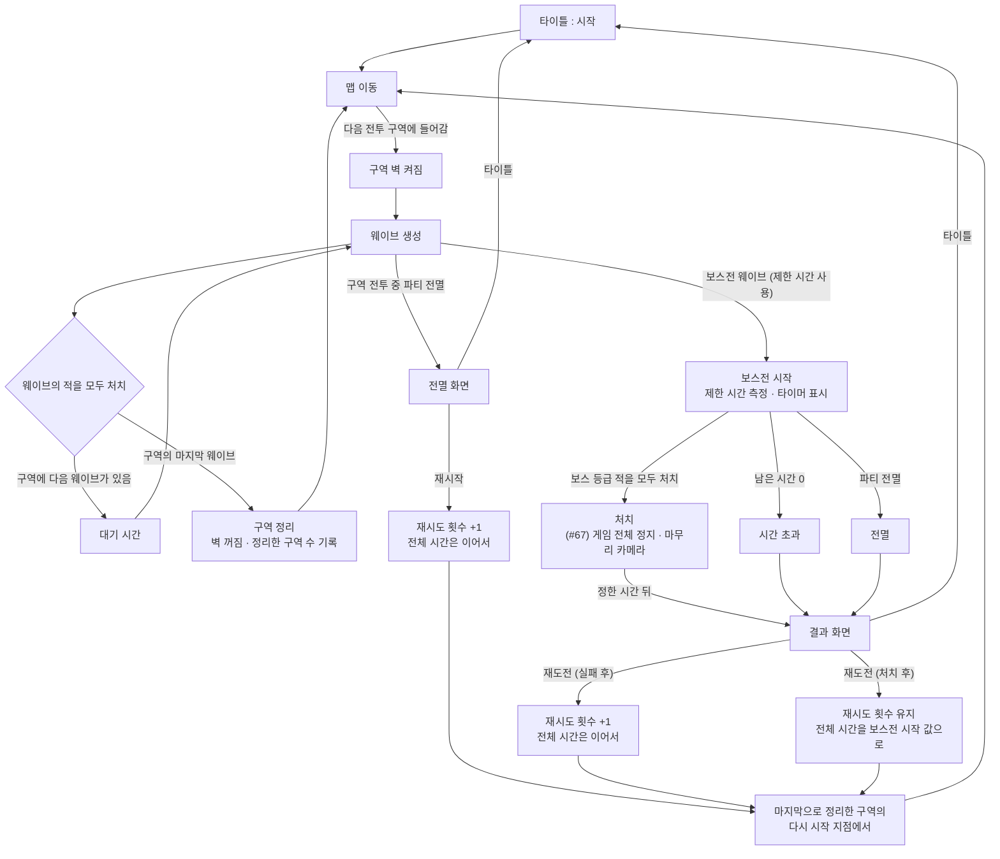
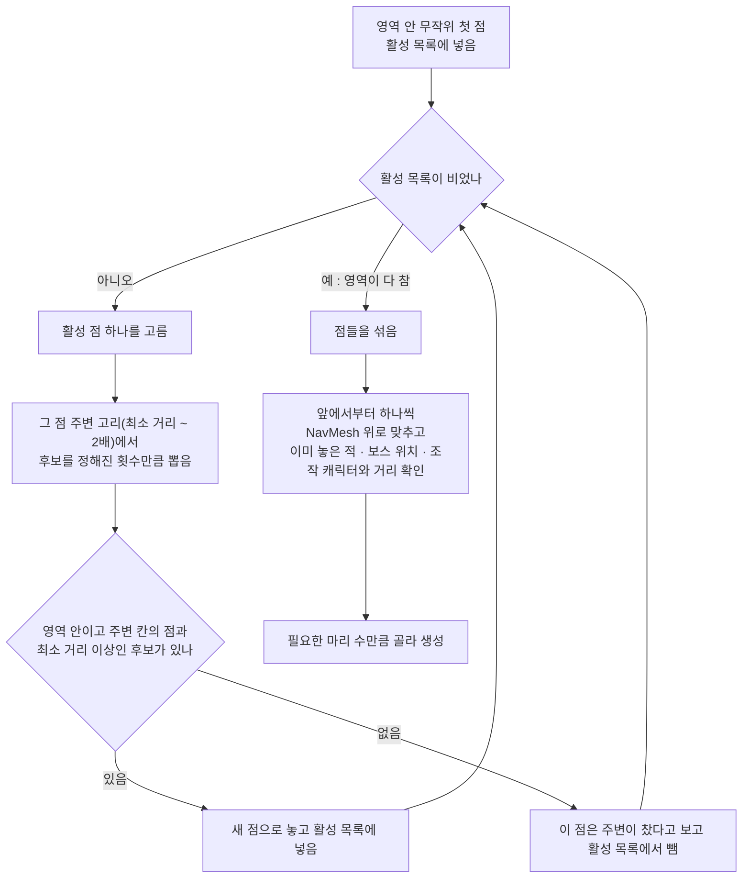
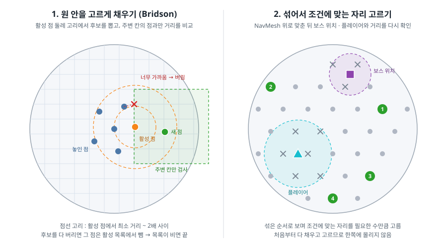
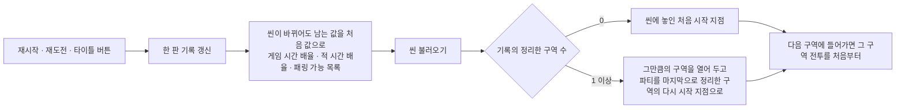
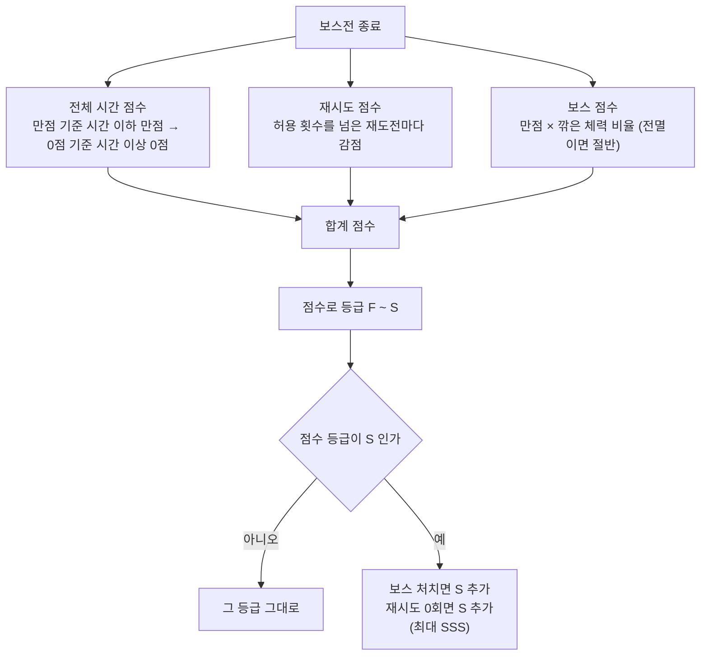

# 게임 흐름 (전투 구역 · 웨이브 · 보스전 · 결과)

## 1. 개요

시연 빌드에서 처음부터 끝까지 플레이할 수 있도록 만든 한 판의 흐름이다. (#75) 맵을 이동하다 전투 구역에 들어가면 구역이 막히고 웨이브가 진행되며, 웨이브를 모두 정리하면 구역이 열려 다음 장소로 이동한다. 이를 반복해 마지막 보스 구역에서 제한 시간 안에 보스를 처치하면 결과를 본다. 전멸하거나 보스전에 실패하면 마지막으로 정리한 구역 뒤에서 다시 도전할 수 있고, 그 기록(전체 시간 · 보스 시간 · 재시도 횟수 · 깎은 보스 체력)은 결과 화면의 점수에 쓰인다.

## 2. 구성 요소

- GameFlow : 전투 구역 순서 진행, 구역 안 웨이브 진행, 보스전 시작과 제한 시간, 끝나는 방식(처치 · 시간 초과 · 전멸) 판정, 다시 시작 지점 배치, 재시작 · 재도전 · 타이틀 이동
- BattleZone : (#75) 전투 구역 하나. 트리거 영역으로 캐릭터의 진입을 알리고, 전투 동안 막는 벽을 켜고 끈다. 구역의 웨이브 구성 · 생성 영역 · 보스 생성 위치 · 다시 시작 지점을 가진다
- WaveData : [ScriptableObject] 구역 하나의 웨이브 목록. 웨이브마다 생성할 적 종류(Prefab)와 마리 수, 보스전 여부(제한 시간 사용)와 제한 시간. 웨이브 사이 대기 시간과 생성 간격
- WaveSpawner : 웨이브 하나의 적 생성. 생성 영역 · 보스 생성 위치는 구역에서 받는다. 보스 등급 적은 보스 생성 위치와 화면 보스 바, 그 밖의 적은 생성 영역 안 무작위 위치. 처치를 세어 웨이브 정리 · 보스 정리를 알린다
- PoissonDiskSampler : Bridson 푸아송 디스크 샘플링. 원 안을 어떤 두 점도 최소 거리보다 가깝지 않게 고르게 채운다
- RunRecord : 한 판의 기록. 정리한 구역 수(다시 불러온 씬이 시작할 곳)와 전체 시간 · 보스전 시작 시점의 전체 시간 · 재시도 횟수 · 보스 시간 · 깎은 보스 체력 비율. 씬을 다시 불러와도 남고 게임을 끄면 사라진다
- BossTimerView : 보스전 남은 시간 표시 (전투 HUD 문서)
- FlowResultView : 구역 전투 중 전멸 화면과 보스전 결과 화면(점수 · 등급), 결과 화면에서 타이틀로 갈 때 최고 기록 저장 (전투 HUD 문서)
- ScoreSettings : [ScriptableObject] 점수 계산 값. 항목별 만점 · 시간 기준 · 재시도 허용 횟수와 감점 · 전멸 배율 · 등급 구간
- ScoreCalculator : 한 판 기록으로 항목별 점수 · 합계 · 등급을 계산한다
- BestRecord · BestRecordStore : 최고 기록 하나와 그 JSON 파일 불러오기 · 저장
- BestRecordView : 타이틀의 최고 기록 표시 (전투 HUD 문서)

## 3. 동작 원리

### 한 판의 흐름

### 전투 구역 (#75)

- 구역은 게임 흐름의 구역 목록 순서대로 진행한다. 마지막 구역이 보스 구역이다. 구역 밖에서는 전투가 없다.
- 구역마다 바닥을 덮는 트리거 영역이 있다. **조작 중인 캐릭터**가 **진행할 순서의 구역**에 들어오는 순간 전투가 시작된다. 이미 정리한 구역이나 순서를 건너뛴 구역에 들어가는 것은 무시한다.
- 전투가 시작되면 구역의 벽을 켜 막고, 구역의 웨이브를 처음부터 진행한다. 마지막 웨이브까지 정리하면 벽을 끄고 정리한 구역 수를 기록한다.
- 벽은 따로 만든 오브젝트를 켜고 끈다. 씬에 저장된 상태와 상관없이 꺼진 채로 시작한다.
    - 맵 경계 벽은 ProBuilder 로 영역 테두리를 따라 만들고, 위 · 아래 면을 지워 옆면만 남긴다.
    - 막힌 것이 보이도록 "WARNING" · "AREA DENIED" 문구 띠가 옆으로 흐르는 Material 을 입힌다. 텍스처 오프셋을 시간에 따라 미는 Shader Graph 다. 전투 동안만 보이게 하려면 그 벽을 구역의 벽 목록에 넣는다.
- 구역을 정리한 뒤 전멸 · 재도전하면 파티가 설 **다시 시작 지점**을 구역마다 둔다. 다음 구역 트리거 바깥에 둬야 한다. 안에 두면 다시 시작하자마자 전투가 시작된다.
- 시작 · 정리 알림 문구와 다음 구역 위치 안내는 두지 않는다. 벽이 켜지고 꺼지는 것과 웨이브 마지막 일격 연출로 알린다. (사용자 결정, 안내 표시는 나중에 검토)

### 웨이브

- 웨이브는 구역의 웨이브 목록 순서대로 진행한다. 한 웨이브의 적을 모두 처치하면 대기 시간 뒤 다음 웨이브가 나온다. 웨이브 구성은 구역마다 따로 둔다.
- 웨이브마다 `적 종류 + 마리 수` 묶음을 여러 개 넣는다. 적 종류는 적 데이터가 아닌 적 Prefab 으로 고른다. Prefab 이 적 데이터를 들고 있어, 데이터만으로는 무엇을 생성할지 알 수 없기 때문이다.
- 보스도 웨이브에 일반 적처럼 넣는다. 생성할 때 적 데이터의 등급이 보스면 보스 생성 위치에 놓고 화면 HUD 에 보스 바를 띄운다. 등급은 적 데이터에 이미 있는 값이라 따로 표시할 칸을 두지 않았다.
- 생성한 적은 조작 중인 캐릭터를 바라보게 놓고, 파티에 등록해 공격 대상을 받는다. (파티 문서)
- (#67) 웨이브가 정리되면(보스까지 모두 처치) 마지막 일격 기능이 게임 전체를 잠깐 느리게 하고 줌이 들어간다. 보스도 웨이브 적 수에 들어 있어, 보스가 살아 있는 동안 일반 적을 다 잡아도 걸리지 않는다. (전투 연출 문서)

### 생성 위치 (푸아송 디스크)

일반 · 엘리트 적은 구역의 생성 영역(수평 원) 안에 서로 겹치지 않게 놓는다.

- **격자** : 칸 크기를 최소 거리 / √2 로 두면 한 칸에 점이 하나만 들어간다. 그래서 새 후보가 다른 점과 가까운지는 주변 칸만 보면 된다. 이미 놓은 모든 점과 비교하는 기본 방식은 점이 늘수록 검사가 늘지만, 이 방식은 점 하나에 드는 검사가 일정하다.
- **활성 목록** : 주변에 새 점을 놓을 여지가 있을지 모르는 점들이다. 활성 점 주변에서 후보를 뽑다가 모두 실패하면 그 점을 뺀다. 목록이 비면 영역이 더 놓을 자리 없이 고르게 찬 것이다.
- **다 채운 뒤 고르기** : Bridson 방식은 첫 점에서 번지며 채운다. 필요한 마리 수만큼 놓고 멈추면 첫 점 근처에 몰리므로, 영역을 다 채운 뒤 섞어서 고른다.
- **NavMesh 위로 맞추기** : 적은 NavMesh 로 경로를 찾으므로 뽑은 자리를 NavMesh 위로 맞춘다. 맞추면 위치가 조금 움직이므로, 거리 확인은 맞춘 위치로 다시 한다.
- **피할 곳** : 이미 놓은 적, 같은 웨이브의 보스 생성 위치, 조작 중인 캐릭터와 거리를 둔다. 보스 바로 옆이나 플레이어 코앞에 적이 나오지 않게 하기 위해서다.
- 자리가 모자라면 놓을 수 있는 만큼만 생성하고 경고를 남긴다. 생성 영역이나 간격을 조정해야 한다는 뜻이다.

### 보스전

- 제한 시간 사용을 켠 웨이브가 보스전이다. 보스 구역의 마지막 웨이브 하나에만 켠다. 그 웨이브가 나오는 순간 제한 시간을 재기 시작하고, 이 순간의 전체 시간을 기록해 둔다.
- 보스전 웨이브의 보스 등급 적을 모두 처치하면 처치로 끝난다. 남은 일반 적은 상관없다. 보스를 잡으면 끝나는 기획에 맞춘 사용자 결정이다.
- 제한 시간을 쓰지 않는 웨이브의 보스(중간 보스)는 보스 바만 나오고 타이머는 없다. 일반 적처럼 웨이브 정리에만 센다.
- 끝날 때 보스 시간(이번 시도에 걸린 시간)과 깎은 보스 체력 비율을 기록한다. 시간 초과면 보스 시간은 제한 시간 그대로다.
- (#67) 처치로 끝나면 기록과 입력 잠금은 처치 순간에 하고, 마지막 일격 기능이 게임 전체를 멈춘 채 마무리 카메라로 처치된 보스를 비춘다. 정한 시간이 지나면 처치 결과를 알려 결과 화면이 뜬다. 보스 시간은 처치 순간 기준이라 정지 시간이 더해지지 않는다. (젠레스 존 제로 레퍼런스, 사용자 결정)
- (#67) 보스 처치와 웨이브 정리가 함께 오면 보스 처치가 먼저 와 판이 끝나므로, 웨이브 슬로우는 걸리지 않는다.
- (#67) 판 실패(전멸 · 시간 초과) 순간을 알려 카메라가 조금 줌 인한 채 유지한다. 시간 초과는 캐릭터를 쓰러뜨리지 않고, 전멸은 마지막 캐릭터가 쓰러진 채 남는다. (파티 문서)

| 끝나는 방식 | 조건 | 결과 화면 버튼 |
|---|---|---|
| 처치 | 제한 시간 안에 보스 등급 적을 모두 처치 | 재도전 · 타이틀 |
| 시간 초과 | 남은 시간이 0 | 재도전 · 타이틀 |
| 전멸 | 보스전 중 파티가 모두 쓰러짐 | 재도전 · 타이틀 |

### 다시 하기와 기록

- 재시작 · 재도전은 씬을 다시 불러와 처리한다. 파티 체력 · 게이지, 보스 체력, 화면 효과가 모두 처음 값으로 돌아오므로, 기능마다 되돌리는 처리를 따로 만들지 않는다.
- 이어 갈 값은 한 판 기록에 둔다. 씬을 다시 불러와도 남고, 파일에 쓰지 않아 게임을 끄면 사라진다. 다시 시작 지점을 저장하지 않는다는 기획 규칙과 맞다.
- (#75) 시작 지점은 "정리한 구역 수" 하나로 정한다. 보스전 재도전은 보스 구역 바로 앞 구역의 다시 시작 지점에서 시작하므로, 따로 두던 보스전 앞 스폰 포인트를 없앴다.
- 기록 규칙

| 행동 | 시작 지점 | 재시도 횟수 | 전체 시간 |
|---|---|---|---|
| (#75) 구역 전투 중 전멸 → 재시작 | 마지막으로 정리한 구역 뒤 (없으면 처음) | +1 | 이어서 |
| 보스전 실패 → 재도전 | 보스 구역 앞 | +1 | 이어서 |
| 보스 처치 → 재도전 | 보스 구역 앞 | 그대로 | 보스전 시작 값으로 되돌림 |
| Esc 메뉴 → 처음부터 재시작 | 처음 | 0 | 0 부터 |
| 결과 화면 → 타이틀 | 처음 | 0 | 0 부터 |

- (#75) 구역 전투 전멸은 보스전 실패와 같은 규칙으로 센다. 어디서 실패했든 "실패하고 다시 한 횟수"가 점수에 반영되도록 규칙을 하나로 맞춘 사용자 결정이다.

- 처치 후 재도전은 더 빠른 처치에 다시 도전하는 용도다. 재시도 횟수를 올리고 시간을 이어서 세면 다시 잡아도 점수가 항상 떨어지므로, 이전 처치와 같은 조건에서 겨루게 했다.
- 히트스톱 · 콤보 선택 · 슬로모션 중에 버튼을 누를 수 있으므로, 씬을 바꾸기 전에 시간 배율과 패링 가능 목록을 처음 값으로 돌린다.

### 점수 · 등급 (#59)

- 점수는 세 항목을 더한다. 기준 시간 · 만점 · 감점 · 등급 구간은 점수 설정 에셋에서 고치고, 플레이해 본 뒤 정한다.
    - 전체 시간 : 빠를수록 높다. 만점 기준 시간 이하면 만점, 0점 기준 시간 이상이면 0점이고, 그 사이는 일정하게 줄어든다.
    - 재시도 : 허용 횟수까지는 감점이 없고, 넘은 재도전마다 감점한다. 0점 아래로 내려가지 않는다.
    - 보스 : 만점 × 깎은 보스 체력 비율이다. 처치하면 비율이 1 이라 만점이고, 시간 초과는 깎은 만큼, 전멸로 실패하면 그 절반이다.
- 등급은 합계 점수로 F ~ S 중 하나를 정한다. 점수로 S 를 받았을 때만 추가 조건마다 S 를 하나씩 더 붙인다.

| 점수 등급 | 보스 처치 | 재시도 0회 | 최종 등급 |
|---|---|---|---|
| S | ○ | ○ | SSS |
| S | ○ | ✕ | SS |
| S | ✕ | ○ | SS |
| S | ✕ | ✕ | S |
| A 이하 | 상관없음 | 상관없음 | 점수 등급 그대로 |

- 점수가 S 에 못 미치면 처치 · 재시도 조건을 통과해도 SS · SSS 가 붙지 않는다. 높은 등급은 점수와 완벽한 플레이를 모두 해야 받게 하기 위한 사용자 결정이다.
- 계산은 기록 값만 쓰므로 같은 기록이면 항상 같은 점수 · 등급이 나온다.
- 기록 시간은 분 : 초 . 1/100초 로 보여준다. 기록끼리 비교하므로 1/100초까지 보이게 했다.

### 최고 기록 (#59)

- 최고 기록 하나를 설정과 따로 JSON 파일에 저장한다. 점수 · 등급 · 전체 시간 · 보스 시간 · 재시도 횟수와 보스 실패 여부(전멸이면 보스 시간을 실패로 보여주기 위해)를 둔다.
- 보스전 결과 화면에서 타이틀로 갈 때만 저장을 시도하고, 기존 최고 점수보다 높을 때만 바꾼다. 재도전하면 그 결과는 저장하지 않는다. Esc 메뉴 · 구역 전투 전멸 화면의 타이틀 이동도 저장하지 않는다.
- 타이틀은 최고 기록 다섯 항목을 보여주고, 기록이 없으면 표시 자체를 숨긴다.
- 파일이 없으면 기록 없음이고, 읽을 수 없으면 경고를 남기고 기록 없음으로 둔다.

### 시간

- 대기 시간 · 제한 시간 · 전체 시간은 게임 시간으로 잰다. Esc 일시정지 중에는 함께 멈추고, 히트스톱 · 콤보 선택 슬로모션 동안에는 느리게 흐른다.
- 결과 화면이 뜨면 전체 시간과 제한 시간을 멈춘다.

### 결과 화면이 떠 있는 동안

- 플레이어 입력을 잠그고 커서를 풀어 버튼을 누르게 한다. 이후 오는 처치 · 시간 초과 · 전멸 알림은 무시한다.
- (#67) 판이 끝나는 순간 판 종료를 알린다. 파티는 이후 적 공격을 무시하고, 일시정지 기능은 카메라 입력 컨트롤러를 꺼 마우스로 카메라를 돌릴 수 없게 한다. (파티 · 공용 UI 문서)
- 시간 초과 · 전멸은 전투가 멈추지 않아 남은 적이 계속 움직인다. 플레이어는 적 공격에 맞지 않는다. Esc 일시정지(#58)도 결과 화면이 뜬 뒤에는 막아 두었다. (공용 UI 문서)
- (#67) 보스 처치는 결과 화면이 뜬 뒤에도 게임 전체가 멈춘 채로 있고, 남은 적도 그대로 멈춰 있다. 결과 화면의 버튼(재도전 · 타이틀)은 씬을 바꾸기 전에 게임 시간을 되돌린다. 결과 화면에는 시간에 따라 움직이는 연출이 없어 멈춘 상태에서도 그대로 보이고 눌린다.

## 4. 구현 과정

- 활용한 기능 :
    - ScriptableObject : 웨이브 구성을 에셋으로 둔다. 플레이 중 바꾼 값이 플레이를 끝내도 남아 웨이브 구성을 여러 번 고치며 맞추기 좋다. 적 데이터 · 적 공격 데이터와 데이터를 다루는 방식이 같아진다.
    - NavMesh `SamplePosition` : 뽑은 생성 위치를 NavMesh 위로 맞춘다.
    - `SceneManager` 씬 불러오기 : 재시작 · 재도전 · 타이틀 이동
    - 정적 클래스 : 씬을 다시 불러와도 남는 한 판 기록
    - Unity Behavior Blackboard 변수 : 생성한 적에게 공격 대상을 준다. (파티 문서)
    - Scene 뷰 Handles : 전투 구역을 선택하면 생성 영역을 원으로 그려 크기를 맞추기 쉽게 했다.
    - (#75) 트리거 Collider (`OnTriggerEnter`) : 전투 구역 진입 감지. 캐릭터의 `CharacterController` 가 트리거에 들어오면 알린다.
    - (#75) ProBuilder · Shader Graph : 구역 경계 벽과 흐르는 경고 문구 띠
- 구현 과정 :
    1. 플레이어 쓰러짐 · 전투 불능 규칙을 먼저 만들었다. 전멸이 있어야 실패를 만들 수 있기 때문이다. (파티 · 피격 문서)
    2. 웨이브 에셋, 푸아송 디스크 생성, 웨이브 진행을 만들었다. 생성한 적을 파티에 등록해 공격 대상을 받게 했다.
    3. 처음에는 마지막 웨이브 뒤에 보스를 따로 생성하고 항상 제한 시간을 걸었다. 중간 보스를 넣으면 타이머가 나오면 안 된다는 의견에 따라, 보스를 웨이브에 넣고 등급으로 구분하며 웨이브마다 제한 시간 사용을 고르게 바꿨다.
    4. 한 판 기록, 전멸 화면 · 보스전 임시 결과 화면, 씬 다시 불러오기로 재시작 · 재도전을 만들었다. 결과 화면 중 입력을 잠갔다.
    5. 보스를 처치해도 재도전할 수 있어야 한다는 의견에 따라, 처치 후 재도전 규칙(재시도 유지 · 시간 되돌림)을 결과 화면 작업에서 앞당겨 넣었다.
    6. 씬을 바꾸거나 에디터를 정지할 때 적 이동 · 행동에서 오류가 나는 문제를 함께 고쳤다. (적 공통 규칙 문서)
    7. (#59) 점수 설정 에셋 · 점수 계산 · 최고 기록 저장을 만들고, 임시 결과 화면을 점수 결과 화면으로 바꿨다. 처음에는 등급을 F ~ SSS 8단계 점수 구간으로 계획했으나, 사용자 요청으로 점수는 F ~ S 까지만 정하고 SS · SSS 는 처치 · 재시도 0회 조건으로 붙게 바꿨다. 재시도 감점에 허용 횟수를 더했다.
    8. (#75) 한 공간 웨이브를 전투 구역 진행으로 바꿨다. 웨이브 구성 · 생성 영역 · 보스 위치를 구역으로 옮기고, 시작 지점을 정리한 구역 수로 바꿔 보스전 앞 스폰 포인트를 구역의 다시 시작 지점으로 합쳤다. 사용자 결정 : 전멸하면 직전 구역 뒤에서 다시, 보이는 벽으로 막기, 시작 · 정리 알림 없음, 구역 재시작도 재시도로 셈, 이동 안내 없음.
    9. (#75) 첫 빌드 전에 맵을 Prefab 3개로 나누고, 구역마다 쓸데없는 콜라이더를 지우거나 Mesh Collider 를 Box 로 단순화했다. (사용자 작업)
- 주요 결정과 이유 :
    - 생성 위치는 Bridson 방식으로 영역을 다 채운 뒤 고른다. 한 웨이브의 적 수가 적어 기본 방식과 속도 차이는 거의 없지만, 알고리즘 자체로 더 빠르고 고르게 퍼진다.
    - 재시작 · 재도전은 씬 다시 불러오기로 한다. 되돌릴 기능이 많아 하나씩 되돌리면 빠뜨리기 쉽기 때문이다.
    - 타이틀은 이동만 한다. 이어 하면 기록이 쌓이고, 그만두면 타이틀로 가는 규칙 하나로 맞췄다. 기록을 지우고 싶으면 타이틀에서 새로 시작한다.
    - (#75) 구역 전투 중 전멸도 보스전 실패처럼 재시도로 세고, 전체 시간은 이어서 센다. (#57 에서는 웨이브 중 전멸을 재시도로 세지 않고 처음부터 다시 했다)

### 참고 레퍼런스

- 인터넷 자료(영상) : 몬스터 생성 위치를 푸아송 디스크 샘플링으로 정해 서로 겹치지 않게 고르게 퍼뜨리는 방식을 참고했다.

## 5. 기존 방식과 비교

- 필요하게 된 과정 :
    - 코어 전투와 파티 전투를 시험용 씬에서 적을 직접 놓고 확인해 왔다. 시연 빌드에는 타이틀에서 시작해 웨이브 → 보스전 → 결과까지 끝까지 플레이하는 흐름이 필요했다. (기획서 게임 흐름)
    - 기획서에서는 보스전 제한 시간이 없었고 재시작은 처음부터 · 보스전 직전부터 중 고르는 방식이었다. 11.18 에 보스전 제한 시간, 보스전 앞 스폰 포인트 부활, 결과 기록(점수 Issue #59)을 더하기로 정했다.
- 생성 위치 방식 비교

| 방식 | 겹침 검사 | 분포 | 끝나는 조건 |
|---|---|---|---|
| 기본 (뽑고 가까우면 버림) | 이미 놓은 모든 점과 비교 | 빈자리가 남거나 한쪽에 몰릴 수 있음 | 최대 시도 횟수로 끊어야 함 |
| Bridson (사용) | 주변 칸의 점만 비교 | 영역 전체를 고르게 채움 | 더 놓을 자리가 없으면 저절로 끝남 |

- 카메라 워크 · 타격감 작업(#67)에서 달라진 점 :
    - 기존 : 보스를 처치하면 바로 결과 화면이 떴고, 남은 적은 계속 움직였다. 판이 끝나도 적 공격에 맞고 마우스로 카메라를 돌릴 수 있었다. 웨이브를 정리해도 연출이 없었다.
    - 변경 : 웨이브 정리는 잠깐 슬로우, 보스 처치는 정지 · 마무리 카메라 뒤 결과 화면이고 결과 화면 동안 멈춘 채 둔다. 판이 끝나면 적 공격 · 카메라 입력을 막고, 실패는 줌 인을 유지한다.
    - 개선된 점 : 판의 끝이 분명하게 보이고, 결과 화면 뒤에서 적에게 맞는 일이 없다.
- 구역 진행 게임 흐름(#75)에서 달라진 점 :
    - 기존 : 한 공간에서 웨이브 목록을 차례로 진행했다. 웨이브 중 전멸은 처음부터 다시 했고, 보스전 재도전은 따로 둔 보스전 앞 스폰 포인트에서 시작했다.
    - 변경 : 맵을 이동하며 전투 구역마다 막고 웨이브를 진행한다. 전멸 · 재도전은 마지막으로 정리한 구역의 다시 시작 지점에서 시작하고, 어디서 실패하든 재시도로 센다.
    - 개선된 점 : 맵을 이동하며 진행하는 느낌이 생기고, 구역이 늘어도 실패할 때마다 처음부터 다시 하지 않는다.

### 미정 · 미검증 항목

- 다음 구역 위치 안내 표시 (나중에 검토, 사용자 결정)
- 구역이 갈래로 나뉘는 맵 (지금은 한 줄 순서만 지원)

- 시간 초과 · 전멸 결과 화면 중 남은 적은 계속 움직인다 (플레이어는 맞지 않음)
- 보스 마무리 카메라를 Timeline 컷으로 바꾸기 (필살기 Timeline 작업 때)
- 점수 · 등급 · 최고 기록의 실제 동작 (구현만 하고 확인은 게임 완성 · 밸런스 작업 뒤로 미룸)
- 점수 설정 초기값(기준 시간 · 만점 · 감점 · 허용 횟수 · 등급 구간) (플레이해 본 뒤 결정)
- SSS 추가 조건의 "재시도 0회" 를 허용 횟수 이내로 바꿀지 (지금은 0회 기준)
- 전체 시간 점수 기준 (플레이해 본 뒤 결정)
- 한 웨이브에 보스가 여러 마리면 같은 위치에 겹친다. 지금은 한 마리로 가정한다
