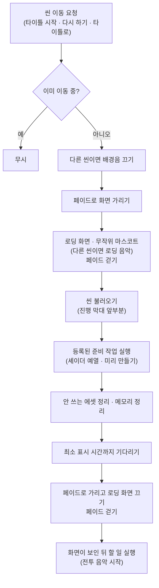
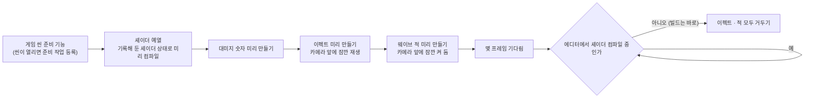

# 씬 이동 · 전투 준비 (페이드 · 로딩 화면 · 셰이더 예열 · 미리 만들기)

## 1. 개요

씬을 옮길 때 화면을 페이드로 가리고, 로딩 화면이 떠 있는 동안 전투에 쓸 셰이더 · 이펙트 · 대미지 숫자를 미리 준비한다. 첫 타격에서 셰이더 컴파일과 이펙트 생성 때문에 끊기는 현상을 없애는 것이 목적이다. 로딩 화면에는 세 캐릭터를 동물 마스코트로 그린 달리기 그림 중 하나를 무작위로 보여준다. 기다리는 시간을 덜 지루하게 하면서 캐릭터를 귀여운 모습으로 한 번 더 보여주기 위해서다. 전투 음악과 입력은 화면이 완전히 보인 뒤에 시작한다.

## 2. 구성 요소

- SceneLoader : 씬 이동. 페이드 · 로딩 화면 · 진행 막대 · 최소 표시 시간을 맡고, 다른 기능이 로딩 중 할 준비 작업과 화면이 보인 뒤 할 일을 등록받는다 (공용 UI)
- ScenePreparer : 게임 씬의 전투 준비. 셰이더 예열, 대미지 숫자 · 이펙트 · 웨이브 적 미리 만들기, 에디터 셰이더 컴파일 대기를 준비 작업으로 등록한다
- GraphicsStateTracer : 개발 중 셰이더 상태 기록. 기록할 때만 켜 두고, 플레이를 마치면 기록 파일로 저장한다
- BattleEffectPool : 이펙트 풀. 미리 만들 이펙트 목록을 받아 로딩 중에 만들어 두고 거둔다
- BattleEffectPoolEditor : 이펙트 풀 Inspector 의 "데이터에서 이펙트 모으기" 버튼. 데이터 폴더의 액션 · 적 데이터에서 쓰는 이펙트를 찾아 미리 만들 목록에 넣는다

## 3. 동작 원리

### 씬 이동 순서

- 이동하는 동안에는 공격 · 이동 입력과 Esc 일시정지를 받지 않는다.
- (#74) 모든 씬 이동(타이틀 시작 · 재시작 · 재도전 · 타이틀로)에서 로딩 화면을 쓴다. 처음에는 타이틀로 돌아갈 때 페이드만 썼으나, 어느 이동이든 같은 로딩 화면을 보여 주도록 바꿨다. (사용자 결정)
- 같은 씬을 다시 불러올 때(재시작 · 재도전)는 로딩 곡으로 바꾸지 않고 지금 곡을 이어 간다.
- 로딩 화면은 정해진 최소 시간 동안은 떠 있어서, 준비가 빨리 끝나도 화면이 깜빡이듯 지나가지 않는다.
- 배경음은 화면이 완전히 보인 뒤에 시작한다. 로딩 중에는 로딩 음악이 나온다.

### 전투 준비 (로딩 중 준비 작업)

- **셰이더 예열** : Unity `GraphicsStateCollection` 으로 기록해 둔 셰이더 상태를 로딩 중에 미리 컴파일한다. 그래픽 API 가 기록할 때와 다르면 건너뛴다.
- **이펙트 미리 만들기** : 목록의 이펙트를 정한 개수만큼 카메라 앞 보이는 위치에 만들어 몇 프레임 재생한다. 화면에 한 번 그려야 실제로 쓰일 셰이더 · 버퍼가 준비되기 때문이다. 로딩 화면에 가려 플레이어에게는 보이지 않는다.
- **대미지 숫자 미리 만들기** : 동시에 띄울 수 있는 최대 개수만큼 만들어 둔다.
- **웨이브 적 미리 만들기 (#96)** : 씬의 모든 구역 웨이브를 보고, 적 Prefab 마다 한 웨이브에 나오는 가장 많은 수만큼 만들어 이펙트와 같은 카메라 앞 위치에 몇 프레임 켜 둔다. 끝나면 끄고, 웨이브에서 다시 꺼내 쓴다. (게임 흐름 문서)
    - 공격 대상을 받지 않아(배틀 매니저에 등록하지 않음) 켜 둔 동안 움직이거나 공격하지 않는다.
    - 보스가 처음 나올 때 한동안 하늘색으로 보이는 문제가 있었다. 에디터는 셰이더를 비동기로 컴파일하며, 끝나기 전까지 하늘색 임시 셰이더로 그리기 때문이다. 빌드는 그 대신 처음 그리는 순간 끊긴다. 로딩 중에 미리 그려 두면 두 경우 모두 전투 전에 끝난다.
- **에디터 셰이더 컴파일 대기 (#96)** : 에디터에서는 미리 그린 것들의 셰이더 컴파일이 모두 끝날 때까지 로딩 화면을 유지한다. 정해진 프레임만 기다리면 컴파일이 끝나기 전에 화면이 보일 수 있기 때문이다. 빌드는 그리는 순간 컴파일하므로 기다리지 않는다.

### 셰이더 상태 기록과 다시 기록하는 규칙

- 기록 기능을 켠 채로 게임을 처음부터 끝까지 플레이하면, 그동안 그려진 셰이더 상태가 기록 파일로 저장된다. 빌드에서 기록하면 에디터로 보낸다.
- 처음 플레이하는 사람도 이 기록으로 예열된다. 기록은 개발자가 미리 만들어 프로젝트에 넣어 두기 때문이다.
- **셰이더 · 머티리얼 · 이펙트 · 캐릭터 · 적을 추가하거나 바꾸면 다시 기록한다.** 기록에 없는 셰이더는 예열되지 않아, 처음 그려질 때 다시 끊길 수 있다.
- 평소에는 기록 기능을 꺼 둔다.

## 4. 구현 과정

- 활용한 기능 : `SceneManager.LoadSceneAsync`, `GraphicsStateCollection` (기록 · 예열), `Resources.UnloadUnusedAssets`, UniTask, CanvasGroup 페이드, Image Filled 진행 막대, 스프라이트 시트 애니메이션, Editor 확장 (`SerializedObject` 탐색)
- 구현 과정 :
  - 씬 이동을 공용 UI 에 두어, 타이틀 · 게임 어느 씬에서나 같은 페이드 · 로딩 화면을 쓴다. 씬을 옮기는 쪽은 이동만 요청하고, 무엇을 준비할지는 각 씬의 준비 기능이 등록한다.
  - 배경음 기능도 바로 재생하지 않고 "화면이 보인 뒤 할 일" 로 등록해, 로딩 중에 전투 음악이 먼저 나오지 않게 했다.
  - 로딩 마스코트는 캐릭터마다 하나씩(여우 · 고양이 · 그리폰) Codex 로 디자인 · 생성하고, 달리기 시트의 흰 배경 · 칸 넘침을 정리한 뒤 같은 발 위치 기준으로 맞췄다.
  - 이펙트 목록은 데이터마다 손으로 찾기 어려워, 데이터 폴더의 적중 · 동작 · 패링 · 처치 이펙트를 모으는 에디터 버튼을 만들었다. 이미 넣은 개수는 유지하고 빠진 것만 더한다.
  - 버튼을 처음 만들 때 모든 데이터의 속성을 끝까지 따라가게 했더니, 행동 그래프의 서로를 가리키는 참조(SerializeReference 순환)에서 무한 반복이 일어나 에디터가 멈췄다. 탐색 범위를 데이터 폴더로 좁히고, 참조형 속성은 안으로 들어가지 않게 바꿔 해결했다.
  - (#96) 보스가 처음 나올 때 하늘색으로 보이는 문제를 고치려고, 웨이브 적 풀링과 함께 로딩 중 적 미리 만들기를 넣었다. 미리 만든 적은 그대로 풀에 남아 웨이브에서 다시 쓴다. 에디터에서는 셰이더 컴파일이 끝날 때까지 기다리는 단계를 더했다. 에디터 전용 기능이라 빌드에는 들어가지 않게 나눴다.

## 5. 기존 방식과 비교

- 기존 방식 : 씬을 바로 불러와 화면이 곧장 바뀌었고, 셰이더 · 이펙트는 전투 중 처음 쓰일 때 준비됐다.
- 달라진 점 : 페이드와 로딩 화면 뒤에서 셰이더 예열 · 이펙트 · 대미지 숫자 준비를 끝낸 뒤 화면을 보여준다. 음악 · 입력도 화면이 보인 뒤 시작한다.
- 개선된 점 : 첫 타격 · 첫 이펙트에서 생기던 끊김이 줄었다. 씬이 바뀌는 순간이 페이드로 가려져 자연스럽다.
- 몬스터 스폰 풀링(#96)에서 달라진 점 :
    - 기존 : 적은 웨이브에서 처음 만들어질 때 그려져, 에디터에서는 한동안 하늘색으로 보이고 빌드에서는 끊길 수 있었다.
    - 변경 : 로딩 중에 웨이브 적을 미리 만들어 그리고, 에디터에서는 컴파일이 끝날 때까지 기다린다.
    - 개선된 점 : 보스 · 일반 적이 처음 나올 때부터 제 모습으로 보인다.

### 미정 · 미검증 항목

- 빌드에서 기록한 셰이더 상태를 에디터로 보내는 흐름 : 미검증
- 그래픽 API 를 바꿔 빌드할 때의 기록 : 미정 (지금은 DX12 기준으로만 기록)
- (#96) 웨이브 적 미리 만들기로 하늘색 · 끊김이 사라지는지, 로딩 시간이 얼마나 늘어나는지 : 미검증
- (#96) 처치 때 바뀌는 디졸브 셰이더는 미리 그리지 않는다. 처음 처치할 때 하늘색 · 끊김이 보이면 추가 검토
- 지금 셰이더 상태 기록이 에디터에서 뜬 것이라, 빌드에서 다시 기록할지 : 사용자 확인 대기
