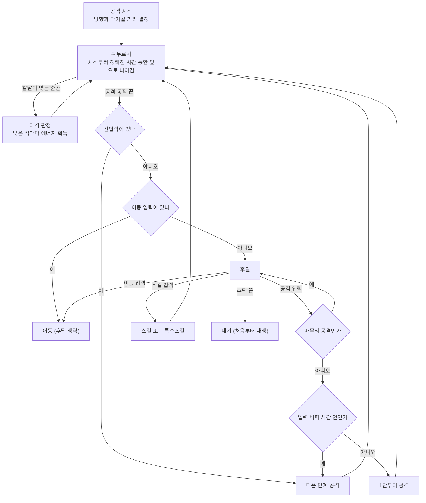
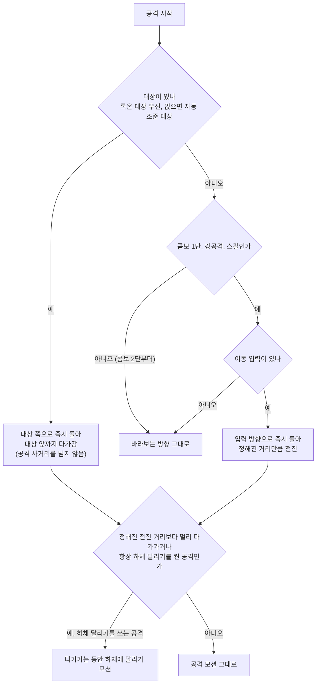
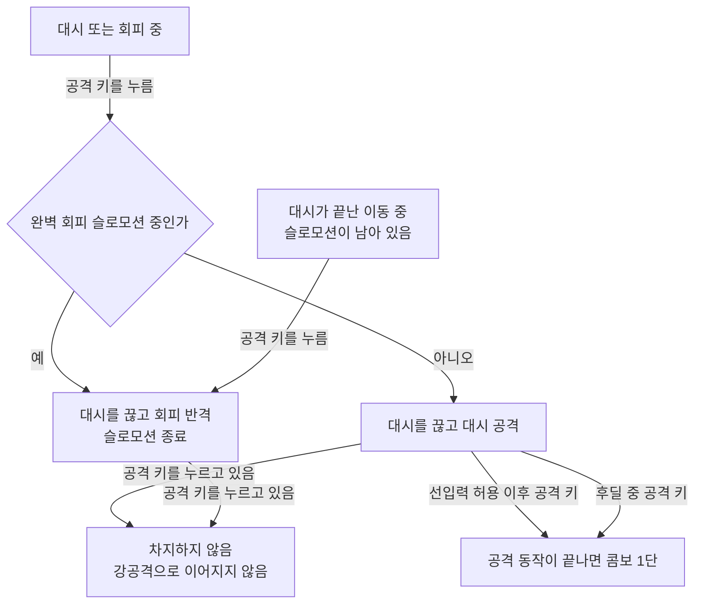
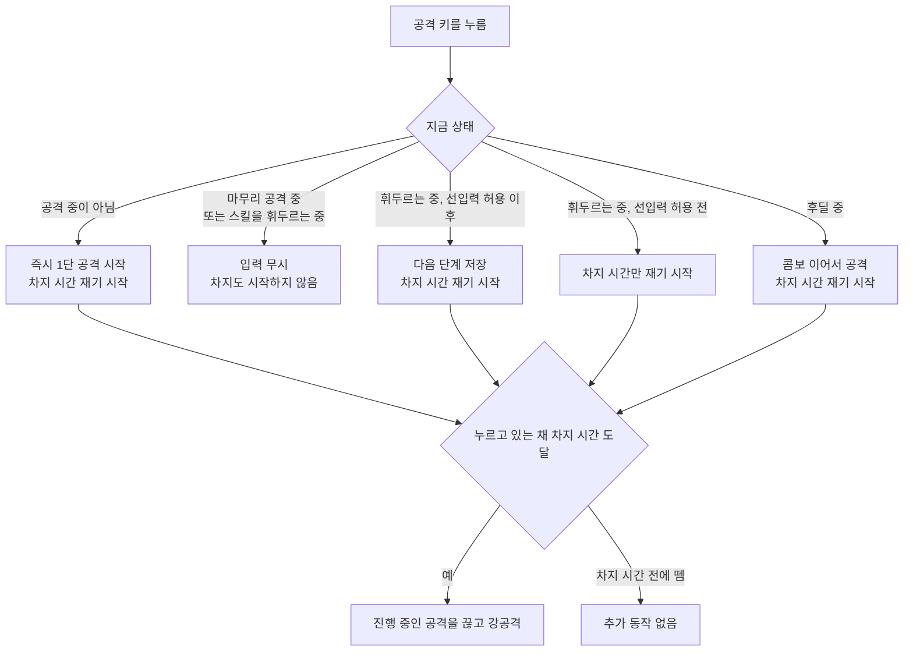
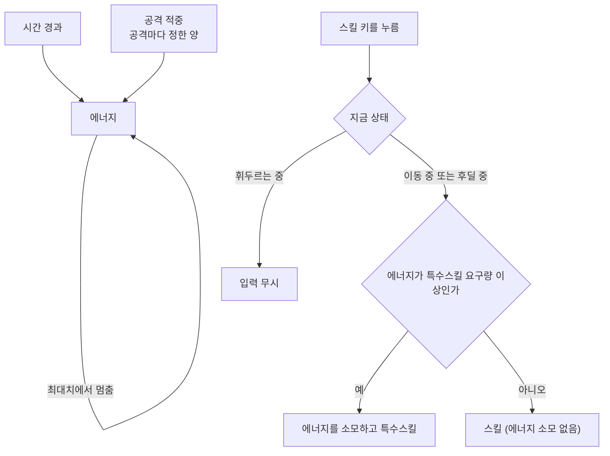

# 플레이어 공격, 스킬과 에너지

## 1. 개요

공격 키 하나로 기본 공격 콤보와 차지 강공격을 쓰고, 스킬 키로 스킬을 쓰는 공격 체계다. 공격이 적중하거나 시간이 지나면 에너지가 쌓이고, 에너지가 충분할 때 스킬 키를 누르면 에너지를 소모해 더 강한 특수스킬이 나간다. 타격은 모션의 칼날이 맞는 순간에 판정한다. 공격을 시작할 때 타겟팅 기능이 고른 대상 쪽으로 돌아 다가가며, 대시 공격과 회피 반격도 같은 공격 흐름과 판정을 쓴다.

## 2. 구성 요소

- PlayerAttackState : 기본 공격, 강공격, 스킬, 특수스킬, 대시 공격, 회피 반격의 흐름(휘두르기, 전진, 후딜, 선입력, 캔슬)을 함께 처리하는 상태
- PlayerAttackSetting : 공격 하나의 설정 묶음 (에너지 증가량, 위력, 전진 거리와 시간, 모션을 섞는 시간, 콤보 입력 버퍼, 하체 달리기 사용 여부, 항상 하체 달리기 여부, 휘두르는 중 대시로 끊기 허용 여부)
- PlayerDashState : 대시와 회피 중 공격 입력을 받아 대시 공격이나 회피 반격으로 넘기는 상태 (공격 관련 역할)
- PlayerEnergy : 에너지를 쌓고 소모하는 기능
- PlayerAnimationEventRelay : 캐릭터 모델에서 받은 애니메이션 이벤트를 플레이어 기능으로 넘기는 기능
- PlayerAnimationEventType : 공격 모션에 찍는 애니메이션 이벤트의 종류
- PlayerController : 콤보 단계와 차지, 스킬 분기, 공격 방향과 다가갈 거리, 하체 달리기, 타격 판정과 에너지 획득을 관리하는 플레이어 기능 (공격 관련 역할)
- PlayerTargeting : 공격 대상을 찾는 기능 (자세한 내용은 타겟팅과 록온 문서)
- DummyEnemy : 공격하지 않고, 맞으면 잠깐 색이 바뀌는 시험용 적

## 3. 동작 원리

### 공격 흐름

- 기본 공격, 강공격, 스킬, 특수스킬은 모두 이 흐름을 함께 쓰고, 재생하는 모션과 공격 설정만 다르다.
- 공격을 시작할 때 방향과 다가갈 거리를 정하고, 휘두르기 시작부터 공격마다 정한 시간 동안 그 방향으로 나아간다. (아래 `공격 방향과 대상 접근` 참고)
- 공격 모션에는 네 가지 신호를 찍는다.
    - 선입력 허용 : 이 시점 이후 누른 공격은 저장했다가 공격 동작이 끝나면 다음 단계로 이어간다.
    - 타격 : 칼날이 맞는 순간. 여러 번 베는 모션은 여러 개를 찍고, 찍은 개수가 그 공격의 히트 수가 된다.
    - 공격 동작 끝 : 휘두르기가 끝나고 후딜이 시작되는 지점
    - 후딜 끝 : 대기 자세로 돌아온 지점
- 공격 동작이 끝나면 다음 단계와, 다음 단계로 이어갈 수 있는 마감 시각을 정한다. 마감 시각은 콤보 단계마다 따로 정한 입력 버퍼 시간으로 계산하며, 마지막 단계 다음은 1단이다.
- 콤보의 마지막 단계는 마무리 공격이다. 마무리 공격 중에는 공격 입력을 받지 않아, 후딜이 끝날 때까지 다음 콤보가 시작되지 않는다. 이동과 대시로 후딜을 끊는 것은 그대로 할 수 있다.
- 다음 공격 모션으로 넘어갈 때 이전 모션과 섞는 시간은 공격마다 따로 정한다.
- 공격이나 후딜 중 언제든 대시 키를 누르면 대시나 회피로 끊는다. 단, 공격 설정에서 대시로 끊기를 끈 공격은 휘두르는 동안 끊을 수 없고, 후딜은 항상 끊을 수 있다.
- 콤보 단수는 콤보 단계 설정의 개수로 정하고, 현재 4단이다.

### 공격 방향과 대상 접근

- 대상은 록온 대상을 먼저 쓰고, 록온 중이 아니면 공격 사거리 안의 자동 조준 대상을 쓴다. 대상을 고르는 기준은 타겟팅과 록온 문서에 적었다.
- 대상이 있으면 콤보 단계와 상관없이 대상 쪽으로 돌아, 대상 앞에서 멈추도록 다가간다. 다가가는 시간은 공격마다 정한 전진 시간과 같아, 대상이 멀수록 빠르게 다가간다. 모션 길이와 타격 시점은 그대로다.
- 대상이 없으면 콤보 1단, 강공격, 스킬, 특수스킬을 시작할 때만 이동 입력 방향으로 돈다. 입력이 없으면 바라보는 방향 그대로 공격한다.
- 콤보 2단부터는 대상이 없으면 방향을 바꾸지 않는다.
- 정해진 전진 거리보다 멀리 다가갈 때는 다가가는 동안 하체에만 달리기 모션을 덮는다. 상체는 공격 모션을 그대로 재생하고, 전진이 끝나거나 공격이 끊기면 하체도 공격 모션으로 돌아온다.
- 하체 달리기는 공격마다 켜고 끌 수 있다.
- 항상 하체 달리기를 켠 공격은 대상이 없거나 가까워도 전진하는 동안 하체 달리기를 보여준다. 대시 공격처럼 달려 나가는 공격에 쓴다. 대상에 바짝 붙어 전진할 거리가 없으면 제자리에서 다리만 달리지 않도록 보여주지 않는다.

### 대시 공격과 회피 반격

- 대시와 회피 중 공격 키를 누르면 언제든 대시를 끊고 공격이 나간다. 완벽 회피 슬로모션 중이면 회피 반격, 아니면 대시 공격이다.
- 슬로모션이 남아 있으면 대시가 끝나 이동 중일 때 공격 키를 눌러도 회피 반격이 나간다.
- 대시 공격과 회피 반격도 공격을 시작할 때 대상 쪽으로 돌아 다가가는 규칙을 그대로 쓴다.
- 대시 공격 뒤의 공격은 콤보 1단부터 시작한다. 휘두르는 중 선입력 허용 이후 누른 공격은 저장했다가 공격 동작이 끝나면 1단으로 이어간다.
- 대시 공격과 회피 반격은 공격 키를 누르고 있어도 차지하지 않아 강공격으로 이어지지 않는다.
- 회피 반격이든 다른 공격이든 공격을 시작하면 슬로모션은 바로 끝난다. 완벽 회피와 슬로모션은 피격 문서에 적었다.

### 공격 키 입력과 차지

- 강공격과 스킬 뒤의 콤보는 1단부터 다시 시작한다.
- 대시를 하거나, 스킬을 쓰거나, 이동으로 돌아가면 진행 중이던 차지는 끊는다.

### 스킬과 에너지

- 에너지는 시간이 지나며 조금씩 쌓이고, 공격이 적에게 맞을 때마다 그 공격에 정한 양만큼 더 쌓인다. 최대치를 넘지 않는다.
- 스킬 키 하나로 스킬과 특수스킬을 모두 쓴다. 에너지가 특수스킬 요구량 이상이면 에너지를 소모하고 특수스킬이, 모자라면 스킬이 나간다.
- 스킬과 특수스킬은 서로 다른 모션을 쓰고, 특수스킬은 히트 수와 위력이 더 크다.
- 위력은 아직 적에게 체력이 없어 적중 기록으로만 확인한다.

### 애니메이션 이벤트 처리

- 애니메이션 이벤트는 Animator 가 붙은 캐릭터 모델에서 발생하므로, 모델에 붙은 중계 기능이 플레이어 기능을 거쳐 현재 상태로 넘긴다.
- 모션을 바꿀 때 이전 모션과 짧게 섞는 동안에는 이전 모션의 이벤트도 함께 발생한다. 예를 들어 1단의 후딜 끝 신호가 2단 공격 도중 들어와 대기로 돌아가 버릴 수 있다.
- 그래서 이벤트가 어느 Animator 상태에서 왔는지 함께 넘기고, 공격 상태는 지금 재생 중인 공격의 이벤트만 처리한다.

## 4. 구현 과정

- 활용한 기능 :
    - Animation Event : 공격 모션의 특정 프레임에서 코드로 신호를 보내, 타격 시점과 콤보 시점을 모션에 맞춘다.
    - Animator 상태 직접 재생 : 전이선 없이 코드가 상태 이름으로 공격 모션을 재생한다. 다음 동작을 정하는 판단이 코드 한 곳에 모인다. 모션을 섞는 시간도 재생할 때 공격마다 넘긴다.
    - Animator Override Controller : 스킬과 특수스킬을 Animator 의 별도 상태로 두어, 캐릭터마다 각각 다른 클립으로 바꿔 끼울 수 있게 했다.
    - `Physics.OverlapBox` : 타격 신호가 온 순간 캐릭터 앞의 상자 범위 안에 있는 적을 찾는다. 판정 범위는 Inspector 에서 조정하고, 플레이어를 선택하면 Scene 창에 상자로 표시된다.
    - Avatar Mask 와 Animator 레이어 : 하체만 덮는 레이어에 달리기 모션을 두고, 코드가 레이어 비중을 서서히 올리고 내려 상체 공격과 하체 달리기를 함께 재생한다.
    - `[Serializable]` 설정 묶음 : 공격 하나의 값을 묶은 일반 클래스를 Inspector 에 펼쳐 보여, 콤보 단계마다, 그리고 강공격, 스킬, 특수스킬마다 같은 형태로 값을 정한다.
- 구현 과정 :
    1. 공격 입력을 추가하고, 공격 상태를 상태 머신에 추가했다.
    2. 애니메이션 이벤트는 처음에 타격 시작과 끝을 포함한 다섯 가지로 계획했으나, 타격을 한 순간의 신호 하나로 줄였다. 시작과 끝 사이에 같은 적을 여러 번 맞히지 않게 막는 처리가 필요 없어지고, 여러 번 베는 모션은 신호를 여러 개 찍으면 된다.
    3. 차지 중 따로 보여줄 모션이 없어 별도의 차지 상태는 두지 않고, 플레이어 기능이 누른 시간을 재고 강공격은 공격 상태를 그대로 쓴다.
    4. 상태가 바뀌며 이전 모션의 이벤트가 섞여 들어오는 문제를 막기 위해, 이벤트에 발생한 Animator 상태를 함께 넘겨 걸러냈다.
    5. 타격 판정은 시험용 적 하나만 대상으로 하고, 일반 적을 만드는 단계에서 적 공통 계약이 필요한지 다시 검토한다.
    6. 콤보 단계마다 입력 버퍼만 정하던 값을 공격 설정 묶음으로 바꾸고, 강공격, 스킬, 특수스킬도 같은 묶음을 쓰게 했다. 공격마다 에너지 증가량, 위력, 전진, 섞는 시간을 한곳에서 정할 수 있다.
    7. 스킬과 특수스킬은 휘두르기, 후딜, 대기, 캔슬 흐름이 기본 공격과 같아 별도 상태를 만들지 않고, 공격 상태가 공격 종류를 받아 함께 처리하게 했다.
    8. 에너지는 플레이어 기능에 넣지 않고 별도 기능으로 두었다. 이후 에너지 표시와 캐릭터별 에너지가 붙을 때 이 기능만 보면 된다.
    9. 타겟팅을 만들며 공격을 시작할 때 대상 쪽으로 돌아 다가가게 했다. 대상이 없을 때는 콤보 1단과 강공격, 스킬에서만 이동 입력 방향으로 돌게 했다.
    10. 멀리 다가가는 공격에 하체 달리기 레이어를 추가하고, 공격마다 사용 여부를 정할 수 있게 했다.
    11. 대시 공격과 회피 반격은 휘두르기, 후딜, 캔슬 흐름이 다른 공격과 같아 별도 상태를 만들지 않고 공격 종류로 추가했다. 모션은 임시로 기존 공격 모션을 쓰고, 나중에 Animator Override Controller 로 바꾼다.
    12. 공격 설정에 휘두르는 중 대시로 끊기 허용 여부와 항상 하체 달리기 여부를 추가했다. 대상이 없는 대시 공격도 달려 나가는 모습을 보이기 위해서다.
    13. 회피 반격의 발동 조건인 완벽 회피는 다음 단계에서 만든다. 그 전에 회피 반격을 확인할 수 있도록, 실제와 같은 경로로 시험하는 Inspector 테스트 옵션을 두었다.
    14. 완벽 회피를 구현하며 테스트 옵션을 지우고, 슬로모션 중 공격 입력을 회피 반격으로 연결했다. 공격을 시작하면 슬로모션이 끝나게 했다.
- 주요 결정과 이유 :
    - 공격 키를 누르는 즉시 1단 공격이 나가고 누르고 있는 동안 차지 시간을 잰다.
        - 레퍼런스와 같은 조작감을 위해서다.
        - 누르는 즉시 공격이 나가 공격 버튼이 눌렸다는 것을 바로 알 수 있다. 입력이 정상적으로 들어갔다는 피드백이 된다.
    - 공격이 끝나고 이동 입력이 없으면 후딜을 거쳐 대기로 돌아가고, 이동 입력이 있으면 후딜을 끊는다. 대기 모션은 매번 처음부터 재생한다.
        - 공격의 마무리 동작을 보여주기 위해서다.
        - 조작 중에는 반응을 우선하기 위해서다.
    - 기본 공격 콤보를 4단으로 정했다. 고른 공격 모션 네 개가 자연스럽게 이어지기 때문이다.
    - 공격 방향은 대상이 있으면 대상 쪽, 없으면 이동 입력 방향, 입력도 없으면 바라보는 방향으로 정한다.
        - 콤보 2단부터는 대상이 없으면 입력 방향으로 돌지 않는다. 콤보 도중 방향이 휙휙 바뀌어 모션이 어색했기 때문이다.
        - 레퍼런스의 조작감에 맞추기 위해서다.
    - 정해진 전진 거리보다 멀리 다가갈 때 하체에 달리기 모션을 덮는다.
        - 일부 모션에서 어색함을 줄이기 위해서다.
    - 공격할 때 앞으로 나아간다.
        - 고른 공격 모션의 몸 움직임이 제자리에서 휘두르는 동작과 맞지 않았기 때문이다.
        - 제자리에서 휘두르면 타격감과 박력이 약해 보이고, 콤보 도중 밀려나는 적을 따라붙기 위해서다.
        - 레퍼런스의 조작감에 맞추기 위해서다.
    - 스킬은 이동 중과 후딜 중에만 쓸 수 있고, 휘두르는 도중에는 공격을 끊고 나가지 않는다.
        - 레퍼런스의 조작감에 맞추기 위해서다.
        - 아무 때나 스킬로 끊을 수 있으면 콤보 연계의 의미가 낮아지기 때문이다.
    - 콤보의 마지막 단계는 후딜이 끝날 때까지 공격 입력을 받지 않는다.
        - 마지막 단계에서 다시 1단으로 넘어가는 사이에 콤보가 끝났다는 느낌을 주기 위해서다.
    - 회피 반격은 완벽 회피에 성공했을 때만 나가고, 그 외의 대시와 회피 중 공격은 대시 공격이 나간다.
    - 대시 공격은 대시를 언제든 끊고, 대시 공격 뒤의 콤보는 1단부터 시작한다.
    - 특정 공격은 휘두르는 동안 대시로 끊지 못하게, 대시 공격과 회피 반격은 강공격으로 이어지지 않게 했다.
        - 나중에 추가할 무적과 후딜을 넣어, 각 동작을 상황에 맞게 골라 쓰게 하기 위해서다.

## 5. 기존 방식과 비교

- 기존 방식 :
    - 공격을 시작할 때마다 이동 입력 방향으로 즉시 돌아서 공격했다.
    - 공격 중에는 제자리에 멈춰 휘둘렀다.
    - 모든 모션을 같은 시간으로 섞어 재생했다.
    - 마지막 단계도 다른 단계와 같이 선입력과 후딜 중 입력으로 바로 1단에 이어졌다.
    - 콤보 단계마다 입력 버퍼만 정했다.
- 달라진 점 :
    - 바라보는 방향 그대로 공격하고, 휘두르기 시작부터 앞으로 나아간다.
    - 모션을 섞는 시간을 공격마다 정한다.
    - 마지막 단계는 후딜이 끝날 때까지 공격 입력을 받지 않는다.
    - 공격마다 입력 버퍼, 에너지 증가량, 위력, 전진, 섞는 시간을 한 묶음으로 정한다.
    - 스킬, 특수스킬과 에너지가 추가되었다.
    - 타겟팅이 추가되며, 바라보는 방향 그대로 정해진 거리만큼 전진하던 공격이 대상 쪽으로 돌아 대상 앞까지 다가가는 공격으로 바뀌었다. 대상이 없으면 콤보 1단, 강공격, 스킬에서 이동 입력 방향으로 돈다.
    - 멀리 다가갈 때 하체에 달리기 모션이 나온다.
    - 대시와 회피 중 공격하면 대시 공격이 나가고, 완벽 회피 슬로모션 중에는 회피 반격이 나간다.
    - 공격마다 휘두르는 중 대시로 끊기 허용 여부와 항상 하체 달리기 여부를 정한다.
- 개선된 점 :
    - 콤보 도중 방향이 바뀌며 모션이 어색해지던 문제가 사라졌다.
    - 모션의 몸 움직임과 실제 이동이 맞아 공격에 박력이 생겼다.
    - 콤보의 끝이 분명히 구분된다.
    - 공격 하나의 값을 Inspector 한곳에서 보고 조정할 수 있다.
    - 적을 직접 겨누지 않아도 보고 있는 적을 공격할 수 있다.
    - 멀리 다가갈 때 다리 모션의 어색함이 줄었다.

### 미검증 항목

- 일반 게임패드의 공격 · 스킬 버튼 (조이콘은 입력 문서에서 확인)
- 대시 공격과 회피 반격의 전용 모션
