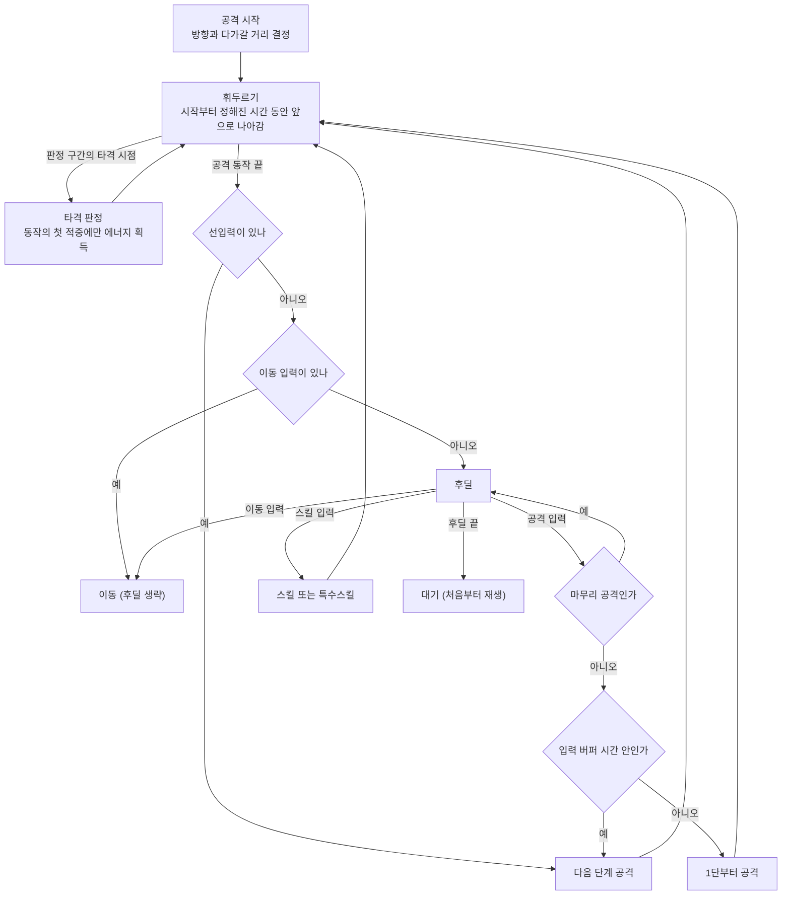
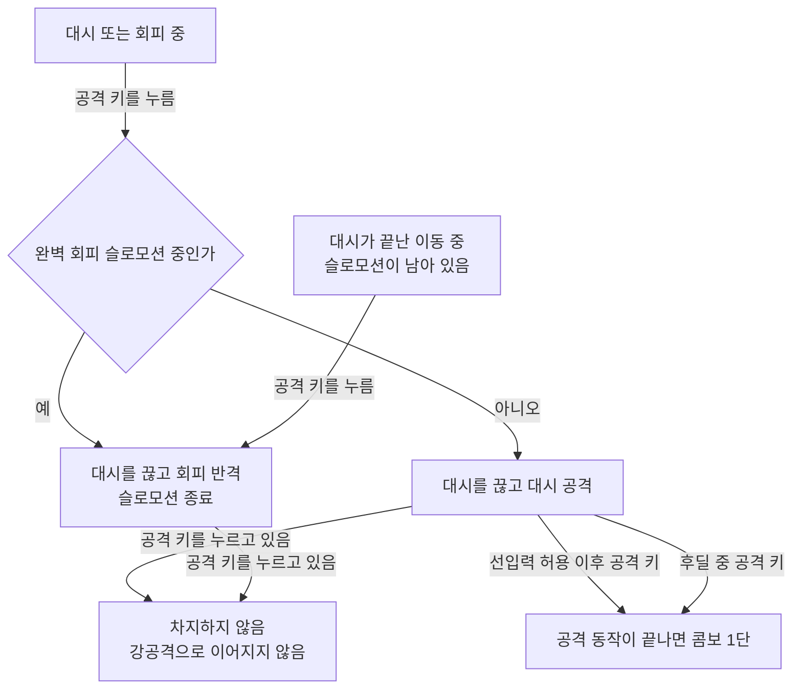
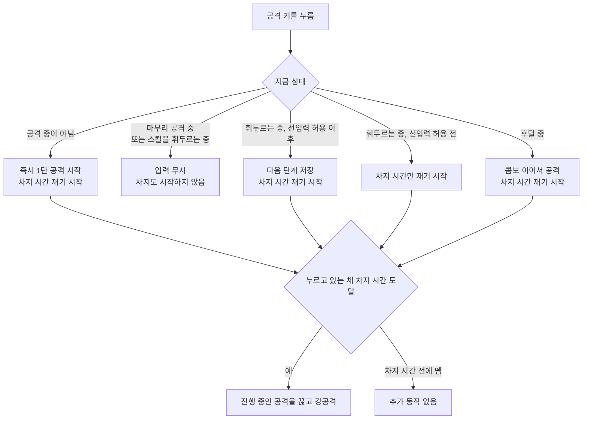
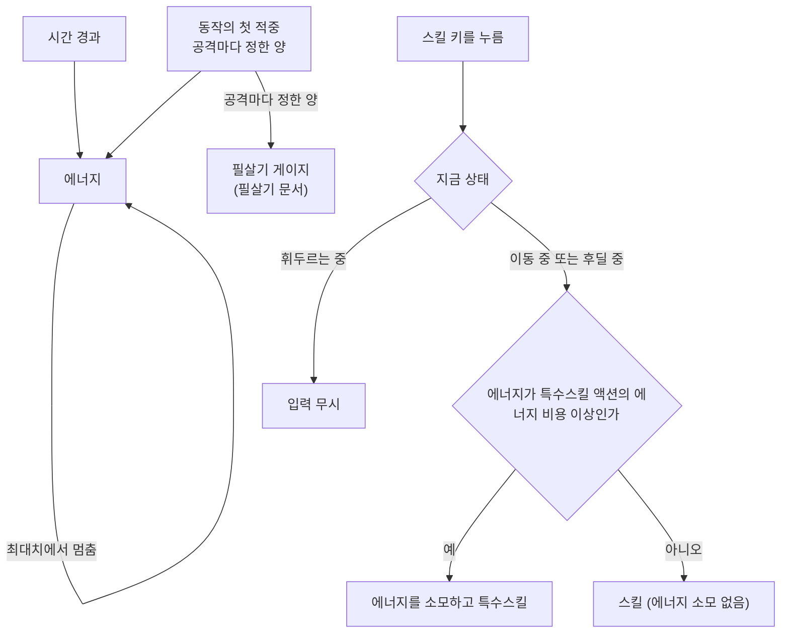
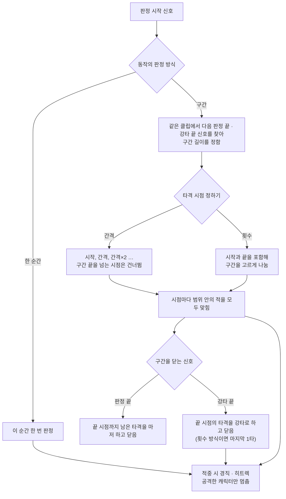

# 플레이어 공격, 스킬과 에너지

## 1. 개요

공격 키 하나로 기본 공격 콤보와 차지 강공격을 쓰고, 스킬 키로 스킬을 쓰는 공격 체계다. 공격이 적중하거나 시간이 지나면 에너지가 쌓이고, 에너지가 충분할 때 스킬 키를 누르면 에너지를 소모해 더 강한 특수스킬이 나간다. 타격은 모션의 칼날이 맞는 순간에 판정한다. 공격을 시작할 때 타겟팅 기능이 고른 대상 쪽으로 돌아 다가가며, 대시 공격과 회피 반격도 같은 공격 흐름과 판정을 쓴다.

## 2. 구성 요소

- PlayerAttackState : 기본 공격, 강공격, 스킬, 특수스킬, 대시 공격, 회피 반격, 패링 추격, 빠른 지원의 흐름(휘두르기, 전진, 후딜, 선입력, 끼어들기)을 함께 처리하는 상태
- ActionData · ActionStep : 액션 하나의 타격 값(에너지 · 게이지 · 위력 · 경직) · 무적과, 동작마다 재생할 모션 · 판정 범위 · 전진 · 끼어들기 허용 (자세한 내용은 플레이어 구성과 데이터 문서)
- PlayerAttackJudge : 판정 시작 ~ 끝 구간의 타격 시점(간격 / 횟수) 관리, 동작의 판정 범위 안의 적 찾기, 체력 · 에너지 · 게이지 · 경직 · 히트렉 요청 · 콤보 스킬 발동을 처리하는 기능
- HitShape · HitRange : 적 공격과 함께 쓰는 판정 범위 모양(상자 · 구 · 캡슐 · 부채꼴)과 범위 찾기 · 그리기
- PlayerStatus · PlayerController : 캐릭터 시간 배율과 히트렉. 히트렉 동안 공격한 캐릭터의 모션 · 이동 · 타이머가 멈춘다 (타격 관련 역할, 자세한 내용은 플레이어 구성과 데이터 문서)
- CharacterDebugger : [개발용] 판정 범위를 Scene 창에 표시하는 디버그 기능 (타격 관련 역할)
- PlayerAnimation : 공격 모션 재생과 하체 달리기 레이어 (공격 관련 역할)
- PlayerDashState : 대시와 회피 중 공격 입력을 받아 대시 공격이나 회피 반격으로 넘기는 상태 (공격 관련 역할)
- PlayerStatus : 에너지를 쌓고 소모하는 상태 기능 (체력 · 필살기 게이지와 함께, 공격 관련 역할)
- ActionData : 공격 하나의 값. 강공격 차지 시간 · 특수스킬 에너지 비용도 그 액션에 있다 (공격 관련 역할)
- BodyRadius : 대상 앞에서 멈추는 거리를 정할 때 대상 몸의 반지름을 재는 규칙 (순간 이동과 함께 씀)
- PlayerAnimationEventRelay : 캐릭터 모델에서 받은 애니메이션 이벤트를 플레이어 기능으로 넘기는 기능
- PlayerAnimationEventType : 공격 모션에 찍는 애니메이션 이벤트의 종류
- PlayerController : 콤보 단계와 차지, 스킬 분기, 공격 방향과 다가갈 거리 (공격 관련 역할)
- PlayerTargeting : 공격 대상을 찾는 기능 (자세한 내용은 타겟팅과 록온 문서)

## 3. 동작 원리

### 공격 흐름

- 기본 공격, 강공격, 스킬, 특수스킬은 모두 이 흐름을 함께 쓰고, 재생하는 모션과 공격 설정만 다르다.
- 공격을 시작할 때 방향과 다가갈 거리를 정하고, 휘두르기 시작부터 공격마다 정한 시간 동안 그 방향으로 나아간다. (아래 `공격 방향과 대상 접근` 참고)
- 공격 모션에는 여섯 가지 신호를 찍는다.
    - 선입력 허용 : 이 시점 이후 누른 공격은 저장했다가 공격 동작이 끝나면 다음 단계로 이어간다.
    - 판정 시작 : 판정 구간을 연다. 한 순간 판정 동작은 이 순간 한 번만 판정한다.
    - 판정 끝 : 판정 구간을 닫는다.
    - 강타 끝 : 구간의 마지막 타격을 강타로 하고 구간을 닫는다. 판정 끝 대신 찍는다. 그로기 적에게 맞으면 콤보 스킬이 발동한다. (콤보 스킬 문서 참고)
    - 공격 동작 끝 : 휘두르기가 끝나고 후딜이 시작되는 지점
    - 후딜 끝 : 대기 자세로 돌아온 지점
- 판정 구간 안에서 언제 몇 번 맞힐지는 아래 `판정 구간 · 다단 히트 · 히트렉` 에 적었다.
- 공격 동작이 끝나면 다음 단계와, 다음 단계로 이어갈 수 있는 마감 시각을 정한다. 마감 시각은 콤보 단계마다 따로 정한 입력 버퍼 시간으로 계산하며, 마지막 단계 다음은 1단이다.
- 콤보의 마지막 단계는 마무리 공격이다. 마무리 공격 중에는 공격 입력을 받지 않아, 후딜이 끝날 때까지 다음 콤보가 시작되지 않는다. 이동과 대시로 후딜을 끊는 것은 그대로 할 수 있다.
- 다음 공격 모션으로 넘어갈 때 이전 모션과 섞는 시간은 공격마다 따로 정한다.
- 공격이나 후딜 중 언제든 대시 키를 누르면 대시나 회피로 끊는다. 단, 지금 동작의 끼어들기 허용에서 대시를 뺀 동작은 휘두르는 동안 끊을 수 없고, 후딜은 항상 끊을 수 있다. (아래 `끼어들기 허용`)
- 콤보 단수는 캐릭터 데이터의 콤보 단계 개수로 정한다. (검방 4단 · 대검 3단 · 격투가 5단)

### 끼어들기 허용

- 동작마다 그 동작 중 끼어들 수 있는 행동을 체크 목록 하나로 고른다. 허용할 행동만 체크한다.

| 행동 | 체크했을 때 | 체크하지 않았을 때 |
|---|---|---|
| 대시 | 휘두르는 중 대시 · 회피로 끊을 수 있다 | 휘두르는 동안 대시 입력을 무시한다. 후딜은 항상 끊을 수 있다 |
| 필살기 | 게이지가 가득 차 있으면 필살기로 끊을 수 있다 | 필살기 입력을 무시한다 |
| 교체 | 교체 키로 다른 캐릭터와 교체할 수 있다 (노란 예고면 지원 패링) | 교체 키를 무시한다 (다시 눌러야 한다) |
| 패링 교체 | 노란 예고가 떠서 교체가 지원 패링이 될 때만 교체 키를 받는다 | 교체를 켜지 않았으면 교체 키를 무시한다 |

- 상태마다 어느 값을 읽는지

| 상태 | 대시 | 필살기 | 교체 |
|---|---|---|---|
| 공격 (기본 · 강공격 · 스킬 · 대시 공격 · 회피 반격 · 패링 추격 · 빠른 지원) | 지금 동작 | 지금 동작 | 지금 동작 |
| 패링 (준비 · 반응) | 쓰지 않음 (입력을 읽지 않음) | 항상 불가 | 준비 중은 패링 액션의 준비 동작, 반응 중은 반응 동작 |
| 필살기 | 쓰지 않음 | 쓰지 않음 | 연출 구간은 불가, 공격 단계는 지금 동작 |
| 콤보 스킬 | 쓰지 않음 | 쓰지 않음 | 지금 동작 |
| 이동 · 대시 · 회피 · 피격 · 넉백 · 입장 | 상태마다 정함 | 상태마다 정함 | 항상 가능 |

- 동작 단위로 두어, 패링 준비와 반응처럼 한 액션 안에서도 다르게 정할 수 있다. 실제 설정 값은 파티 문서의 `끼어들기 허용` 표에 있다.
- 공격 · 패링 · 필살기 · 콤보 스킬 상태는 교체 · 패링 교체를 같은 규칙 한 곳에서 판단한다. 그래서 패링 교체는 어느 액션 동작에서든 쓸 수 있다.
- "전부 허용" 으로 저장된 동작은 나중에 항목이 늘면 새 항목도 허용된 것으로 본다.

### 공격 방향과 대상 접근

- 대상은 록온 대상을 먼저 쓰고, 록온 중이 아니면 우선 대상, 그것도 없으면 공격 사거리 안의 자동 조준 대상을 쓴다. 대상을 고르는 기준은 타겟팅과 록온 문서에 적었다.
    - 우선 대상은 공격을 시작하는 쪽이 넘기는 대상이다. 패링 추격은 마지막으로 패링한 적을 넘긴다. 다른 공격은 우선 대상이 없다.
    - 필살기와 콤보 스킬은 이 순서를 쓰지 않고, 발동 때 정한 대상을 록온과 상관없이 끝까지 노린다.
- 대상이 있으면 콤보 단계와 상관없이 대상 쪽으로 돌아, 대상 앞에서 멈추도록 다가간다. 다가가는 시간은 공격마다 정한 전진 시간과 같아, 대상이 멀수록 빠르게 다가간다. 모션 길이와 타격 시점은 그대로다.
- 멈추는 거리는 대상 몸 표면 기준이다. 대상 반지름 + 플레이어 반지름 + 공격 간격만큼 떨어져 멈춘다. 공격 간격은 순간 이동과 같은 공통 설정 값이라, 공격과 순간 이동이 같은 거리에 선다. 보스처럼 큰 적 앞에서는 자동으로 더 멀리 멈춰 몸 안으로 파고들지 않는다.
- 대상이 없으면 콤보 1단, 강공격, 스킬, 특수스킬을 시작할 때만 이동 입력 방향으로 돈다. 입력이 없으면 바라보는 방향 그대로 공격한다.
- 콤보 2단부터는 대상이 없으면 방향을 바꾸지 않는다.
- 정해진 전진 거리보다 멀리 다가갈 때는 다가가는 동안 하체에만 달리기 모션을 덮는다. 상체는 공격 모션을 그대로 재생하고, 전진이 끝나거나 공격이 끊기면 하체도 공격 모션으로 돌아온다.
- 하체 달리기는 공격마다 켜고 끌 수 있다.
- 항상 하체 달리기를 켠 공격은 대상이 없거나 가까워도 전진하는 동안 하체 달리기를 보여준다. 대시 공격처럼 달려 나가는 공격에 쓴다. 대상에 바짝 붙어 전진할 거리가 없으면 제자리에서 다리만 달리지 않도록 보여주지 않는다.

### 대시 공격과 회피 반격

- 대시와 회피 중 공격 키를 누르면 언제든 대시를 끊고 공격이 나간다. 완벽 회피 슬로모션 중이면 회피 반격, 아니면 대시 공격이다.
- 슬로모션이 남아 있으면 대시가 끝나 이동 중일 때 공격 키를 눌러도 회피 반격이 나간다.
- 대시 공격과 회피 반격도 공격을 시작할 때 대상 쪽으로 돌아 다가가는 규칙을 그대로 쓴다.
- 대시 공격 뒤의 공격은 콤보 1단부터 시작한다. 휘두르는 중 선입력 허용 이후 누른 공격은 저장했다가 공격 동작이 끝나면 1단으로 이어간다.
- 대시 공격과 회피 반격은 공격 키를 누르고 있어도 차지하지 않아 강공격으로 이어지지 않는다.
- 회피 반격이든 다른 공격이든 공격을 시작하면 슬로모션은 바로 끝난다. 완벽 회피와 슬로모션은 피격 문서에 적었다.

### 공격 키 입력과 차지

- 차지 시간은 강공격 액션의 값이다. 캐릭터마다 강공격 액션을 바꾸면 차지 시간도 함께 바뀐다.
- 강공격과 스킬 뒤의 콤보는 1단부터 다시 시작한다.
- 대시를 하거나, 스킬을 쓰거나, 이동으로 돌아가면 진행 중이던 차지는 끊는다.

### 스킬과 에너지

- 에너지는 시간이 지나며 조금씩 쌓이고, 공격이 적에게 맞으면 그 공격에 정한 양만큼 더 쌓인다. 최대치를 넘지 않는다.
- 공격으로 얻는 에너지 · 필살기 게이지는 한 동작에서 처음 적중했을 때 한 번만 얻는다. 여러 적을 한 번에 맞히거나, 다단 히트 · 강타로 여러 번 맞혀도 더 얻지 않는다. 다음 동작(콤보 다음 단, 스킬의 다음 동작)이 시작되거나 공격이 끝나면 다시 얻을 수 있다. (#58)
    - 적이 몰려 있을 때 타격마다 · 적마다 얻으면 의도보다 훨씬 많이 쌓여, 특수스킬 · 필살기를 너무 자주 쓰게 되기 때문이다.
    - 패링 성공 · 완벽 회피로 얻는 필살기 게이지는 공격 판정이 아니라 이 규칙과 상관없다.
- 에너지는 캐릭터마다 따로 가지는 값이라 체력 · 필살기 게이지와 함께 상태 기능에 있다.
- 스킬 키 하나로 스킬과 특수스킬을 모두 쓴다. 에너지가 특수스킬 액션의 에너지 비용 이상이면 에너지를 소모하고 특수스킬이, 모자라면 스킬이 나간다.
    - 비용은 스킬을 시작하는 곳에서 특수스킬 액션의 값을 바로 읽는다. 액션 종류로 나눠 계산하면 같은 정보를 두 곳에서 맞춰야 하고, 잘못 고르면 비용이 조용히 무시되기 때문이다.
- 스킬과 특수스킬은 서로 다른 모션을 쓰고, 특수스킬은 히트 수와 위력이 더 크다.
- 맞은 적의 체력은 그 공격의 위력만큼 줄어든다. 체력이 0 인 적은 강타에 맞아야 처치된다. (적 공통 규칙 문서)
- 공격이 적에게 맞으면 그 공격에 정한 양만큼 필살기 게이지도 쌓인다. 에너지와 같이 한 동작에 한 번이다. 공격마다 공격 중 필살기로 끊을 수 있는지도 정한다. 필살기 게이지와 발동은 필살기 문서에 적었다.

### 판정 구간 · 다단 히트 · 히트렉

- 판정 시작 ~ 끝 사이를 판정 구간으로 두고, 그 안에 타격 시점을 정해 시점마다 범위 안의 적을 모두 맞힌다. 모든 적이 같은 시점에 맞고, 시점 사이에 범위로 들어온 적은 다음 시점에 맞는다.
- 타격 시점은 동작마다 고른다.
    - 간격 : 판정 시작부터 정한 간격마다 타격한다. 구간 끝을 넘어가는 타격은 하지 않는다. 마지막 시점이 끝과 겹치면 그 타격도 한다.
    - 횟수 : 구간을 정한 횟수로 고르게 나누고, 시작과 끝 시점을 모두 포함한다. 1타면 시작 시점에 한 번이다.
    - 한 순간 : 구간을 열지 않고 판정 시작 순간 한 번만 판정한다.
- 구간이 강타 끝으로 끝나면 끝 시점의 타격이 강타다. 횟수 방식에서는 강타까지 포함해 정한 횟수만큼 맞는다.
- 판정 시작 없이 강타 끝 신호만 오면, 그 순간 강타를 한 번 판정한다. 마지막 한 방만 있는 모션은 신호 하나로 정할 수 있다.
- 구간 길이는 판정 시작 신호가 올 때 같은 클립에서 뒤따르는 판정 끝 · 강타 끝 신호를 찾아 정한다. 클립의 신호 위치만 옮기면 되고, 길이를 따로 적지 않는다. 길이를 알 수 없는 횟수 방식 동작은 시작 시점에 한 번만 맞히고 경고를 남긴다.
- 판정 끝 신호가 프레임 사이에 와도, 끝 시점까지 남은 타격을 마저 한 뒤 닫아 마지막 타격이 빠지지 않는다. 공격이 끊기거나 다음 동작으로 넘어가면 남은 타격 없이 바로 닫는다.
- 히트렉 : 적중하면 동작마다 정한 시간 동안 공격한 캐릭터만 멈춘다. 모션 · 이동 · 상태 시간이 모두 멈추고 적은 계속 움직인다.
    - 한 번의 타격에 여러 적이 맞아도 히트렉은 한 번이다. 히트렉 중에 또 맞히면 남은 시간과 새 시간 중 긴 쪽으로 다시 건다.
    - 타격 시점은 캐릭터 시간으로 재서, 히트렉 동안은 다음 타격이 오지 않는다.
    - 히트렉이 끝나면 겹친 효과와 상관없이 원래 속도로 돌아온다. 히트렉 중에 필살기를 쓰면 바로 원래 속도로 시작한다.
- 첫 타격에만 반응 : 동작마다 켤 수 있다. 켜면 판정 구간에서 처음 적중한 타격에만 경직 · 히트렉을 걸고, 나머지 타격은 피해 · 그로기만 준다. 에너지 · 필살기 게이지는 동작의 첫 적중에 이미 얻었다. 강타는 항상 경직 · 히트렉을 건다.
- 개발 중에는 판정 범위를 찾을 때마다 Scene 창에 빨간 선으로 범위를 그린다. 구간은 켜져 있는 동안, 한 순간 판정 · 강타는 잠깐 남아 보인다.

### 애니메이션 이벤트 처리

- 애니메이션 이벤트는 Animator 가 붙은 캐릭터 모델에서 발생하므로, 모델에 붙은 중계 기능이 플레이어 기능을 거쳐 현재 상태로 넘긴다.
- 모션을 바꿀 때 이전 모션과 짧게 섞는 동안에는 이전 모션의 이벤트도 함께 발생한다. 예를 들어 1단의 후딜 끝 신호가 2단 공격 도중 들어와 대기로 돌아가 버릴 수 있다.
- 그래서 이벤트가 어느 Animator 상태에서 왔는지 함께 넘기고, 공격 상태는 지금 재생 중인 공격의 이벤트만 처리한다.

## 4. 구현 과정

- 활용한 기능 :
    - Animation Event : 공격 모션의 특정 프레임에서 코드로 신호를 보내, 타격 시점과 콤보 시점을 모션에 맞춘다.
    - Animator 상태 직접 재생 : 전이선 없이 코드가 상태 이름으로 공격 모션을 재생한다. 다음 동작을 정하는 판단이 코드 한 곳에 모인다. 모션을 섞는 시간도 재생할 때 공격마다 넘긴다.
    - Animator Override Controller : 스킬과 특수스킬을 Animator 의 별도 상태로 두어, 캐릭터마다 각각 다른 클립으로 바꿔 끼울 수 있게 했다.
    - `Physics.OverlapBox` · `OverlapSphere` · `OverlapCapsule` : 타격 시점마다 동작의 판정 모양 범위 안에 있는 적을 찾는다.
    - `AnimationEvent.animatorClipInfo` · `AnimationClip.events` : 판정 시작 신호가 온 클립의 신호 목록에서 뒤따르는 판정 끝 · 강타 끝을 찾아 구간 길이를 구한다.
    - `Animator.speed` : 히트렉 동안 모델 재생 속도를 캐릭터 시간 배율에 맞춰 멈춘다. 모션이 멈추면 애니메이션 이벤트도 함께 멈춘다.
    - Gizmos (`OnDrawGizmos`) : 판정 범위를 캐릭터를 선택하지 않아도 Scene 창에 그린다.
    - C# `event` : 판정 기능이 범위를 찾을 때 알리고, 디버그 기능이 구독해 범위를 표시한다. 판정 기능은 알리기만 하므로 디버그 기능을 빼도 판정은 그대로다.
    - Avatar Mask 와 Animator 레이어 : 하체만 덮는 레이어에 달리기 모션을 두고, 코드가 레이어 비중을 서서히 올리고 내려 상체 공격과 하체 달리기를 함께 재생한다.
    - `[Serializable]` 설정 묶음 : 공격 하나의 값을 묶은 일반 클래스를 Inspector 에 펼쳐 보여, 콤보 단계마다, 그리고 강공격, 스킬, 특수스킬마다 같은 형태로 값을 정한다.
- 구현 과정 :
    1. 공격 입력을 추가하고, 공격 상태를 상태 머신에 추가했다.
    2. 애니메이션 이벤트는 처음에 타격 시작과 끝을 포함한 다섯 가지로 계획했으나, 타격을 한 순간의 신호 하나로 줄였다. 시작과 끝 사이에 같은 적을 여러 번 맞히지 않게 막는 처리가 필요 없어지고, 여러 번 베는 모션은 신호를 여러 개 찍으면 된다.
    3. 차지 중 따로 보여줄 모션이 없어 별도의 차지 상태는 두지 않고, 플레이어 기능이 누른 시간을 재고 강공격은 공격 상태를 그대로 쓴다.
    4. 상태가 바뀌며 이전 모션의 이벤트가 섞여 들어오는 문제를 막기 위해, 이벤트에 발생한 Animator 상태를 함께 넘겨 걸러냈다.
    5. 타격 판정은 시험용 적 하나만 대상으로 하고, 일반 적을 만드는 단계에서 적 공통 계약이 필요한지 다시 검토한다.
    6. 콤보 단계마다 입력 버퍼만 정하던 값을 공격 설정 묶음으로 바꾸고, 강공격, 스킬, 특수스킬도 같은 묶음을 쓰게 했다. 공격마다 에너지 증가량, 위력, 전진, 섞는 시간을 한곳에서 정할 수 있다.
    7. 스킬과 특수스킬은 휘두르기, 후딜, 대기, 캔슬 흐름이 기본 공격과 같아 별도 상태를 만들지 않고, 공격 상태가 공격 종류를 받아 함께 처리하게 했다.
    8. 에너지는 플레이어 기능에 넣지 않고 별도 기능으로 두었다. 이후 에너지 표시와 캐릭터별 에너지가 붙을 때 이 기능만 보면 된다.
    9. 타겟팅을 만들며 공격을 시작할 때 대상 쪽으로 돌아 다가가게 했다. 대상이 없을 때는 콤보 1단과 강공격, 스킬에서만 이동 입력 방향으로 돌게 했다.
    10. 멀리 다가가는 공격에 하체 달리기 레이어를 추가하고, 공격마다 사용 여부를 정할 수 있게 했다.
    11. 대시 공격과 회피 반격은 휘두르기, 후딜, 캔슬 흐름이 다른 공격과 같아 별도 상태를 만들지 않고 공격 종류로 추가했다. 모션은 임시로 기존 공격 모션을 쓰고, 나중에 Animator Override Controller 로 바꾼다.
    12. 공격 설정에 휘두르는 중 대시로 끊기 허용 여부와 항상 하체 달리기 여부를 추가했다. 대상이 없는 대시 공격도 달려 나가는 모습을 보이기 위해서다.
    13. 회피 반격의 발동 조건인 완벽 회피는 다음 단계에서 만든다. 그 전에 회피 반격을 확인할 수 있도록, 실제와 같은 경로로 시험하는 Inspector 테스트 옵션을 두었다.
    14. 완벽 회피를 구현하며 테스트 옵션을 지우고, 슬로모션 중 공격 입력을 회피 반격으로 연결했다. 공격을 시작하면 슬로모션이 끝나게 했다.
    15. 패링 추격을 공격 종류로 추가하고, 기본 공격 외의 공격 시작을 하나의 함수로 정리했다. 공격마다 휘두르는 동안 무적을 켤 수 있게 했다. (패링은 피격 문서 참고)
    16. 필살기를 만들며 공격 설정에 필살기 게이지 증가량과 필살기로 끊기 허용 여부를 추가했다. 공격 대상 순서에 우선 대상을 넣어, 패링 추격과 필살기가 정해 둔 대상에게 다가가게 했다. (필살기는 필살기 문서 참고)
    17. 콤보 스킬을 만들며 애니메이션 신호에 강타를 추가했다. 필살기는 도중 록온 변경에 대상이 바뀌어, 우선 대상 대신 발동 때 대상을 끝까지 노리는 조준을 쓰게 했다. (콤보 스킬 문서 참고)
    18. 일반 적을 만들며 타격 판정이 시험용 적 대신 적 공통 약속을 쓰게 바꿨다. 맞은 적의 체력이 위력만큼 줄고, 경직 레벨이 적의 경직 저항 레벨 이상일 때만 경직시킨다. (적 공통 규칙 문서)
    19. 공격 전진을 루트 모션으로 바꿀지 시험했다. 결과는 아래 `루트 모션 시험` 에 적었다.
    20. (#35) 캐릭터 시간 배율을 만들고 플레이어 쪽 타이머 · 이동 · 모델 재생 속도가 따르게 한 뒤, 적중 시 공격한 캐릭터만 멈추는 히트렉을 동작마다 정하게 했다.
    21. (#35) 한 순간의 타격 · 강타 신호를 판정 시작 · 판정 끝 · 강타 끝 신호로 바꾸고, 클립 신호를 모두 다시 찍었다. 동작마다 한 순간 판정도 고를 수 있게 남겼다.
    22. (#35) 신호 종류를 함수 이름 대신 에셋으로 넘기는 방식을 적용해 봤으나, 기존 방식과 다루는 수고에 차이가 없어 이름별 함수 방식으로 되돌렸다.
    23. (#35) 처음에는 적마다 마지막으로 맞은 시간 · 최대 횟수로 다단 히트를 막았으나, 의도는 "구간 안의 정해진 시점마다 타격"이었다. 구간 공통 타격 시점(간격 / 횟수)으로 바꾸고, 구간 길이는 클립 신호에서 자동으로 구하게 했다.
    24. (#41) 액션 단위의 대시로 끊기 · 필살기로 끊기 값을 동작 단위 끼어들기 허용 체크 목록(`[Flags]` enum)으로 바꾸고, 교체 허용을 더했다. 끼어드는 행동끼리만 묶고, 하체 달리기 · 휘두르는 중 무적처럼 성격이 다른 값은 따로 두었다.
    25. (#41) 빠른 지원을 공격 종류로 추가했다. 대시 공격처럼 휘두르는 중 차지하지 않고, 끝나면 기본 공격 1단으로 이어진다. (파티 문서)
    24. (#35) 경직 · 히트렉을 구간의 첫 적중에만 거는 옵션을 넣었다. 계속 베는 공격이 매 타격마다 적을 묶거나 캐릭터를 멈추지 않게 하기 위해서다.
    25. (#35) 판정 모양 중 기본(판정 기능의 공통 상자)을 없앴다. 동작의 상자와 하는 일이 같아서다. 판정 기능의 디버그 표시 · 로그와 그로기 테스트는 디버그 기능 하나로 모았다.
    26. (#52) 판정 범위 모양과 범위 찾기 · 그리기를 적 공격과 함께 쓰는 곳으로 옮기고 부채꼴(각도 · 안쪽 반지름 · 높이)을 추가했다. 모양 순서 번호는 뒤에 추가해 기존 액션 에셋의 모양 값이 유지된다. 끼어들기에 패링 교체를 추가했다.
- 주요 결정과 이유 :
    - 공격 키를 누르는 즉시 1단 공격이 나가고 누르고 있는 동안 차지 시간을 잰다.
        - 레퍼런스와 같은 조작감을 위해서다.
        - 누르는 즉시 공격이 나가 공격 버튼이 눌렸다는 것을 바로 알 수 있다. 입력이 정상적으로 들어갔다는 피드백이 된다.
    - 공격이 끝나고 이동 입력이 없으면 후딜을 거쳐 대기로 돌아가고, 이동 입력이 있으면 후딜을 끊는다. 대기 모션은 매번 처음부터 재생한다.
        - 공격의 마무리 동작을 보여주기 위해서다.
        - 조작 중에는 반응을 우선하기 위해서다.
    - 기본 공격 콤보를 4단으로 정했다. 고른 공격 모션 네 개가 자연스럽게 이어지기 때문이다.
    - 공격 방향은 대상이 있으면 대상 쪽, 없으면 이동 입력 방향, 입력도 없으면 바라보는 방향으로 정한다.
        - 콤보 2단부터는 대상이 없으면 입력 방향으로 돌지 않는다. 콤보 도중 방향이 휙휙 바뀌어 모션이 어색했기 때문이다.
        - 레퍼런스의 조작감에 맞추기 위해서다.
    - 정해진 전진 거리보다 멀리 다가갈 때 하체에 달리기 모션을 덮는다.
        - 일부 모션에서 어색함을 줄이기 위해서다.
    - 공격할 때 앞으로 나아간다.
        - 고른 공격 모션의 몸 움직임이 제자리에서 휘두르는 동작과 맞지 않았기 때문이다.
        - 제자리에서 휘두르면 타격감과 박력이 약해 보이고, 콤보 도중 밀려나는 적을 따라붙기 위해서다.
        - 레퍼런스의 조작감에 맞추기 위해서다.
    - 스킬은 이동 중과 후딜 중에만 쓸 수 있고, 휘두르는 도중에는 공격을 끊고 나가지 않는다.
        - 레퍼런스의 조작감에 맞추기 위해서다.
        - 아무 때나 스킬로 끊을 수 있으면 콤보 연계의 의미가 낮아지기 때문이다.
    - 콤보의 마지막 단계는 후딜이 끝날 때까지 공격 입력을 받지 않는다.
        - 마지막 단계에서 다시 1단으로 넘어가는 사이에 콤보가 끝났다는 느낌을 주기 위해서다.
    - 회피 반격은 완벽 회피에 성공했을 때만 나가고, 그 외의 대시와 회피 중 공격은 대시 공격이 나간다.
    - 대시 공격은 대시를 언제든 끊고, 대시 공격 뒤의 콤보는 1단부터 시작한다.
    - 특정 공격은 휘두르는 동안 대시로 끊지 못하게, 대시 공격과 회피 반격은 강공격으로 이어지지 않게 했다.
        - 나중에 추가할 무적과 후딜을 넣어, 각 동작을 상황에 맞게 골라 쓰게 하기 위해서다.
    - 공격 전진은 루트 모션으로 바꾸지 않고 코드 전진을 유지한다. (아래 `루트 모션 시험`)

### 루트 모션 시험

콤보 1단 공격 하나에 루트 모션을 시험 적용해, 공격 전진 전체를 루트 모션으로 바꿀지 판단했다. 시험한 클립은 회전 · 높이는 클립에 고정(Bake Into Pose)하고, 수평 이동만 루트 모션으로 남겼다. Animator 가 계산한 이동량을 캐릭터 모델에서 받아 CharacterController 로 옮기는 방식으로 적용했다.

| 방식 | 결과 |
|---|---|
| 클립 이동량을 대상까지 다가갈 거리에 맞춰 늘이거나 줄임 | 앞으로 크게 나갔다가 미끄러지듯 돌아오는 고무줄 움직임이 생기고, 대상 근처 엉뚱한 위치로 향했다. 대상이 멀수록 심했다 |
| 클립 이동량을 그대로 사용 | 발 미끄러짐은 사라졌지만 대상에게 다가가지 않아 돌진하는 느낌이 없었다 |
| 기존 코드 전진 + 하체 달리기 | 대상 앞까지 정확히 다가가고 돌진하는 느낌이 있다 |

- 원인 : 시험한 클립은 제자리에서 앞뒤로 디디며 휘두르는 공격이었다. 실제로 지나가는 거리보다 끝났을 때 시작 위치에서 떨어진 거리가 훨씬 짧고, 클립 안에 돌진 동작이 없다.
    - 끝난 위치 기준으로 배율을 정하면 앞 · 뒤 · 옆으로 오가는 움직임이 모두 함께 커져 고무줄처럼 보인다.
    - 앞으로 가는 움직임만 늘이도록 고쳐도, 먼 대상에게 붙으려면 클립 이동을 크게 늘려야 해 발 미끄러짐이 다시 생긴다. 결국 코드 전진과 차이가 거의 없다.
- 결론 : 플레이어 공격은 코드 전진을 유지하고 루트 모션은 전체 적용하지 않는다. 시험 코드는 모두 되돌렸다.
    - 공격할 때 대상에게 붙는 것이 이 게임 공격의 핵심이고, 지금 쓰는 클립들은 제자리 공격이라 루트 모션으로 붙는 거리를 만들 수 없기 때문이다.
- 다시 검토할 조건 : 돌진 동작이 들어 있는 클립을 쓰거나, 대상 위치에 맞춰 클립 이동을 보정하는 도구를 들일 때

## 5. 기존 방식과 비교

- 기존 방식 :
    - 공격을 시작할 때마다 이동 입력 방향으로 즉시 돌아서 공격했다.
    - 공격 중에는 제자리에 멈춰 휘둘렀다.
    - 모든 모션을 같은 시간으로 섞어 재생했다.
    - 마지막 단계도 다른 단계와 같이 선입력과 후딜 중 입력으로 바로 1단에 이어졌다.
    - 콤보 단계마다 입력 버퍼만 정했다.
- 달라진 점 :
    - 바라보는 방향 그대로 공격하고, 휘두르기 시작부터 앞으로 나아간다.
    - 모션을 섞는 시간을 공격마다 정한다.
    - 마지막 단계는 후딜이 끝날 때까지 공격 입력을 받지 않는다.
    - 공격마다 입력 버퍼, 에너지 증가량, 위력, 전진, 섞는 시간을 한 묶음으로 정한다.
    - 스킬, 특수스킬과 에너지가 추가되었다.
    - 타겟팅이 추가되며, 바라보는 방향 그대로 정해진 거리만큼 전진하던 공격이 대상 쪽으로 돌아 대상 앞까지 다가가는 공격으로 바뀌었다. 대상이 없으면 콤보 1단, 강공격, 스킬에서 이동 입력 방향으로 돈다.
    - 멀리 다가갈 때 하체에 달리기 모션이 나온다.
    - 대시와 회피 중 공격하면 대시 공격이 나가고, 완벽 회피 슬로모션 중에는 회피 반격이 나간다.
    - 공격마다 휘두르는 중 대시로 끊기 허용 여부와 항상 하체 달리기 여부를 정한다.
    - 공격마다 휘두르는 동안 무적 여부를 정한다. 패링 추격 뒤의 공격은 대시 공격처럼 콤보 1단부터 이어진다.
    - 공격 대상이 록온 대상 → 자동 조준 대상 순서에서 록온 대상 → 우선 대상 → 자동 조준 대상 순서로 바뀌었다.
    - 공격마다 필살기 게이지 증가량과 필살기로 끊기 허용 여부를 정한다.
- 개선된 점 :
    - 콤보 도중 방향이 바뀌며 모션이 어색해지던 문제가 사라졌다.
    - 모션의 몸 움직임과 실제 이동이 맞아 공격에 박력이 생겼다.
    - 콤보의 끝이 분명히 구분된다.
    - 공격 하나의 값을 Inspector 한곳에서 보고 조정할 수 있다.
    - 적을 직접 겨누지 않아도 보고 있는 적을 공격할 수 있다.
    - 멀리 다가갈 때 다리 모션의 어색함이 줄었다.

- 구조 정리 (#31) : (자세한 내용은 플레이어 구성과 데이터 문서)
    - 기존 : 공격 설정은 프리팹 안의 설정 묶음이었고, 재생할 모션은 공격 종류와 단계 번호로 이름을 만들어 정했다. 판정은 모든 공격이 같은 상자였고, 타격 판정 · 모션 재생은 컨트롤러가 했다.
    - 변경 : 공격 값은 액션 에셋에 있고, 액션은 동작 목록으로 여러 모션을 이어 재생할 수 있다. 재생할 모션과 판정 범위(기본 상자 · 상자 · 구 · 캡슐) · 전진은 동작마다 정한다. 타격 판정 · 모션 재생은 각각 판정 · 애니메이션 기능이 한다.

- 컴포넌트 병합 · 정리 (#33) : (자세한 내용은 플레이어 구성과 데이터 문서)
    - 기존 : 에너지는 에너지 전용 기능이 맡았다. 강공격 차지 시간 · 특수스킬 에너지 비용 · 공격 정지 거리는 캐릭터 데이터에 있었고, 정지 거리는 대상 중심 기준이라 큰 적일수록 몸 안까지 파고들었다.
    - 변경 : 에너지는 상태 기능이 맡는다. 차지 시간은 강공격 액션, 에너지 비용은 특수스킬 액션의 값이 되었다. 정지 거리는 순간 이동과 같은 몸 표면 기준 · 같은 공격 간격을 쓴다. (의도한 동작 변경)

- 판정 구간 · 다단 히트 · 히트렉 (#35)
    - 기존 : 칼날이 맞는 순간의 타격 신호 하나에 한 번 판정했다. 계속 베는 공격은 타격 신호를 여러 개(많게는 스무 개 넘게) 찍어 히트 수를 만들었다. 타격 순간 멈춤이 없었다. 판정 모양에 판정 기능의 공통 상자(기본)가 있었다.
    - 변경 : 판정 시작 ~ 끝 구간 안의 타격 시점(간격 / 횟수)마다 판정한다. 강타는 구간의 마지막 타격이다. 적중 시 동작마다 정한 시간 동안 공격한 캐릭터만 멈춘다. 판정 모양은 상자 · 구 · 캡슐이다.
    - 개선된 점 : 계속 베는 공격을 신호 두 개와 숫자 하나로 정할 수 있고, 히트 수를 바꿀 때 클립을 다시 찍지 않는다. 타격감이 생겼다.

- 끼어들기 허용 (#41)
    - 기존 : 액션마다 "휘두르는 중 대시로 끊기" · "필살기로 끊기" 를 각각 켜고 껐다. 교체 허용은 없었다.
    - 변경 : 동작마다 끼어들기 허용 체크 목록 하나에서 대시 · 필살기 · 교체 중 허용할 행동을 고른다.
    - 개선된 점 : 이 동작 중 무엇이 되는지를 한 칸에서 보고, 한 액션 안의 동작마다 다르게 정할 수 있다. 끼어드는 행동이 늘어도 칸이 늘지 않는다.

- 판정 범위 공용화 · 패링 교체 (#52)
    - 기존 : 판정 모양(상자 · 구 · 캡슐)과 범위 찾기 · 그리기가 플레이어 판정 · 디버그 기능 안에 있었다. 교체 허용은 켜면 일반 교체와 패링이 모두 되고, 끄면 둘 다 안 됐다.
    - 변경 : 적 공격과 같은 판정 범위를 쓰고 부채꼴이 생겼다. 끼어들기에 노란 예고일 때만 교체를 받는 패링 교체가 생겼다.
    - 개선된 점 : 모양을 늘릴 때 한 곳만 고친다. 패링 반응처럼 일반 교체는 막고 연속 패링만 받아칠 수 있다.

- 에너지 · 필살기 게이지 획득 (#58, 작은 작업)
    - 기존 : 타격마다, 맞은 적마다 에너지 · 필살기 게이지를 얻었다. 적이 여럿이거나 다단 히트 동작이면 한 번의 공격으로 의도보다 많이 쌓였다.
    - 변경 : 한 동작에서 처음 적중했을 때 한 번만 얻는다. 동작이 바뀌거나 공격이 끝날 때 기록을 지운다. 같은 동작 안의 판정 시작 · 끝 · 강타 끝은 판정 구간만 닫고 기록을 남긴다.
    - 개선된 점 : 적 수 · 히트 수와 상관없이 동작마다 정한 양만큼 쌓여 수치를 맞추기 쉽다.

### 미검증 항목

- 일반 게임패드의 공격 · 스킬 버튼 (조이콘은 입력 문서에서 확인)
- 대시 공격과 회피 반격의 전용 모션
