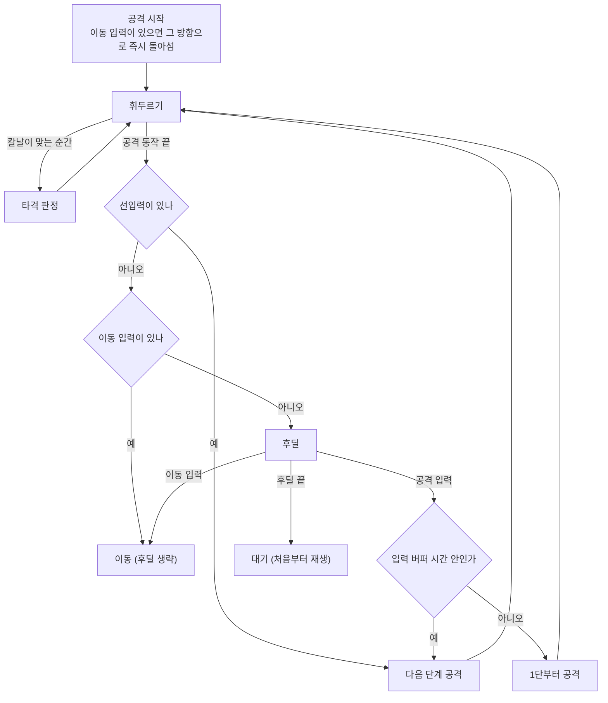
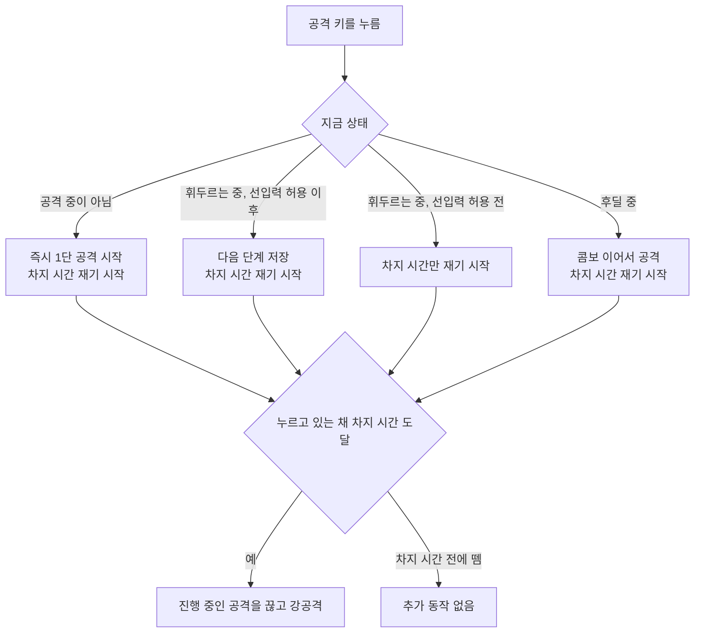

# 플레이어 기본 공격과 강공격

## 1. 개요

공격 키 하나로 기본 공격 콤보와 차지 강공격을 쓰는 공격 체계다. 누르는 즉시 공격이 나가고, 휘두르는 도중 미리 누른 입력은 다음 단계로 이어지며, 누르고 있으면 일정 시간 뒤 강공격으로 바뀐다. 타격은 모션의 칼날이 맞는 순간에 판정하며, 이후 스킬, 타겟팅, 대시 공격이 이 공격 흐름과 판정 위에서 동작한다.

## 2. 구성 요소

- PlayerAttackState : 기본 공격 콤보와 강공격의 흐름(휘두르기, 후딜, 선입력, 캔슬)을 처리하는 상태
- PlayerAnimationEventRelay : 캐릭터 모델에서 받은 애니메이션 이벤트를 플레이어 기능으로 넘기는 기능
- PlayerAnimationEventType : 공격 모션에 찍는 애니메이션 이벤트의 종류
- PlayerController : 콤보 단계와 단계별 입력 버퍼, 차지 시간, 타격 판정 범위를 관리하는 플레이어 기능 (공격 관련 역할)
- DummyEnemy : 공격하지 않고, 맞으면 잠깐 색이 바뀌는 시험용 적

## 3. 동작 원리

### 공격 흐름

- 공격 모션에는 네 가지 신호를 찍는다.
    - 선입력 허용 : 이 시점 이후 누른 공격은 저장했다가 공격 동작이 끝나면 다음 단계로 이어간다.
    - 타격 : 칼날이 맞는 순간. 여러 번 베는 모션은 여러 개를 찍는다.
    - 공격 동작 끝 : 휘두르기가 끝나고 후딜이 시작되는 지점
    - 후딜 끝 : 대기 자세로 돌아온 지점
- 공격 동작이 끝나면 다음 단계와, 다음 단계로 이어갈 수 있는 마감 시각을 정한다. 마감 시각은 콤보 단계마다 따로 정한 입력 버퍼 시간으로 계산하며, 마지막 단계 다음은 1단이다.
- 공격이나 후딜 중 언제든 대시 키를 누르면 대시나 회피로 끊는다.
- 콤보 단수는 단계별 입력 버퍼 목록의 개수로 정하고, 현재 4단이다.

### 공격 키 입력과 차지

- 강공격도 일반 공격과 같은 흐름(휘두르기, 후딜, 대기, 캔슬)을 따르며, 강공격 뒤의 콤보는 1단부터 다시 시작한다.
- 대시를 하거나 이동으로 돌아가면 진행 중이던 차지는 끊는다.

### 애니메이션 이벤트 처리

- 애니메이션 이벤트는 Animator 가 붙은 캐릭터 모델에서 발생하므로, 모델에 붙은 중계 기능이 플레이어 기능을 거쳐 현재 상태로 넘긴다.
- 모션을 바꿀 때 이전 모션과 짧게 섞는 동안에는 이전 모션의 이벤트도 함께 발생한다. 예를 들어 1단의 후딜 끝 신호가 2단 공격 도중 들어와 대기로 돌아가 버릴 수 있다.
- 그래서 이벤트가 어느 Animator 상태에서 왔는지 함께 넘기고, 공격 상태는 지금 재생 중인 공격의 이벤트만 처리한다.

## 4. 구현 과정

- 활용한 기능 :
    - Animation Event : 공격 모션의 특정 프레임에서 코드로 신호를 보내, 타격 시점과 콤보 시점을 모션에 맞춘다.
    - Animator 상태 직접 재생 : 전이선 없이 코드가 상태 이름으로 공격 모션을 재생한다. 다음 동작을 정하는 판단이 코드 한 곳에 모인다.
    - `Physics.OverlapBox` : 타격 신호가 온 순간 캐릭터 앞의 상자 범위 안에 있는 적을 찾는다. 판정 범위는 Inspector 에서 조정하고, 플레이어를 선택하면 Scene 창에 상자로 표시된다.
- 구현 과정 :
    1. 공격 입력을 추가하고, 공격 상태를 상태 머신에 추가했다.
    2. 애니메이션 이벤트는 처음에 타격 시작과 끝을 포함한 다섯 가지로 계획했으나, 타격을 한 순간의 신호 하나로 줄였다. 시작과 끝 사이에 같은 적을 여러 번 맞히지 않게 막는 처리가 필요 없어지고, 여러 번 베는 모션은 신호를 여러 개 찍으면 된다.
    3. 차지 중 따로 보여줄 모션이 없어 별도의 차지 상태는 두지 않고, 플레이어 기능이 누른 시간을 재고 강공격은 공격 상태를 그대로 쓴다.
    4. 상태가 바뀌며 이전 모션의 이벤트가 섞여 들어오는 문제를 막기 위해, 이벤트에 발생한 Animator 상태를 함께 넘겨 걸러냈다.
    5. 타격 판정은 시험용 적 하나만 대상으로 하고, 일반 적을 만드는 단계에서 적 공통 계약이 필요한지 다시 검토한다.
- 주요 결정과 이유 :
    - 공격 키를 누르는 즉시 1단 공격이 나가고 누르고 있는 동안 차지 시간을 잰다.
        - 레퍼런스와 같은 조작감을 위해서다.
        - 누르는 즉시 공격이 나가 공격 버튼이 눌렸다는 것을 바로 알 수 있다. 입력이 정상적으로 들어갔다는 피드백이 된다.
    - 공격이 끝나고 이동 입력이 없으면 후딜을 거쳐 대기로 돌아가고, 이동 입력이 있으면 후딜을 끊는다. 대기 모션은 매번 처음부터 재생한다.
        - 공격의 마무리 동작을 보여주기 위해서다.
        - 조작 중에는 반응을 우선하기 위해서다.
    - 기본 공격 콤보를 4단으로 정했다. 고른 공격 모션 네 개가 자연스럽게 이어지기 때문이다.

## 5. 기존 방식과 비교

- 필요하게 된 과정 : 기획서 코어 전투 구현 순서 2묶음의 첫 단계다. 에너지와 스킬, 타겟팅과 록온, 대시 공격과 회피 반격이 모두 공격 흐름과 타격 판정을 바탕으로 하므로 가장 먼저 만들었다.

### 미검증 항목

- 게임패드와 조이콘의 공격 버튼
