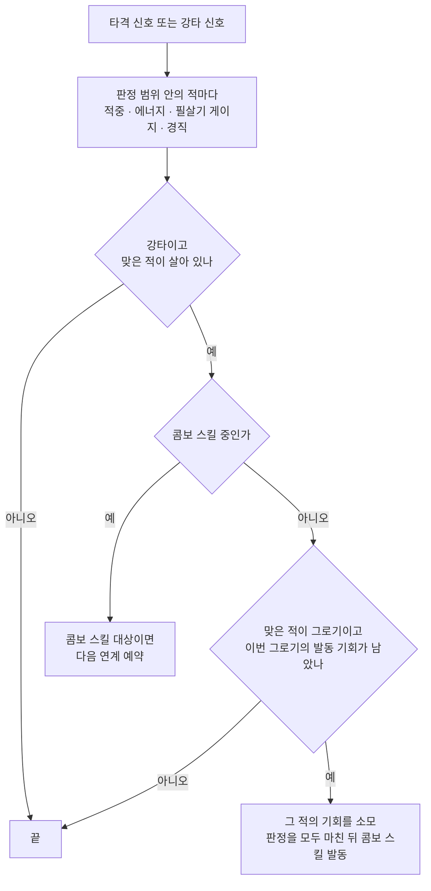
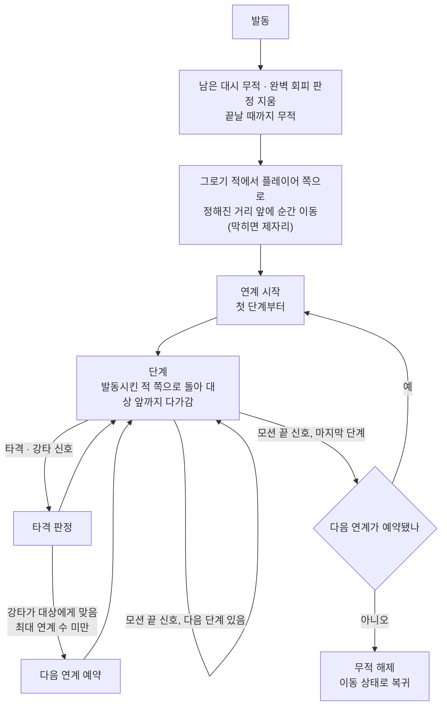

# 콤보 스킬과 그로기 · 강타

## 1. 개요

그로기 상태의 적을 강타로 맞히면 그 적 앞으로 순간 이동해 무적 콤보 스킬(체인 스킬)을 쓰는 1인 틀이다. 한 번의 콤보 스킬은 필살기처럼 여러 동작 단계로 이루어지고, 콤보 스킬의 마지막 강타가 그 적에게 맞으면 적이 정한 최대 연계 수까지 다음 연계가 이어진다. 코어 전투에서는 테스트 입력으로 적을 그로기로 만들어 시험하고, 파티 전투에서 그로기 게이지 · 캐릭터 연계로 확장한다. 강타는 모션의 특정 타격을 표시하는 신호로, 적 처치 판정에도 쓴다.

## 2. 구성 요소

- PlayerComboSkill : 한 번의 콤보 스킬을 이루는 단계(동작)별 설정, 발동 가능 여부, 그로기 적 앞 순간 이동
- PlayerComboSkillState : 단계 진행, 다음 연계 예약과 진행, 무적, 단계별 대상 접근과 타격
- PlayerGroggyDebug : [코어 전투 테스트] 입력으로 록온 대상 또는 자동 조준 대상을 그로기로 만드는 기능
- PlayerAnimationEventType · PlayerAnimationEventRelay : 모션에 찍는 강타 신호를 받아 넘기는 기능 (강타 관련 역할)
- PlayerController : 강타가 그로기 적에게 맞으면 판정을 마친 뒤 콤보 스킬을 발동하고, 콤보 스킬 중의 강타는 다음 연계로 넘기며, 발동 때 정한 대상을 끝까지 노리는 조준을 제공하는 플레이어 기능 (콤보 스킬 관련 역할)
- EnemyReaction : 그로기 상태와 시간, 그로기마다 한 번의 콤보 스킬 기회, 최대 연계 수를 가진 적 기능 (자세한 내용은 적 공통 규칙 문서)

## 3. 동작 원리

### 그로기

- 그로기가 되면 적은 진행 중인 공격을 끊고 그로기 모션으로 멈춘다. 그로기가 될 때마다 콤보 스킬 기회가 한 번 생긴다.
- 그로기 시간은 적 전용 시간으로 흐른다. 필살기 연출 동안은 멈추고, 콤보 스킬 중에는 계속 흐른다.
- 그로기 중에 다시 그로기를 걸면 시간을 처음부터 센다.
- 그로기 중에는 경직하지 않는다. 맞으면 피격 모션만 나오고 그로기가 유지된다.
- 적마다 최대 연계 수를 가진다. 일반 적 1, 엘리트 2 로 정했다.
- 그로기 기능이 없는 적은 그로기가 되지 않고 콤보 스킬도 받을 수 없다.
- 그로기 · 경직 규칙은 적 공통 규칙 문서에 적었다.

### 강타와 콤보 스킬 발동

- 강타는 타격과 똑같이 판정하고, 강타였다는 것만 함께 알린다. 한 프레임에 타격과 강타를 둘 다 찍으면 두 번 맞으므로 하나만 찍는다.
- 일반 공격 · 대시 공격 · 회피 반격 · 패링 추격 · 필살기 어디서 나온 강타든 그로기 적에게 맞으면 콤보 스킬이 발동한다. 필살기 중이었으면 필살기가 끝나고 콤보 스킬로 넘어간다.
- 한 번의 판정에서 콤보 스킬은 하나의 적에게만 발동하고, 발동하지 않은 다른 그로기 적의 기회는 남긴다.
- 판정을 모두 마친 뒤 콤보 스킬로 넘어가, 같은 판정의 다른 적도 에너지 · 게이지 · 경직을 빠짐없이 받는다.
- 강타로 처치된 적은 콤보 스킬 발동 · 연계 대상이 아니다. 처치가 먼저다.

### 콤보 스킬 진행과 연계

- 한 번의 콤보 스킬은 단계 설정의 개수만큼 동작을 이어 쓴다. 캐릭터마다 보통 한 동작을 쓰고, 애니메이션이 부족하면 여러 동작을 섞는다. 단계마다 위력 · 전진 거리 등을 따로 정한다.
- 다음 연계는 콤보 스킬 중 대상에게 맞은 강타로 정해진다. 강타 신호는 콤보 스킬 동작의 마지막 타격에 찍는다.
- 단계 수와 연계 수는 관계없다. 연계 수는 대상 적의 최대 연계 수까지다.
- 코어 전투는 1인이므로, 마지막 단계가 끝난 뒤 같은 콤보 스킬을 첫 단계부터 다시 쓴다.
- 입력을 읽지 않아 대시 · 공격 · 스킬 · 필살기로 끊기지 않는다. 무적 중이라 패링 · 교체 키도 무시된다.
- 적 시간은 멈추지 않는다.
- 도중에 록온을 바꾸거나 풀어도 콤보 스킬을 발동시킨 적에게 다가간다. 카메라는 바뀐 록온 대상을 따라간다. 필살기도 같은 규칙으로 발동 때 대상을 끝까지 노린다.

## 4. 구현 과정

- 활용한 기능 :
    - Animation Event : 강타 신호를 기존 타격 신호와 같은 방식으로 모션에 찍는다.
    - Animator 상태 직접 재생 : 단계마다 상태를 나눠 코드가 다음 상태를 재생한다.
    - Input System 프로젝트 공통 입력 : 테스트 입력을 기존 입력 에셋의 액션으로 받는다.
- 구현 과정 :
    1. 애니메이션 신호에 강타를 추가하고, 공격 · 필살기 상태가 강타를 타격처럼 처리하게 했다.
    2. 더미 적 공격 기능에 그로기 단계를 추가하고, 공격 중 그로기는 경직과 같은 기준으로 공격을 끊게 했다. 경직과 그로기가 함께 쓰는 공격 끊기를 하나로 모았다.
    3. 피격 깜빡임이 끝나면 처음 색으로 돌아가 경직 · 그로기 색이 사라지는 문제가 있어, 피격 반응과 상태 표시 색을 나눴다.
    4. 그로기마다 콤보 스킬 발동 기회를 두고, 타격 판정에서 강타가 그로기 적에게 맞으면 기회를 소모해 콤보 스킬을 발동하게 했다.
    5. 콤보 스킬 상태를 만들고 순간 이동 · 무적 · 연계 단계 진행을 넣었다.
    6. 필살기 · 콤보 스킬 도중 록온을 바꾸면 새 록온 대상에게 다가가는 문제가 있어, 발동 때 정한 대상을 끝까지 노리게 바꿨다.
    7. 일반 적을 만들며 그로기 · 콤보 스킬 기회를 적 공통 반응 기능으로 옮기고, 연계 수를 플레이어 설정 수 대신 대상 적의 최대 연계 수로 바꿨다.
    8. 연계 한 번이 동작 하나였던 구조를, 한 번의 콤보 스킬이 여러 단계를 모두 재생하고 강타로 다음 연계를 정하는 구조로 바꿨다. 그로기 기능이 없는 적에게 플레이어 설정 수로 연계하던 처리는 지웠다.
- 주요 결정과 이유 :
    - 콤보 스킬은 강타로만 발동한다. 강타는 적 처치 판정에도 쓰기 때문이다.
    - 그로기마다 한 번만 발동한다. 콤보 스킬 캔슬은 나중에 검토한다.
    - 콤보 스킬은 순간 이동과 무적, 끊기 불가는 필살기와 같게 하고, 적 시간은 멈추지 않는다.
    - 같은 모션이라도 단계마다 Animator 상태를 나눴다. 재생 중인 상태를 다시 재생하면 처음부터 재생되지 않을 수 있고, 섞이는 동안 이전 회차의 모션 끝 신호와 구분할 수 없기 때문이다.
    - 그로기 중에는 경직하지 않는다. 피격 모션(반응)과 경직 · 그로기(상태)는 나눠 다루기로 했다.
    - 도중에 록온을 바꿔도 발동 때 대상을 유지한다. 록온 입력을 막는 방법은 록온 대상이 사거리 밖으로 나가 자동으로 풀리는 경우를 막지 못하기 때문이다.
    - 콤보 스킬 상태는 필살기 상태와 겹치는 부분이 있지만 따로 두었다. 파티 전투에서 슬로모션 · 캐릭터 선택 · 교체가 붙어 흐름이 달라지기 때문이다.
    - 최대 연계 수는 적이 가진다. 적의 등급에 따라 연계 수가 달라지는 규칙이기 때문이다. 그로기 기능이 없는 적은 콤보 스킬을 받을 수 없다.
    - 단계 수와 연계 수를 나눴다. 한 번의 콤보 스킬은 캐릭터의 동작 묶음이고, 연계는 그 콤보 스킬을 몇 번 이어 쓰는지라서 서로 다른 값이다.
    - 다음 연계는 동작이 끝난 것이 아니라 마지막 강타로 정한다. 파티 전투에서는 강타 순간 다음 캐릭터가 콤보 스킬을 시전하고, 기존 캐릭터는 남은 동작을 마무리한 뒤 대기 상태로 들어가게 확장할 예정이다.
    - 필드 이름은 콤보 스킬의 영문 명칭(chain skill)에 맞춰 체인 단계로 둔다.
- 레퍼런스 : 젠레스 존 제로의 연계 공격(체인 스킬)

## 5. 기존 방식과 비교

- 기존 방식 :
    - 더미 적의 피격 깜빡임이 끝나면 처음 색으로 돌아갔다. 필살기는 단계마다 록온 대상을 먼저 노렸다.
    - 연계 한 번이 동작 하나였다. 동작이 끝나면 강타와 상관없이 다음 연계로 넘어가, 연계 단계 설정 수(3)만큼 같은 모션을 이어 썼다.
    - 일반 적 단계 초반에는 연계 수를 적의 최대 연계 수로 바꿨지만, 연계마다 단계 설정을 하나씩 쓰는 구조는 그대로였다. 그로기 기능이 없는 적은 플레이어 설정 수만큼 연계했다.
- 달라진 점 :
    - 깜빡임이 끝나면 그때의 상태 색으로 돌아간다. 필살기 · 콤보 스킬은 발동 때 대상을 끝까지 노린다.
    - 한 번의 콤보 스킬이 단계 설정의 동작을 모두 재생한다. 다음 연계는 대상에게 맞은 강타로 정해지고, 적의 최대 연계 수까지 이어진다.
    - 그로기 기능이 없는 적은 콤보 스킬을 받지 않는다.
- 개선된 점 :
    - 경직 · 그로기 중에 맞아도 상태가 보이고, 도중의 록온 변경으로 공격 대상이 바뀌지 않는다.
    - 콤보 스킬 하나에 여러 동작을 섞을 수 있고, 적 등급에 따라 연계 수가 달라진다. 파티 전투의 캐릭터 연계로 확장할 틀이 생겼다.
- 필요하게 된 과정 : 기획서 코어 전투 4묶음의 두 번째 단계다. 파티 전투의 그로기 → 연계 공격을 만들기 전에, 1인으로 발동 · 진행 · 복귀 흐름을 먼저 확인하기 위해 만들었다.

### 미검증 항목

- 그로기 게이지 누적, 그로기 시간 규칙, 캐릭터 선택 UI · 슬로모션, 3명 연계 (파티 전투 단계)
- 콤보 스킬 캔슬 (추가 콘텐츠 단계)
- 콤보 시작 카메라 워크
- 동작이 하나인 콤보 스킬로 2연계 이상 이어질 때, 같은 상태를 연속으로 재생하는 문제 (캐릭터 추가 단계에서 문제가 되면 검토)
- 엘리트(최대 연계 2) 적에서의 실제 연계
