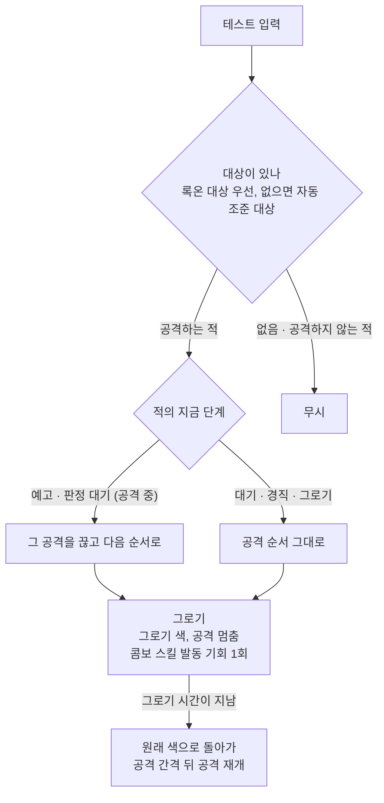
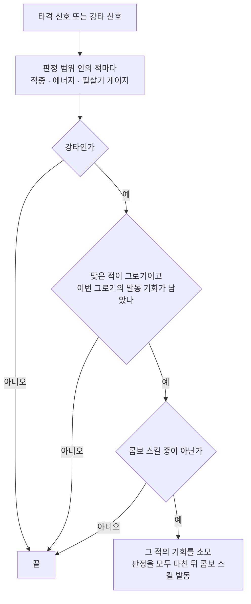
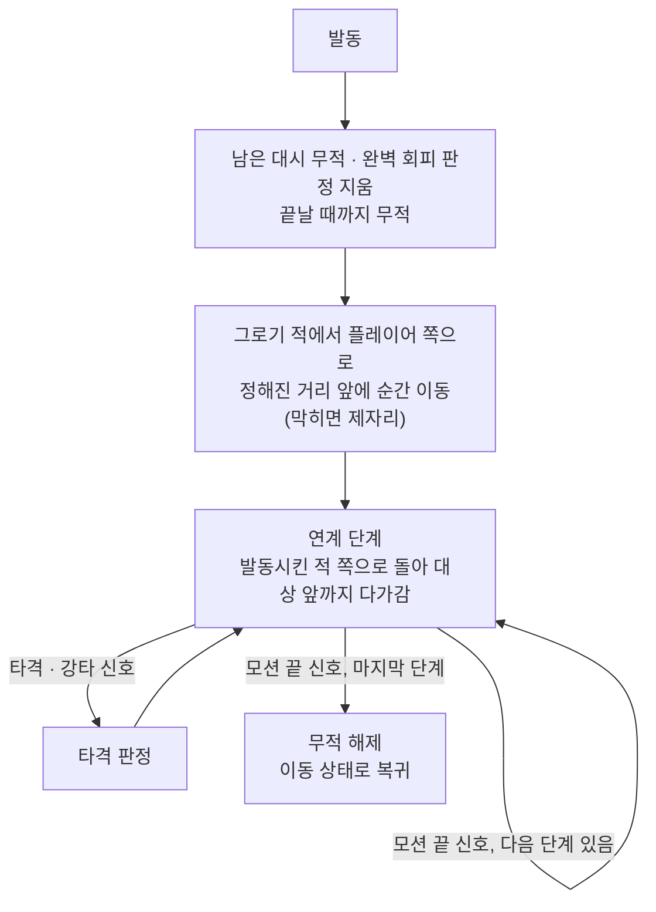

# 콤보 스킬과 그로기 · 강타

## 1. 개요

그로기 상태의 적을 강타로 맞히면 그 적 앞으로 순간 이동해 무적 3연계 공격을 쓰는 콤보 스킬의 1인 틀이다. 코어 전투에서는 테스트 입력으로 적을 그로기로 만들어 시험하고, 파티 전투에서 그로기 게이지 · 캐릭터 연계로 확장한다. 강타는 모션의 특정 타격을 표시하는 신호로, 이후 몬스터 처치 판정에도 쓴다.

## 2. 구성 요소

- PlayerComboSkill : 콤보 스킬 연계 단계 설정, 발동 가능 여부, 그로기 적 앞 순간 이동
- PlayerComboSkillState : 연계 단계 진행, 무적, 단계별 대상 접근과 타격
- PlayerGroggyDebug : [코어 전투 테스트] 입력으로 록온 대상 또는 자동 조준 대상을 그로기로 만드는 기능
- PlayerAnimationEventType · PlayerAnimationEventRelay : 모션에 찍는 강타 신호를 받아 넘기는 기능 (강타 관련 역할)
- PlayerController : 강타가 그로기 적에게 맞으면 판정을 마친 뒤 콤보 스킬을 발동하고, 발동 때 정한 대상을 끝까지 노리는 조준을 제공하는 플레이어 기능 (콤보 스킬 관련 역할)
- DummyEnemy : 피격 깜빡임과 상태 표시 색을 나눠 처리하는 시험용 적 (피격 반응 역할)
- DummyEnemyAttacker : 그로기 상태, 그로기마다 한 번의 콤보 스킬 발동 기회를 관리하는 시험용 적 공격 기능 (그로기 역할)

## 3. 동작 원리

### 그로기

- 그로기 시간은 적 전용 시간으로 흐른다. 필살기 연출 동안은 멈추고, 콤보 스킬 중에는 계속 흐른다.
- 그로기 중에 다시 그로기를 걸면 시간을 처음부터 센다.
- 그로기 중에는 경직하지 않는다. 필살기에 맞아도 그로기가 유지되고 피격 깜빡임만 나온다.
- 피격 깜빡임과 상태 색(예고 · 경직 · 그로기)을 나눴다. 상태 색은 적의 기본 색으로 정하고, 깜빡임은 끝나면 그때의 기본 색으로 돌아간다. 그래서 경직 · 그로기 · 예고 중에 맞아도 상태 색이 사라지지 않는다.

### 강타와 콤보 스킬 발동

- 강타는 타격과 똑같이 판정하고, 강타였다는 것만 함께 알린다. 한 프레임에 타격과 강타를 둘 다 찍으면 두 번 맞으므로 하나만 찍는다.
- 일반 공격 · 대시 공격 · 회피 반격 · 패링 추격 · 필살기 어디서 나온 강타든 그로기 적에게 맞으면 콤보 스킬이 발동한다. 필살기 중이었으면 필살기가 끝나고 콤보 스킬로 넘어간다.
- 한 번의 판정에서 콤보 스킬은 하나의 적에게만 발동하고, 발동하지 않은 다른 그로기 적의 기회는 남긴다.
- 판정을 모두 마친 뒤 콤보 스킬로 넘어가, 같은 판정의 다른 적도 에너지 · 게이지 · 경직을 빠짐없이 받는다.

### 콤보 스킬 진행

- 연계 단계 설정의 개수만큼 이어간다. 코어 전투에서는 1인이므로 같은 모션을 세 번 이어 쓴다.
- 입력을 읽지 않아 대시 · 공격 · 스킬 · 필살기로 끊기지 않는다. 무적 중이라 패링 · 교체 키도 무시된다.
- 적 시간은 멈추지 않는다.
- 도중에 록온을 바꾸거나 풀어도 콤보 스킬을 발동시킨 적에게 다가간다. 카메라는 바뀐 록온 대상을 따라간다. 필살기도 같은 규칙으로 발동 때 대상을 끝까지 노린다.

## 4. 구현 과정

- 활용한 기능 :
    - Animation Event : 강타 신호를 기존 타격 신호와 같은 방식으로 모션에 찍는다.
    - Animator 상태 직접 재생 : 연계 단계마다 상태를 나눠 코드가 다음 상태를 재생한다.
    - Input System 프로젝트 공통 입력 : 테스트 입력을 기존 입력 에셋의 액션으로 받는다.
- 구현 과정 :
    1. 애니메이션 신호에 강타를 추가하고, 공격 · 필살기 상태가 강타를 타격처럼 처리하게 했다.
    2. 더미 적 공격 기능에 그로기 단계를 추가하고, 공격 중 그로기는 경직과 같은 기준으로 공격을 끊게 했다. 경직과 그로기가 함께 쓰는 공격 끊기를 하나로 모았다.
    3. 피격 깜빡임이 끝나면 처음 색으로 돌아가 경직 · 그로기 색이 사라지는 문제가 있어, 피격 반응과 상태 표시 색을 나눴다.
    4. 그로기마다 콤보 스킬 발동 기회를 두고, 타격 판정에서 강타가 그로기 적에게 맞으면 기회를 소모해 콤보 스킬을 발동하게 했다.
    5. 콤보 스킬 상태를 만들고 순간 이동 · 무적 · 연계 단계 진행을 넣었다.
    6. 필살기 · 콤보 스킬 도중 록온을 바꾸면 새 록온 대상에게 다가가는 문제가 있어, 발동 때 정한 대상을 끝까지 노리게 바꿨다.
- 주요 결정과 이유 :
    - 콤보 스킬은 강타로만 발동한다. 강타는 이후 몬스터 처치 판정에도 쓰기 때문이다.
    - 그로기마다 한 번만 발동한다. 콤보 스킬 캔슬은 나중에 검토한다.
    - 콤보 스킬은 순간 이동과 무적, 끊기 불가는 필살기와 같게 하고, 적 시간은 멈추지 않는다.
    - 같은 모션이라도 연계 단계마다 Animator 상태를 나눴다. 재생 중인 상태를 다시 재생하면 처음부터 재생되지 않을 수 있고, 섞이는 동안 이전 회차의 모션 끝 신호와 구분할 수 없기 때문이다. 파티 전투에서 단계마다 다른 캐릭터 모션으로 바꾸기도 쉽다.
    - 그로기 중에는 경직하지 않는다. 피격 모션(반응)과 경직 · 그로기(상태)는 나눠 다루기로 했다.
    - 도중에 록온을 바꿔도 발동 때 대상을 유지한다. 록온 입력을 막는 방법은 록온 대상이 사거리 밖으로 나가 자동으로 풀리는 경우를 막지 못하기 때문이다.
    - 콤보 스킬 상태는 필살기 상태와 겹치는 부분이 있지만 따로 두었다. 파티 전투에서 슬로모션 · 캐릭터 선택 · 교체가 붙어 흐름이 달라지기 때문이다.
- 레퍼런스 : 젠레스 존 제로의 연계 공격

## 5. 기존 방식과 비교

- 기존 방식 : 더미 적의 피격 깜빡임이 끝나면 처음 색으로 돌아갔다. 필살기는 단계마다 록온 대상을 먼저 노렸다.
- 달라진 점 : 깜빡임이 끝나면 그때의 상태 색으로 돌아간다. 필살기 · 콤보 스킬은 발동 때 대상을 끝까지 노린다.
- 개선된 점 : 경직 · 그로기 중에 맞아도 상태가 보이고, 도중의 록온 변경으로 공격 대상이 바뀌지 않는다.
- 필요하게 된 과정 : 기획서 코어 전투 4묶음의 두 번째 단계다. 파티 전투의 그로기 → 연계 공격을 만들기 전에, 1인으로 발동 · 진행 · 복귀 흐름을 먼저 확인하기 위해 만들었다.

### 주의 항목

- 공격 목록이 비어 있는 적은 그로기 · 경직 시간이 흐르지 않아 풀리지 않는다. 테스트용 적은 항상 공격 방식을 1개 이상 유지하기로 정했다.

### 미검증 항목

- 그로기 게이지 누적, 그로기 시간 규칙, 캐릭터 선택 UI · 슬로모션, 3명 연계 (파티 전투 단계)
- 콤보 스킬 캔슬 (추가 콘텐츠 단계)
- 콤보 시작 카메라 워크
- 강타를 이용한 몬스터 처치 판정 (일반 적 단계)
