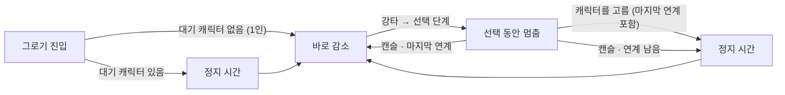
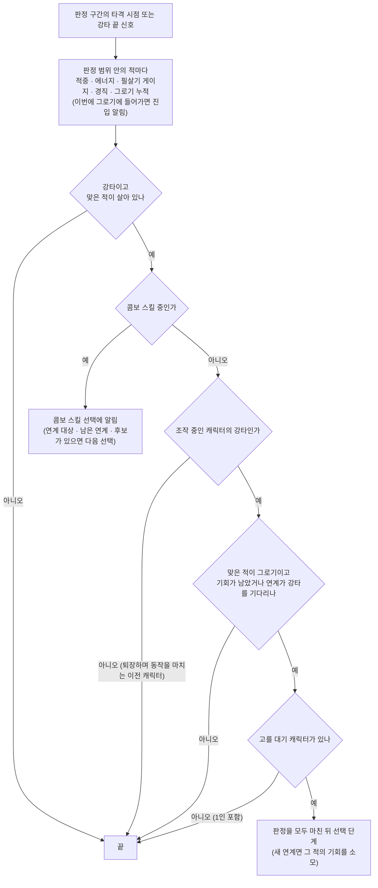
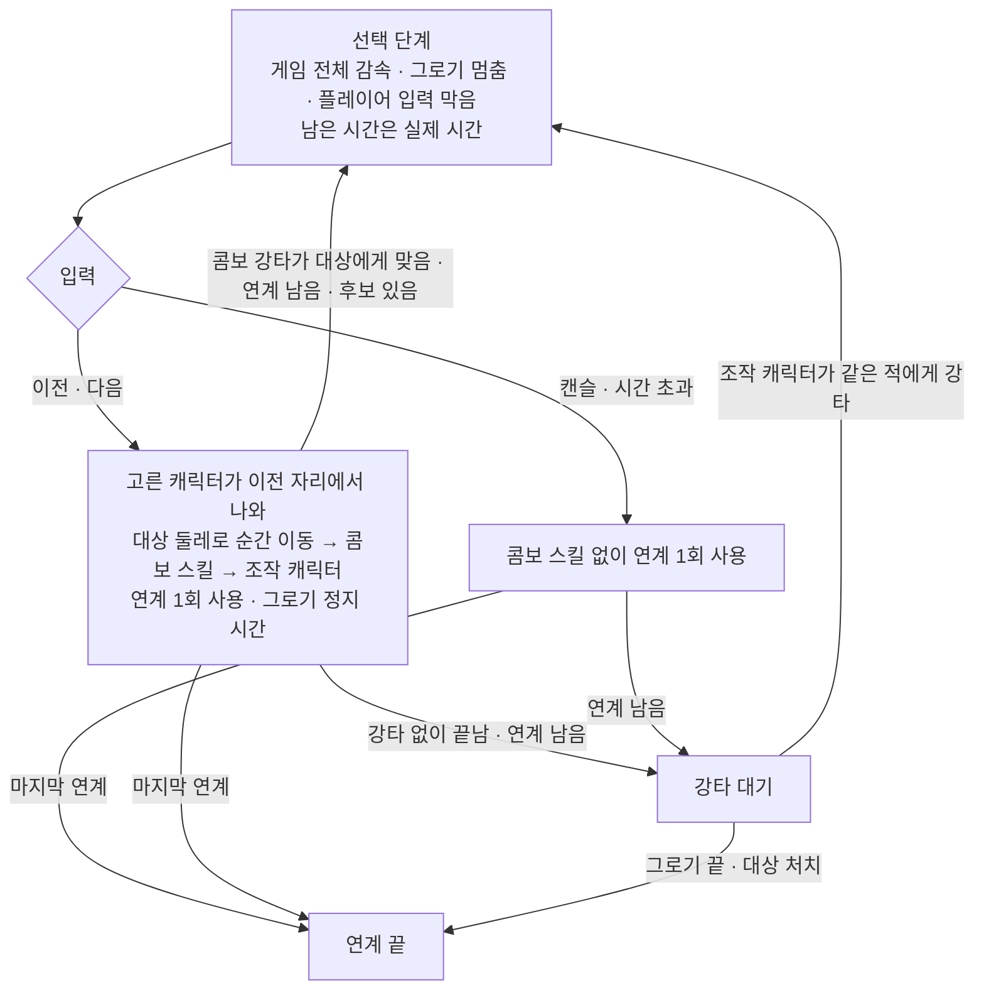
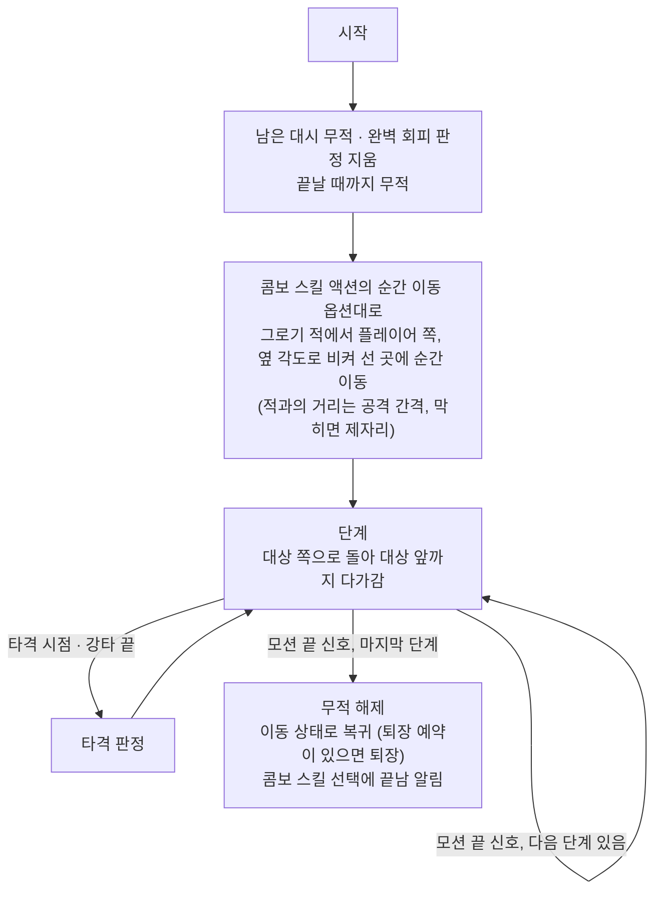

# 콤보 스킬과 그로기 · 강타

## 1. 개요

그로기 상태의 적을 강타로 맞히면 게임이 느려지며 캐릭터 선택 화면이 열리고, 고른 캐릭터가 그 적 둘레로 순간 이동해 무적 콤보 스킬(체인 스킬)을 이어받는 파티 연계 체계다. 한 번의 콤보 스킬은 필살기처럼 여러 동작 단계로 이루어지고, 콤보 스킬의 강타가 그 적에게 맞으면 적이 정한 최대 연계 수까지 다음 캐릭터를 다시 고른다. 적은 공격 적중 · 패링 성공으로 쌓인 그로기 게이지가 가득 차면 그로기가 된다. 강타는 모션의 특정 타격을 표시하는 신호로, 적 처치 판정에도 쓴다.

## 2. 구성 요소

- ComboSkillSelector : 콤보 스킬 발동 판정과 연계 진행을 맡는 전투 공통 규칙 (파티 오브젝트에 하나). 캐릭터 선택 단계 · 게임 감속 · 실제 시간 카운트 · 선택과 캔슬 · 연계 횟수 · 쓴 캐릭터 · 그로기 정지 지시
- ComboSelectionView : [임시 표시] 캐릭터 선택 화면 (이전 · 다음 캐릭터 이름, 남은 시간, 캔슬 키)
- PlayerParty : 고른 캐릭터를 교체처럼 이전 캐릭터 자리에 꺼내 콤보 스킬로 들여보내고, 선택 중 입력을 막는 파티 기능 (콤보 스킬 관련 역할)
- PlayerActionTrigger : 고른 캐릭터의 콤보 스킬 상태를 시작하고, 콤보 스킬 중 강타를 콤보 스킬 선택에 알리는 특수 행동 시작 기능. 콤보 스킬 액션은 캐릭터 데이터에서 읽는다
- PlayerComboSkillState : 순간 이동, 무적, 단계 진행, 단계별 대상 접근과 타격. 끝나면 콤보 스킬 선택에 알린다
- TeleportManager · TeleportOption : 콤보 스킬 액션에 붙인 순간 이동 옵션대로 그로기 적 둘레에 비켜 서는 순간 이동 (콤보 스킬 관련 역할)
- PlayerAnimationEventType · PlayerAnimationEventRelay : 모션에 찍는 판정 시작 · 강타 끝 신호를 받아 넘기는 기능 (강타 관련 역할)
- PlayerAttackJudge : 강타가 그로기 적에게 맞으면 판정을 마친 뒤 콤보 스킬 선택을 열고, 그로기 진입을 알리는 판정 기능 (콤보 스킬 관련 역할)
- PlayerController : 발동 때 정한 대상을 끝까지 노리는 조준을 제공하는 플레이어 기능 (콤보 스킬 관련 역할)
- EnemyReaction : 그로기 게이지, 그로기 상태와 시간 · 시간 정지, 그로기마다 한 번의 콤보 스킬 기회, 최대 연계 수를 가진 적 기능 (자세한 내용은 적 공통 규칙 문서)

## 3. 동작 원리

### 그로기

- 그로기가 되면 적은 진행 중인 공격을 끊고 그로기 모션으로 멈춘다. 그로기가 될 때마다 콤보 스킬 기회가 한 번 생긴다.
- 그로기 시간은 적 전용 시간으로 흐른다. 필살기 연출 동안은 멈추고, 콤보 스킬 중에는 계속 흐른다.
- 그로기 게이지는 공격 적중 · 패링 성공으로 쌓이고, 가득 차면 그로기가 된다. 그로기 중에는 쌓이지 않고, 끝나면 0 부터 다시 쌓는다.
- 그로기 중에는 경직하지 않는다. 맞으면 피격 모션만 나오고 그로기가 유지된다.
- 적마다 최대 연계 수를 가진다. 일반 적 1, 엘리트 2 로 정했다.
- 그로기 기능이 없는 적은 그로기가 되지 않고 콤보 스킬도 받을 수 없다.
- 그로기 · 경직 규칙은 적 공통 규칙 문서에 적었다.

### 그로기 시간 정지

- 콤보 연계를 이어 갈 틈을 주기 위해, 플레이어 쪽(콤보 스킬 선택)이 정해진 순간에 그로기 시간을 멈춘다. 적은 시키는 대로 멈추기만 한다.
- 정지 시간은 그로기 진입 순간(대기 캐릭터가 있을 때), 연계의 콤보 스킬 시전을 시작할 때마다(마지막 연계 포함), 연계가 남은 캔슬에 건다. 새로 걸면 남은 정지 시간을 버리고 처음부터 센다.
- 캐릭터 선택 화면이 떠 있는 동안에는 그로기 시간이 멈춘다.
- 마지막 연계를 콤보 스킬 없이 캔슬하면 정지 없이 바로 줄어든다. 대기 캐릭터가 없으면(1인) 진입 정지도 없다.
- 멈춘 동안 남은 그로기 시간은 그대로이고, 다시 흐를 때 이어서 줄어든다. 처음 값으로 되돌리지 않는다.

### 강타와 콤보 스킬 발동

- 강타는 판정 구간의 마지막 타격이다. 강타 끝 신호가 오면 끝 시점의 타격을 강타로 판정하고 구간을 닫는다. 판정은 일반 타격과 같고, 강타였다는 것만 함께 알린다. 구간 판정 규칙은 공격 문서의 `판정 구간 · 다단 히트 · 히트렉` 에 적었다.
- 발동 판정은 어느 캐릭터 · 어느 적에게나 같은 규칙이라, 캐릭터가 아닌 파티 오브젝트의 콤보 스킬 선택 하나가 맡는다.
- 일반 공격 · 대시 공격 · 회피 반격 · 패링 추격 · 필살기 어디서 나온 강타든 그로기 적에게 맞으면 선택 단계가 열린다. 강타를 맞힌 캐릭터는 하던 동작을 느린 속도로 이어 간다.
- 조작 중인 캐릭터의 강타만 선택 단계를 연다. 교체로 나가며 하던 동작을 마치는 이전 캐릭터의 강타는 위력 · 그로기 누적은 그대로 주지만 선택 단계를 열지 않고, 적의 발동 기회도 소모하지 않는다.
- 고를 대기 캐릭터가 없으면(1인 포함) 선택 단계 · 콤보 스킬이 나오지 않고 적의 기회도 남는다. 패링처럼 교체로 나오는 행동이기 때문이다.
- 한 번의 판정에서 콤보 스킬은 하나의 적에게만 발동하고, 발동하지 않은 다른 그로기 적의 기회는 남긴다.
- 그로기를 쌓은 뒤 발동을 확인하므로, 게이지를 채운 타격이 강타라면 그 강타로 바로 선택 단계가 열린다. (젠레스 존 제로와 같은 흐름)
- 강타로 처치된 적은 콤보 스킬 발동 · 연계 대상이 아니다. 처치가 먼저다.

### 캐릭터 선택과 연계

- **선택 단계** : 게임 전체 시간 배율을 낮춰 적 · 캐릭터 · 타격 간격 · 카메라가 함께 느려진다. 선택 화면과 남은 시간은 실제 시간으로 흐른다. 완벽 회피 슬로모션이 남아 있으면 겹치지 않게 끝낸다.
- **선택 입력** : 이전은 교체(이전) · 공격 · 필살기, 다음은 교체(다음) · 대시 · 스킬 입력으로 고른다. 기존 입력 동작을 그대로 읽어, 키를 바꾸면 선택 키도 함께 바뀌고 게임패드 · 조이콘도 같은 버튼으로 고른다. 선택 중에는 이 입력이 원래 행동으로 나가지 않고, 이동 · 록온 등 다른 입력도 막는다. 선택을 마친 프레임까지 막아, 선택에 쓴 입력이 같은 프레임에 공격 · 교체로 다시 읽히지 않는다.
- **후보** : 이번 연계에서 아직 콤보 스킬을 쓰지 않은 대기 캐릭터다. 처음 강타를 맞힌 캐릭터도 대기 중이면 후보다. 이전 · 다음 방향으로 처음 만나는 후보를 고르고, 후보가 하나면 두 입력 모두 그 캐릭터다.
- **이어받기** : 고른 캐릭터는 교체처럼 이전 캐릭터 자리에 나와 콤보 스킬의 순간 이동을 하므로, 남아 있는 이전 캐릭터 위치를 기준으로 비켜 선다. 이전 캐릭터는 하던 동작(콤보 스킬 포함)을 마친 뒤 퇴장한다.
- **캔슬** : 캔슬 입력이나 시간 초과는 콤보 스킬 없이 연계 1회를 쓴다. 연계가 남았으면 조작 캐릭터가 같은 그로기 적에게 강타를 맞혀 다시 선택 단계를 연다. 캔슬은 콤보 스킬을 쓴 것으로 치지 않아 후보가 줄지 않는다. (예 : 최대 연계 3 → 강타 · 콤보 · 캔슬 · 강타 · 콤보)
- **강타 대기** : 콤보 스킬이 대상에게 강타를 맞히지 못하고 끝나도, 연계가 남았으면 캔슬처럼 강타로 다시 선택 단계를 연다. 그로기가 끝나거나 대상이 처치되면 남은 연계는 사라진다.

### 콤보 스킬 진행

- 한 번의 콤보 스킬은 단계 설정의 개수만큼 동작을 한 번 이어 쓴다. 캐릭터마다 보통 한 동작을 쓰고, 애니메이션이 부족하면 여러 동작을 섞는다. 단계마다 위력 · 전진 거리 등을 따로 정한다.
- 다음 연계는 콤보 스킬 중 대상에게 맞은 강타로 정해진다. 콤보 스킬 동작의 판정 구간은 강타 끝 신호로 끝나게 찍는다.
- 단계 수와 연계 수는 관계없다. 연계 수는 대상 적의 최대 연계 수까지다.
- 입력을 읽지 않아 대시 · 공격 · 스킬 · 필살기로 끊기지 않는다. 교체는 콤보 스킬 액션의 동작마다 정한 끼어들기 허용을 따르고, 첫 동작이 시작되기 전에는 교체할 수 없다. (공격 문서의 `끼어들기 허용`)
- 적 시간은 멈추지 않는다.
- 서는 방향과 옆 각도 범위는 콤보 스킬 액션에 붙인 순간 이동 옵션이 정한다. 각도와 좌우는 발동할 때마다 범위 안에서 무작위로 고른다.
- 단계마다 대상 앞에서 멈추는 거리는 일반 공격과 같은 몸 표면 기준이다.
- 도중에 록온을 바꾸거나 풀어도 콤보 스킬 대상에게 다가간다. 카메라는 바뀐 록온 대상을 따라간다. 필살기도 같은 규칙으로 발동 때 대상을 끝까지 노린다.

## 4. 구현 과정

- 활용한 기능 :
    - Animation Event : 강타를 처음에는 한 순간의 신호로 찍었고, 타격 기능 작업(#35)에서 판정 구간을 닫는 강타 끝 신호로 바꿨다.
    - Animator 상태 직접 재생 : 단계마다 상태를 나눠 코드가 다음 상태를 재생한다.
    - `Time.timeScale` · `Time.unscaledDeltaTime` : 선택 단계 동안 게임 전체를 한 번에 느리게 하고, 남은 시간은 시간 배율을 무시하는 실제 시간으로 센다.
    - uGUI Canvas · TextMeshPro : 임시 선택 화면을 만든다.
    - Input System 입력 동작 : 선택은 기존 동작을 그대로 읽고, 캔슬은 새 입력 동작으로 추가했다.
- 구현 과정 :
    1. 애니메이션 신호에 강타를 추가하고, 공격 · 필살기 상태가 강타를 타격처럼 처리하게 했다.
    2. 더미 적 공격 기능에 그로기 단계를 추가하고, 공격 중 그로기는 경직과 같은 기준으로 공격을 끊게 했다. 경직과 그로기가 함께 쓰는 공격 끊기를 하나로 모았다.
    3. 피격 깜빡임이 끝나면 처음 색으로 돌아가 경직 · 그로기 색이 사라지는 문제가 있어, 피격 반응과 상태 표시 색을 나눴다.
    4. 그로기마다 콤보 스킬 발동 기회를 두고, 타격 판정에서 강타가 그로기 적에게 맞으면 기회를 소모해 콤보 스킬을 발동하게 했다.
    5. 콤보 스킬 상태를 만들고 순간 이동 · 무적 · 연계 단계 진행을 넣었다.
    6. 필살기 · 콤보 스킬 도중 록온을 바꾸면 새 록온 대상에게 다가가는 문제가 있어, 발동 때 정한 대상을 끝까지 노리게 바꿨다.
    7. 일반 적을 만들며 그로기 · 콤보 스킬 기회를 적 공통 반응 기능으로 옮기고, 연계 수를 플레이어 설정 수 대신 대상 적의 최대 연계 수로 바꿨다.
    8. 연계 한 번이 동작 하나였던 구조를, 한 번의 콤보 스킬이 여러 단계를 모두 재생하고 강타로 다음 연계를 정하는 구조로 바꿨다. 그로기 기능이 없는 적에게 플레이어 설정 수로 연계하던 처리는 지웠다.
    9. (#45) 발동 판정 · 연계 진행을 파티 오브젝트의 콤보 스킬 선택으로 옮기고, 캐릭터 선택 단계(게임 감속 · 실제 시간 카운트 · 선택 입력)와 고른 캐릭터의 이어받기를 만들었다. 같은 캐릭터가 연계를 반복하던 처리는 지웠다.
    10. (#45) 적의 그로기 시간을 멈추는 기능(정지 시간 · 선택 중 멈춤)을 만들고, 그로기 진입 · 연계 시전 · 캔슬에 맞춰 걸게 했다.
    11. (#45) 선택 단계 캔슬을 추가했다. 처음에는 연계 전체를 끝내도록 생각했다가, 연계 1회를 쓰고 남으면 강타로 다시 여는 규칙으로 정했다. 이때 콤보 스킬이 강타 없이 끝나면 연계가 진행 중으로 남아 다시 시작할 수 없는 문제를 찾아, 강타 대기로 넘어가게 고쳤다.
- 주요 결정과 이유 :
    - 콤보 스킬은 강타로만 발동한다. 강타는 적 처치 판정에도 쓰기 때문이다.
    - 콤보 스킬은 순간 이동과 무적, 끊기 불가는 필살기와 같게 하고, 적 시간은 멈추지 않는다.
    - 같은 모션이라도 단계마다 Animator 상태를 나눴다. 재생 중인 상태를 다시 재생하면 처음부터 재생되지 않을 수 있고, 섞이는 동안 이전 회차의 모션 끝 신호와 구분할 수 없기 때문이다.
    - 그로기 중에는 경직하지 않는다. 피격 모션(반응)과 경직 · 그로기(상태)는 나눠 다루기로 했다.
    - 도중에 록온을 바꿔도 발동 때 대상을 유지한다. 록온 입력을 막는 방법은 록온 대상이 사거리 밖으로 나가 자동으로 풀리는 경우를 막지 못하기 때문이다.
    - 최대 연계 수는 적이 가진다. 적의 등급에 따라 연계 수가 달라지는 규칙이기 때문이다. 그로기 기능이 없는 적은 콤보 스킬을 받을 수 없다.
    - 단계 수와 연계 수를 나눴다. 한 번의 콤보 스킬은 캐릭터의 동작 묶음이고, 연계는 그 콤보 스킬을 몇 번 이어 쓰는지라서 서로 다른 값이다.
    - (#45) 강타를 맞힌 캐릭터는 콤보 스킬을 쓰지 않고, 고른 캐릭터가 이어받는다. 대기 캐릭터가 없으면 콤보 스킬이 없다. 지원 공격과 같은 "교체로 나오는 행동" 규칙이다.
    - (#45) 게임 전체 감속은 Unity 전체 시간 배율 하나로 했다. 캐릭터 · 적 시간 배율을 따로 낮추면 카메라 · 모션 재생 속도까지 따로 맞춰야 하기 때문이다. 선택 중에는 슬로모션 · 히트렉 타이머도 함께 느려진다.
    - (#45) 선택은 기존 입력 동작을 읽는다. 키를 바꿀 때 한 곳만 관리하면 되기 때문이다. 그래서 대시 동작에 묶인 Shift 도 다음 선택이 된다.
    - (#45) 그로기 진입은 적이 "이번에 그로기가 되었는지" 를 돌려주고, 그로기를 쌓은 쪽이 콤보 스킬 선택에 알린다. 적이 파티를 몰라도 된다.
    - (#45) 선택 흐름은 파티와 따로 둔 콤보 스킬 선택 기능이 맡는다. 파티가 교체 · 지원 · 선택을 모두 맡아 커지지 않게 하기 위해서다. 고른 캐릭터를 들여보내는 일은 파티의 교체를 다시 쓴다.
- 레퍼런스 : 젠레스 존 제로의 연계 공격(체인 스킬)과 캐릭터 선택

## 5. 기존 방식과 비교

- 기존 방식 :
    - 더미 적의 피격 깜빡임이 끝나면 처음 색으로 돌아갔다. 필살기는 단계마다 록온 대상을 먼저 노렸다.
    - 연계 한 번이 동작 하나였다. 동작이 끝나면 강타와 상관없이 다음 연계로 넘어가, 연계 단계 설정 수(3)만큼 같은 모션을 이어 썼다.
    - 일반 적 단계 초반에는 연계 수를 적의 최대 연계 수로 바꿨지만, 연계마다 단계 설정을 하나씩 쓰는 구조는 그대로였다. 그로기 기능이 없는 적은 플레이어 설정 수만큼 연계했다.
- 달라진 점 :
    - 깜빡임이 끝나면 그때의 상태 색으로 돌아간다. 필살기 · 콤보 스킬은 발동 때 대상을 끝까지 노린다.
    - 한 번의 콤보 스킬이 단계 설정의 동작을 모두 재생한다. 다음 연계는 대상에게 맞은 강타로 정해지고, 적의 최대 연계 수까지 이어진다.
    - 그로기 기능이 없는 적은 콤보 스킬을 받지 않는다.
- 개선된 점 :
    - 경직 · 그로기 중에 맞아도 상태가 보이고, 도중의 록온 변경으로 공격 대상이 바뀌지 않는다.
    - 콤보 스킬 하나에 여러 동작을 섞을 수 있고, 적 등급에 따라 연계 수가 달라진다.
- 필요하게 된 과정 : 기획서 코어 전투 4묶음의 두 번째 단계다. 파티 전투의 그로기 → 연계 공격을 만들기 전에, 1인으로 발동 · 진행 · 복귀 흐름을 먼저 확인하기 위해 만들었다.

- 구조 정리 (#31) : (자세한 내용은 플레이어 구성과 데이터 문서)
    - 기존 : 콤보 스킬 단계마다 설정 묶음을 따로 두고, 단계 번호로 모션 이름을 만들었다. 순간 이동은 플레이어 쪽으로 정해진 거리 앞에 섰다.
    - 변경 : 콤보 스킬은 동작 목록을 가진 액션 하나다. 순간 이동은 공통 간격 그대로, 범위 안 무작위 옆 각도 · 좌우로 비켜 선다. 파티 전투에서 남아 있는 캐릭터와 교체된 캐릭터가 같은 자리에서 콤보 스킬을 쓰지 않게 하기 위해서다.

- 컴포넌트 병합 · 정리 (#33) : (자세한 내용은 플레이어 구성과 데이터 문서)
    - 기존 : 콤보 스킬 전용 기능이 발동 · 연계 알림과 옆 각도 값 · 순간 이동을 들고 있었다.
    - 변경 : 발동 · 연계 알림은 패링 · 필살기와 함께 특수 행동 시작 기능으로 옮겼다. 옆 각도와 서는 방향은 콤보 스킬 액션의 순간 이동 옵션으로, 순간 이동은 공통 규칙으로 옮겼다.

- 조작 캐릭터만 발동 (#43, 작은 수정)
    - 기존 : 교체한 뒤 하던 스킬을 마치는 이전 캐릭터의 강타도 그로기 적에게 맞으면 콤보 스킬을 발동했다.
    - 변경 : 조작 중인 캐릭터의 강타만 발동하고, 이전 캐릭터의 강타는 적의 발동 기회를 남긴다.

- 콤보 스킬 이어받기 · 캐릭터 선택 (#45)
    - 기존 : 강타를 맞힌 캐릭터가 직접 콤보 스킬을 쓰고, 연계도 같은 캐릭터가 처음 단계부터 반복했다. 그로기 시간은 멈추지 않았다.
    - 변경 : 강타 → 게임 감속과 캐릭터 선택 → 고른 캐릭터가 콤보 스킬을 이어받는다. 캔슬 · 시간 초과는 연계 1회를 쓰고, 남은 연계는 강타로 다시 연다. 그로기 진입 · 연계 시전 · 캔슬과 선택 동안 그로기 시간이 멈춘다. 대기 캐릭터가 없으면 콤보 스킬이 없다.
    - 개선된 점 : 3명이 한 번씩 이어 쓰는 파티 연계가 생겼고, 연계를 이어 갈지 끊을지 플레이어가 고를 수 있다.

### 미정 · 미검증 항목

- 그로기 시간 특수 스킬 증가 · 최대 시간 (스킬 입력 작업 때)
- 선택 화면 꾸미기 (최소 UI 작업)
- 콤보 시작 카메라 워크
- 동작이 하나인 콤보 스킬로 2연계 이상 이어질 때, 같은 상태를 연속으로 재생하는 문제 (캐릭터 추가 단계에서 문제가 되면 검토)
- 엘리트(최대 연계 2) 적에서의 실제 연계 (지금은 일반 적의 최대 연계 수를 임시로 바꿔 확인)
- 조이콘의 캔슬 버튼(L) 입력
