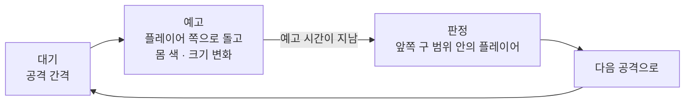
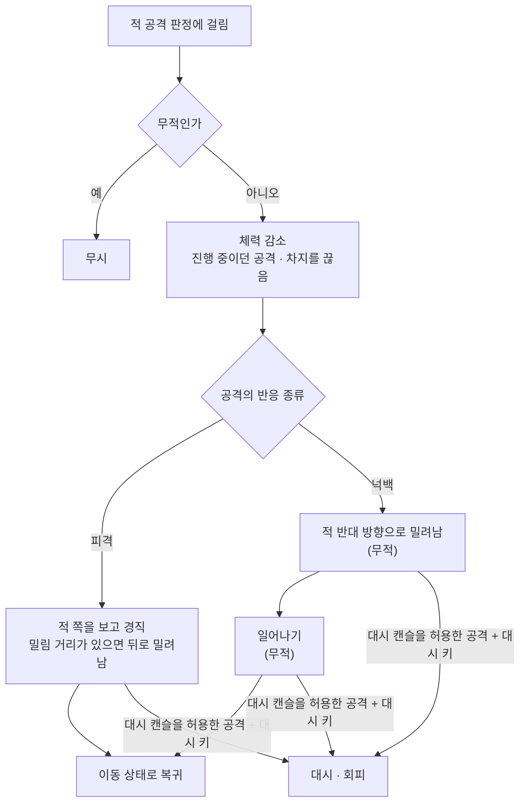
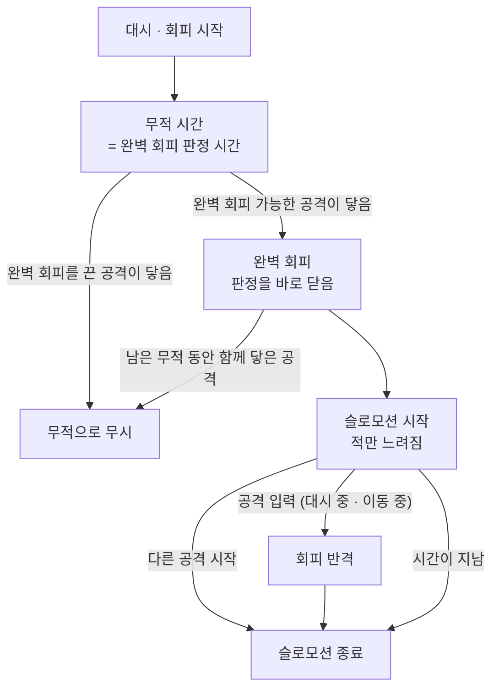

# 적 공격과 플레이어 피격

## 1. 개요

공격하는 더미 적이 예고 뒤 공격하고, 플레이어가 맞으면 체력이 줄며 공격 종류에 따라 경직 또는 넉백이 나오는 체계다. 대시 · 회피의 앞부분은 무적이고, 이 시간 안에 공격이 닿으면 완벽 회피가 되어 적만 느려지는 슬로모션과 함께 회피 반격을 할 수 있다. 이후 패링 · 일반 적 AI 가 이 공격과 피격 흐름 위에서 동작한다.

## 2. 구성 요소

- DummyEnemyAttacker : 공격하지 않는 더미 적에 붙여, 공격 목록을 예고 → 판정 순서로 반복하는 시험용 공격 기능
- EnemyAttackSetting : 적 공격 하나의 설정 묶음 (예고 시간 · 색 · 크기, 패링 · 완벽 회피 가능 여부, 판정 범위, 위력, 플레이어 반응, 경직 · 밀림 · 넉백 · 일어나기 수치, 피격 중 대시 캔슬 가능 여부)
- EnemyTime : 적 전용 시간 배율. 슬로모션 동안 적만 느려지게 한다
- PlayerHealth : 플레이어 체력, 무적 시간, 완벽 회피 판정. 맞으면 완벽 회피 · 무적인지 확인하고 체력을 줄인 뒤 피격 상태로 넘긴다
- PlayerSlowMotion : 완벽 회피 후 슬로모션의 시작 · 종료와 임시 표시 오브젝트
- PlayerHitState : 피격 · 넉백 상태
- PlayerController : 어떤 상태에서든 피격 상태로 넘기고, 대시 무적 시간을 들고 있는 플레이어 기능 (피격 · 완벽 회피 관련 역할)
- PlayerDashState : 대시 · 회피를 시작할 때 무적과 완벽 회피 판정을 거는 상태 (무적 관련 역할)

## 3. 동작 원리

### 더미 적의 공격 흐름

- 공격 목록을 순서대로 반복한다. 기획서 기준으로 약공격 → 강공격 → 패링 공격 순서로 둔다.
- 예고는 색과 크기로 구분한다.
    - 패링 공격만 노란색으로 바뀐다.
    - 약공격과 강공격은 색 없이 몸이 커지는 정도와 예고 길이로 구분한다. 강공격일수록 크게, 길게 예고한다.
- 판정은 예고가 끝나는 순간 적 앞쪽의 구 범위로 한 번 한다. 더미 적을 선택하면 Scene 창에 공격별 범위가 보인다.
- 공격 기능은 기존 더미 적에 덧붙이는 방식이라, 타겟팅 · 록온 · 공격 적중은 그대로 동작한다.

### 피격 처리

| 공격 | 반응 | 동작 |
|---|---|---|
| 약공격 | 피격 | 제자리에서 짧게 경직 |
| 강공격 | 피격 (큰 경직) | 경직이 시작될 때 뒤로 조금 밀려나고, 길게 경직 |
| 패링 공격 | 넉백 | 뒤로 밀려난 뒤 일어남. 넉백과 일어나기 동안 무적 |

- 어느 상태에서든 맞으면 피격 상태로 넘어간다. 공격 중이면 공격이 끊기고, 이후 콤보는 1단부터 다시 시작한다.
- 경직 중 다시 맞으면 새 피격으로 바뀐다.
- 경직 · 밀림 · 넉백 · 일어나기 시간과 피격 중 대시 캔슬 허용 여부는 공격마다 따로 정한다.
- 체력이 0이 되었을 때의 쓰러짐과 실패 처리는 아직 없고, 0에서 멈춘다.

### 무적과 완벽 회피

- 대시 · 회피를 시작하면 정해진 시간 동안 무적이다. 대시와 회피는 같은 시간을 쓰고, 연속 대시는 대시마다 다시 건다.
- 무적 시간과 완벽 회피 판정 시간은 같은 값이다. 이 시간 안에 완벽 회피할 수 있는 공격이 닿으면 완벽 회피가 된다.
    - 완벽 회피할 수 있는지는 공격마다 정한다. 끈 공격은 무적으로 무시만 된다.
    - 한 번의 대시 · 회피에서 완벽 회피는 한 번만 발동한다. 여러 공격이 동시에 닿아도 모두 피하고, 슬로모션은 한 번만 시작된다.
- 넉백과 일어나기 동안은 무적이지만, 이때 맞은 공격은 완벽 회피가 아니다.
- 넉백 중 대시로 끊으면 남은 넉백 무적은 지우고 대시 무적만 새로 건다.

### 슬로모션과 적 전용 시간

- 완벽 회피에 성공하면 정해진 시간(기본 1초) 동안 적만 정해진 배속(기본 0.5배)으로 느려진다. 플레이어와 카메라는 원래 속도로 움직인다.
- 슬로모션 중 공격 키를 누르면 대시 중이든 대시가 끝난 이동 중이든 대시 공격보다 회피 반격이 먼저 나간다.
- 회피 반격이든 다른 공격이든 공격을 시작하면 슬로모션은 바로 끝난다.
- 슬로모션 중 새로 대시 · 회피해 다시 완벽 회피하면 슬로모션 시간을 처음부터 다시 센다.
- 적만 느려지도록 Unity 전체 시간은 바꾸지 않고, 적이 쓰는 시간 배율만 낮춘다. 그래서 적 · 적 애니메이션 · 적 이펙트는 모두 이 배율을 따라야 한다.
- 지금은 슬로모션의 시작과 끝을 알 수 있도록 플레이어 위치에 임시 표시 오브젝트를 만들었다가 지운다.

## 4. 구현 과정

- 활용한 기능 :
    - `Physics.OverlapSphere` : 예고가 끝나는 순간 적 앞쪽 구 범위 안의 플레이어를 찾는다.
    - Gizmos : Scene 창에 공격별 판정 범위를 보여, 공격 범위를 조정할 때 확인한다.
    - `[Serializable]` 설정 묶음 : 적 공격 하나의 값을 묶어 Inspector 에서 공격마다 같은 형태로 정한다.
    - Animator 상태 직접 재생 : 피격 · 넉백 · 일어나기 상태를 전이선 없이 코드가 이름으로 재생한다.
- 구현 과정 :
    1. 적 공격 설정 묶음과 공격하는 더미 기능, 플레이어 체력 기능을 만들고, 맞았을 때 체력 감소 로그로 판정을 확인했다.
    2. 피격 · 넉백 상태를 추가하고 체력 기능에서 피격 상태로 넘기게 했다.
    3. 테스트 중 강공격이 약공격 · 패링 공격과 구분되도록 넉백 대신 큰 경직과 밀림으로 바꿨다.
    4. 대시 · 회피 시작부터 일정 시간 무적을 추가했다.
    5. 적 전용 시간 배율과 슬로모션을 만들고, 더미 적의 공격 대기 · 예고 · 깜빡임이 이 배율을 따르게 했다.
    6. 대시 무적에 완벽 회피 판정을 함께 열고, 완벽 회피 시 슬로모션과 회피 반격을 연결했다. 이전에 회피 반격을 시험하던 임시 옵션은 지웠다.
    7. 동시에 닿는 여러 공격에 슬로모션이 여러 번 걸리지 않도록, 한 번 발동하면 판정을 바로 닫게 했다.
    8. 처음에는 회피 반격을 시작할 때만 슬로모션을 끝냈으나, 다른 공격을 시작해도 끝나도록 바꿨다.
- 주요 결정과 이유 :
    - 체력 · 무적은 플레이어 기능에 넣지 않고 별도 기능으로 두었다. 플레이어 기능이 길어지는 것을 막고, 이후 체력 표시와 쓰러짐 처리가 이 기능만 보면 되게 하기 위해서다.
    - 공격 기능은 새 적을 만들지 않고 기존 더미 적에 덧붙였다. 타겟팅 · 록온 · 적중이 더미 적을 기준으로 동작해 그대로 쓸 수 있기 때문이다.
    - 대시 · 회피의 앞부분만 무적으로 했다. 정확한 타이밍에 회피해야 보상을 주기 위해서다.
    - 강공격은 넉백 대신 큰 경직과 밀림으로 했다. 약공격, 패링 공격과 차이를 두기 위해서다.
    - 넉백과 일어나기 동안은 무적으로 했다. 연속으로 맞으며 계속 띄워지는 것을 막기 위해서다.
    - 슬로모션은 적만 느려지게 했다. 액션 게임의 완벽 회피처럼, 성공했다는 피드백을 주기 위해서다.
    - 공격을 시작하면 슬로모션을 바로 끝낸다. 피드백은 주되 너무 과한 효과가 되지 않게 하기 위해서다.
    - 무적 시간과 완벽 회피 판정 시간을 하나로 통일했다. 대시와 회피 모두에서 같은 경험을 주기 위해서다.
    - 한 번의 회피에서 완벽 회피는 한 번만 발동하고, 함께 닿은 공격은 모두 피한다. 동시에 들어온 공격에 슬로모션이 여러 번 걸리지 않게 하기 위해서다.
    - 피격 중 대시 캔슬은 공격마다 허용 여부를 정한다.
- 레퍼런스 : 젠레스 존 제로의 피격 · 넉백 반응, 회피 무적, 완벽 회피 후 회피 반격

## 5. 기존 방식과 비교

- 기존 방식 : 적은 공격하지 않고 맞으면 색만 바뀌었다. 플레이어에게는 체력과 피격이 없었다.
- 달라진 점 :
    - 더미 적이 예고 뒤 약공격 · 강공격 · 패링 공격을 반복한다.
    - 플레이어가 맞으면 체력이 줄고 공격에 따라 경직 · 밀림 · 넉백이 나온다.
    - 대시 · 회피 앞부분과 넉백 · 일어나기 동안 무적이다.
    - 타이밍을 맞춰 피하면 완벽 회피가 되어 적만 느려지고, 회피 반격이 테스트 옵션이 아닌 실제 판정으로 나간다.
- 개선된 점 : 적의 공격에 맞고 피하는 흐름과 정확한 회피에 대한 보상이 생겼고, 이후 패링을 시험할 수 있다.
- 필요하게 된 과정 : 기획서 코어 전투 3묶음의 첫 단계다. 완벽 회피 · 패링 · 넉백은 모두 적의 공격이 플레이어에게 닿아야 시험할 수 있어 가장 먼저 만들었다.

### 미검증 항목

- 체력이 0이 되었을 때의 쓰러짐 · 실패 처리 (게임 흐름 단계)
- 완벽 회피 연출 (화면 효과 · 잔상 등, 지금은 임시 표시 오브젝트)
- 적 애니메이션 · 이펙트의 적 전용 시간 적용 (일반 적 · 보스 단계)
- 적 공격 설정과 피격 수치의 ScriptableObject 이전 (추후 검토)
