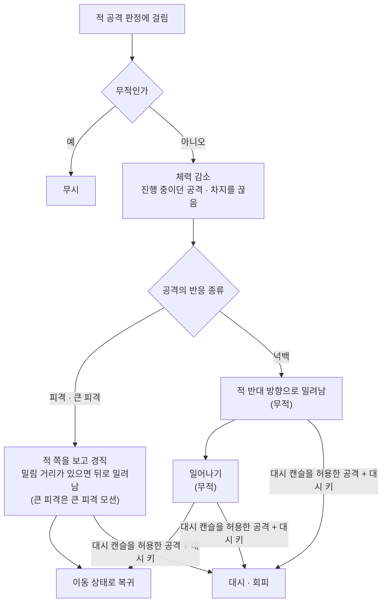
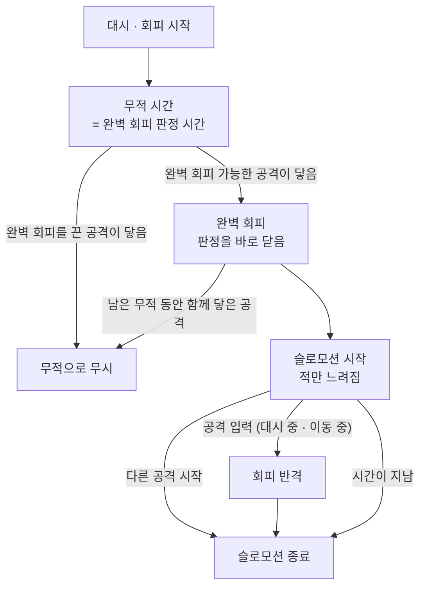
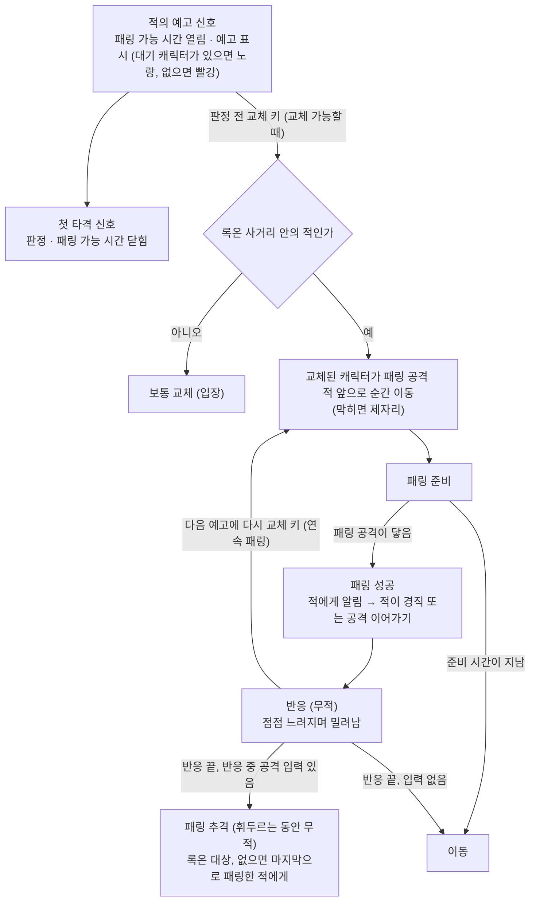

# 적 공격과 플레이어 피격

## 1. 개요

적이 예고 뒤 공격하고, 플레이어가 맞으면 체력이 줄며 공격 종류에 따라 경직 또는 넉백이 나오는 체계다. 대시 · 회피의 앞부분은 무적이고, 이 시간 안에 공격이 닿으면 완벽 회피가 되어 적만 느려지는 슬로모션과 함께 회피 반격을 할 수 있다. 예고 표시가 나오는 패링 공격은 교체 키로 나온 캐릭터가 패링하고(지원 공격), 밀려난 뒤 추격 공격으로 이어갈 수 있다. 넉백되면 빠른 지원으로 다음 캐릭터를 보낼 수 있다. (파티 문서)

## 2. 구성 요소

- EnemyAttacker : 적의 공격 선택 · 진행 · 판정과 패링 가능 시간 (자세한 내용은 적 공격 문서)
- PlayerHitState : 피격 · 큰 피격 · 넉백 상태
- EnemyAttackData · EnemyAttackStep : 적 공격 데이터와 동작 (피격 관련 역할 : 완벽 회피 가능 여부, 위력, 플레이어 반응, 경직 · 밀림 · 넉백 · 일어나기 수치, 피격 중 대시 캔슬 가능 여부, 동작마다 패링 가능 · 막타 반응)
- EnemyTime : 적 전용 시간 배율. 슬로모션 동안 적만 느려지게 한다
- ParryWindow : 지금 패링 가능 시간을 열어 둔 적 목록. 열릴 때 · 닫힐 때 알린다
- ParryTelegraphView : 패링 가능 시간이 열리면 파티가 그 순간 정한 패링 가능 여부로 패링 가능 · 불가 예고 표시를 적의 예고 위치에 띄운다
- PlayerStatus : 플레이어 체력 · 에너지 · 필살기 게이지, 무적 시간, 완벽 회피 판정. 맞으면 완벽 회피 · 패링 · 무적인지 확인하고 체력을 줄인 뒤 피격 상태로 넘긴다
- BattleSlowMotion : 완벽 회피 후 슬로모션의 시작 · 종료. 파티 오브젝트에 하나만 있고, 시간 · 배속은 공통 설정에서 읽는다. 화면 효과는 전투 연출 문서의 화면 효과 기능이 맡는다
- PlayerActionTrigger : 패링 시작(교체할 때 파티가 부름), 패링 대상 선택, 패링 성공 처리, 패링 상태 보유 (필살기 · 콤보 스킬과 함께 있는 특수 행동 시작 기능)
- TeleportManager · TeleportOption : 패링 액션에 붙인 순간 이동 옵션대로 적 정면에 서는 순간 이동, 바닥 높이 맞춤, 도착 지점 막힘 검사 (필살기 · 콤보 스킬이 함께 씀)
- CommonCharacterSettings : 패링 준비 · 반응 시간과 밀려나는 거리, 슬로모션 값 (피격 관련 역할)
- PlayerParryState : 패링 준비 · 반응 · 추격 연결 상태, 마지막으로 패링한 적 기억. 준비 · 반응 모션은 패링 액션의 동작 0 · 1 번을 재생한다
- PlayerController : 어떤 상태에서든 피격 상태로 넘기고, 대시 무적 시간을 들고 있는 플레이어 기능 (피격 · 완벽 회피 관련 역할)
- PlayerDashState : 대시 · 회피를 시작할 때 무적과 완벽 회피 판정을 거는 상태 (무적 관련 역할)

## 3. 동작 원리

### 적의 공격

- 적은 공격 목록에서 쿨타임 · 가중치로 공격을 골라, 단계별 모션과 모션 신호(예고 · 타격)에 맞춰 공격한다. 공격 선택 · 진행 · 판정 방식은 적 공격 문서에 적었다.
- 기획서 기준으로 일반 적은 약공격(피격) · 강공격(큰 피격) · 패링 공격(넉백)을 1종씩 쓴다.
- 패링 공격은 예고 표시가 켜지는 동안 패링할 수 있다. 예고 표시는 적이 아니라 플레이어 쪽이 띄우고, 교체할 대기 캐릭터가 없으면 패링 불가 표시가 뜬다.
- 적 공격은 타격 시점마다 범위 안의 캐릭터를 한 번씩 판정한다. 필드에 캐릭터가 여럿이면 각자 따로 맞고, 연타 공격은 타격마다 피격 · 완벽 회피 · 패링을 따로 판정한다. (적 공격 문서)
- 연타의 막타는 동작에 정한 막타 반응(예 : 넉백)으로 맞을 수 있다. 그 밖의 타격은 공격의 반응으로 맞는다. 경직 · 밀림 · 넉백 값은 공격 공통 값이다.
- 경직 · 그로기 · 처치되면 진행 중인 공격이 끊긴다. 경직 여부는 경직 레벨과 경직 저항 레벨을 비교해 정한다. (적 공통 규칙 문서)

### 피격 처리

| 공격 | 반응 | 동작 |
|---|---|---|
| 약공격 | 피격 | 제자리에서 짧게 경직 |
| 강공격 | 큰 피격 | 큰 피격 모션으로, 경직이 시작될 때 뒤로 조금 밀려나고 길게 경직 |
| 패링 공격 | 넉백 | 뒤로 밀려난 뒤 일어남. 넉백과 일어나기 동안 무적. 넉백되는 순간 빠른 지원 입력 시간이 열린다 |

- 어느 상태에서든 맞으면 피격 상태로 넘어간다. 공격 중이면 공격이 끊기고, 이후 콤보는 1단부터 다시 시작한다.
- 경직 중 다시 맞으면 새 피격으로 바뀐다.
- 경직 · 밀림 · 넉백 · 일어나기 시간과 피격 중 대시 캔슬 허용 여부는 공격마다 따로 정한다.
- 체력이 0이 되었을 때의 쓰러짐과 실패 처리는 아직 없고, 0에서 멈춘다.

### 무적과 완벽 회피

- 대시 · 회피를 시작하면 정해진 시간 동안 무적이다. 대시와 회피는 같은 시간을 쓰고, 연속 대시는 대시마다 다시 건다.
- 대시 · 회피는 시작 지연 동안 제자리에 있다가 전진한다. 무적 · 완벽 회피 판정은 지연과 상관없이 시작부터 열려, 몸이 공격 범위를 빠져나가기 전에 닿은 공격도 완벽 회피로 판정된다. (이동 문서의 `대시 · 회피 이동`)
- 무적 시간과 완벽 회피 판정 시간은 같은 값이다. 이 시간 안에 완벽 회피할 수 있는 공격이 닿으면 완벽 회피가 된다.
    - 완벽 회피할 수 있는지는 공격마다 정한다. 끈 공격은 무적으로 무시만 된다.
    - 한 번의 대시 · 회피에서 완벽 회피는 한 번만 발동한다. 여러 공격이 동시에 닿아도 모두 피하고, 슬로모션은 한 번만 시작된다.
- 넉백과 일어나기 동안은 무적이지만, 이때 맞은 공격은 완벽 회피가 아니다.
- 넉백 중 대시로 끊으면 남은 넉백 무적은 지우고 대시 무적만 새로 건다.

### 슬로모션과 적 전용 시간

- 완벽 회피에 성공하면 정해진 시간 동안 적만 정해진 배속으로 느려진다. 플레이어와 카메라는 원래 속도로 움직인다. 시간과 배속은 모든 캐릭터가 같이 쓰는 공통 설정 값이다.
- 슬로모션은 캐릭터가 아닌 전투 단위 기능으로 파티에 하나만 있다. 어느 캐릭터가 완벽 회피했든 같은 슬로모션을 쓰고, 슬로모션 중 교체하면 끝난다.
- 슬로모션 중 공격 키를 누르면 대시 중이든 대시가 끝난 이동 중이든 대시 공격보다 회피 반격이 먼저 나간다.
- 회피 반격이든 다른 공격이든 공격을 시작하면 슬로모션은 바로 끝난다.
- 슬로모션 중에는 무적이다. 판정 순서가 완벽 회피 → 패링 → 무적이므로, 슬로모션 중 새로 대시 · 회피해 판정 시간 안에 타격이 닿으면 완벽 회피가 다시 발동하고 슬로모션 시간을 처음부터 다시 센다.
    - 그래서 연타 공격 하나 안에서 완벽 회피 → 회피 반격 → (아직 공격 중) → 다시 대시로 완벽 회피를 반복할 수 있다. 회피 반격을 시작하면 슬로모션과 함께 무적도 끝나, 다시 피하지 않으면 다음 타격에 맞는다.
- 적만 느려지도록 Unity 전체 시간은 바꾸지 않고, 적이 쓰는 시간 배율만 낮춘다. 그래서 적 · 적 애니메이션 · 적 이펙트는 모두 이 배율을 따라야 한다.
- 슬로모션 동안 화면 가장자리가 어두운 파란색으로 물들고, 끝나면 사라진다. 완벽 회피 순간에는 카메라가 줄었다 늘어나는 줌 효과를 준다. 흔들림은 "맞았다" 는 신호라 완벽 회피에는 넣지 않았다. (전투 연출 문서)

### 패링과 패링 추격

- 판정 순서는 완벽 회피 → 패링 → 무적 → 피격이다.
- 패링은 현재 캐릭터가 직접 하지 않는다. 패링 가능 시간에 교체 키를 누르면 교체로 나온 캐릭터가 입장 대신 바로 패링한다(지원 공격). 이전 캐릭터는 하던 동작을 마친 뒤 퇴장한다. (파티 문서)
    - 교체할 대기 캐릭터가 없으면(3명 모두 필드에 있거나 1인) 패링할 수 없다. 이때 예고는 패링 불가로 뜬다. 1인 씬도 같은 규칙이다.
    - 지금 동작이 교체를 허용하지 않으면(끼어들기 허용) 교체 키를 무시해 지원 공격도 나가지 않는다.
- 패링 가능 시간은 패링 공격 모션의 예고 신호부터 첫 타격 신호까지다. 예고가 나오는 시점은 신호를 찍는 프레임으로 조정한다.
- 록온 사거리 안의 적이 연 패링 가능 시간에만 패링한다. 록온 사거리 밖의 적만 패링 예고를 하면 교체 키는 보통 교체가 된다.
    - 록온 사거리는 록온할 수 있고 록온이 풀리는 거리와 같다.
- 패링 액션이 연결되지 않은 캐릭터는 패링을 시작하지 않고 경고를 남긴다. 상태에 들어가기 전에 막아, 준비 모션 없이 패링 판정만 켜지거나 진행 중이던 동작이 끊기지 않게 한다.
- 패링을 시작하면 패링 액션에 붙인 순간 이동 옵션대로, 패링 공격을 하는 적의 정면에서 적 몸 표면과 공격 간격만큼 떨어진 곳에 순간 이동한다. (순간 이동 규칙은 플레이어 구성과 데이터 문서)
    - 그런 적이 여럿이면 공격 대상 기준을 따른다. 록온 대상 → 자동 조준 대상 → 록온 사거리 안에서 가장 최근에 예고를 시작한 적 순서다.
    - 대상은 교체 키를 누른 순간 정한다.
    - 도착 지점이 벽 · 지형에 겹치거나 적과 도착 지점 사이가 막혀 있으면 제자리에서 패링한다.
    - 도착 높이는 도착 지점에서 찾은 바닥 높이를 쓴다.
- 준비 자세는 적 공격이 끊겨도 정해진 시간까지 유지한다. 준비 · 반응 시간과 밀려나는 거리는 모든 캐릭터가 같이 쓰는 공통 설정 값이다.
- 준비 · 반응 모션은 패링 액션의 동작 0 · 1 번에 적힌 모션을 그 동작의 섞는 시간으로 재생한다. 패링 액션에 두 동작이 없으면 패링을 시작하지 않고 경고를 남긴다.
- 패링은 준비 · 반응을 맡는 패링 액션과, 반응 중 입력으로 나가는 패링 추격 액션으로 나뉜다. 추격은 조건부로 나가는 동작이고, 패링 성공과 추격 공격의 타격 값이 다를 수 있기 때문이다.
- 패링에 성공하면 플레이어는 적에게 알림만 보낸다. 적은 지금 동작 설정으로 경직(공격이 끊기고 피격 모션)하거나, 이어가기 동작이면 공격을 끊지 않고 다음 동작으로 이어간다. (적 공격 문서의 `패링과 연속 패링`)
- 패링 한 번은 노란 공격 하나만 막는다. 성공하면 패링이 꺼지고 반응으로 넘어간다. 이어지는 노란 공격은 다시 교체 키를 눌러 패링해야 막는다. (파티 문서의 연속 패링)
- 패링에 성공할 때마다 필살기 게이지가 정해진 양만큼 쌓인다. 완벽 회피도 마찬가지다. (필살기 문서 참고)
- 반응 동안 플레이어는 공격 반대 방향으로 밀려나며, 반응 시간에 걸쳐 속도가 0까지 일정하게 줄어든다. 반응 동안은 무적이라 성공 → 추격 사이에 어떤 공격에도 맞지 않는다. 반응 중 닿은 노란 공격은 패링하지 않고 흘려보낸다.
- 반응 동안 공격 키를 눌렀으면 반응이 끝난 뒤 추격 공격이 나간다.
- 추격 공격은 록온 중이면 록온 대상에게, 아니면 패링한 적에게 나간다. 화면 중앙에 다른 적이 있어도 패링한 적을 쫓는다.
- 패링 준비 · 반응 · 추격 중에는 필살기를 쓸 수 없다. 패링 준비 · 반응 중 교체는 패링 액션의 동작마다 정한 교체 허용을 따른다.
- 패링 공격이 아닌 공격은 패링 중에도 맞는다.
- 플레이어 공격마다 시전 중 무적을 켤 수 있다. 켠 공격은 휘두르는 동안 무적이고 후딜에 들어가면 풀린다. 패링 추격은 이 옵션을 켜서 무적이며, 이때 들어온 패링 공격은 패링되지 않는다.

## 4. 구현 과정

- 활용한 기능 :
    - `Physics.OverlapSphere` : 적 공격의 판정 순간 적 앞쪽 구 범위 안의 플레이어를 찾는다.
    - Gizmos : Scene 창에 공격별 판정 범위를 보여, 공격 범위를 조정할 때 확인한다.
    - `[Serializable]` 설정 묶음 : 적 공격 하나의 값을 묶어 Inspector 에서 공격마다 같은 형태로 정한다.
    - Animator 상태 직접 재생 : 피격 · 넉백 · 일어나기 상태를 전이선 없이 코드가 이름으로 재생한다.
- 구현 과정 :
    1. 적 공격 설정 묶음과 공격하는 더미 기능, 플레이어 체력 기능을 만들고, 맞았을 때 체력 감소 로그로 판정을 확인했다.
    2. 피격 · 넉백 상태를 추가하고 체력 기능에서 피격 상태로 넘기게 했다.
    3. 테스트 중 강공격이 약공격 · 패링 공격과 구분되도록 넉백 대신 큰 경직과 밀림으로 바꿨다.
    4. 대시 · 회피 시작부터 일정 시간 무적을 추가했다.
    5. 적 전용 시간 배율과 슬로모션을 만들고, 더미 적의 공격 대기 · 예고 · 깜빡임이 이 배율을 따르게 했다.
    6. 대시 무적에 완벽 회피 판정을 함께 열고, 완벽 회피 시 슬로모션과 회피 반격을 연결했다. 이전에 회피 반격을 시험하던 임시 옵션은 지웠다.
    7. 동시에 닿는 여러 공격에 슬로모션이 여러 번 걸리지 않도록, 한 번 발동하면 판정을 바로 닫게 했다.
    8. 처음에는 회피 반격을 시작할 때만 슬로모션을 끝냈으나, 다른 공격을 시작해도 끝나도록 바꿨다.
    9. 적 공격에 판정 대기 시간과 패링 가능 시간, 패링 경직을 추가했다.
    10. 플레이어 공격 시작을 하나의 함수로 정리하고, 공격마다 시전 중 무적을 정할 수 있게 했다.
    11. 패링 준비 · 반응 · 연속 패링 · 추격을 만들었다. 반응은 처음에 밀려나는 시간과 연속 패링 유지 시간을 따로 두었다가 하나로 합쳤고, 밀려나는 속도가 점점 줄도록 바꿨다.
    12. 처음에는 패링할 때 대상에게 다가갔으나 벽 뒤에서 패링하면 걸려 어색해서, 패링 공격 적 앞으로 순간 이동하도록 바꿨다.
    13. 순간 이동 시 공중에 뜨는 문제는 더미 적의 기준점이 몸 가운데에 있어서 생겼다. 코드로 바닥 높이를 맞추지 않고, 적의 기준점을 발바닥에 두는 것으로 정했다.
    14. 필살기를 만들며 순간 이동과 막힘 검사를 별도 기능으로 분리해 패링과 필살기가 함께 쓰게 했다. 패링 성공 · 완벽 회피에 필살기 게이지 획득을 추가했다.
    15. 패링 추격이 다른 공격과 같은 대상 기준(록온 → 자동 조준)을 써서, 록온하지 않으면 패링한 적이 아닌 화면 중앙의 적에게 나갈 수 있었다. 마지막으로 패링한 적을 기억해 추격 대상으로 넘기게 바꿨다.
    16. 필살기가 여러 번 맞히면서 경직할 때마다 적의 공격 순서가 넘어가 공격을 건너뛰었다. 공격 중일 때만 그 공격을 끊고 순서를 넘기도록 바꿨다.
    17. 패링 가능 시간이 열려 있으면 거리에 상관없이 패링해 멀리 있는 적 앞으로도 순간 이동했다. 록온 사거리 안의 적만 패링 대상으로 보도록 바꿨다.
    18. 강공격 피격이 약공격과 같은 피격 모션으로 나와, 반응 종류에 큰 피격을 추가했다. 경직 · 밀림 흐름은 피격과 같고 모션만 다르다.
    19. 콤보 스킬을 만들며 더미 적에 그로기를 추가하고, 피격 깜빡임과 상태 색을 나눴다.
    20. 일반 적을 만들며 피격 · 패링이 더미 적 공격 기능 대신 적 공통 약속을 쓰게 바꿨다. 적 공격은 모션 신호로 예고 · 판정하는 새 공격 기능으로 옮기고, 더미 적은 삭제했다. (적 공통 규칙 · 적 공격 문서)
    21. (#55) 패링 시작 · 성공, 완벽 회피, 조작 캐릭터 넉백 순간을 전투 연출에 알리게 했다. 슬로모션 임시 표시를 지우고 화면 효과로 바꿨다. 패링 성공에는 히트스톱 · 반동 흔들림 · 줌, 넉백에는 흔들림이 붙는다. (전투 연출 문서)
- 주요 결정과 이유 :
    - 체력 · 무적은 플레이어 기능에 넣지 않고 별도 기능으로 두었다. 플레이어 기능이 길어지는 것을 막고, 이후 체력 표시와 쓰러짐 처리가 이 기능만 보면 되게 하기 위해서다.
    - 공격 기능은 새 적을 만들지 않고 기존 더미 적에 덧붙였다. 타겟팅 · 록온 · 적중이 더미 적을 기준으로 동작해 그대로 쓸 수 있기 때문이다.
    - 대시 · 회피의 앞부분만 무적으로 했다. 정확한 타이밍에 회피해야 보상을 주기 위해서다.
    - 강공격은 넉백 대신 큰 경직과 밀림으로 했다. 약공격, 패링 공격과 차이를 두기 위해서다.
    - 넉백과 일어나기 동안은 무적으로 했다. 연속으로 맞으며 계속 띄워지는 것을 막기 위해서다.
    - 슬로모션은 적만 느려지게 했다. 액션 게임의 완벽 회피처럼, 성공했다는 피드백을 주기 위해서다.
    - 공격을 시작하면 슬로모션을 바로 끝낸다. 피드백은 주되 너무 과한 효과가 되지 않게 하기 위해서다.
    - 무적 시간과 완벽 회피 판정 시간을 하나로 통일했다. 대시와 회피 모두에서 같은 경험을 주기 위해서다.
    - 한 번의 회피에서 완벽 회피는 한 번만 발동하고, 함께 닿은 공격은 모두 피한다. 동시에 들어온 공격에 슬로모션이 여러 번 걸리지 않게 하기 위해서다.
    - 피격 중 대시 캔슬은 공격마다 허용 여부를 정한다.
    - 패링을 시작하면 적 앞으로 순간 이동한다. 실제로 다가가면 벽 등에 걸리기 때문이다.
    - 패링 대상은 공격 대상 기준(록온 → 자동 조준)을 따른다.
    - 패링 추격 대상은 록온이 아니면 패링한 적으로 한다. 패링한 대상과 추격 공격 대상을 일관되게 유지하기 위해서다.
    - 적의 공격 취소는 공격 중에 경직했을 때만 한다. 공격 전 대기 중에 맞았다고 다음 공격이 사라지지 않게 하기 위해서다.
    - 큰 피격은 별도 경직 값을 두지 않고 피격 값을 함께 쓴다. 강공격과 약공격의 차이는 경직 시간 · 밀림 값으로 이미 정하고 있고, 모션만 다르면 되기 때문이다.
    - 밀려나는 속도는 시간에 비례해 0까지 줄이고, 처음 속도를 거리 × 2 ÷ 시간으로 잡아 설정한 거리만큼 밀려나게 했다. 매 프레임 보간하면 거리와 멈추는 시간을 정할 수 없기 때문이다.
    - 패링 공격이 아닌 공격은 패링 중에도 맞는다. 패링을 유도한 뒤 마지막 타격만 패링 불가로 두어 회피를 요구하는 패턴을 만들 수 있게 하기 위해서다.
    - 공격 중 무적은 휘두르는 동안만 걸고 후딜에는 푼다.
- 레퍼런스 : 젠레스 존 제로의 피격 · 넉백 반응, 회피 무적, 완벽 회피 후 회피 반격, 지원 공격(패링 · 추격)

## 5. 기존 방식과 비교

- 기존 방식 : 적은 공격하지 않고 맞으면 색만 바뀌었다. 플레이어에게는 체력과 피격이 없었다.
- 달라진 점 :
    - 더미 적이 예고 뒤 약공격 · 강공격 · 패링 공격을 반복한다.
    - 플레이어가 맞으면 체력이 줄고 공격에 따라 경직 · 밀림 · 넉백이 나온다.
    - 대시 · 회피 앞부분과 넉백 · 일어나기 동안 무적이다.
    - 타이밍을 맞춰 피하면 완벽 회피가 되어 적만 느려지고, 회피 반격이 테스트 옵션이 아닌 실제 판정으로 나간다.
    - 노란 공격을 패링해 적을 경직시키고, 밀려난 뒤 무적 추격 공격으로 이어갈 수 있다.
    - 필살기 작업에서 바뀐 점
        - 기존 : 경직하면 항상 다음 공격으로 넘어갔다. 패링 추격은 록온 대상, 없으면 자동 조준 대상에게 나갔다. 순간 이동은 패링 기능 안에 있었다. 패링 가능 시간을 연 적이 어디에 있든 패링할 수 있었다.
        - 변경 : 공격 중에 경직했을 때만 다음 공격으로 넘어간다. 패링 추격은 록온 대상, 없으면 마지막으로 패링한 적에게 나간다. 순간 이동은 패링 · 필살기가 함께 쓰는 별도 기능이 되었다. 록온 사거리 안의 적만 패링할 수 있다.
    - 콤보 스킬 작업에서 바뀐 점
        - 기존 : 강공격도 약공격과 같은 피격 모션이었다. 피격 깜빡임이 끝나면 처음 색으로 돌아가, 경직 중에 맞으면 회색이 사라졌다.
        - 변경 : 강공격은 큰 피격 모션이 나온다. 깜빡임이 끝나면 그때의 상태 색으로 돌아간다. 더미 적에 그로기가 생겼다.
    - 일반 적 작업에서 바뀐 점
        - 기존 : 더미 적이 공격 목록을 순서대로 반복했다. 예고는 정해진 시간 동안 몸 색 · 크기를 바꿔 보여주고(패링 공격은 노란색), 예고가 끝난 뒤 판정 대기 시간이 지나면 판정했다. 패링 가능 시간은 예고 시작부터 판정까지였다. 패링 · 필살기에 당하면 몸이 회색이 되고, 공격 중일 때만 다음 순서 공격으로 넘어갔다.
        - 변경 : 일반 적이 쿨타임 · 가중치로 공격을 고르고, 모션 신호로 예고 · 판정한다. 패링 가능 시간은 예고 신호부터 첫 타격까지다. 경직 · 그로기는 모션으로 보여주고, 경직 여부는 경직 레벨과 경직 저항 레벨을 비교해 정한다. 더미 적은 삭제했다.
    - 파티 전투 작업(#41)에서 바뀐 점 (파티 문서)
        - 기존 : 이전 · 다음 캐릭터 키 모두 현재 캐릭터가 직접 패링했다. 예고 표시는 적이 들고 있던 표시를 켜고 껐다. 슬로모션은 캐릭터마다 있었다. 적 공격은 공격 한 번에 플레이어 한 명만 맞혔다.
        - 변경 : 패링은 교체로 나온 캐릭터가 한다(지원 공격). 예고 표시는 플레이어 쪽이 대기 캐릭터 수로 색을 골라 띄운다. 슬로모션은 전투 단위로 하나다. 적 공격은 범위 안의 캐릭터마다 한 번씩 판정한다. 넉백되면 빠른 지원 입력 시간이 열린다.
    - 대시 · 회피 시작 지연 작업(#43)에서 바뀐 점
        - 기존 : 대시 · 회피가 판정이 열리는 순간부터 움직여, 공격 범위를 바로 빠져나가 완벽 회피가 잘 나오지 않았다.
        - 변경 : 시작 지연 동안 제자리에서 판정을 받다가 전진한다.
    - 적 공격 데이터 작업(#52)에서 바뀐 점
        - 기존 : 적 공격은 공격 한 번에 캐릭터마다 한 번만 판정했다. 슬로모션 중에는 무적이 아니었다. 패링에 성공하면 플레이어 쪽이 적을 경직시켰고, 반응 중 닿은 노란 공격도 자동으로 패링했다(기획서 규칙). 반응 중에는 무적이 아니었다.
        - 변경 : 타격 시점마다 판정하고 막타 반응이 있다. 슬로모션 중 무적이고 재대시로 완벽 회피가 다시 발동한다. 패링은 적에게 알리고, 적이 경직 · 이어가기를 정한다. 패링 한 번은 노란 공격 하나만 막고, 반응 중에는 무적이다.
        - 이유 : 연타 공격 안에서 회피 · 반격을 반복하고, 이어지는 패링 공격을 매번 입력해 받아치는 연속 패링 패턴을 만들기 위해서다.
    - 타격감 연출 작업(#55)에서 바뀐 점 (전투 연출 문서)
        - 기존 : 슬로모션의 시작과 끝을 알 수 있도록 플레이어 위치에 임시 표시 오브젝트를 만들었다가 지웠다. 표시 Prefab 은 공통 설정에 있었다.
        - 변경 : 임시 표시와 공통 설정 칸을 지우고, 슬로모션 동안 화면 효과를 켠다.
- 개선된 점 : 적의 공격에 맞고, 피하고, 막는 흐름과 정확한 입력에 대한 보상이 생겼다. 패링 추격이 막아 낸 적을 정확히 쫓고, 여러 번 맞는 공격에도 적의 공격 순서가 유지된다. 강공격 피격이 모션으로 구분되고, 경직 · 그로기 상태가 피격 중에도 보인다.
- 필요하게 된 과정 : 기획서 코어 전투 3묶음의 첫 단계다. 완벽 회피 · 패링 · 넉백은 모두 적의 공격이 플레이어에게 닿아야 시험할 수 있어 가장 먼저 만들었다.

- 구조 정리 (#31) : (자세한 내용은 플레이어 구성과 데이터 문서)
    - 기존 : 순간 이동 도착 높이는 적의 기준점 높이였고, 거리는 적 중심에서 정한 값이었다. 체력은 체력 기능이 맡았다.
    - 변경 : 도착 지점의 바닥 높이를 찾아 맞추고, 거리는 적 몸 표면 기준으로 띄운다. 경사에서 땅에 박히거나, 큰 적의 몸 안에 서던 문제가 사라졌다. 체력 기능은 상태 기능으로 이름을 바꿨고, 최대 체력은 캐릭터 데이터에서 읽는다.

- 컴포넌트 병합 · 정리 (#33) : (자세한 내용은 플레이어 구성과 데이터 문서)
    - 기존 : 패링 전용 기능이 패링 입력 · 수치 · 대상 선택 · 성공 처리 · 순간 이동을 들고 있었다. 순간 이동은 캐릭터에 붙은 기능이었고, 서는 방향은 코드가 정했다. 슬로모션 시간 · 배속 · 표시와 패링 수치는 각 기능의 Inspector 칸에 있었고, 슬로모션 표시는 씬 안의 오브젝트를 복제해 썼다.
    - 변경 : 패링 입력 · 대상 선택 · 성공 처리는 필살기 · 콤보 스킬과 함께 특수 행동 시작 기능으로 옮겼다. 순간 이동은 공통 규칙이 되었고, 정면에 서는 것은 패링 액션의 순간 이동 옵션이 정한다. 패링 · 슬로모션 수치와 표시 Prefab 은 공통 설정에서 읽는다. 상태 기능이 에너지 · 필살기 게이지도 함께 맡는다.

### 미검증 항목

- 체력이 0이 되었을 때의 쓰러짐 · 실패 처리 (게임 흐름 단계)
- 완벽 회피 잔상 · 효과음 (화면 효과 · 줌은 #55 에서 추가)
- 적 이펙트의 적 전용 시간 적용 (적 애니메이션은 일반 적 단계에서 적용)
- 패링 준비 · 반응 · 추격 전용 모션
- 패링 성공 시 그로기 누적, 이전 · 다음 캐릭터 교체 방향 구분 (파티 전투 단계)
- 패링 성공 그로기 값 사용 (적 그로기 게이지 작업 때, 패링 액션에 칸만 있음)
- 슬로모션을 전투 공통 규칙으로 옮기기 (전투 구조 단계). 정해진 방향 : 슬로모션 중 캐릭터를 교체하면 슬로모션이 끝나고, 교체로 나온 패링은 정상 속도로 한다
