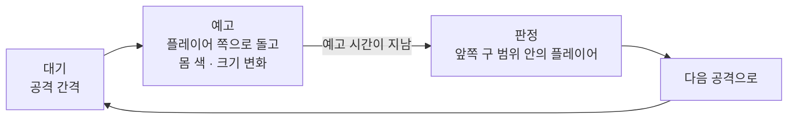
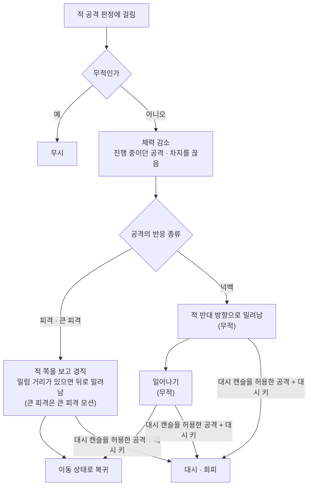
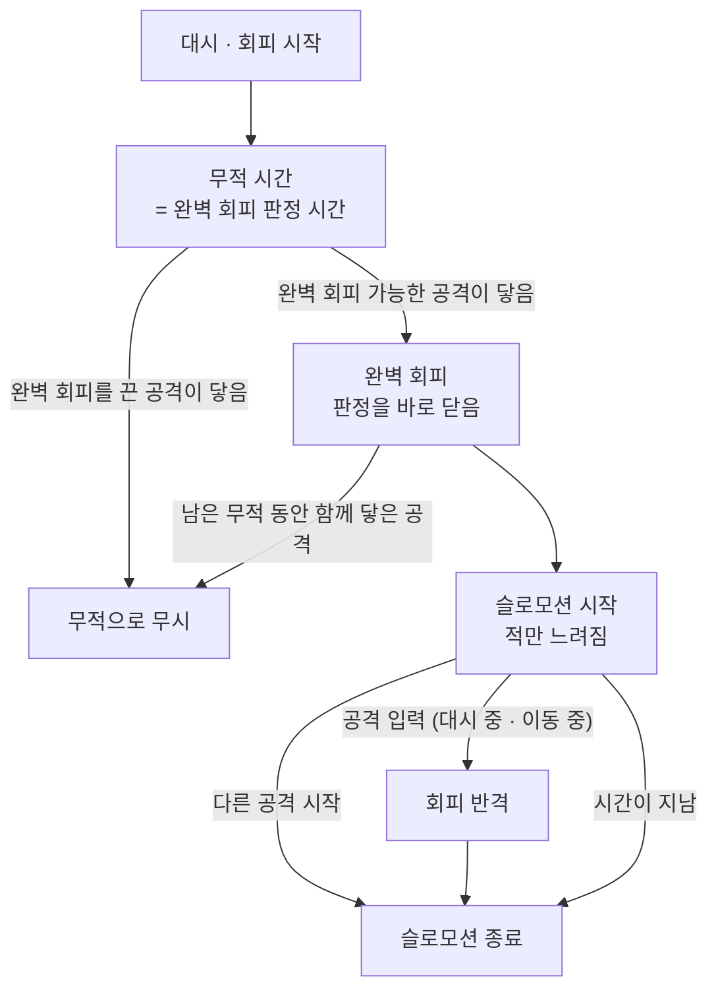
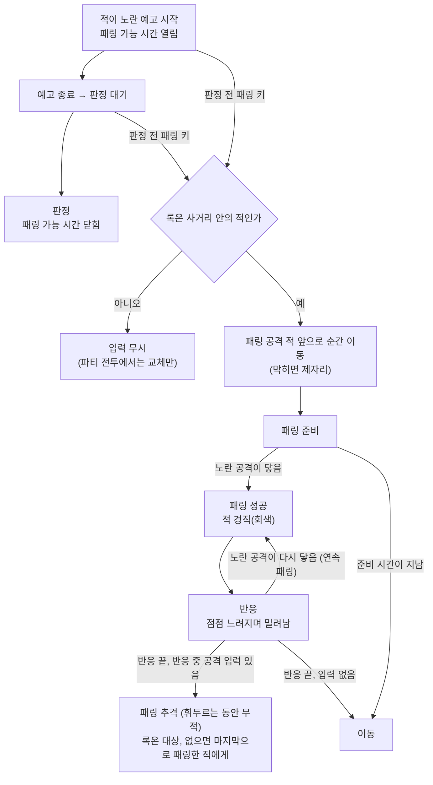

# 적 공격과 플레이어 피격

## 1. 개요

공격하는 더미 적이 예고 뒤 공격하고, 플레이어가 맞으면 체력이 줄며 공격 종류에 따라 경직 또는 넉백이 나오는 체계다. 대시 · 회피의 앞부분은 무적이고, 이 시간 안에 공격이 닿으면 완벽 회피가 되어 적만 느려지는 슬로모션과 함께 회피 반격을 할 수 있다. 노란 예고 공격은 패링으로 막고 밀려난 뒤 추격 공격으로 이어갈 수 있다. 이후 파티 전투의 지원 공격 · 일반 적 AI 가 이 공격과 피격 흐름 위에서 동작한다.

## 2. 구성 요소

- DummyEnemyAttacker : 공격하지 않는 더미 적에 붙여, 공격 목록을 예고 → 판정 대기 → 판정 순서로 반복하고, 패링 · 필살기에 당하면 경직, 그로기가 되면 공격을 멈추는 시험용 공격 기능
- PlayerHitState : 피격 · 큰 피격 · 넉백 상태
- EnemyAttackSetting : 적 공격 하나의 설정 묶음 (예고 시간 · 색 · 크기, 판정 대기 시간, 패링 · 완벽 회피 가능 여부, 패링 경직 시간, 판정 범위, 위력, 플레이어 반응, 경직 · 밀림 · 넉백 · 일어나기 수치, 피격 중 대시 캔슬 가능 여부)
- EnemyTime : 적 전용 시간 배율. 슬로모션 동안 적만 느려지게 한다
- ParryWindow : 지금 패링 가능 시간을 열어 둔 적 목록
- PlayerHealth : 플레이어 체력, 무적 시간, 완벽 회피 판정. 맞으면 완벽 회피 · 패링 · 무적인지 확인하고 체력을 줄인 뒤 피격 상태로 넘긴다
- PlayerSlowMotion : 완벽 회피 후 슬로모션의 시작 · 종료와 임시 표시 오브젝트
- PlayerParry : 패링 입력과 수치, 패링 대상 선택, 패링 성공 처리
- PlayerTeleport : 대상 앞 순간 이동과 도착 지점 막힘 검사 (패링 · 필살기가 함께 씀)
- PlayerParryState : 패링 준비 · 반응 · 추격 연결 상태, 마지막으로 패링한 적 기억
- PlayerController : 어떤 상태에서든 피격 상태로 넘기고, 대시 무적 시간을 들고 있는 플레이어 기능 (피격 · 완벽 회피 관련 역할)
- PlayerDashState : 대시 · 회피를 시작할 때 무적과 완벽 회피 판정을 거는 상태 (무적 관련 역할)

## 3. 동작 원리

### 더미 적의 공격 흐름

- 공격 목록을 순서대로 반복한다. 기획서 기준으로 약공격 → 강공격 → 패링 공격 순서로 둔다.
- 예고는 색과 크기로 구분한다.
    - 패링 공격만 노란색으로 바뀐다.
    - 약공격과 강공격은 색 없이 몸이 커지는 정도와 예고 길이로 구분한다. 강공격일수록 크게, 길게 예고한다.
- 판정은 예고가 끝나는 순간 적 앞쪽의 구 범위로 한 번 한다. 더미 적을 선택하면 Scene 창에 공격별 범위가 보인다.
- 공격 기능은 기존 더미 적에 덧붙이는 방식이라, 타겟팅 · 록온 · 공격 적중은 그대로 동작한다.
- 패링 · 필살기에 당하면 경직한다. 예고 · 판정 대기 중(공격 중)이었으면 그 공격을 끊고, 경직이 끝나면 다음 순서의 공격으로 넘어간다. 공격 전 대기 중이거나 이미 경직 중이면 공격 순서는 그대로 두고, 경직이 끝나면 원래 하려던 공격을 한다.
- 그로기가 되면 경직과 같은 기준으로 공격을 끊고, 그로기 시간 동안 공격을 멈춘다. 그로기 중에는 경직하지 않는다. (콤보 스킬 문서 참고)
- 피격 깜빡임과 상태 색(예고 · 경직 · 그로기)을 나눴다. 깜빡임이 끝나면 그때의 상태 색으로 돌아간다.
- 공격 목록이 비어 있으면 경직 · 그로기 시간이 흐르지 않는다. 테스트용 적은 항상 공격 방식을 1개 이상 둔다.

### 피격 처리

| 공격 | 반응 | 동작 |
|---|---|---|
| 약공격 | 피격 | 제자리에서 짧게 경직 |
| 강공격 | 큰 피격 | 큰 피격 모션으로, 경직이 시작될 때 뒤로 조금 밀려나고 길게 경직 |
| 패링 공격 | 넉백 | 뒤로 밀려난 뒤 일어남. 넉백과 일어나기 동안 무적 |

- 어느 상태에서든 맞으면 피격 상태로 넘어간다. 공격 중이면 공격이 끊기고, 이후 콤보는 1단부터 다시 시작한다.
- 경직 중 다시 맞으면 새 피격으로 바뀐다.
- 경직 · 밀림 · 넉백 · 일어나기 시간과 피격 중 대시 캔슬 허용 여부는 공격마다 따로 정한다.
- 체력이 0이 되었을 때의 쓰러짐과 실패 처리는 아직 없고, 0에서 멈춘다.

### 무적과 완벽 회피

- 대시 · 회피를 시작하면 정해진 시간 동안 무적이다. 대시와 회피는 같은 시간을 쓰고, 연속 대시는 대시마다 다시 건다.
- 무적 시간과 완벽 회피 판정 시간은 같은 값이다. 이 시간 안에 완벽 회피할 수 있는 공격이 닿으면 완벽 회피가 된다.
    - 완벽 회피할 수 있는지는 공격마다 정한다. 끈 공격은 무적으로 무시만 된다.
    - 한 번의 대시 · 회피에서 완벽 회피는 한 번만 발동한다. 여러 공격이 동시에 닿아도 모두 피하고, 슬로모션은 한 번만 시작된다.
- 넉백과 일어나기 동안은 무적이지만, 이때 맞은 공격은 완벽 회피가 아니다.
- 넉백 중 대시로 끊으면 남은 넉백 무적은 지우고 대시 무적만 새로 건다.

### 슬로모션과 적 전용 시간

- 완벽 회피에 성공하면 정해진 시간(기본 1초) 동안 적만 정해진 배속(기본 0.5배)으로 느려진다. 플레이어와 카메라는 원래 속도로 움직인다.
- 슬로모션 중 공격 키를 누르면 대시 중이든 대시가 끝난 이동 중이든 대시 공격보다 회피 반격이 먼저 나간다.
- 회피 반격이든 다른 공격이든 공격을 시작하면 슬로모션은 바로 끝난다.
- 슬로모션 중 새로 대시 · 회피해 다시 완벽 회피하면 슬로모션 시간을 처음부터 다시 센다.
- 적만 느려지도록 Unity 전체 시간은 바꾸지 않고, 적이 쓰는 시간 배율만 낮춘다. 그래서 적 · 적 애니메이션 · 적 이펙트는 모두 이 배율을 따라야 한다.
- 지금은 슬로모션의 시작과 끝을 알 수 있도록 플레이어 위치에 임시 표시 오브젝트를 만들었다가 지운다.

### 패링과 패링 추격

- 판정 순서는 완벽 회피 → 패링 → 무적 → 피격이다.
- 패링 공격은 예고가 끝난 뒤 판정까지 기다리는 시간이 있다(기본 0.5초). 패링 가능 시간은 노란 예고 시작부터 판정 순간까지이고, 이 밖의 패링 입력은 무시한다.
- 이동 · 공격 · 대시 · 피격 · 넉백 중 어디서든 패링할 수 있다. 시전 중 무적인 공격(패링 추격 포함)을 휘두르는 중에는 입력을 무시한다.
- 록온 사거리 안의 적이 연 패링 가능 시간에만 패링할 수 있다. 록온 사거리 밖의 적만 노란 예고를 하면 패링 키 입력은 무시하고, 파티 전투에서는 캐릭터 교체만 된다.
    - 록온 사거리는 록온할 수 있고 록온이 풀리는 거리와 같다.
- 패링을 시작하면 패링 공격을 하는 적의 정면, 정해진 거리 앞으로 순간 이동한다.
    - 그런 적이 여럿이면 공격 대상 기준을 따른다. 록온 대상 → 자동 조준 대상 → 록온 사거리 안에서 가장 최근에 예고를 시작한 적 순서다.
    - 대상은 패링 키를 누른 순간 정한다.
    - 도착 지점이 벽 · 지형에 겹치거나 적과 도착 지점 사이가 막혀 있으면 제자리에서 패링한다.
    - 도착 높이는 적의 기준점 높이를 쓰므로, 적의 기준점은 플레이어처럼 발바닥에 있어야 한다.
- 준비 자세는 적 공격이 끊겨도 정해진 시간까지 유지한다.
- 패링에 성공하면 적은 경직 시간 동안 공격을 멈추고 회색이 된다. 패링당한 공격은 소모되어 경직이 끝나면 다음 공격으로 넘어간다.
- 패링에 성공할 때마다 필살기 게이지가 정해진 양만큼 쌓인다. 완벽 회피도 마찬가지다. (필살기 문서 참고)
- 반응 동안 플레이어는 공격 반대 방향으로 밀려나며, 반응 시간에 걸쳐 속도가 0까지 일정하게 줄어든다. 반응 동안 노란 공격이 다시 닿으면 자동으로 패링하고 반응을 처음부터 다시 시작한다.
- 반응 동안 공격 키를 눌렀으면 반응이 끝난 뒤 추격 공격이 나간다. 연속 패링이 일어나면 이전 입력은 지우고 마지막 반응의 입력만 본다.
- 추격 공격은 록온 중이면 록온 대상에게, 아니면 마지막으로 패링한 적에게 나간다. 화면 중앙에 다른 적이 있어도 패링한 적을 쫓는다.
- 필살기 중에는 무적이라 패링 입력이 무시된다.
- 노란색이 아닌 공격은 패링 중에도 맞는다.
- 플레이어 공격마다 시전 중 무적을 켤 수 있다. 켠 공격은 휘두르는 동안 무적이고 후딜에 들어가면 풀린다. 패링 추격은 이 옵션을 켜서 무적이며, 이때 들어온 노란 공격은 패링되지 않는다.

## 4. 구현 과정

- 활용한 기능 :
    - `Physics.OverlapSphere` : 예고가 끝나는 순간 적 앞쪽 구 범위 안의 플레이어를 찾는다.
    - Gizmos : Scene 창에 공격별 판정 범위를 보여, 공격 범위를 조정할 때 확인한다.
    - `[Serializable]` 설정 묶음 : 적 공격 하나의 값을 묶어 Inspector 에서 공격마다 같은 형태로 정한다.
    - Animator 상태 직접 재생 : 피격 · 넉백 · 일어나기 상태를 전이선 없이 코드가 이름으로 재생한다.
- 구현 과정 :
    1. 적 공격 설정 묶음과 공격하는 더미 기능, 플레이어 체력 기능을 만들고, 맞았을 때 체력 감소 로그로 판정을 확인했다.
    2. 피격 · 넉백 상태를 추가하고 체력 기능에서 피격 상태로 넘기게 했다.
    3. 테스트 중 강공격이 약공격 · 패링 공격과 구분되도록 넉백 대신 큰 경직과 밀림으로 바꿨다.
    4. 대시 · 회피 시작부터 일정 시간 무적을 추가했다.
    5. 적 전용 시간 배율과 슬로모션을 만들고, 더미 적의 공격 대기 · 예고 · 깜빡임이 이 배율을 따르게 했다.
    6. 대시 무적에 완벽 회피 판정을 함께 열고, 완벽 회피 시 슬로모션과 회피 반격을 연결했다. 이전에 회피 반격을 시험하던 임시 옵션은 지웠다.
    7. 동시에 닿는 여러 공격에 슬로모션이 여러 번 걸리지 않도록, 한 번 발동하면 판정을 바로 닫게 했다.
    8. 처음에는 회피 반격을 시작할 때만 슬로모션을 끝냈으나, 다른 공격을 시작해도 끝나도록 바꿨다.
    9. 적 공격에 판정 대기 시간과 패링 가능 시간, 패링 경직을 추가했다.
    10. 플레이어 공격 시작을 하나의 함수로 정리하고, 공격마다 시전 중 무적을 정할 수 있게 했다.
    11. 패링 준비 · 반응 · 연속 패링 · 추격을 만들었다. 반응은 처음에 밀려나는 시간과 연속 패링 유지 시간을 따로 두었다가 하나로 합쳤고, 밀려나는 속도가 점점 줄도록 바꿨다.
    12. 처음에는 패링할 때 대상에게 다가갔으나 벽 뒤에서 패링하면 걸려 어색해서, 패링 공격 적 앞으로 순간 이동하도록 바꿨다.
    13. 순간 이동 시 공중에 뜨는 문제는 더미 적의 기준점이 몸 가운데에 있어서 생겼다. 코드로 바닥 높이를 맞추지 않고, 적의 기준점을 발바닥에 두는 것으로 정했다.
    14. 필살기를 만들며 순간 이동과 막힘 검사를 별도 기능으로 분리해 패링과 필살기가 함께 쓰게 했다. 패링 성공 · 완벽 회피에 필살기 게이지 획득을 추가했다.
    15. 패링 추격이 다른 공격과 같은 대상 기준(록온 → 자동 조준)을 써서, 록온하지 않으면 패링한 적이 아닌 화면 중앙의 적에게 나갈 수 있었다. 마지막으로 패링한 적을 기억해 추격 대상으로 넘기게 바꿨다.
    16. 필살기가 여러 번 맞히면서 경직할 때마다 적의 공격 순서가 넘어가 공격을 건너뛰었다. 공격 중일 때만 그 공격을 끊고 순서를 넘기도록 바꿨다.
    17. 패링 가능 시간이 열려 있으면 거리에 상관없이 패링해 멀리 있는 적 앞으로도 순간 이동했다. 록온 사거리 안의 적만 패링 대상으로 보도록 바꿨다.
    18. 강공격 피격이 약공격과 같은 피격 모션으로 나와, 반응 종류에 큰 피격을 추가했다. 경직 · 밀림 흐름은 피격과 같고 모션만 다르다.
    19. 콤보 스킬을 만들며 더미 적에 그로기를 추가하고, 피격 깜빡임과 상태 색을 나눴다.
- 주요 결정과 이유 :
    - 체력 · 무적은 플레이어 기능에 넣지 않고 별도 기능으로 두었다. 플레이어 기능이 길어지는 것을 막고, 이후 체력 표시와 쓰러짐 처리가 이 기능만 보면 되게 하기 위해서다.
    - 공격 기능은 새 적을 만들지 않고 기존 더미 적에 덧붙였다. 타겟팅 · 록온 · 적중이 더미 적을 기준으로 동작해 그대로 쓸 수 있기 때문이다.
    - 대시 · 회피의 앞부분만 무적으로 했다. 정확한 타이밍에 회피해야 보상을 주기 위해서다.
    - 강공격은 넉백 대신 큰 경직과 밀림으로 했다. 약공격, 패링 공격과 차이를 두기 위해서다.
    - 넉백과 일어나기 동안은 무적으로 했다. 연속으로 맞으며 계속 띄워지는 것을 막기 위해서다.
    - 슬로모션은 적만 느려지게 했다. 액션 게임의 완벽 회피처럼, 성공했다는 피드백을 주기 위해서다.
    - 공격을 시작하면 슬로모션을 바로 끝낸다. 피드백은 주되 너무 과한 효과가 되지 않게 하기 위해서다.
    - 무적 시간과 완벽 회피 판정 시간을 하나로 통일했다. 대시와 회피 모두에서 같은 경험을 주기 위해서다.
    - 한 번의 회피에서 완벽 회피는 한 번만 발동하고, 함께 닿은 공격은 모두 피한다. 동시에 들어온 공격에 슬로모션이 여러 번 걸리지 않게 하기 위해서다.
    - 피격 중 대시 캔슬은 공격마다 허용 여부를 정한다.
    - 패링을 시작하면 적 앞으로 순간 이동한다. 실제로 다가가면 벽 등에 걸리기 때문이다.
    - 패링 대상은 공격 대상 기준(록온 → 자동 조준)을 따른다.
    - 패링 추격 대상은 록온이 아니면 패링한 적으로 한다. 패링한 대상과 추격 공격 대상을 일관되게 유지하기 위해서다.
    - 적의 공격 취소는 공격 중에 경직했을 때만 한다. 공격 전 대기 중에 맞았다고 다음 공격이 사라지지 않게 하기 위해서다.
    - 큰 피격은 별도 경직 값을 두지 않고 피격 값을 함께 쓴다. 강공격과 약공격의 차이는 경직 시간 · 밀림 값으로 이미 정하고 있고, 모션만 다르면 되기 때문이다.
    - 밀려나는 속도는 시간에 비례해 0까지 줄이고, 처음 속도를 거리 × 2 ÷ 시간으로 잡아 설정한 거리만큼 밀려나게 했다. 매 프레임 보간하면 거리와 멈추는 시간을 정할 수 없기 때문이다.
    - 노란색이 아닌 공격은 패링 중에도 맞는다. 패링을 유도한 뒤 마지막 타격만 패링 불가로 두어 회피를 요구하는 패턴을 만들 수 있게 하기 위해서다.
    - 공격 중 무적은 휘두르는 동안만 걸고 후딜에는 푼다.
- 레퍼런스 : 젠레스 존 제로의 피격 · 넉백 반응, 회피 무적, 완벽 회피 후 회피 반격, 지원 공격(패링 · 추격)

## 5. 기존 방식과 비교

- 기존 방식 : 적은 공격하지 않고 맞으면 색만 바뀌었다. 플레이어에게는 체력과 피격이 없었다.
- 달라진 점 :
    - 더미 적이 예고 뒤 약공격 · 강공격 · 패링 공격을 반복한다.
    - 플레이어가 맞으면 체력이 줄고 공격에 따라 경직 · 밀림 · 넉백이 나온다.
    - 대시 · 회피 앞부분과 넉백 · 일어나기 동안 무적이다.
    - 타이밍을 맞춰 피하면 완벽 회피가 되어 적만 느려지고, 회피 반격이 테스트 옵션이 아닌 실제 판정으로 나간다.
    - 노란 공격을 패링해 적을 경직시키고, 밀려난 뒤 무적 추격 공격으로 이어갈 수 있다.
    - 필살기 작업에서 바뀐 점
        - 기존 : 경직하면 항상 다음 공격으로 넘어갔다. 패링 추격은 록온 대상, 없으면 자동 조준 대상에게 나갔다. 순간 이동은 패링 기능 안에 있었다. 패링 가능 시간을 연 적이 어디에 있든 패링할 수 있었다.
        - 변경 : 공격 중에 경직했을 때만 다음 공격으로 넘어간다. 패링 추격은 록온 대상, 없으면 마지막으로 패링한 적에게 나간다. 순간 이동은 패링 · 필살기가 함께 쓰는 별도 기능이 되었다. 록온 사거리 안의 적만 패링할 수 있다.
    - 콤보 스킬 작업에서 바뀐 점
        - 기존 : 강공격도 약공격과 같은 피격 모션이었다. 피격 깜빡임이 끝나면 처음 색으로 돌아가, 경직 중에 맞으면 회색이 사라졌다.
        - 변경 : 강공격은 큰 피격 모션이 나온다. 깜빡임이 끝나면 그때의 상태 색으로 돌아간다. 더미 적에 그로기가 생겼다.
- 개선된 점 : 적의 공격에 맞고, 피하고, 막는 흐름과 정확한 입력에 대한 보상이 생겼다. 패링 추격이 막아 낸 적을 정확히 쫓고, 여러 번 맞는 공격에도 적의 공격 순서가 유지된다. 강공격 피격이 모션으로 구분되고, 경직 · 그로기 상태가 피격 중에도 보인다.
- 필요하게 된 과정 : 기획서 코어 전투 3묶음의 첫 단계다. 완벽 회피 · 패링 · 넉백은 모두 적의 공격이 플레이어에게 닿아야 시험할 수 있어 가장 먼저 만들었다.

### 미검증 항목

- 체력이 0이 되었을 때의 쓰러짐 · 실패 처리 (게임 흐름 단계)
- 완벽 회피 연출 (화면 효과 · 잔상 등, 지금은 임시 표시 오브젝트)
- 적 애니메이션 · 이펙트의 적 전용 시간 적용 (일반 적 · 보스 단계)
- 적 공격 설정과 피격 수치의 ScriptableObject 이전 (캐릭터 공격 데이터 작업 때 함께)
- 패링 준비 · 반응 · 추격 전용 모션
- 패링 성공 시 그로기 누적, 이전 · 다음 캐릭터 교체 방향 구분 (파티 전투 단계)
- 적 공통 계약 (지금은 맞았을 때 더미 적 공격 기능을 직접 받음, 일반 적 단계에서 검토)
