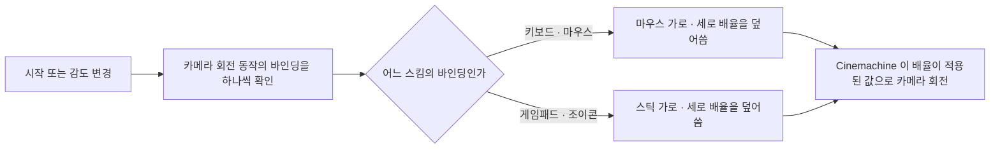

# 플레이어 입력과 조작 배치

## 1. 개요

키보드 · 마우스, 일반 게임패드, 조이콘의 입력을 하나의 입력 에셋에서 관리하는 입력 체계다. 기획서의 전체 동작을 아직 구현하지 않은 것까지 미리 등록해, 키가 겹치는지 한곳에서 확인할 수 있게 했다. 카메라 회전은 마우스와 스틱의 감도를 따로 정하며, 이후 설정 화면의 감도 · 키 재설정 옵션이 이 체계 위에서 동작한다.

## 2. 구성 요소

- PlayerInputReader : 플레이어 캐릭터 입력(이동 · 대시 · 공격 · 스킬 · 필살기 · 패링 두 키 · 록온 · 그로기 테스트)을 한곳에서 읽고, 조작 중이 아니면 입력에 반응하지 않게 하는 기능
- CommonCharacterSettings : 플레이어 캐릭터 입력 액션을 모든 캐릭터가 같이 쓰도록 참조하는 공통 설정 (입력 관련 역할)
- LookSensitivity : 카메라 회전 입력의 감도를 마우스와 스틱으로 나눠 적용하는 기능
- 입력 에셋 (Input Action Asset) : 플레이어 동작과 장치별 바인딩, 컨트롤 스킴을 모아 둔 에셋
- Switch Controller Input 패키지 : 조이콘을 Input System 장치로 인식시키는 외부 패키지

## 3. 동작 원리

### 조작 배치

| 동작 | 키보드 · 마우스 | 게임패드 | 조이콘 | 상태 |
|---|---|---|---|---|
| 이동 | WASD | 왼쪽 스틱 | L 스틱 | 구현 |
| 카메라 회전 | 마우스 이동 | 오른쪽 스틱 | R 스틱 | 구현 |
| 대시 · 회피 | Shift, 우클릭 | 아래 버튼 | B | 구현 |
| 기본 공격 · 강공격 | 좌클릭 (길게 누르면 차지) | 오른쪽 버튼 | A | 구현 |
| 스킬 · 특수스킬 | E | 위 버튼 | X | 구현 |
| 록온 / 해제 | 휠 클릭 | 오른쪽 스틱 누르기 | R 스틱 누르기 | 구현 |
| 일시정지 | Esc | Start | + | 구현 |
| 필살기 | Q | 왼쪽 버튼 | Y | 등록만 |
| 패링 · 교체 (이전 캐릭터) | C | 왼쪽 트리거 | ZL | 등록만 |
| 패링 · 교체 (다음 캐릭터) | Space | 오른쪽 트리거 | ZR | 등록만 |
| [테스트] 적 그로기 | 0 | 없음 | 없음 | 등록만 |

- `등록만` 인 동작은 입력과 바인딩만 있고, 각 기능을 구현할 때 연결해 조이콘 입력도 다시 확인한다.
- 콤보 스킬의 캐릭터 선택은 기존 키를 다시 쓰므로 따로 등록하지 않았다.
- 조이콘 버튼은 조이콘을 쥔 손에 맞게 정했다.
- 게임패드는 조이콘과 같은 위치의 버튼으로 맞췄다. 버튼 이름은 패드마다 달라, 예를 들어 조이콘의 A(오른쪽)는 Xbox 패드에서 B로 보인다.

### 컨트롤 스킴

- 바인딩을 장치 종류별로 키보드 · 마우스, 게임패드, 조이콘(Switch) 세 스킴으로 나눴다.
- 조이콘 패키지의 장치는 Input System 의 일반 게임패드로 분류되지 않는다. 그래서 게임패드 스킴에 넣으면 스킴이 요구하는 장치와 맞지 않아, 조이콘 전용 스킴을 따로 두었다.
- 스킴이 나뉘어 있으면 설정 화면에서 패드 종류별로 키를 다시 정할 때 해당 스킴의 바인딩만 다루면 된다.
- 플레이어 기능은 스킴을 고르지 않고 동작을 직접 읽으므로, 연결된 모든 장치의 입력을 함께 받는다.

### 카메라 회전 감도

- 마우스와 스틱은 같은 카메라 회전 동작과 같은 Cinemachine 감도를 쓴다. 마우스는 한 프레임에 수~수십씩 움직이고 스틱은 최대 1이라, 마우스에 맞춘 감도로는 스틱 회전이 매우 느렸다.
- 그래서 바인딩마다 스킴에 맞는 배율을 덮어써, 마우스와 스틱의 가로 · 세로 감도를 따로 정한다.
- 키 재설정으로 바뀐 바인딩 경로는 그대로 두고 배율만 덮어쓴다.
- 지금은 Inspector 값만 쓰고, 플레이 중에 값을 바꾸면 바로 반영된다. 값 저장과 설정 화면 옵션은 UI 단계에서 만든다.

## 4. 구현 과정

- 활용한 기능 :
    - Input System 컨트롤 스킴 : 바인딩을 장치 종류별로 묶어 에디터에서 걸러 보고, 이후 키 재설정에서 장치별로 다룬다.
    - Input System 바인딩 덮어쓰기와 `ScaleVector2` Processor : 입력 에셋을 바꾸지 않고 실행 중에 바인딩의 배율만 바꾼다.
    - Input Debugger : 조이콘의 인식, 버튼 · 스틱 값, 보고 주기를 확인했다.
- 구현 과정 :
    1. Bluetooth 동글로 조이콘 두 개를 연결해 Input System 장치로 인식되고, 버튼 · 스틱 값이 바뀌며, 연결을 끊으면 장치가 사라지는 것을 확인했다. 조이콘 패키지를 계속 쓰기로 했다.
    2. 대시 · 공격 · 스킬 · 록온 버튼 배치를 정하고, 게임패드에 빠져 있던 스킬 · 록온 바인딩을 추가했다.
    3. 어느 스킴에도 속하지 않던 조이콘 바인딩을 조이콘 전용 스킴으로 옮겼다.
    4. 프로젝트 템플릿에서 남은 일반 조이스틱 · XR 바인딩을 지웠다.
    5. 조이콘으로 플레이하며 스틱 카메라 회전이 느린 것을 확인하고, 마우스와 스틱의 감도를 나눠 정하는 기능을 추가했다.
    6. 기획서 조작 표의 남은 동작(필살기, 패링 · 교체 이전 / 다음, 테스트용 그로기)을 미리 등록했다.
- 레퍼런스 : 젠레스 존 제로의 게임패드 기본 배치와 비교했다. 대시 · 회피와 스킬은 같은 위치이고, 기본 공격 · 필살기 · 교체는 조이콘을 쥔 손에 맞게 다르게 정했다.
- 주요 결정과 이유 :
    - 조이콘 전용 컨트롤 스킴을 두었다. 조이콘이 일반 게임패드로 분류되지 않고, 기획서대로 패드 종류별 키 재설정을 지원하기 위해서다.
    - 카메라 회전 감도를 마우스와 스틱으로 나눴다. 두 입력의 값 크기가 달라 하나의 감도로 맞출 수 없기 때문이다.
    - 구현하지 않은 동작도 입력을 미리 등록했다. 기획서 전체의 키 배치가 겹치지 않는지 한곳에서 확인하기 위해서다.
    - 플레이어 캐릭터 입력 액션은 모든 캐릭터가 같이 쓰는 공통 설정에서 참조한다. 캐릭터마다 조작이 조금 다를 수는 있어도 기본 조작은 바뀌지 않기 때문이다. 입력 기능에는 캐릭터마다 다른 "조작 중 여부"만 남는다.

## 5. 기존 방식과 비교

- 기존 방식 :
    - 조이콘 바인딩이 어느 스킴에도 속하지 않아 에디터의 스킴 목록에서 보이지 않았다.
    - 게임패드에는 스킬 · 록온 바인딩이 없었다.
    - 카메라 회전 감도를 마우스와 스틱이 함께 써서 스틱 회전이 매우 느렸다.
    - 조이콘은 장치 인식만 확인했고 실제 플레이는 확인하지 않았다.
- 달라진 점 :
    - 바인딩을 세 스킴으로 관리하고, 구현된 모든 동작을 게임패드 · 조이콘으로 쓸 수 있다.
    - 마우스와 스틱의 가로 · 세로 감도를 따로 정한다.
    - 기획서 전체 동작의 입력이 등록되어 있다.
- 개선된 점 :
    - 조이콘만으로 이동, 카메라, 대시, 공격, 스킬, 록온, 일시정지를 모두 조작할 수 있다.
    - 이후 설정 화면에서 감도와 키 재설정 옵션을 붙이기 쉽다.
- 알려진 제약 :
    - Bluetooth 동글 하나에 조이콘 두 개를 연결하면 각 조이콘의 보고 주기가 약 30Hz로 떨어져 버튼 입력이 늦게 느껴진다. 하나만 연결하면 정상이며, 코드로는 해결할 수 없다.
    - 연결할 때 스틱 보정값을 제대로 받지 못하면 R 스틱이 놓아도 움직이는 값으로 읽혀 카메라가 한쪽으로 돈다. 다시 연결하면 해결된다. 자주 일어나면 스틱 영점 맞추기 기능을 검토한다.

- 구조 정리 (#31) : (자세한 내용은 플레이어 구성과 데이터 문서)
    - 기존 : 컨트롤러 · 패링 · 필살기 · 타겟팅 · 그로기 테스트가 각자 입력을 읽었다.
    - 변경 : 플레이어 캐릭터 입력은 입력 기능 한곳에서 읽고, 조작 중 여부로 입력 반응을 끄고 켤 수 있다. 파티 전투에서 필드 위 여러 캐릭터 중 조작 중인 캐릭터만 반응하게 하기 위해서다.

- 컴포넌트 병합 · 정리 (#33) : (자세한 내용은 플레이어 구성과 데이터 문서)
    - 기존 : 입력 액션 참조는 입력 기능의 Inspector 칸에 있어, 캐릭터 Prefab마다 같은 액션을 연결해야 했다.
    - 변경 : 입력 액션 참조는 공통 설정 하나에 있고, 입력 기능은 공통 설정에서 읽는다.

### 미검증 항목

- 일반 게임패드(Xbox 등)의 전체 조작
- 등록만 한 동작(필살기, 패링 · 교체, 테스트용 그로기)의 실제 입력 동작
- 설정 화면에서 레퍼런스 게임의 키 배치를 고를 수 있게 하는 방법 (UI 단계에서 확인)
