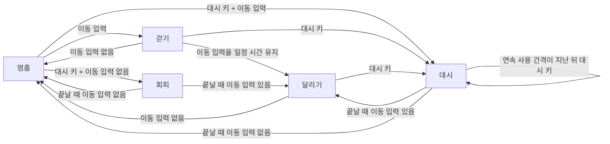
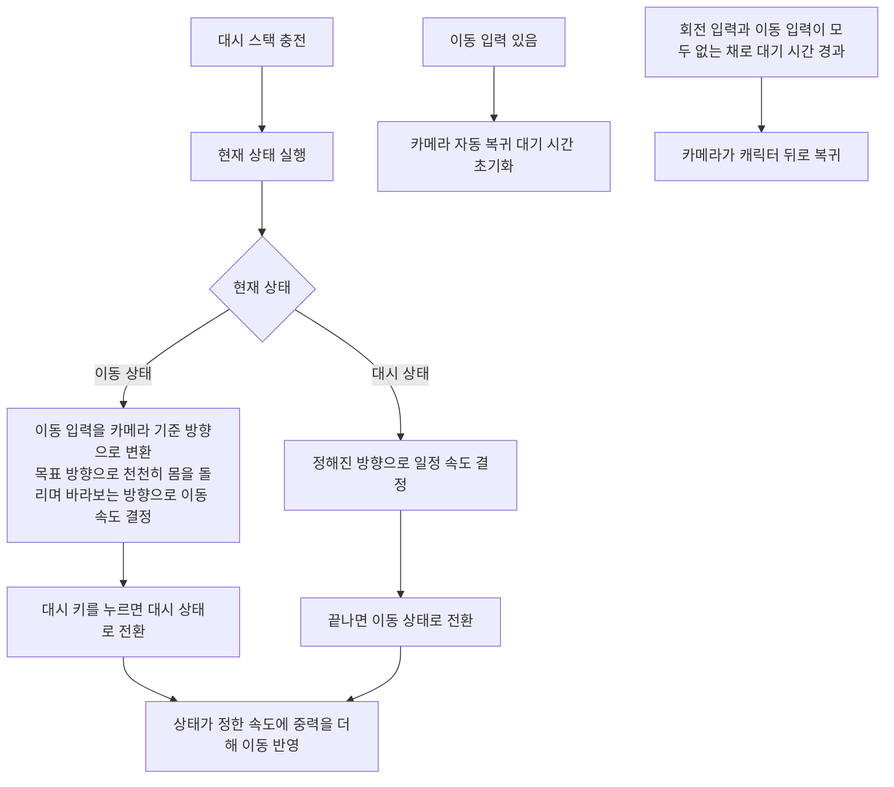
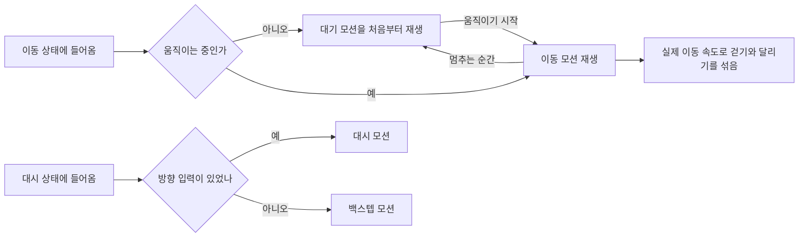

# 플레이어 이동과 3인칭 카메라

## 1. 개요

플레이어가 카메라가 보는 방향을 기준으로 이동하고, 하나의 키로 대시와 회피(백스텝)를 함께 쓰는 이동 체계다. 대시가 끝나면 자연스럽게 달리기로 이어지고, 3인칭 카메라는 플레이어가 멈춰 있을 때 캐릭터 뒤로 돌아온다. 코어 전투의 첫 단계로 만들었으며, 이후 공격과 패링 같은 전투 동작이 이 이동 체계 위에서 동작한다.

## 2. 구성 요소

- PlayerController : 이동 수치(캐릭터 데이터), 대시 스택, 회전, 중력(공통 설정)처럼 여러 상태가 함께 쓰는 기능과 상태 전환을 맡는 플레이어 기능
- PlayerState : 플레이어 상태의 공통 틀 (들어올 때, 매 프레임, 나갈 때, 애니메이션 이벤트)
- PlayerStateMachine : 현재 상태를 하나 들고 상태를 전환하는 기능
- PlayerLocomotionState : 멈춤, 걷기, 달리기 상태
- PlayerDashState : 대시와 회피(백스텝) 상태. 시작할 때 무적을 건다
- CursorLock : 일시정지 입력마다 마우스 커서의 잠금과 해제를 전환하는 기능
- CameraRecenterBlocker : 플레이어가 이동하는 동안 카메라의 자동 복귀를 막는 기능

## 3. 동작 원리

### 이동 상태 전환

플레이어는 멈춤, 걷기, 달리기, 대시, 회피 다섯 상태 중 하나에 있다.

- 대시와 회피는 같은 키를 쓴다.
    - 방향 입력이 있으면 그 방향으로 즉시 돌아서 대시한다.
    - 방향 입력이 없으면 바라보는 방향을 유지한 채 뒤로 회피한다.
- 대시나 회피가 끝날 때 이동 입력이 있으면 대시 키를 누르고 있지 않아도 달리기로 이어진다.
- 대시 키를 누른 채 멈춰 있다가 이동을 시작하면 걷기부터 시작한다. 키를 누르고 있다고 빨라지지 않는다.
- 대시는 스택 방식이다.
    - 최대 두 번까지 연속으로 쓸 수 있고, 일정 시간마다 한 개씩 다시 찬다.
    - 대시 중에도 충전 시간은 계속 흐른다.
    - 대시 도중 다음 대시를 쓸 수 있는 간격은 Inspector 에서 대시 지속시간보다 짧게 줄일 수 있다.
- 대시와 회피는 시작부터 일정 시간 무적이다. (피격 문서 참고)

### 매 프레임 처리 순서와 카메라

- 각 상태는 이번 프레임에 움직일 수평 속도만 정하고, 실제 이동과 중력은 플레이어 기능이 상태 실행 뒤에 한 번에 반영한다. 중력은 캐릭터가 바뀌어도 같은 값이라 모든 캐릭터가 같이 쓰는 공통 설정에서 읽는다.
- 대시 시작, 이동으로 돌아가기처럼 여러 상태가 쓰는 전환은 플레이어 기능에 모아 두고, 각 상태는 언제 전환할지만 판단한다.

- 이동 방향은 매 프레임 카메라의 수평 방향을 기준으로 정한다. 이동 중에 카메라를 돌리면 진행 방향도 함께 바뀐다.
- 캐릭터는 목표 방향으로 일정 시간에 걸쳐 몸을 돌리고, 지금 바라보는 방향으로 이동한다. 그래서 방향을 바꿀 때 곡선을 그리며 꺾는다.
- 카메라 자동 복귀는 플레이어가 이동하는 동안 막는다.
    - 카메라 기준으로 이동하는 중에 카메라가 캐릭터 뒤로 돌아가면 이동 기준이 계속 바뀌어, 옆으로 걸을 때 원을 그리며 돌게 된다.
    - 그래서 자동 복귀는 회전 입력과 이동 입력이 모두 없는 상태, 곧 멈춰 서 있을 때만 일어난다.
- 마우스 커서는 플레이 시작 시 잠기고, 일시정지 입력마다 잠금과 해제가 번갈아 바뀐다.
    - 이후 UI 단계에서 열린 UI를 하나씩 닫다가 남은 UI가 없으면 게임 화면으로 돌아가 다시 잠그는 방식으로 확장할 예정이다.

### 애니메이션 재생

- Animator 에는 상태 사이의 전이선을 두지 않는다. 상태에 들어오는 순간 코드가 재생할 모션을 이름으로 지정하고, 이전 모션과 짧게 섞어 바꾼다.
- 대기 모션은 걷기, 달리기와 상태를 나눠 두어, 움직이다 멈추거나 대시가 끝나 멈출 때마다 처음부터 재생한다.
- 걷기와 달리기는 하나의 Blend Tree 로 묶고, 캐릭터의 실제 수평 이동 속도를 넘겨 섞는다. Blend Tree 의 기준값을 걷기 속도와 달리기 속도에 맞춰, 해당 속도일 때 그 모션이 그대로 나오게 했다.
- 이동은 코드가 맡으므로 애니메이션이 캐릭터를 움직이지 않게 했다. 모션은 캐릭터 위치에 고정된 채 재생된다.

## 4. 구현 과정

- 활용한 기능 :
    - `CharacterController` : 대시, 회피처럼 정해진 시간 동안 정해진 거리를 움직이는 동작을 정확하게 제어하기 위해 물리 기반 이동 대신 선택했다.
    - Input System 의 Input Action : 프로젝트 전체 입력 에셋에 이동, 시점, 대시, 일시정지 동작을 두고, Inspector 에서 Input Action Reference 로 연결해 매 프레임 값을 읽는다.
    - Cinemachine `Orbital Follow` : 구 형태 궤도로 캐릭터 주위를 돌며, 아래쪽 각도 한계를 두어 카메라가 바닥 아래로 내려가지 않게 했다.
    - Cinemachine `Rotation Composer` : 캐릭터의 발밑이 아닌 상체 높이를 바라보게 했다.
    - Cinemachine `Input Axis Controller` : 마우스와 오른쪽 스틱 입력으로 카메라를 회전한다. 마우스와 스틱의 감도는 입력 문서에 적었다.
    - Cinemachine `Recentering` : 입력이 일정 시간 없으면 카메라를 캐릭터 뒤로 되돌린다.
    - Cinemachine `Deoccluder` : 경사나 장애물에 카메라가 가리면 카메라를 앞으로 당긴다.
    - Switch Controller Input 패키지 : 조이콘을 Input System 장치로 인식시킨다.
    - Animator 와 Animator Override Controller : 모션 재생은 Animator 가 맡고, 나중에 캐릭터나 모션을 바꿀 때 Override Controller 에서 클립만 교체한다.
    - Blend Tree : 이동 속도 하나로 걷기와 달리기를 섞는다.
    - Humanoid 리타게팅 : 다른 캐릭터용으로 만들어진 외부 애니메이션을 플레이어 캐릭터에 옮겨 쓴다.
- 구현 과정 :
    1. 템플릿 입력 에셋에서 쓰지 않는 동작을 지우고, 대시와 일시정지 동작을 추가했다.
    2. 처음에는 다섯 상태를 하나의 이동 기능 안에서 상태 값으로 나눠 처리했다. 공격이 추가되는 단계에서 상태 머신으로 바꿨다. (5장 참고)
    3. 이동 기준은 테스트하면서 여러 번 바꿨다.
        - 처음에는 매 프레임 카메라 기준으로 이동했다. 옆으로 걸으면 카메라가 캐릭터를 화면 가운데에 두려고 고개를 돌리면서 이동 기준도 함께 돌아, 캐릭터가 원을 그리며 돌았다.
        - 캐릭터 기준 이동으로 바꾸고, 이동 입력을 시작한 순간의 방향을 기준으로 고정했다. 몸을 천천히 돌리며 곡선으로 꺾는 회전도 이때 추가했다.
        - 다시 카메라 기준으로 바꾸되 입력을 시작한 순간의 카메라 방향으로 고정했다. 원을 그리는 문제는 없었지만 이동 중에 카메라로 방향을 틀 수 없었다.
        - 최종적으로 매 프레임 카메라 기준 이동으로 돌아가고, 원을 그리는 원인인 이동 중 카메라 자동 복귀를 막았다.
    4. 최종 방식을 고른 이유는 두 가지다.
        - 레퍼런스와 같이 이동 중에도 카메라로 방향을 틀 수 있게 하기 위해서다.
        - 처음 기획한 조작 방법이 불편하고 일관성이 없다고 판단했다.
    5. 카메라 화면이 낮고 바닥 아래로 꺼지는 문제가 있어, 시선 높이를 상체로 올리고 구 형태 궤도의 아래쪽 한계와 Deoccluder 를 적용했다.
    6. 조이콘 패키지의 장치는 Input System 의 일반 게임패드로 분류되지 않아, 일반 게임패드 바인딩과 별도로 조이콘 전용 바인딩을 추가했다. 이후 조이콘 실기 테스트에서 조이콘 전용 컨트롤 스킴으로 분리했다. (입력 문서 참고)
    7. 모션을 적용하며 두 가지 문제를 해결했다.
        - 걷기와 달리기 모션이 캐릭터 위치를 벗어나 혼자 앞으로 나아갔다. 모션의 수평 이동을 포즈에 남기던 설정을 끄고, 그 이동을 버리도록 바꿔 모션이 캐릭터 위치에 고정되게 했다.
        - 달리기에서만 왼발목이 돌아간 채 재생됐다. 스킨 없이 받은 모션은 첫 프레임 자세를 기준 자세로 삼는데, 달리기 모션의 첫 프레임에서 왼발이 비틀려 있어 리타게팅 결과가 틀어졌다. 모든 모션이 T자 자세로 들어 있는 같은 기준 Avatar 를 쓰도록 통일해 해결했다.
    8. 첫 캐릭터는 처음에 임시 캐릭터로 시작할 계획이었으나, 바로 실전 캐릭터를 적용하는 편이 낫다고 판단했고 결과물이 기대보다 잘 나와 실전 캐릭터로 확정했다.

## 5. 기존 방식과 비교

- 기존 방식 : 멈춤, 걷기, 달리기, 대시, 회피를 하나의 이동 기능 안에서 상태 값과 분기로 처리했다.
- 달라진 점 : 상태마다 별도의 상태 클래스로 나누고, 플레이어 기능은 여러 상태가 함께 쓰는 기능과 상태 전환만 맡는다. 동작은 바꾸지 않았다.
- 개선된 점 : 공격, 스킬, 패링, 피격처럼 상태가 계속 늘어나도 각 상태의 처리를 따로 읽고 고칠 수 있다. 캔슬처럼 상태 사이의 규칙을 상태마다 정할 수 있다.
- 필요하게 된 과정 : 기획서 코어 전투 구현 순서의 첫 단계다. 공격, 패링, 완벽 회피 같은 이후 전투 동작이 모두 이동과 대시 위에서 동작하므로 가장 먼저 만들었다. 게임패드 입력을 처음부터 함께 만들어, 보유한 조이콘으로 적용 여부를 확인한다.

- 구조 정리 (#31) : (자세한 내용은 플레이어 구성과 데이터 문서)
    - 기존 : 이동 · 대시 수치와 입력 읽기, 모션 재생을 컨트롤러가 직접 들고 있었다.
    - 변경 : 이동 · 대시 수치는 캐릭터 데이터에, 입력은 입력 기능에, 모션 재생은 애니메이션 기능에 있다.

- 컴포넌트 병합 · 정리 (#33) : (자세한 내용은 플레이어 구성과 데이터 문서)
    - 기존 : 중력은 플레이어 기능의 Inspector 칸에 있었다.
    - 변경 : 중력은 모든 캐릭터가 같이 쓰는 공통 설정에서 읽는다.

### 미검증 항목

- 일반 게임패드 조작 (입력 문서의 미검증 항목에서 관리)
- 대시를 연속으로 쓸 때 두 번째 대시 모션이 처음부터 다시 재생되는지
