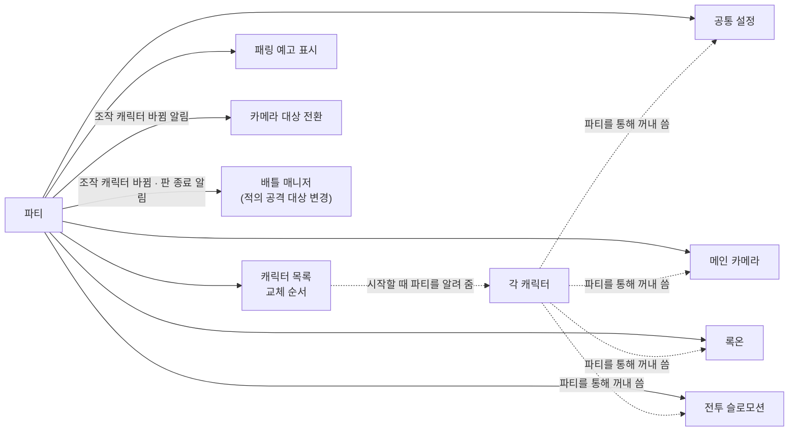
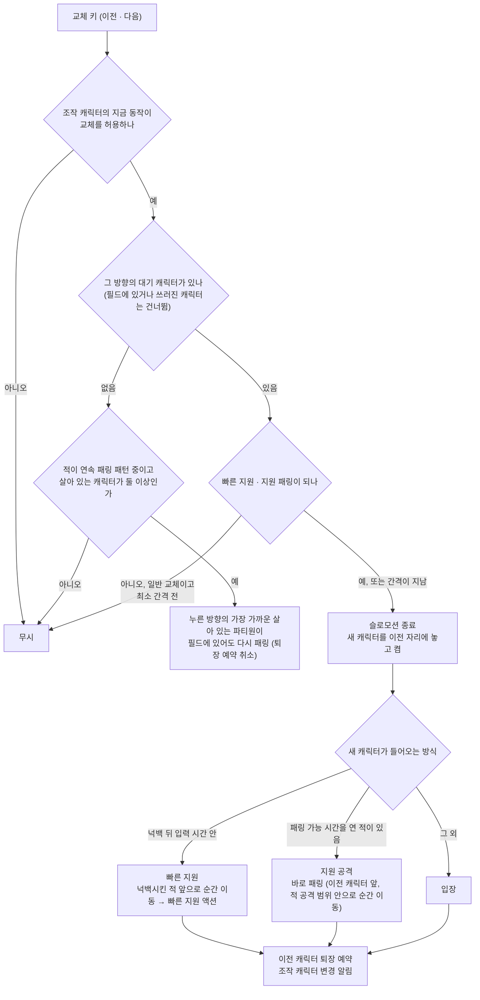
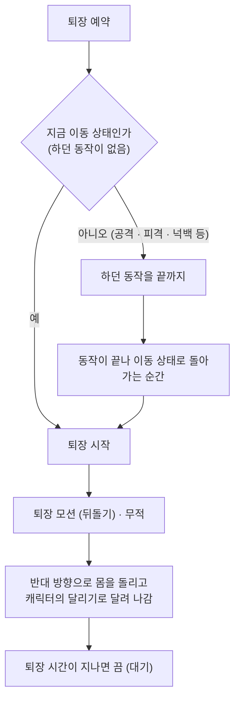
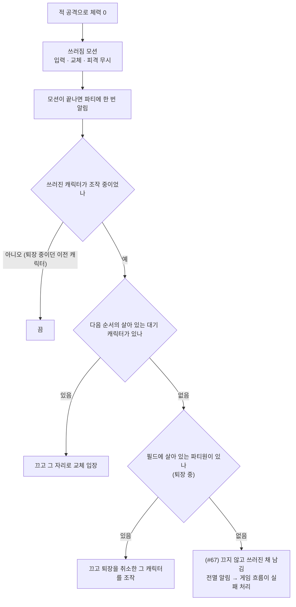
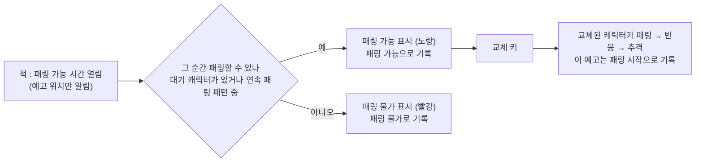

# 파티 전투 구조와 캐릭터 교체

## 1. 개요

캐릭터 3명이 한 전투에서 교체하며 싸우는 구조다. 파티 하나가 플레이어 쪽 전투에서 하나뿐인 것(캐릭터 목록 · 공통 설정 · 카메라 · 록온 · 슬로모션)을 들고, 필드의 캐릭터 중 조작 중인 캐릭터만 입력에 반응한다. 교체 · 지원 공격(교체 패링) · 빠른 지원은 파티 전투의 핵심 조작이며, 다음 단계인 콤보 스킬 이어받기의 전제가 된다.

## 2. 구성 요소

- PlayerParty : 캐릭터 목록 · 공통 설정 · 메인 카메라를 들고, 조작 캐릭터 · 교체 순서 · 대기 · 빠른 지원 입력 시간 · 대기 회복을 맡고, 조작 캐릭터 변경 · 판 종료를 알린다. 전투 화면이 대기 칸을 채우도록 캐릭터 목록을 읽기 전용으로 알려준다 (전투 HUD 문서)
- PlayerLockOn : 파티에 하나만 있는 록온 상태. 교체해도 같은 대상을 유지한다
- BattleSlowMotion : 완벽 회피 후 적만 느려지는 전투 단위 슬로모션
- ParryTelegraphView : 적의 패링 공격 예고 표시. 대기 캐릭터 수로 패링 가능 · 불가 표시를 고른다
- CameraTargetSwitcher : 조작 캐릭터가 바뀌면 카메라 · 록온 카메라가 따라갈 대상을 바꾼다
- ComboSkillSelector : 콤보 스킬 이어받기의 캐릭터 선택 · 연계 진행 (파티 오브젝트, 자세한 내용은 콤보 스킬 문서)
- PlayerSwapInState : 교체로 들어오는 입장 상태
- PlayerSwapOutState : 교체로 나가는 퇴장 상태
- PlayerDownedState : 체력이 0 이 된 캐릭터의 쓰러짐 상태. 모션이 끝나면 파티에 알린다 (피격 문서)

## 3. 동작 원리

### 파티가 들고 있는 것

- 캐릭터마다 다른 것(능력치 · 액션 · 체력 · 에너지 · 대상 찾기)은 캐릭터가 들고, 플레이어 쪽 전투에서 하나뿐인 것은 파티가 든다. 같은 에셋 · 씬 오브젝트를 캐릭터마다 연결하지 않아도 되고, 교체할 때 넘겨줄 값이 없어진다.
- 캐릭터 하나만 있는 씬도 목록에 한 명을 넣어 같은 구조로 쓴다. 교체할 캐릭터가 없어 교체 키는 아무 일도 하지 않는다.
- 파티는 시작할 때 각 캐릭터에 자신을 알려 준다. 캐릭터 기능은 시작 단계부터 공통 설정을 읽으므로, 그보다 먼저 알려 준다.
- 조작 캐릭터가 바뀌면 파티는 "바뀌었다" 는 것만 알리고, 카메라 대상 전환 기능이 듣고 카메라를 바꾼다. 파티가 카메라 구성까지 알지 않게 하기 위해서다.

### 교체

- 목록 순서대로 돌아가며 교체한다. 마지막 다음은 처음, 처음 이전은 마지막이다.
- 다음 순서의 캐릭터가 아직 필드에 있거나(퇴장 중) 쓰러졌으면 건너뛰고 같은 방향의 다음 대기 캐릭터로 교체한다. 교체할 대기 캐릭터가 없으면 교체하지 않는다. (연속 패링 패턴 중은 예외, 아래 `연속 패링`)
- 일반 교체는 마지막 교체(패링 · 빠른 지원 · 콤보 스킬 입장 포함)부터 최소 간격이 지나야 한다. 간격은 실제 시간이다. 빠른 지원 · 지원 패링이 되는 교체는 간격과 상관없이 바로 한다. 빠르게 연타해 캐릭터가 계속 바뀌는 것을 막되, 패링 · 빠른 지원의 타이밍은 막지 않기 위해서다.
- 새 캐릭터가 들어오는 방식은 빠른 지원 → 지원 공격 → 입장 순서로 본다. 빠른 지원 액션이 없는 캐릭터나 넉백시킨 적이 이미 처치된 경우에는 다음 방식으로 넘어간다.
- 교체하면 록온은 그대로 이어지고, 완벽 회피 슬로모션은 끝난다. 교체로 나온 패링은 정상 속도다.

### 입장

- 이전 캐릭터 자리에서 입장 모션을 재생하며 이전 캐릭터가 보던 방향으로 달려 나오다 멈춘다. 처음이 가장 빠르고 끝에서 0 이 되도록 고르게 느려져, 정해진 거리만큼 나아간다.
- 무적이 아니다. 입장 중 적 공격에 맞으면 피격 상태로 넘어간다.
- 입력
    - 이동 키 : 입장을 바로 끝내고 달리기로 이동을 시작한다. 달려 나오던 흐름을 그대로 잇는다.
    - 공격 · 스킬 키 : 입장 중 공격 가능 시점부터 쓸 수 있다. 그 전에 누르면 기억해 두었다가 그 시점에 바로 나간다. 입장이 다 끝날 때까지 기다리지 않아 조금 빠르게 나간다.
    - 필살기 : 입장을 끊고 바로 쓸 수 있다.
- 입장 · 퇴장 모션은 모든 캐릭터가 같은 공용 모션을 쓴다. 캐릭터마다 하체 · 상체 · 전신을 골라 그 부위만 캐릭터 클립으로 덮을 수 있다. 무기를 메고 서는 대검 캐릭터처럼, 공용 모션의 일부 부위가 캐릭터에 맞지 않을 때 그 부위만 바꾸기 위해서다.

### 퇴장 · 대기

- 모든 동작은 끝나면 이동 상태로 돌아간다. 그래서 "이동 상태로 돌아가는 순간" 한곳에서 퇴장 예약을 확인하면, 공격을 끝까지 하거나 넉백에서 일어난 뒤 퇴장하는 경우를 상태마다 따로 처리하지 않아도 된다.
- 퇴장 모션은 모델만 뒤돌고 캐릭터 방향은 그대로다. 그래서 달리기로 바꾸는 순간 캐릭터를 반대로 돌려야 돌아선 자세에서 그대로 달려 나간다. 벽에 막히면 제자리에서 달리다 사라진다.
- 퇴장 전 하던 동작을 마치는 동안의 적중은 그 캐릭터의 에너지 · 필살기 게이지로 쌓이고 적의 그로기도 채운다. 다만 그 강타로는 콤보 스킬을 발동하지 않는다. (콤보 스킬 문서)
- 대기 캐릭터는 오브젝트를 끈다. 꺼진 캐릭터는 적에게 맞거나 대상으로 잡히지 않고, 카메라도 담지 않는다.
- 대기 캐릭터는 스스로 에너지를 회복하지 못하므로 파티가 대신 채운다. 초당 회복량에 대기 회복 배율을 곱하고, 공격으로 얻는 에너지는 없다.

### 쓰러짐 (전투 불능)

- 체력이 0 이 되면 피격 대신 쓰러짐 상태로 넘어간다. 쓰러짐 모션이 끝날 때까지 입력과 교체 키를 받지 않고, 공격에도 맞지 않는다. 모션 도중 다른 캐릭터로 바뀌면 쓰러지는 모습이 끊기므로, 모션을 끝까지 보여 준 뒤 교체한다.
- 쓰러진 캐릭터는 다시 일어나지 않는다. 교체 대상 · 콤보 스킬 후보 · 대기 에너지 회복에서 빠진다. 쓰러진 캐릭터도 꺼져 있으므로, 대기 캐릭터를 찾을 때 쓰러짐 여부를 함께 본다.
- 살아 있는 캐릭터가 혼자 남으면 교체할 캐릭터가 없어 패링할 수 없다. 연속 패링 패턴 중에도 마찬가지이고, 예고는 빨간색으로 뜬다. (기획서의 "혼자 남으면 패링 불가")
- 마지막 캐릭터의 쓰러짐 모션이 끝나면 전멸을 알린다. 무엇을 할지(전멸 화면 · 보스전 실패)는 게임 흐름이 정한다. (게임 흐름 문서)
- (#67) 마지막 캐릭터는 끄지 않고 그 자리에 쓰러진 채 남긴다. 전멸 화면 뒤로 쓰러진 모습이 보이게 하기 위해서다. 꺼지지 않으므로 모션 끝 알림은 한 번만 보낸다.
- (#67) 쓰러지는 순간 에너지를 모두 잃고, 쓰러진 동안은 다시 차지 않는다. 전투 화면의 초상화는 회색으로 어둡게 보인다. (전투 HUD 문서)

### 판 종료 (#67)

- 판이 끝나면(보스 처치 · 시간 초과 · 전멸) 게임 흐름이 파티에 판 종료를 알린다. 파티는 입력을 막고, 이후 적의 공격을 모두 무시한다.
    - 시간 초과 때는 캐릭터를 쓰러뜨리지 않고, 결과 화면이 뜬 뒤에도 적에게 맞지 않는다.
    - 입력을 막아 결과 화면의 버튼을 누르는 클릭이 공격으로 들어가지 않는다.
    - (#77) 등록된 적의 공격 대상을 비운다. (#92 부터는 파티가 판 종료를 알리고 배틀 매니저가 비운다) 적 행동은 대상이 없으면 끝나, 쓰러진 채 남은 마지막 캐릭터를 쫓아와 공격하거나 몸으로 밀지 않는다. 판이 끝난 뒤 등록되는 적도 대상을 받지 않는다. 이미 시작한 공격 한 번은 끝까지 나가지만 맞지 않는다.

### 패링 성공 보호 (#67)

- 패링에 성공하면 패링 반응 시간 동안 **필드에 나와 있는 파티원 모두**가 무적이 된다. 막은 순간 다른 적의 공격에 파티가 맞지 않게 하기 위해서다. (젠레스 존 제로 레퍼런스, 사용자 결정)
    - 새 값을 두지 않고, 패링한 캐릭터에 걸던 반응 시간 무적을 그대로 쓴다.
    - 대기 중(꺼진) 캐릭터는 시간이 흐르지 않아 나중에 나올 때 무적이 남으므로 넣지 않는다.
    - 일반 무적이라 완벽 회피는 발동하지 않는다.
- 패링한 타격 자체가 다른 캐릭터를 맞히지 않게 하는 판정 순서는 적 공격 문서에 적었다.

### 필살기 게이지 나눠 주기 (#67)

- 조작 중인 캐릭터가 필살기 게이지를 얻으면, 나머지 파티원(대기 · 퇴장 중 포함)도 공통 설정의 비율만큼 함께 얻는다. 공격 적중 · 패링 · 완벽 회피 모두 해당한다.
- 대기 캐릭터도 싸움에 참여한 몫을 받아, 교체해 들어왔을 때 필살기를 쓸 수 있게 하기 위해서다. (사용자 결정)
- 나눠 받은 게이지는 다시 나눠 주지 않는다. 서로 나눠 주며 불어나지 않게 하기 위해서다.
- 쓰러진 캐릭터도 받는다. 쓰러진 캐릭터는 교체로 나올 수 없어 필살기를 쓰지 못하므로 따로 막지 않았다. (사용자 결정)

### 지원 공격과 패링 예고

- 패링은 현재 캐릭터가 직접 하지 않고, 교체로 나온 캐릭터가 한다. 그래서 대기 캐릭터가 없으면(3명 모두 필드에 있거나, 1인이거나, 나머지가 쓰러짐) 패링할 수 없고 예고가 패링 불가로 뜬다. 연속 패링 패턴 중은 살아 있는 캐릭터가 둘 이상일 때만 예외다.
- 적은 패링 가능 시간을 열고 예고 위치만 알려 준다. 표시를 고르는 일은 플레이어 쪽이 한다. 적이 파티를 알 필요가 없고, 색을 정하는 규칙이 한곳에 있다.
- **예고가 뜬 순간 기준** : 파티는 패링 가능 시간이 열리는 순간 그 적을 패링할 수 있는지 기록하고, 예고 색과 실제 패링 대상 고르기가 같은 기록을 쓴다. 빨간 예고가 뜬 뒤 대기 캐릭터가 생겨도 그 예고는 끝까지 패링할 수 없다. 함부로 교체해 두고 패링을 노리지 못하게 하는 기획 의도이고, 예고 색과 판정이 어긋나지 않게 하기 위해서다.
- **예고 하나에 패링 하나** : 캐릭터가 패링을 시작하면 그 예고를 패링 시작으로 기록한다. 같은 예고에서 교체 키를 다시 누르면 패링 대상이 아니므로 일반 교체로 보고, 최소 간격에 막힌다. 교체 키를 연타해도 여러 캐릭터가 한 예고를 동시에 패링하지 않는다. 기록은 패링 가능 시간이 닫히면 지운다.
- (#93) 교체된 캐릭터는 이전 캐릭터 앞, 적 공격 범위 안의 자리로 순간 이동해 막아 주는 위치에 서고, 맞는 자리가 없으면 이전 캐릭터 자리에 선다. 패링 규칙은 코어 전투와 같다. (피격 · 패링 문서)
- 지원 공격 순간에는 적 앞에 이전 캐릭터와 새 캐릭터가 함께 있을 수 있다. 적 공격은 범위 안의 캐릭터마다 한 번씩 판정하므로, 무적인 이전 캐릭터가 있어도 새 캐릭터가 따로 패링 판정을 받는다. (적 공격 문서)

### 연속 패링

- 적이 이어가기 동작이 있는 공격(연속 패링 패턴)을 하는 동안, 적이 공용 패링 목록에 시작 · 끝을 알린다. 파티는 이 상태를 보고 교체 규칙을 바꾼다. (적 공격 문서의 `패링과 연속 패링`)
- 패턴 중에는 대기 캐릭터가 없어도 예고가 노란색으로 뜬다. 교체 키를 누르면 누른 방향으로 가장 가까운 살아 있는 파티원이, 필드에서 퇴장 중이어도 다시 조작되어 패링한다. 그 파티원의 퇴장 예약은 지우고, 이미 퇴장 중이면 이동 상태로 되돌린다.
- 살아 있는 캐릭터가 혼자면(1인 씬 포함) 패턴 중에도 패링할 수 없고 예고는 빨간색이다. (#57)
- 패링 한 번은 노란 공격 하나만 막는다. 다음 예고가 뜨면 다시 교체 키를 눌러야 막는다. 패링 성공 뒤 밀려나는 반응 동안 교체를 받으려면 패링 반응 동작의 끼어들기에 `패링 교체`를 켠다 (아래 `끼어들기 허용`).
- 패턴이 끝나면(마지막 패링 경직 · 그로기 · 처치 · 공격 끝) 교체 규칙이 원래대로 돌아온다.

### 빠른 지원

- 조작 중인 캐릭터가 넉백되면 빠른 지원 입력 시간이 열린다. 그 안에 교체하면 새 캐릭터가 넉백시킨 적 앞으로 순간 이동해 빠른 지원 액션(대시 공격 모션)을 쓴다.
- 서는 방향과 무적은 기존 액션 옵션(순간 이동 옵션 · 휘두르는 중 무적)을 그대로 쓴다. 넉백된 캐릭터는 일어난 뒤 퇴장한다.
- 입력 시간은 실제 시간으로 잰다. 교체하면 어느 방식으로 들어오든 닫힌다. 퇴장하려고 동작을 마치던 이전 캐릭터가 넉백된 것은 입력 시간을 열지 않는다.

### 콤보 스킬 이어받기

- 그로기 적에게 조작 캐릭터의 강타가 맞으면 게임이 느려지며 캐릭터 선택 화면이 열리고, 고른 캐릭터가 콤보 스킬로 들어온다. 선택 · 연계 규칙은 콤보 스킬 문서에 적었다.
- 고른 캐릭터는 교체와 같은 방식으로 이전 캐릭터 자리에 나와 조작 캐릭터가 되고, 이전 캐릭터는 하던 동작을 마친 뒤 퇴장한다. 교체 · 콤보 이어받기가 "이전 자리에 꺼내 놓기" 와 "퇴장 예약 · 조작 캐릭터 변경" 을 함께 쓴다.
- 선택 중에는 교체 키를 선택이 쓰므로 교체하지 않고, 캐릭터 입력과 록온 입력도 막는다.
- 이어받을 파티원(조작 캐릭터를 뺀 살아 있는 파티원)이 없으면 콤보 스킬이 나오지 않는다. 지원 공격과 같은 "교체로 나오는 행동" 규칙이다.
- 연속 패링 중처럼 고른 캐릭터가 이미 필드에 있으면, 이전 자리로 옮기지 않고 그 자리에서 콤보 스킬로 들어오며 퇴장 예약을 지운다. 연속 패링에서 필드의 파티원이 다시 패링하는 방식과 같다. (#55)

### 카메라 · 록온 · 적의 공격 대상

- 카메라 설정 하나를 모든 캐릭터가 함께 쓴다. 조작 캐릭터가 바뀌면 일반 · 록온 Cinemachine 카메라의 `Tracking Target` 과 록온 카메라가 보는 `Target Group` 의 플레이어를 새 캐릭터로 바꾼다. 퇴장하는 캐릭터는 바로 대상에서 빠진다.
- 록온은 파티에 하나만 있어, 교체해도 같은 대상을 유지한다. 거리 · 가림 확인은 조작 캐릭터 기준이다. (대상 고르기 문서)
- (#92) 적 목록과 공격 대상 지정은 전투 공용 기능(배틀 매니저)이 맡는다. 파티는 시작할 때와 교체할 때 조작 캐릭터가 바뀌었다는 것만 알리고, 배틀 매니저가 듣고 등록된 적의 공격 대상을 조작 캐릭터로 바꾼다. (전투 공용 적 관리 문서)
- 적은 공격을 시작할 때 대상을 따로 저장하므로, 진행 중인 공격은 이전 캐릭터의 위치로 끝까지 시전하고 다음 공격부터 새 캐릭터를 노린다. 이전 캐릭터가 사라져도 그 자리로 시전된다.

### 끼어들기 허용 (교체 · 대시 · 필살기)

- 공격 · 패링 · 필살기 · 콤보 스킬 중 교체할 수 있는지는 액션의 동작마다 정한다. 대시 · 필살기로 끊기와 함께 "끼어들기 허용" 하나에 모아, 허용할 행동만 체크한다. (공격 문서의 `끼어들기 허용`)
- 액션이 없는 상태(이동 · 대시 · 회피 · 피격 · 넉백 · 입장)는 항상 교체할 수 있다. 필살기 연출 구간은 액션의 동작이 아니어서 교체할 수 없다.
- `교체` 를 켜면 일반 교체와 노란 예고 때의 지원 패링이 모두 된다. `패링 교체` 는 노란 예고가 떠서 교체가 지원 패링이 될 때만 교체 키를 받는다. 일반 교체는 막고 연속 패링만 받아치고 싶은 동작(패링 반응 등)에 켠다.

| 동작의 끼어들기 | 평소 교체 키 | 노란 예고일 때 교체 키 |
|---|---|---|
| 교체 | 일반 교체 | 지원 패링 |
| 패링 교체 | 무시 | 지원 패링 |
| 둘 다 끔 | 무시 | 무시 |

작성 시점의 설정 (값의 원본은 각 액션 에셋이며, 바뀌면 이 표와 다를 수 있다)

| 액션 (동작) | 검방 | 대검 | 격투가 |
|---|---|---|---|
| 기본 공격 1 · 2단 | 대시 ○ 필살기 ○ 교체 ○ | 대시 ○ 필살기 ○ 교체 ○ | 대시 ○ 필살기 ○ 교체 ○ |
| 기본 공격 3단 | 대시 ○ 필살기 ○ 교체 ○ | 대시 ✕ 필살기 ○ 교체 ○ | 대시 ○ 필살기 ○ 교체 ○ |
| 기본 공격 4 · 5단 | 대시 ○ 필살기 ○ 교체 ○ (4단까지) | 없음 | 대시 ○ 필살기 ○ 교체 ○ |
| 강공격 | 대시 ✕ 필살기 ○ 교체 ○ | 대시 ✕ 필살기 ○ 교체 ○ | 대시 ✕ 필살기 ○ 교체 ○ |
| 스킬 | 대시 ○ 필살기 ○ 교체 ○ | 대시 ○ 필살기 ○ 교체 ○ | 대시 ○ 필살기 ○ 교체 ○ |
| 특수스킬 | 대시 ○ 필살기 ○ 교체 ○ | 대시 ✕ 필살기 ○ 교체 ○ | 대시 ○ 필살기 ○ 교체 ○ |
| 대시 공격 · 회피 반격 | 대시 ○ 필살기 ○ 교체 ○ | 대시 ✕ 필살기 ○ 교체 ○ | 대시 ○ 필살기 ○ 교체 ○ |
| 빠른 지원 | 대시 ✕ 필살기 ○ 교체 ○ | 대시 ✕ 필살기 ○ 교체 ○ | 대시 ✕ 필살기 ○ 교체 ○ |
| 패링 준비 · 반응 | 모두 ✕ | 모두 ✕ | 모두 ✕ |
| 패링 추격 | 모두 ✕ | 모두 ✕ | 모두 ✕ |
| 필살기 (공격 동작) | 모두 ✕ | 모두 ✕ | 모두 ✕ |
| 콤보 스킬 | 모두 ✕ | 모두 ✕ | 모두 ✕ |

- "전부 허용" 으로 저장된 동작은 나중에 끼어들기 항목이 늘어나면 새 항목도 허용된 것으로 본다. 새 항목을 추가할 때 기본으로 허용하지 않을 행동이면 에셋을 다시 확인한다.

## 4. 구현 과정

- 활용한 기능 :
    - `CharacterController` : 대기 캐릭터를 끄기 전에 옮겨 두어, 켜지는 순간 새 위치에서 시작하게 했다. 꺼진 컨트롤러는 움직이지 않도록 퇴장이 끝난 프레임에는 이동을 반영하지 않는다.
    - Animator 레이어 · Avatar Mask : 입장 · 퇴장 공용 모션 위에 하체 · 상체 마스크 레이어를 두고, 고른 부위만 캐릭터 클립으로 덮는다. 레이어의 상태에 기본 레이어와 다른 클립을 넣어 캐릭터별 Override Controller 로 바꿔 끼운다.
    - Cinemachine `Tracking Target` · `Target Group` : 조작 캐릭터가 바뀔 때 카메라가 따라갈 대상과 록온 구도의 플레이어를 바꾼다.
    - Unity Behavior Blackboard 변수 : 적 행동 그래프의 공격 대상을 바꾼다. (#92 부터 배틀 매니저가 맡음)
    - C# event : 조작 캐릭터 바뀜 · 패링 가능 시간 열림 · 닫힘을 알린다. 구독하는 쪽이 활성 상태에서만 듣는다.
    - `[Flags]` enum : 동작별 끼어들기 허용을 Inspector 에서 여러 개 골라 체크하는 마스크로 만들었다.
    - Physics Layer Collision Matrix : 플레이어 캐릭터끼리 서로 밀지 않고 통과하게 했다. 공격 판정은 범위 검사라 이 설정의 영향을 받지 않는다.
- 구현 과정 :
    1. 파티를 만들고, 공통 설정을 캐릭터 Prefab 대신 파티가 들고 시작할 때 각 캐릭터에 알려 주게 했다. 조작 캐릭터만 입력을 켠다.
    2. 슬로모션을 캐릭터 기능에서 전투 단위 기능으로 옮겼다.
    3. 교체(순서 · 건너뛰기 · 입장 · 퇴장 예약 · 대기)를 만들었다. 입장 시간 · 전진 · 입력, 퇴장 뒤 달리기, 부위 덮기를 사용자 확인을 거치며 다듬었다.
    4. 록온 · 메인 카메라를 파티로 옮기고, 조작 캐릭터 바뀜 알림으로 카메라 대상을 바꿨다. 적의 공격 대상을 바꾸고, 교체하면 슬로모션을 끝냈다.
    5. 대시 · 필살기로 끊기를 액션 단위 체크에서 동작 단위 끼어들기 마스크로 바꾸고 교체 허용을 더했다.
    6. 지원 공격과 예고 색을 만들었다. 적 공격이 캐릭터 한 명만 맞히던 규칙 때문에 지원 공격 패링이 실패해, 캐릭터마다 한 번씩 판정하도록 바꿨다.
    7. 빠른 지원과 대기 회복 배율을 만들었다.
    8. (#52) 끼어들기에 `패링 교체` 를 추가했다. 패링 반응 중에는 교체를 막아 두어 연속 패링을 받아칠 수 없었는데, 교체를 켜면 일반 교체까지 되어 노란 예고일 때만 받는 항목을 따로 두었다.
    9. (#52) 연속 패링 패턴 중 대기 캐릭터가 없으면 빨간 예고가 떠 받아칠 수 없었다. 적이 패턴 시작 · 끝을 알리고, 패턴 중에는 필드의 파티원으로 다시 패링하게 했다.
    10. (#52) 빨간 예고 뒤 공격 직전에 대기 캐릭터가 생기면 패링이 되는 문제가 있어, 예고가 뜬 순간의 판단을 기록해 쓰게 했다.
    11. (#52) 교체 키를 연타하면 한 예고에 여러 캐릭터가 동시에 패링하는 문제가 있어, 예고마다 패링 시작을 기록했다. 일반 교체에는 최소 간격을 두었다.
    12. (#57) 체력 0 에서 멈추기만 하던 것을 쓰러짐 상태로 바꾸고, 모션이 끝나면 다음 살아 있는 캐릭터로 교체하게 했다. 쓰러진 캐릭터를 교체 · 콤보 후보 · 대기 회복 · 연속 패링에서 뺐다. 퇴장 중인 캐릭터를 다시 조작할 때 퇴장 예약만 지우면 퇴장이 끝나 꺼지므로, 이미 퇴장 중이면 이동 상태로 되돌리게 했다.
    13. (#57) 교체할 때마다 씬 전체에서 적을 찾던 것을, 시작할 때 한 번 찾고 생성되는 적은 등록받는 방식으로 바꿨다.
- 주요 결정과 이유 :
    - 플레이어 쪽에서 하나뿐인 것(공통 설정 · 카메라 · 록온 · 슬로모션)을 파티로 모았다. 교체할 때 넘겨줄 값이 없어지고, 록온 유지처럼 따로 만들 기능이 저절로 해결된다.
    - 대기 캐릭터는 오브젝트를 끈다. 적의 판정 · 대상 찾기 · 카메라에서 저절로 빠지기 때문이다. 처음 조작하지 않는 캐릭터는 각 캐릭터의 시작 단계가 끝난 뒤인 첫 프레임에 끈다. 시작 단계 전에 끄면 처음 교체할 때 상태가 준비되지 않는다.
    - 1인 씬에서도 패링은 교체로만 나온다. 패링 불가 예고와 지원 공격 규칙을 1인 · 파티가 똑같이 따르게 했다.
    - 입장 중 공격 시점은 클립 이벤트 대신 시간 값으로 정했다. 입장 모션이 모든 캐릭터의 공용 모션이기 때문이다.
    - 끼어들기 허용은 끼어드는 행동끼리(대시 · 필살기 · 교체)만 마스크로 묶었다. 하체 달리기 · 휘두르는 중 무적처럼 성격이 다른 값은 따로 둔다. 패링 준비와 반응처럼 한 액션 안에서도 다르게 정할 수 있도록 동작 단위로 했다.
    - 적의 공격 대상은 등록된 적에게만 준다. 웨이브로 적이 계속 생기므로, 생성하는 쪽이 등록하면 교체할 때 씬 전체를 찾지 않아도 된다. 처치되어 꺼진 적도 목록에 남겨 둔다. 꺼진 행동 그래프에 값을 넣어도 문제가 없고, 씬을 다시 불러오면 목록도 새로 만들어진다. (#92 에서 이 목록은 배틀 매니저로 옮겼다)
    - (#92) 적 목록 · 공격 대상 지정을 배틀 매니저로 옮기고 파티는 알림만 보낸다. 파티가 적을 몰라도 되고, 공격 권한처럼 적 쪽에서 하나뿐인 규칙을 한 곳에 모으기 위해서다.
    - 쓰러짐 모션이 끝난 뒤 교체한다. 쓰러지는 모습을 끝까지 보여 주기 위한 사용자 결정이다. 그동안 입력 · 피격을 막는다.

### 참고 레퍼런스

- 젠레스 존 제로 : 캐릭터 교체 · 교체 패링(지원 공격) · 넉백 뒤 빠른 지원의 흐름을 참고했다.

## 5. 기존 방식과 비교

- 기존 방식 : 캐릭터 Prefab 마다 공통 설정 · 메인 카메라를 연결하고, 록온 · 슬로모션도 캐릭터마다 따로 가졌다. 한 씬에서 한 캐릭터만 확인할 수 있었고, 패링은 현재 캐릭터가 이전 · 다음 키로 직접 했다. 적 공격은 공격 한 번에 플레이어 한 명만 맞혔다.
- 달라진 점 : 파티 하나가 공통 설정 · 카메라 · 록온 · 슬로모션을 들고, 캐릭터는 파티를 통해 꺼내 쓴다. 교체 키로 캐릭터를 바꾸고, 패링은 교체로 나온 캐릭터가 한다. 적 공격은 범위 안의 캐릭터마다 한 번씩 판정한다.
- 개선된 점 : 캐릭터 3명이 한 전투에서 교체하며 싸울 수 있다. 캐릭터를 추가해도 연결할 곳이 늘지 않고, 교체할 때 록온 · 카메라 · 적 대상이 자연스럽게 이어진다.
- 적 공격 데이터 작업(#52)에서 달라진 점 :
    - 기존 : 교체 쿨타임이 없었다(기획서 규칙). 예고 색은 대기 캐릭터 수로 정했지만 실제 패링은 교체 순간 다시 판단했다. 교체 키를 연타하면 한 예고에 여러 캐릭터가 패링했다. 대기 캐릭터가 없으면 연속 패링도 받아칠 수 없었다.
    - 변경 : 일반 교체에 최소 간격을 두었다. 예고가 뜬 순간의 판단을 끝까지 쓰고, 예고 하나에 패링 하나만 한다. 연속 패링 패턴 중에는 필드의 파티원으로 다시 패링한다. 끼어들기 `패링 교체` 가 생겼다.
    - 이유 : 연속 패링 패턴을 매번 입력해 받아치게 하면서, 연타로 여러 캐릭터가 겹쳐 나오는 문제와 예고 색과 판정이 어긋나는 문제를 막기 위해서다.

- 게임 흐름 작업(#57)에서 달라진 점 :
    - 기존 : 체력이 0 이 되면 멈추고 로그만 남겼다. 혼자서도 연속 패링 패턴은 받아칠 수 있었다. 적의 공격 대상은 교체할 때마다 씬 전체에서 적을 찾아 바꿨다.
    - 변경 : 쓰러짐 모션 뒤 다음 살아 있는 캐릭터로 교체하고, 쓰러진 캐릭터는 교체 · 콤보 후보에서 빠진다. 혼자 남으면 연속 패링도 막는다. 적은 등록된 목록으로 공격 대상을 받는다.
    - 이유 : 기획서의 전투 불능 규칙(쓰러진 캐릭터 교체 불가, 혼자 남으면 패링 불가)과 전멸 실패를 만들고, 웨이브로 생기는 적에게 공격 대상을 주기 위해서다.

- 카메라 워크 · 타격감 작업(#67)에서 달라진 점 :
    - 기존 : 마지막 캐릭터도 쓰러짐 모션 뒤 꺼졌다. 쓰러져도 에너지가 남았다. 패링 성공 무적은 패링한 캐릭터에만 걸려, 지원 공격 때 퇴장하는 캐릭터가 맞을 수 있었다. 판이 끝난 뒤에도 적 공격에 맞았다. 필살기 게이지는 얻은 캐릭터만 찼다.
    - 변경 : 마지막 캐릭터는 쓰러진 채 남고, 쓰러지면 에너지를 잃는다. 패링 성공 때 필드의 파티 전체가 무적이 된다. 판이 끝나면 적 공격을 무시한다. 조작 캐릭터가 얻은 필살기 게이지를 다른 파티원도 나눠 받는다.
    - 개선된 점 : 패링이 "파티를 막아 줬다" 는 느낌이 나고, 대기 캐릭터도 교체해 들어와 필살기를 쓸 수 있다.

### 미정 · 미검증 항목

- 퇴장 모션의 뒤돌기에서 달리기로 이어질 때 클립 Import 설정에 따른 회전 차이 (미검증)
