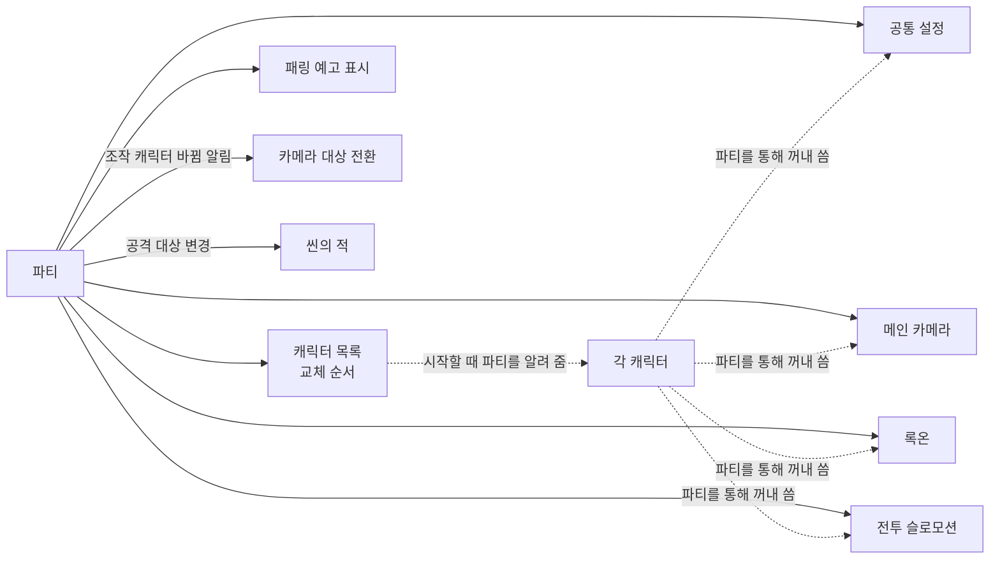
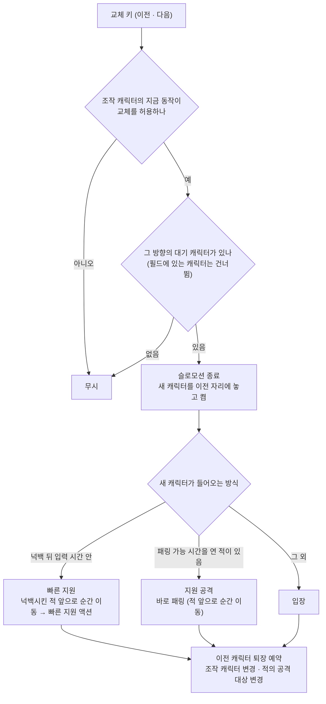
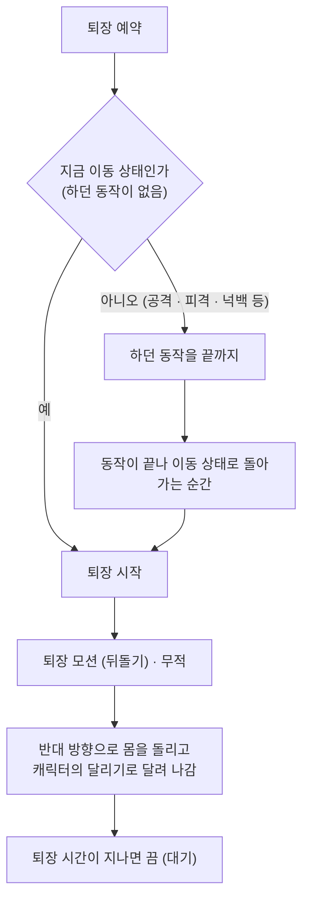
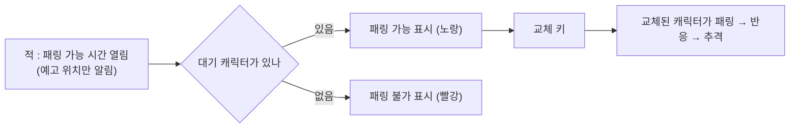

# 파티 전투 구조와 캐릭터 교체

## 1. 개요

캐릭터 3명이 한 전투에서 교체하며 싸우는 구조다. 파티 하나가 플레이어 쪽 전투에서 하나뿐인 것(캐릭터 목록 · 공통 설정 · 카메라 · 록온 · 슬로모션)을 들고, 필드의 캐릭터 중 조작 중인 캐릭터만 입력에 반응한다. 교체 · 지원 공격(교체 패링) · 빠른 지원은 파티 전투의 핵심 조작이며, 다음 단계인 콤보 스킬 이어받기의 전제가 된다.

## 2. 구성 요소

- PlayerParty : 캐릭터 목록 · 공통 설정 · 메인 카메라를 들고, 조작 캐릭터 · 교체 순서 · 대기 · 빠른 지원 입력 시간 · 적의 공격 대상 전환 · 대기 회복을 맡는다
- PlayerLockOn : 파티에 하나만 있는 록온 상태. 교체해도 같은 대상을 유지한다
- BattleSlowMotion : 완벽 회피 후 적만 느려지는 전투 단위 슬로모션
- ParryTelegraphView : 적의 패링 공격 예고 표시. 대기 캐릭터 수로 패링 가능 · 불가 표시를 고른다
- CameraTargetSwitcher : 조작 캐릭터가 바뀌면 카메라 · 록온 카메라가 따라갈 대상을 바꾼다
- ComboSkillSelector : 콤보 스킬 이어받기의 캐릭터 선택 · 연계 진행 (파티 오브젝트, 자세한 내용은 콤보 스킬 문서)
- PlayerSwapInState : 교체로 들어오는 입장 상태
- PlayerSwapOutState : 교체로 나가는 퇴장 상태

## 3. 동작 원리

### 파티가 들고 있는 것

- 캐릭터마다 다른 것(능력치 · 액션 · 체력 · 에너지 · 대상 찾기)은 캐릭터가 들고, 플레이어 쪽 전투에서 하나뿐인 것은 파티가 든다. 같은 에셋 · 씬 오브젝트를 캐릭터마다 연결하지 않아도 되고, 교체할 때 넘겨줄 값이 없어진다.
- 캐릭터 하나만 있는 씬도 목록에 한 명을 넣어 같은 구조로 쓴다. 교체할 캐릭터가 없어 교체 키는 아무 일도 하지 않는다.
- 파티는 시작할 때 각 캐릭터에 자신을 알려 준다. 캐릭터 기능은 시작 단계부터 공통 설정을 읽으므로, 그보다 먼저 알려 준다.
- 조작 캐릭터가 바뀌면 파티는 "바뀌었다" 는 것만 알리고, 카메라 대상 전환 기능이 듣고 카메라를 바꾼다. 파티가 카메라 구성까지 알지 않게 하기 위해서다.

### 교체

- 목록 순서대로 돌아가며 교체한다. 마지막 다음은 처음, 처음 이전은 마지막이다.
- 다음 순서의 캐릭터가 아직 필드에 있으면(퇴장 중) 건너뛰고 같은 방향의 다음 대기 캐릭터로 교체한다. 3명이 모두 필드에 있으면 교체하지 않는다. 쿨타임은 없다.
- 새 캐릭터가 들어오는 방식은 빠른 지원 → 지원 공격 → 입장 순서로 본다. 빠른 지원 액션이 없는 캐릭터나 넉백시킨 적이 이미 처치된 경우에는 다음 방식으로 넘어간다.
- 교체하면 록온은 그대로 이어지고, 완벽 회피 슬로모션은 끝난다. 교체로 나온 패링은 정상 속도다.

### 입장

- 이전 캐릭터 자리에서 입장 모션을 재생하며 이전 캐릭터가 보던 방향으로 달려 나오다 멈춘다. 처음이 가장 빠르고 끝에서 0 이 되도록 고르게 느려져, 정해진 거리만큼 나아간다.
- 무적이 아니다. 입장 중 적 공격에 맞으면 피격 상태로 넘어간다.
- 입력
    - 이동 키 : 입장을 바로 끝내고 달리기로 이동을 시작한다. 달려 나오던 흐름을 그대로 잇는다.
    - 공격 · 스킬 키 : 입장 중 공격 가능 시점부터 쓸 수 있다. 그 전에 누르면 기억해 두었다가 그 시점에 바로 나간다. 입장이 다 끝날 때까지 기다리지 않아 조금 빠르게 나간다.
    - 필살기 : 입장을 끊고 바로 쓸 수 있다.
- 입장 · 퇴장 모션은 모든 캐릭터가 같은 공용 모션을 쓴다. 캐릭터마다 하체 · 상체 · 전신을 골라 그 부위만 캐릭터 클립으로 덮을 수 있다. 무기를 메고 서는 대검 캐릭터처럼, 공용 모션의 일부 부위가 캐릭터에 맞지 않을 때 그 부위만 바꾸기 위해서다.

### 퇴장 · 대기

- 모든 동작은 끝나면 이동 상태로 돌아간다. 그래서 "이동 상태로 돌아가는 순간" 한곳에서 퇴장 예약을 확인하면, 공격을 끝까지 하거나 넉백에서 일어난 뒤 퇴장하는 경우를 상태마다 따로 처리하지 않아도 된다.
- 퇴장 모션은 모델만 뒤돌고 캐릭터 방향은 그대로다. 그래서 달리기로 바꾸는 순간 캐릭터를 반대로 돌려야 돌아선 자세에서 그대로 달려 나간다. 벽에 막히면 제자리에서 달리다 사라진다.
- 퇴장 전 하던 동작을 마치는 동안의 적중은 그 캐릭터의 에너지 · 필살기 게이지로 쌓이고 적의 그로기도 채운다. 다만 그 강타로는 콤보 스킬을 발동하지 않는다. (콤보 스킬 문서)
- 대기 캐릭터는 오브젝트를 끈다. 꺼진 캐릭터는 적에게 맞거나 대상으로 잡히지 않고, 카메라도 담지 않는다.
- 대기 캐릭터는 스스로 에너지를 회복하지 못하므로 파티가 대신 채운다. 초당 회복량에 대기 회복 배율을 곱하고, 공격으로 얻는 에너지는 없다.

### 지원 공격과 패링 예고

- 패링은 현재 캐릭터가 직접 하지 않고, 교체로 나온 캐릭터가 한다. 그래서 대기 캐릭터가 없으면(3명 모두 필드에 있거나 1인) 패링할 수 없고 예고가 패링 불가로 뜬다.
- 적은 패링 가능 시간을 열고 예고 위치만 알려 준다. 표시를 고르는 일은 플레이어 쪽이 한다. 적이 파티를 알 필요가 없고, 색을 정하는 규칙이 한곳에 있다. 색은 예고가 뜨는 순간 정한다.
- 교체된 캐릭터는 패링 액션의 순간 이동 옵션으로 적 앞에 서고, 패링 규칙은 코어 전투와 같다.
- 지원 공격 순간에는 적 앞에 이전 캐릭터와 새 캐릭터가 함께 있을 수 있다. 적 공격은 범위 안의 캐릭터마다 한 번씩 판정하므로, 무적인 이전 캐릭터가 있어도 새 캐릭터가 따로 패링 판정을 받는다. (적 공격 문서)

### 빠른 지원

- 조작 중인 캐릭터가 넉백되면 빠른 지원 입력 시간이 열린다. 그 안에 교체하면 새 캐릭터가 넉백시킨 적 앞으로 순간 이동해 빠른 지원 액션(대시 공격 모션)을 쓴다.
- 서는 방향과 무적은 기존 액션 옵션(순간 이동 옵션 · 휘두르는 중 무적)을 그대로 쓴다. 넉백된 캐릭터는 일어난 뒤 퇴장한다.
- 입력 시간은 실제 시간으로 잰다. 교체하면 어느 방식으로 들어오든 닫힌다. 퇴장하려고 동작을 마치던 이전 캐릭터가 넉백된 것은 입력 시간을 열지 않는다.

### 콤보 스킬 이어받기

- 그로기 적에게 조작 캐릭터의 강타가 맞으면 게임이 느려지며 캐릭터 선택 화면이 열리고, 고른 캐릭터가 콤보 스킬로 들어온다. 선택 · 연계 규칙은 콤보 스킬 문서에 적었다.
- 고른 캐릭터는 교체와 같은 방식으로 이전 캐릭터 자리에 나와 조작 캐릭터가 되고, 이전 캐릭터는 하던 동작을 마친 뒤 퇴장한다. 교체 · 콤보 이어받기가 "이전 자리에 꺼내 놓기" 와 "퇴장 예약 · 조작 캐릭터 변경" 을 함께 쓴다.
- 선택 중에는 교체 키를 선택이 쓰므로 교체하지 않고, 캐릭터 입력과 록온 입력도 막는다.
- 대기 캐릭터가 없으면 콤보 스킬이 나오지 않는다. 지원 공격과 같은 "교체로 나오는 행동" 규칙이다.

### 카메라 · 록온 · 적의 공격 대상

- 카메라 설정 하나를 모든 캐릭터가 함께 쓴다. 조작 캐릭터가 바뀌면 일반 · 록온 Cinemachine 카메라의 `Tracking Target` 과 록온 카메라가 보는 `Target Group` 의 플레이어를 새 캐릭터로 바꾼다. 퇴장하는 캐릭터는 바로 대상에서 빠진다.
- 록온은 파티에 하나만 있어, 교체해도 같은 대상을 유지한다. 거리 · 가림 확인은 조작 캐릭터 기준이다. (대상 고르기 문서)
- 파티는 시작할 때와 교체할 때 씬의 적 행동 그래프 Blackboard 의 공격 대상을 조작 캐릭터로 바꾼다. 적은 공격을 시작할 때 대상을 따로 저장하므로, 진행 중인 공격은 이전 캐릭터의 위치로 끝까지 시전하고 다음 공격부터 새 캐릭터를 노린다. 이전 캐릭터가 사라져도 그 자리로 시전된다.

### 끼어들기 허용 (교체 · 대시 · 필살기)

- 공격 · 패링 · 필살기 · 콤보 스킬 중 교체할 수 있는지는 액션의 동작마다 정한다. 대시 · 필살기로 끊기와 함께 "끼어들기 허용" 하나에 모아, 허용할 행동만 체크한다. (공격 문서의 `끼어들기 허용`)
- 액션이 없는 상태(이동 · 대시 · 회피 · 피격 · 넉백 · 입장)는 항상 교체할 수 있다. 필살기 연출 구간은 액션의 동작이 아니어서 교체할 수 없다.

작성 시점의 설정 (값의 원본은 각 액션 에셋이며, 바뀌면 이 표와 다를 수 있다)

| 액션 (동작) | 검방 | 대검 | 격투가 |
|---|---|---|---|
| 기본 공격 1 · 2단 | 대시 ○ 필살기 ○ 교체 ○ | 대시 ○ 필살기 ○ 교체 ○ | 대시 ○ 필살기 ○ 교체 ○ |
| 기본 공격 3단 | 대시 ○ 필살기 ○ 교체 ○ | 대시 ✕ 필살기 ○ 교체 ○ | 대시 ○ 필살기 ○ 교체 ○ |
| 기본 공격 4 · 5단 | 대시 ○ 필살기 ○ 교체 ○ (4단까지) | 없음 | 대시 ○ 필살기 ○ 교체 ○ |
| 강공격 | 대시 ✕ 필살기 ○ 교체 ○ | 대시 ✕ 필살기 ○ 교체 ○ | 대시 ✕ 필살기 ○ 교체 ○ |
| 스킬 | 대시 ○ 필살기 ○ 교체 ○ | 대시 ○ 필살기 ○ 교체 ○ | 대시 ○ 필살기 ○ 교체 ○ |
| 특수스킬 | 대시 ○ 필살기 ○ 교체 ○ | 대시 ✕ 필살기 ○ 교체 ○ | 대시 ○ 필살기 ○ 교체 ○ |
| 대시 공격 · 회피 반격 | 대시 ○ 필살기 ○ 교체 ○ | 대시 ✕ 필살기 ○ 교체 ○ | 대시 ○ 필살기 ○ 교체 ○ |
| 빠른 지원 | 대시 ✕ 필살기 ○ 교체 ○ | 대시 ✕ 필살기 ○ 교체 ○ | 대시 ✕ 필살기 ○ 교체 ○ |
| 패링 준비 · 반응 | 모두 ✕ | 모두 ✕ | 모두 ✕ |
| 패링 추격 | 모두 ✕ | 모두 ✕ | 모두 ✕ |
| 필살기 (공격 동작) | 모두 ✕ | 모두 ✕ | 모두 ✕ |
| 콤보 스킬 | 모두 ✕ | 모두 ✕ | 모두 ✕ |

- "전부 허용" 으로 저장된 동작은 나중에 끼어들기 항목이 늘어나면 새 항목도 허용된 것으로 본다. 새 항목을 추가할 때 기본으로 허용하지 않을 행동이면 에셋을 다시 확인한다.

## 4. 구현 과정

- 활용한 기능 :
    - `CharacterController` : 대기 캐릭터를 끄기 전에 옮겨 두어, 켜지는 순간 새 위치에서 시작하게 했다. 꺼진 컨트롤러는 움직이지 않도록 퇴장이 끝난 프레임에는 이동을 반영하지 않는다.
    - Animator 레이어 · Avatar Mask : 입장 · 퇴장 공용 모션 위에 하체 · 상체 마스크 레이어를 두고, 고른 부위만 캐릭터 클립으로 덮는다. 레이어의 상태에 기본 레이어와 다른 클립을 넣어 캐릭터별 Override Controller 로 바꿔 끼운다.
    - Cinemachine `Tracking Target` · `Target Group` : 조작 캐릭터가 바뀔 때 카메라가 따라갈 대상과 록온 구도의 플레이어를 바꾼다.
    - Unity Behavior Blackboard 변수 : 적 행동 그래프의 공격 대상을 파티가 바꾼다.
    - C# event : 조작 캐릭터 바뀜 · 패링 가능 시간 열림 · 닫힘을 알린다. 구독하는 쪽이 활성 상태에서만 듣는다.
    - `[Flags]` enum : 동작별 끼어들기 허용을 Inspector 에서 여러 개 골라 체크하는 마스크로 만들었다.
    - Physics Layer Collision Matrix : 플레이어 캐릭터끼리 서로 밀지 않고 통과하게 했다. 공격 판정은 범위 검사라 이 설정의 영향을 받지 않는다.
- 구현 과정 :
    1. 파티를 만들고, 공통 설정을 캐릭터 Prefab 대신 파티가 들고 시작할 때 각 캐릭터에 알려 주게 했다. 조작 캐릭터만 입력을 켠다.
    2. 슬로모션을 캐릭터 기능에서 전투 단위 기능으로 옮겼다.
    3. 교체(순서 · 건너뛰기 · 입장 · 퇴장 예약 · 대기)를 만들었다. 입장 시간 · 전진 · 입력, 퇴장 뒤 달리기, 부위 덮기를 사용자 확인을 거치며 다듬었다.
    4. 록온 · 메인 카메라를 파티로 옮기고, 조작 캐릭터 바뀜 알림으로 카메라 대상을 바꿨다. 적의 공격 대상을 바꾸고, 교체하면 슬로모션을 끝냈다.
    5. 대시 · 필살기로 끊기를 액션 단위 체크에서 동작 단위 끼어들기 마스크로 바꾸고 교체 허용을 더했다.
    6. 지원 공격과 예고 색을 만들었다. 적 공격이 캐릭터 한 명만 맞히던 규칙 때문에 지원 공격 패링이 실패해, 캐릭터마다 한 번씩 판정하도록 바꿨다.
    7. 빠른 지원과 대기 회복 배율을 만들었다.
- 주요 결정과 이유 :
    - 플레이어 쪽에서 하나뿐인 것(공통 설정 · 카메라 · 록온 · 슬로모션)을 파티로 모았다. 교체할 때 넘겨줄 값이 없어지고, 록온 유지처럼 따로 만들 기능이 저절로 해결된다.
    - 대기 캐릭터는 오브젝트를 끈다. 적의 판정 · 대상 찾기 · 카메라에서 저절로 빠지기 때문이다. 처음 조작하지 않는 캐릭터는 각 캐릭터의 시작 단계가 끝난 뒤인 첫 프레임에 끈다. 시작 단계 전에 끄면 처음 교체할 때 상태가 준비되지 않는다.
    - 1인 씬에서도 패링은 교체로만 나온다. 패링 불가 예고와 지원 공격 규칙을 1인 · 파티가 똑같이 따르게 했다.
    - 입장 중 공격 시점은 클립 이벤트 대신 시간 값으로 정했다. 입장 모션이 모든 캐릭터의 공용 모션이기 때문이다.
    - 끼어들기 허용은 끼어드는 행동끼리(대시 · 필살기 · 교체)만 마스크로 묶었다. 하체 달리기 · 휘두르는 중 무적처럼 성격이 다른 값은 따로 둔다. 패링 준비와 반응처럼 한 액션 안에서도 다르게 정할 수 있도록 동작 단위로 했다.
    - 적의 공격 대상은 지금은 교체할 때 씬의 적을 찾아 바꾼다. 웨이브로 적이 생기는 전투 흐름 단계에서 생성할 때 등록하는 방식으로 바꾼다.

### 참고 레퍼런스

- 젠레스 존 제로 : 캐릭터 교체 · 교체 패링(지원 공격) · 넉백 뒤 빠른 지원의 흐름을 참고했다.

## 5. 기존 방식과 비교

- 기존 방식 : 캐릭터 Prefab 마다 공통 설정 · 메인 카메라를 연결하고, 록온 · 슬로모션도 캐릭터마다 따로 가졌다. 한 씬에서 한 캐릭터만 확인할 수 있었고, 패링은 현재 캐릭터가 이전 · 다음 키로 직접 했다. 적 공격은 공격 한 번에 플레이어 한 명만 맞혔다.
- 달라진 점 : 파티 하나가 공통 설정 · 카메라 · 록온 · 슬로모션을 들고, 캐릭터는 파티를 통해 꺼내 쓴다. 교체 키로 캐릭터를 바꾸고, 패링은 교체로 나온 캐릭터가 한다. 적 공격은 범위 안의 캐릭터마다 한 번씩 판정한다.
- 개선된 점 : 캐릭터 3명이 한 전투에서 교체하며 싸울 수 있다. 캐릭터를 추가해도 연결할 곳이 늘지 않고, 교체할 때 록온 · 카메라 · 적 대상이 자연스럽게 이어진다.

### 미정 · 미검증 항목

- 웨이브로 생기는 적의 공격 대상 등록 (전투 흐름 단계)
- 전투 불능 캐릭터 교체 불가 (체력 0 처리 · 게임 흐름 단계)
- 퇴장 모션의 뒤돌기에서 달리기로 이어질 때 클립 Import 설정에 따른 회전 차이 (미검증)
