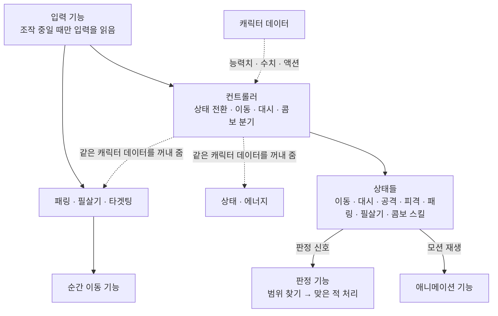
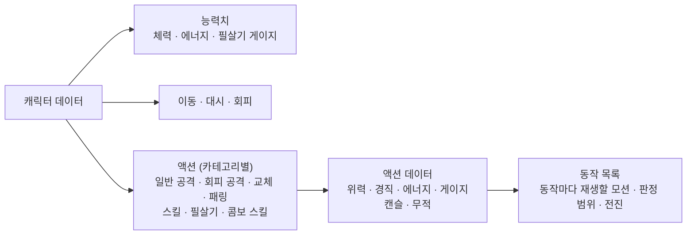
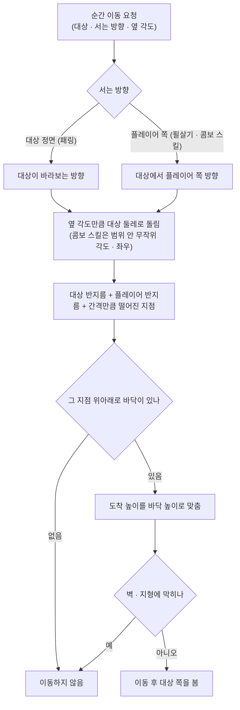

# 플레이어 구성과 데이터

## 1. 개요

플레이어 기능을 역할별로 나누고, 캐릭터마다 달라지는 값과 액션(공격 · 스킬)을 데이터 에셋으로 분리한 구조다. 한 기능이 입력 · 이동 · 판정 · 모션 · 수치를 모두 들고 있던 구조에서 벗어나, 각 기능을 따로 읽고 고칠 수 있게 했다. 파티 전투에서 캐릭터를 추가 · 교체할 때 캐릭터 데이터만 바꿔 끼우고, 필드에 여러 캐릭터가 있어도 조작 중인 캐릭터만 입력에 반응하게 하기 위해 만들었다.

## 2. 구성 요소

- PlayerController : 상태 전환과 이동 · 회전 · 중력 · 대시 스택 · 콤보 · 차지 · 스킬 분기. 캐릭터 데이터를 들고, 다른 기능이 이를 꺼내 쓴다
- PlayerInputReader : 플레이어 입력을 한곳에서 읽고, 조작 중 여부로 입력 반응을 켜고 끈다
- PlayerAttackJudge : 타격 판정. 판정 범위 찾기와 맞은 적 처리
- PlayerAnimation : 모델 Animator 제어 (상태 재생 · 이동 속도 값 · 하체 달리기 레이어)
- PlayerTeleport : 대상 앞 순간 이동 (패링 · 필살기 · 콤보 스킬)
- PlayerStatus : 체력 · 무적 · 완벽 회피 판정과 피격 진입
- CharacterData : 캐릭터 하나의 능력치 · 이동 · 대시 수치와 카테고리별 액션
- ActionData : 액션 하나의 타격 값 · 캔슬 · 무적과 동작 목록
- ActionStep : 동작 하나의 재생할 모션 · 판정 범위 · 전진

## 3. 동작 원리

### 기능 구성

- 상태들은 컨트롤러를 통해 판정 · 애니메이션 · 상태(체력 · 무적) 기능을 꺼내 쓴다. 컨트롤러가 모든 일을 직접 하지 않는다.
- 캐릭터 데이터는 컨트롤러 한 곳만 들고 있다. 다른 기능은 컨트롤러에서 같은 데이터를 꺼내 쓰므로, 캐릭터를 바꿀 때 바꿀 칸이 하나다.
- 입력 기능은 조작 중이 아니면 모든 입력을 눌리지 않은 것으로 돌려준다. 파티 전투에서 교체 기능이 조작 중인 캐릭터만 켜면, 필드에 남은 다른 캐릭터는 입력에 반응하지 않는다.

### 데이터 구조

- 캐릭터마다 달라지는 값은 캐릭터 데이터에, 캐릭터가 바뀌어도 같은 규칙(중력 · 입력 · 타겟팅 사거리 · 패링 타이밍 · 슬로모션 · 순간 이동 간격)은 각 기능에 둔다.
- 액션은 카테고리(일반 공격 / 회피 공격 / 교체 · 패링 / 스킬 / 필살기 / 콤보 스킬)로 묶어 스킬창처럼 한눈에 보이게 했다.
- 액션 하나는 동작 목록을 가진다. 1개면 한 동작만, 여러 개면 순서대로 이어 재생한다. 필살기처럼 여러 모션으로 이루어진 액션도 에셋 하나로 다룬다.
    - 모션마다 달라지는 값(재생할 모션, 판정 범위, 전진 거리 · 시간)은 동작에 둔다.
    - 위력 · 경직 · 게이지 · 캔슬 · 무적 같은 타격 값은 액션 공통이다.
    - 재생할 모션은 동작에 적힌 Animator 상태 이름을 따른다. 공격 종류와 단계 번호로 이름을 만들던 방식을 없앴다.
- 판정 범위는 동작마다 기본 상자 · 상자 · 구 · 캡슐 중에서 고른다. 내려 베기는 좌우가 좁은 상자, 회전 베기는 캐릭터 중심의 구처럼 모션에 맞춘다.

### 대상 고르기

- 공격 · 필살기 · 그로기 테스트처럼 "누구를 노릴지"는 하나의 규칙(록온 대상 → 우선 대상 → 사거리 안의 자동 조준 대상)을 따른다. 우선 대상은 패링 추격이 넘기는 "방금 패링한 적"이다.
- 패링은 이 규칙을 쓰지 않고 패링만의 순서를 따른다. 후보마다 패링 가능 시간을 열었는지 확인하고, 열지 않았으면 다음 후보로 넘어가야 하기 때문이다.

### 순간 이동

- 패링 · 필살기 · 콤보 스킬이 같은 계산과 같은 간격을 쓴다. 서는 방향만 고른다.
- 거리는 대상 중심이 아니라 몸 표면 기준이다. 대상의 반지름은 콜라이더의 월드 경계 상자에서 가로 · 세로 중 큰 쪽 절반을 쓴다. 그래서 큰 적(보스)에게는 자동으로 더 멀리 선다.
- 도착 높이는 도착 지점에서 찾은 바닥 높이를 쓴다. 대상 높이를 그대로 쓰면 경사 · 높낮이에서 발이 땅 속에 들어가기 때문이다.
- 콤보 스킬은 옆 각도로 비켜 선다. 적과의 거리는 같게 두어 모든 캐릭터의 사정거리를 하나로 관리한다. 지금(1인)은 기준이 자기 위치이고, 파티 전투에서는 남아 있는 캐릭터의 위치가 기준이 된다.

## 4. 구현 과정

- 활용한 기능 :
    - ScriptableObject : 캐릭터 데이터 · 액션 데이터를 에셋으로 만들어 프리팹 · 씬과 따로 관리하고 여러 곳에서 다시 쓴다.
    - `[Serializable]` 클래스 배열 : 액션 안의 동작 목록을 Inspector 에 펼쳐 정한다.
    - `Physics.OverlapBox` · `OverlapSphere` · `OverlapCapsule` : 동작의 판정 모양에 맞춰 범위 안의 적을 찾는다.
    - `Physics.Raycast` : 순간 이동 도착 지점의 바닥 높이를 찾는다.
    - `Collider.bounds` : 모양과 상관없이 대상의 수평 크기를 구한다.
    - 에디터 전용 메뉴(일회용) : 프리팹에 저장된 기존 공격 값을 액션 에셋으로 옮긴 뒤 삭제했다.
- 구현 과정 :
    1. 대상 고르기 순서와 순간 이동 거리 · 계산이 여러 기능에 따로 적혀 있어 각각 한곳으로 모았다. 패링 대상 고르기는 자체 로직으로 남겼다.
    2. 입력을 각 기능이 직접 읽던 것을 입력 기능 하나로 모으고, 조작 중 여부를 추가했다.
    3. 컨트롤러에서 타격 판정과 Animator 제어를 떼어 냈다. 판정은 범위 찾기와 맞은 적 처리를 나눠, 나중에 검기처럼 날아가며 맞히는 공격도 같은 처리를 쓰게 했다. 공격마다 판정 모양을 고를 수 있게 했다.
    4. 공격 설정을 액션 에셋으로 바꿨다. 값은 일회용 메뉴로 옮겼다. 이어서 액션에 동작 목록을 두어 재생할 모션 · 판정 범위 · 전진을 동작마다 정하게 하고, 필살기 · 콤보 스킬을 액션 하나로 합쳤다.
    5. 캐릭터 값과 액션을 캐릭터 데이터로 옮기고, 카테고리로 묶었다. 체력 기능은 상태 기능으로 이름을 바꿨다.
    - 작업 중 고친 문제
        - 필살기 순간 이동 뒤 땅 밑으로 떨어지는 문제 : 도착 높이로 대상 높이를 그대로 써서, 바닥이 더 높은 곳에서는 발이 땅 속에 들어갔다. 도착 지점의 바닥 높이를 찾아 맞췄다.
        - 보스에게 필살기를 쓰면 컷신 중 땅에 박히는 문제 : 대상 중심에서 정한 거리만 띄워서, 몸이 큰 보스의 몸 안에 섰다. 겹침을 풀며 아래로 밀려났다. 거리를 몸 표면 기준으로 바꿨다.
- 주요 결정과 이유 :
    - 캐릭터 데이터는 컨트롤러 한 곳만 들고 있다. 새 기능을 만들지 않고, 이미 모든 기능이 참조하는 컨트롤러를 재사용했다.
    - 상태 클래스는 컨트롤러가 대신 전달하지 않고, 컨트롤러에서 판정 · 애니메이션 기능을 꺼내 쓴다. 컨트롤러가 모든 일을 알지 않게 하기 위해서다.
    - 동작의 전진은 동작마다 값을 둔다. 모션마다 움직이는 구간이 달라서다. 시네마틱 스킬의 경로 이동은 연출 작업 때 따로 만든다.
    - 액션 종류 값은 만들어만 두었다. 공격 종류에 따른 대미지 계산에 쓸 예정이다.
    - 체력 · 에너지 · 게이지 값을 한 기능으로 모으지 않았다. 최대치 · 획득량이 캐릭터 데이터로 옮겨 가면서, 각 기능에는 현재 값과 그 값을 다루는 규칙만 남아 충분히 나뉘어 있기 때문이다.

### 참고 레퍼런스

- 젠레스 존 제로 : 스킬창의 카테고리 구분(일반 공격 · 회피 · 지원 · 특수 스킬 · 필살기 · 연계)을 캐릭터 데이터의 액션 묶음에 참고했다.

## 5. 기존 방식과 비교

- 기존 방식 :
    - 컨트롤러 하나가 입력 · 이동 · 대시 · 콤보 분기와 타격 판정 · Animator 제어 · 캐릭터 수치 · 공격 설정을 모두 들고 있었다.
    - 입력은 컨트롤러 · 패링 · 필살기 · 타겟팅 · 그로기 테스트가 각자 읽었다.
    - 공격 설정은 프리팹 안의 설정 묶음이었고, 필살기 · 콤보 스킬은 단계마다 설정을 따로 두었다.
    - 재생할 모션은 공격 종류와 단계 번호로 이름을 만들어 정했다.
    - 대상 고르기 순서와 순간 이동 거리가 여러 기능에 따로 적혀 있었다.
- 달라진 점 :
    - 입력 · 판정 · 애니메이션 · 순간 이동이 각 기능으로 나뉘었다.
    - 캐릭터 값과 액션이 캐릭터 데이터 · 액션 데이터 에셋으로 옮겨 갔다.
    - 액션은 동작 목록으로 여러 모션을 이어 재생하고, 재생할 모션을 데이터가 정한다.
    - 판정 범위를 동작마다 고를 수 있다.
- 개선된 점 :
    - 캐릭터를 추가할 때 캐릭터 데이터와 액션 에셋만 만들면 된다.
    - 필드에 여러 캐릭터가 있어도 조작 중인 캐릭터만 입력에 반응하게 할 수 있다.
    - 기능별로 코드가 짧아져 읽고 고치기 쉽다. 컨트롤러의 실제 코드가 기준 줄 수 아래로 줄었다.

### 미정 · 미검증 항목

- 액션 에셋의 판정 범위를 Scene 창에 표시하는 기능
- 캐릭터마다 모션 수가 달라질 때 공통 Animator 에 상태를 늘리지 않는 방식 (액션 데이터에 클립을 직접 넣는 방식 검토)
- 시네마틱 스킬의 경로 이동 · 연출 참조 (연출 작업 때)
- 액션 종류에 따른 대미지 계산
- 순간 이동이 위층 · 지붕 아래 등에서 잘못된 바닥을 찾는 경우
- 콤보 스킬 옆 각도의 자리가 막혔을 때 반대쪽 재시도 (파티 전투 때)
