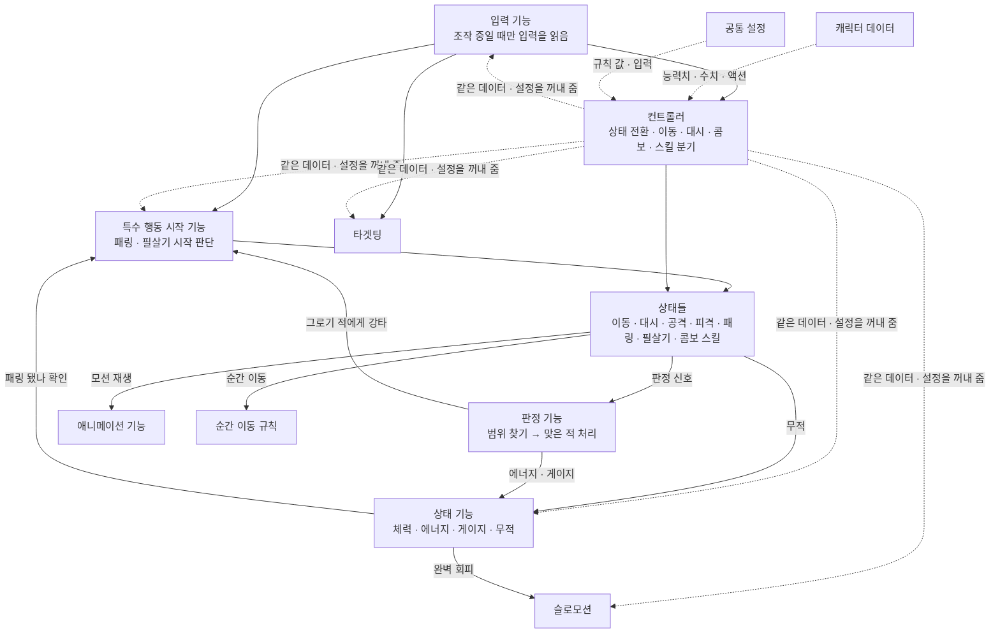
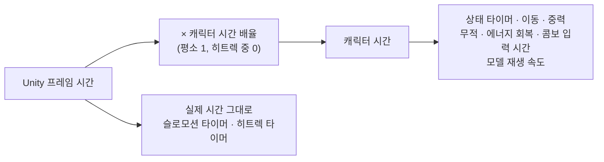
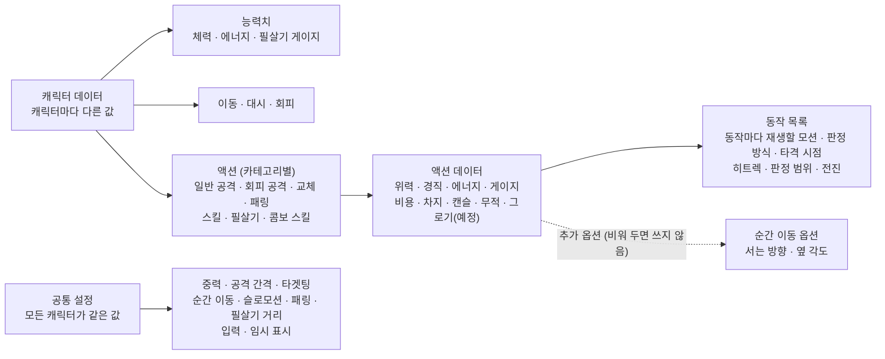
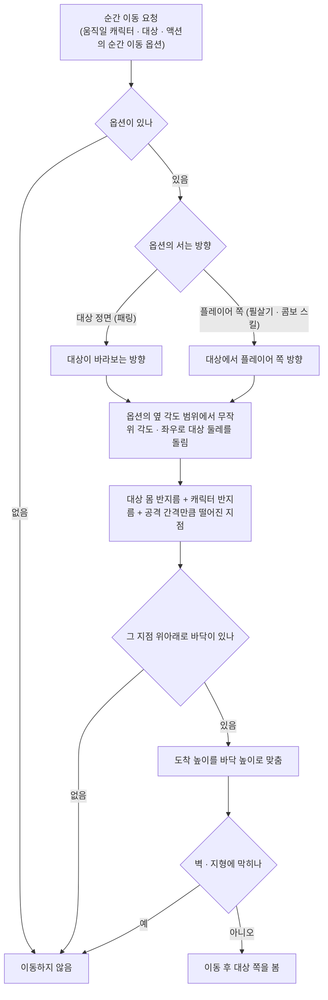
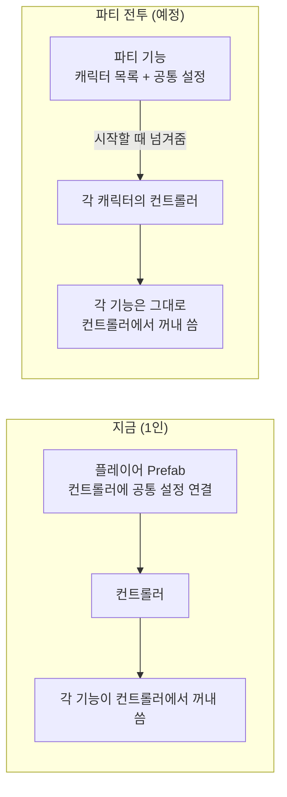

# 플레이어 구성과 데이터

## 1. 개요

플레이어 기능을 역할별로 나누고, 캐릭터마다 달라지는 값과 액션(공격 · 스킬)을 데이터 에셋으로 분리한 구조다. 각 기능을 따로 읽고 고칠 수 있게 하되, 역할과 바뀌는 이유가 가까운 작은 기능은 다시 하나로 합쳐 관리할 곳을 줄였다. 모든 캐릭터가 똑같이 쓰는 규칙 값은 공통 설정 하나에 모았다. 파티 전투에서 캐릭터를 추가 · 교체할 때 캐릭터 데이터만 바꿔 끼우고, 필드에 여러 캐릭터가 있어도 조작 중인 캐릭터만 입력에 반응하게 하기 위해 만들었다.

## 2. 구성 요소

- PlayerController : 상태 전환과 이동 · 회전 · 중력 · 대시 스택 · 콤보 · 차지 · 스킬 분기 · 공격 방향과 다가갈 거리. 캐릭터 데이터와 공통 설정을 들고, 다른 기능이 이를 꺼내 쓴다
- PlayerInputReader : 플레이어 입력을 한곳에서 읽고, 조작 중 여부로 입력 반응을 켜고 끈다
- PlayerActionTrigger : 특수 행동(패링 · 필살기 · 콤보 스킬)을 언제 시작할지 판단하고 각 상태를 들고 있다. 패링 대상 고르기 · 패링 성공 처리 · 필살기 대상 고르기
- PlayerStatus : 체력 · 에너지 · 필살기 게이지 · 무적 · 완벽 회피 판정과 피격 진입, 캐릭터 시간 배율과 히트렉
- PlayerTargeting : 공격 · 록온 대상 찾기와 록온 관리
- PlayerSlowMotion : 완벽 회피 후 적만 느려지는 슬로모션
- PlayerAttackJudge : 타격 판정. 판정 범위 찾기와 맞은 적 처리
- PlayerAnimation : 모델 Animator 제어 (상태 재생 · 이동 속도 값 · 하체 달리기 레이어)
- PlayerAnimationEventRelay : 모델의 애니메이션 이벤트를 플레이어 기능으로 넘긴다
- CharacterDebugger : [개발용] 판정 범위 표시 · 적중 로그 · 그로기 테스트 입력. 그로기 테스트는 적 그로기 게이지를 만들면 없앤다
- TeleportManager : 대상 앞 순간 이동 규칙 (특수 행동이 함께 쓴다)
- BodyRadius : 대상 몸의 수평 반지름을 재는 규칙 (순간 이동 · 공격 정지 거리가 함께 쓴다)
- CharacterData : 캐릭터 하나의 능력치 · 이동 · 대시 수치와 카테고리별 액션
- CommonCharacterSettings : 모든 캐릭터가 같이 쓰는 규칙 값 · 입력 · 임시 표시
- ActionData : 액션 하나의 타격 값 · 비용 · 캔슬 · 무적 · 그로기 값(예정) · 추가 옵션과 동작 목록
- ActionStep : 동작 하나의 재생할 모션 · 판정 방식(구간 · 한 순간, 간격 · 횟수) · 첫 타격 반응 · 히트렉 · 판정 범위 · 전진
- TeleportOption : 액션에 붙이는 순간 이동 옵션 (서는 방향 · 옆 각도)

## 3. 동작 원리

### 기능 구성

- 상태들은 컨트롤러를 통해 판정 · 애니메이션 · 상태 기능을 꺼내 쓴다. 컨트롤러가 모든 일을 직접 하지 않는다.
- 캐릭터 데이터와 공통 설정은 컨트롤러 한 곳만 들고 있다. 다른 기능은 컨트롤러에서 같은 것을 꺼내 쓰므로, 캐릭터를 바꿀 때 바꿀 칸이 하나다.
- 입력 기능은 조작 중이 아니면 모든 입력을 눌리지 않은 것으로 돌려준다. 파티 전투에서 교체 기능이 조작 중인 캐릭터만 켜면, 필드에 남은 다른 캐릭터는 입력에 반응하지 않는다.

### 특수 행동 시작

- 일반 공격 · 스킬은 컨트롤러가 지금 상태에 맞춰 시작한다. 패링 · 필살기 · 콤보 스킬은 모양이 같아 특수 행동 시작 기능 하나에 모았다. "언제 시작할지 판단하고, 그 상태를 들고 있는" 역할이다.
    - 패링 · 필살기는 지금 상태와 상관없이 끼어든다. 그래서 매 프레임 직접 입력을 본다.
    - 콤보 스킬은 판정 기능이 그로기 적에게 강타가 맞았을 때 밖에서 시작시킨다.
- 같은 프레임에 패링 키와 필살기 키를 함께 누르면 패링을 먼저 본다. 패링이 시작되면 패링 상태가 필살기를 허락하지 않아 필살기는 나가지 않는다.
- 패링 · 밀려남 · 추격 중에는 필살기를 쓸 수 없다. 공격 중 필살기로 끊을 수 있는지는 액션마다 정한다.
- 패링 액션이 연결되지 않았거나 준비 · 반응 두 동작이 없는 캐릭터는 패링을 시작하지 않고 경고를 남긴다. 상태에 들어간 뒤 멈추면 준비 모션 없이 패링 판정만 켜져 "준비 성공 → 반응 → 추격" 순서가 깨지기 때문이다. 상태가 바뀌기 전에 막아 진행 중이던 동작도 끊지 않는다.

### 캐릭터 시간

- 캐릭터마다 시간 배율을 가진다. 플레이어 쪽 상태 · 기능은 Unity 시간 대신 이 배율을 곱한 캐릭터 시간으로 타이머와 이동을 계산하고, 모델 재생 속도도 배율을 따른다.
- 히트렉처럼 공격한 캐릭터 하나만 멈추게 하기 위해서다. 파티 전투에서 다른 캐릭터와 적은 계속 움직인다.
- 실제 시간을 그대로 쓰는 것도 있다.
    - 슬로모션 타이머 : 적에게 거는 전투 효과라 캐릭터의 히트렉과 상관없이 흐른다. 나중에 콤보 스킬 캐릭터 선택 단계(발동 → 슬로모션 + 선택 화면 → 선택)도 실제 시간을 따른다.
    - 히트렉 타이머 : 캐릭터 시간으로 세면 멈춘 동안 줄지 않기 때문이다.
- 히트렉이 끝나면 겹친 효과와 상관없이 배율을 원래 속도(1)로 되돌린다. 필살기는 시작할 때 히트렉을 바로 끝내, 컷신이 끝난 뒤에도 원래 속도다.
- 체력 · 에너지 · 게이지와 배율 · 남은 히트렉 시간은 실행 중 Inspector 에서 바로 볼 수 있다. 확인용이라 시작할 때 다시 정한다.

### 데이터 구조

- 값은 세 곳으로 나눈다.
    - 캐릭터마다 다른 값(능력치 · 이동 · 대시)은 캐릭터 데이터에 둔다.
    - 캐릭터가 바뀌어도 같은 규칙(중력 · 공격 간격 · 타겟팅 사거리 · 순간 이동 · 슬로모션 · 패링 타이밍 · 입력)은 공통 설정 하나에 둔다. 캐릭터가 늘어도 같은 값을 여러 곳에 적지 않기 위해서다.
    - 액션 하나에만 쓰는 값(강공격 차지 시간 · 특수스킬 에너지 비용)은 그 액션 데이터에 둔다.
- 체력 · 에너지 · 필살기 게이지의 현재 값은 모두 캐릭터마다 따로 가지는 값이라 상태 기능 하나에 모았다. 피격 판정 순서와 무적 규칙은 모든 캐릭터가 같은 코드를 쓰고, 값(남은 체력 · 무적 시간)은 캐릭터마다 따로 있다. 그래서 조작 중인 캐릭터가 무적이어도 필드에 남은 다른 캐릭터는 맞을 수 있다.
- 액션은 카테고리(일반 공격 / 회피 공격 / 교체 · 패링 / 스킬 / 필살기 / 콤보 스킬)로 묶어 스킬창처럼 한눈에 보이게 했다. 액션 에셋은 캐릭터마다 폴더를 나눠, 캐릭터가 늘어도 한곳에서 찾을 수 있게 한다.
- 패링은 준비 · 반응을 하나의 패링 액션으로, 반응 중에 나가는 추격 공격을 따로 패링 추격 액션으로 둔다. 추격은 반응 중 입력이 있을 때만 나가는 조건부 동작이고, 패링 성공과 추격 공격의 타격 값이 다를 수 있기 때문이다. 준비 · 반응 모션은 패링 액션의 동작 0 · 1 번이고, 패링 성공 때 쌓을 그로기 값 칸도 패링 액션에 있다(적 그로기 게이지 작업 때 사용).
- 액션 하나는 동작 목록을 가진다. 1개면 한 동작만, 여러 개면 순서대로 이어 재생한다. 필살기처럼 여러 모션으로 이루어진 액션도 에셋 하나로 다룬다.
    - 모션마다 달라지는 값(재생할 모션, 판정 범위, 전진 거리 · 시간)은 동작에 둔다.
    - 위력 · 경직 · 게이지 · 비용 · 캔슬 · 무적 같은 값은 액션 공통이다.
    - 재생할 모션은 동작에 적힌 Animator 상태 이름을 따른다.
- 일부 액션에만 붙는 기능은 추가 옵션 에셋을 끼워 붙인다. 비워 두면 그 기능을 쓰지 않는다. 지금은 순간 이동 옵션 하나이고, 카메라 워크 같은 연출도 같은 방식으로 붙일 예정이다. 같은 옵션 에셋을 여러 액션이 함께 쓸 수 있다.
- 판정 범위는 동작마다 상자 · 구 · 캡슐 중에서 고른다. 내려 베기는 좌우가 좁은 상자, 회전 베기는 캐릭터 중심의 구처럼 모션에 맞춘다. 판정 방식 · 타격 시점 · 히트렉도 동작마다 정한다. (공격 문서의 `판정 구간 · 다단 히트 · 히트렉`)

### 대상 고르기

- 공격 · 필살기 · 그로기 테스트처럼 "누구를 노릴지"는 하나의 규칙(록온 대상 → 우선 대상 → 사거리 안의 자동 조준 대상)을 따른다. 우선 대상은 패링 추격이 넘기는 "방금 패링한 적"이다.
- 패링은 이 규칙을 쓰지 않고 패링만의 순서를 따른다. 후보마다 패링 가능 시간을 열었는지 확인하고, 열지 않았으면 다음 후보로 넘어가야 하기 때문이다.

### 순간 이동과 공격 정지 거리

- 순간 이동은 기억할 값도, 매 프레임 할 일도 없는 계산이다. 그래서 캐릭터에 붙는 기능이 아닌 공통 규칙으로 두고, 필요한 값(움직일 캐릭터 · 대상 · 옵션 · 공통 설정)은 부를 때 모두 넘겨받는다.
- 어느 쪽에 설지와 옆으로 얼마나 비켜 설지는 액션의 순간 이동 옵션이 정한다. 옵션이 없는 액션은 순간 이동하지 않는다.
- 거리는 대상 중심이 아니라 몸 표면 기준이다. 일반 공격이 대상 앞에서 멈추는 거리도 같은 기준과 같은 공격 간격을 쓴다. 큰 적(보스)에게는 자동으로 더 멀리 서고, 몸 안으로 파고들지 않는다.
- 대상의 몸 반지름은 몸 반지름 규칙 한 곳에서 잰다. 지금은 대상 콜라이더의 월드 경계 상자에서 가로 · 세로 중 큰 쪽 절반을 쓴다. 나중에 적이 자기 반지름을 알려주게 되면 이 규칙 안에서만 바꾸고, 순간 이동 · 공격은 그대로 둔다.
- 도착 높이는 도착 지점에서 찾은 바닥 높이를 쓴다. 대상 높이를 그대로 쓰면 경사 · 높낮이에서 발이 땅 속에 들어가기 때문이다.
- 콤보 스킬은 옆 각도로 비켜 선다. 적과의 거리는 같게 두어 모든 캐릭터의 사정거리를 하나로 관리한다. 지금(1인)은 기준이 자기 위치이고, 파티 전투에서는 남아 있는 캐릭터의 위치가 기준이 된다.

### 공통 설정을 넘겨주는 방식

- 지금은 플레이어 Prefab의 컨트롤러에 공통 설정 에셋을 연결한다.
- 파티 전투에서는 캐릭터 목록을 가진 파티 기능이 공통 설정을 한 번만 들고, 시작할 때 각 캐릭터에 넘겨준다. 바뀌는 곳은 컨트롤러가 공통 설정을 받는 방법 한 곳뿐이다.
- 실행 중에 계산한 값(예: 파티에서 가장 큰 캐릭터 기준 값)은 공통 설정 에셋에 쓰지 않는다. 에디터에서 실행 중 바꾼 에셋 값은 실행을 멈춰도 남기 때문이다.
- 씬 안의 오브젝트(카메라 등)는 에셋이 참조할 수 없어 각 기능에 연결한다. 록온 · 슬로모션 임시 표시는 Prefab으로 바꿔 공통 설정에 넣고, 실행 중에 만든다.

## 4. 구현 과정

- 활용한 기능 :
    - ScriptableObject : 캐릭터 데이터 · 공통 설정 · 액션 데이터 · 순간 이동 옵션을 에셋으로 만들어 프리팹 · 씬과 따로 관리하고 여러 곳에서 다시 쓴다.
    - `[Serializable]` 클래스 배열 : 액션 안의 동작 목록을 Inspector 에 펼쳐 정한다.
    - static 클래스 : 순간 이동 · 몸 반지름처럼 기억할 값이 없는 공통 계산을 컴포넌트 없이 둔다.
    - `Physics.OverlapBox` · `OverlapSphere` · `OverlapCapsule` : 동작의 판정 모양에 맞춰 범위 안의 적을 찾는다.
    - `Physics.Raycast` : 순간 이동 도착 지점의 바닥 높이를 찾는다.
    - `Collider.bounds` : 모양과 상관없이 대상의 수평 크기를 구한다.
    - `InputActionReference` : 공통 설정 에셋에서 입력 액션을 참조한다.
    - 에디터 전용 메뉴(일회용) : 프리팹에 저장된 기존 공격 값을 액션 에셋으로 옮긴 뒤 삭제했다.
- 구현 과정 :
    1. 대상 고르기 순서와 순간 이동 거리 · 계산이 여러 기능에 따로 적혀 있어 각각 한곳으로 모았다. 패링 대상 고르기는 자체 로직으로 남겼다.
    2. 입력을 각 기능이 직접 읽던 것을 입력 기능 하나로 모으고, 조작 중 여부를 추가했다.
    3. 컨트롤러에서 타격 판정과 Animator 제어를 떼어 냈다. 판정은 범위 찾기와 맞은 적 처리를 나눠, 나중에 검기처럼 날아가며 맞히는 공격도 같은 처리를 쓰게 했다. 공격마다 판정 모양을 고를 수 있게 했다.
    4. 공격 설정을 액션 에셋으로 바꾸고, 액션에 동작 목록을 두어 필살기 · 콤보 스킬을 액션 하나로 합쳤다.
    5. 캐릭터 값과 액션을 캐릭터 데이터로 옮기고, 카테고리로 묶었다.
    6. (#33) 순간 이동의 서는 방향 · 옆 각도를 액션의 추가 옵션으로 옮기고, 패링 액션을 새로 만들었다.
    7. (#33) 에너지 · 필살기 게이지를 상태 기능으로 합쳤다.
    8. (#33) 캐릭터가 바뀌어도 같은 규칙 값과 입력을 공통 설정 하나로 모으고, 임시 표시를 Prefab으로 바꿨다.
    9. (#33) 패링 · 필살기 · 콤보 스킬의 시작 기능을 특수 행동 시작 기능 하나로 합치고, 순간 이동을 공통 규칙(static)으로 바꿨다.
    10. (#33) 강공격 차지 시간 · 특수스킬 비용을 액션으로 옮기고, 공격 정지 거리를 순간 이동과 같은 몸 표면 기준으로 바꿨다. 몸 반지름 재기를 한곳으로 모았다. 액션 에셋을 캐릭터별 폴더로 정리했다.
    11. (#35) 캐릭터 시간 배율과 히트렉을 만들고, 판정을 구간 공통 타격 시점(간격 / 횟수)으로 바꿨다. 판정 모양의 기본 상자를 없애고, 패링 준비 · 반응 모션을 패링 액션의 동작으로 옮겼다. (공격 문서)
    - 작업 중 고친 문제
        - 필살기 순간 이동 뒤 땅 밑으로 떨어지는 문제 : 도착 높이로 대상 높이를 그대로 써서, 바닥이 더 높은 곳에서는 발이 땅 속에 들어갔다. 도착 지점의 바닥 높이를 찾아 맞췄다.
        - 보스에게 필살기를 쓰면 컷신 중 땅에 박히는 문제 : 대상 중심에서 정한 거리만 띄워서, 몸이 큰 보스의 몸 안에 섰다. 겹침을 풀며 아래로 밀려났다. 거리를 몸 표면 기준으로 바꿨다.
        - 패링 액션이 비었을 때 준비 모션 없이 패링 · 추격이 나가는 문제 : 상태에 들어간 뒤 오류로 멈춰 패링 판정만 켜졌다. 상태에 들어가기 전에 패링 액션이 있는지 확인하게 했다.
- 주요 결정과 이유 :
    - 캐릭터 데이터와 공통 설정은 컨트롤러 한 곳만 들고 있다. 새 기능을 만들지 않고, 이미 모든 기능이 참조하는 컨트롤러를 재사용했다. 파티 전투에서 넘겨주는 방식으로 바꿀 때도 고칠 곳이 하나다.
    - 상태 클래스는 컨트롤러가 대신 전달하지 않고, 컨트롤러에서 판정 · 애니메이션 · 상태 기능을 꺼내 쓴다. 컨트롤러가 모든 일을 알지 않게 하기 위해서다.
    - 체력 · 에너지 · 게이지를 상태 기능 하나에 모았다. 셋 다 캐릭터마다 따로 가지는 값이고, "쌓이고 한도가 있고 쓰면 줄어드는" 같은 모양이기 때문이다. (#31 에서는 각 기능이 충분히 나뉘어 있다고 보고 모으지 않았다.)
    - 순간 이동 옵션은 액션 데이터 안의 칸이 아니라 따로 끼우는 옵션 에셋으로 했다. 일부 액션에만 붙고 여러 액션이 같은 설정을 쓰는 기능이라서다. 공격마다 따로 조정하는 히트렉은 옵션이 아닌 일반 타격 값으로 정한다.
    - 특수스킬 비용은 스킬을 시작하는 곳에서 특수스킬 액션의 비용을 바로 읽는다. 액션 종류로 나누면 같은 정보를 두 곳에서 맞춰야 하고, 잘못 고르면 비용이 조용히 무시되기 때문이다.
    - 애니메이션 기능과 애니메이션 이벤트 전달 기능은 합치지 않았다. 애니메이션 이벤트는 Animator 가 붙은 모델 오브젝트의 메서드만 부를 수 있어 전달 기능이 모델 쪽에 있어야 하고, 전달만 하는 작은 기능이라 따로 두는 부담이 작다.
    - 동작의 전진은 동작마다 값을 둔다. 모션마다 움직이는 구간이 달라서다. 시네마틱 스킬의 경로 이동은 연출 작업 때 따로 만든다.
    - (#35) 애니메이션 신호 종류를 에셋으로 넘기는 방식을 적용해 봤으나, 기존의 이름별 함수 방식과 다루는 수고에 차이가 없어 되돌렸다. 바꾸는 데 오래 걸리지 않아 시험 · 검증에 시간을 많이 쓰지 않았다.
    - (#35) 판정 범위 표시 · 적중 로그 · 그로기 테스트를 디버그 기능 하나로 모았다. 판정 기능은 이벤트로 알리기만 해서, 디버그 기능을 빼도 판정은 그대로다.

### 참고 레퍼런스

- 젠레스 존 제로 : 스킬창의 카테고리 구분(일반 공격 · 회피 · 지원 · 특수 스킬 · 필살기 · 연계)을 캐릭터 데이터의 액션 묶음에 참고했다.

## 5. 기존 방식과 비교

- 기존 방식 :
    - (#31 이전) 컨트롤러 하나가 입력 · 이동 · 대시 · 콤보 분기와 타격 판정 · Animator 제어 · 캐릭터 수치 · 공격 설정을 모두 들고 있었다. 입력은 여러 기능이 각자 읽었고, 공격 설정은 프리팹 안의 설정 묶음이었다.
    - (#31 직후) 역할별로 나누면서 필살기 · 패링 · 콤보 스킬 · 순간 이동 · 에너지가 각각 작은 기능이 되었다. 필살기 기능은 게이지 · 입력 · 순간 이동을, 패링 기능은 수치 · 입력 · 순간 이동을, 콤보 스킬 기능은 옆 각도 · 순간 이동을 따로 들고 있었다.
    - (#31 직후) 중력 · 사거리 · 순간 이동 간격 · 슬로모션 · 패링 타이밍 · 입력 같은 공통 값은 각 기능의 Inspector 칸에 있어, 캐릭터 Prefab마다 같은 값을 적어야 했다.
    - (#31 직후) 강공격 차지 시간 · 특수스킬 비용 · 공격 정지 거리는 캐릭터 데이터에 있었고, 공격 정지 거리는 대상 중심 기준이었다.
- 달라진 점 :
    - 패링 · 필살기 · 콤보 스킬의 시작이 특수 행동 시작 기능 하나로, 수치는 상태 기능 하나로 모였다.
    - 순간 이동이 공통 규칙이 되었고, 서는 방향 · 옆 각도는 액션의 옵션이 정한다.
    - 공통 값과 입력이 공통 설정 하나로 모였다.
    - 액션 하나에만 쓰는 값이 그 액션 데이터로 옮겨 갔다.
    - 공격 정지 거리가 순간 이동과 같은 몸 표면 기준이 되었다. (의도한 동작 변경 : 보스 앞에서 몸 안으로 파고들지 않는다)
- 개선된 점 :
    - 캐릭터를 추가할 때 캐릭터 데이터와 액션 에셋만 만들면 되고, 공통 값은 다시 적지 않아도 된다.
    - 필드에 여러 캐릭터가 있어도 조작 중인 캐릭터만 입력에 반응하게 할 수 있다.
    - 관리할 기능 수가 줄고, 같은 일을 하는 계산이 한곳에 모였다.

### 미정 · 미검증 항목

- 액션 에셋의 판정 범위를 Scene 창에 표시하는 기능
- 캐릭터마다 모션 수가 달라질 때 공통 Animator 에 상태를 늘리지 않는 방식 (액션 데이터에 클립을 직접 넣는 방식 검토)
- 시네마틱 스킬의 경로 이동 · 연출 참조 (연출 작업 때)
- 액션 종류의 쓰임 (계획 단계)
- 순간 이동이 위층 · 지붕 아래 등에서 잘못된 바닥을 찾는 경우
- 콤보 스킬 옆 각도의 자리가 막혔을 때 반대쪽 재시도 (파티 전투 때)
- 적이 자기 몸 반지름을 알려주는 방식 (적 작업 때, 지금은 콜라이더가 꺼진 순간 반지름이 0 이 된다)
- 슬로모션 · 콤보 스킬 발동 판정을 전투 공통 규칙으로 옮기기 (전투 구조 작업 때)
- 록온 표시 위치를 몬스터별(머리 · 몸통 등)로 정하기
- 적 그로기 게이지와 액션의 그로기 값 사용, 그로기 테스트 삭제 (적 그로기 게이지 작업 때)
