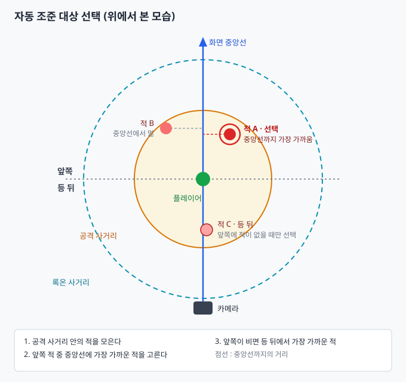
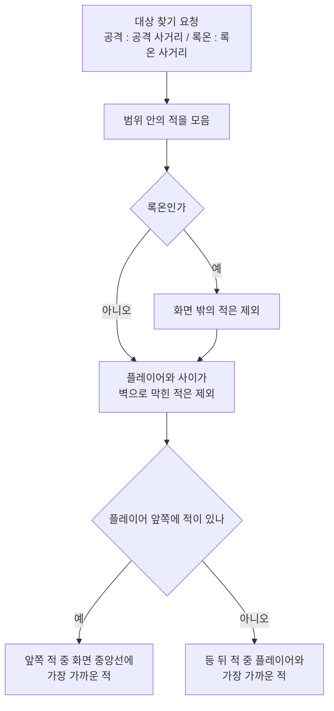
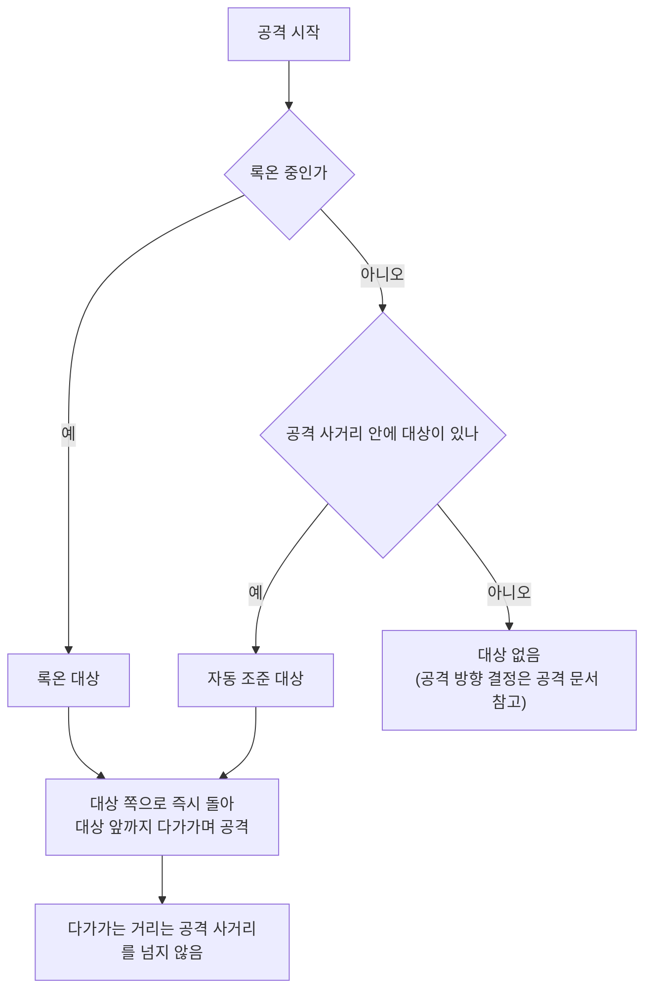
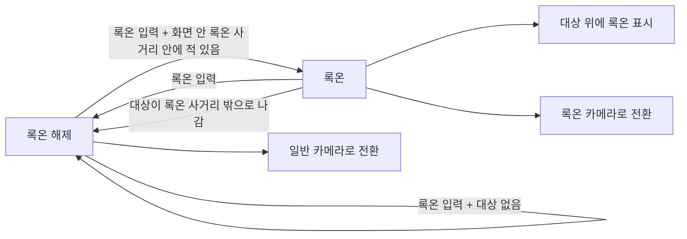
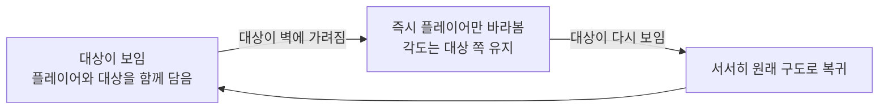

# 타겟팅과 록온

## 1. 개요

공격 버튼만 눌러도 화면 중앙에 가까운 적을 향해 돌아서 다가가며 공격하는 자동 조준 기능과, 원하는 적을 고정해 카메라가 플레이어와 그 적을 함께 담는 록온 기능이다. 플레이어가 적을 일일이 겨누지 않아도 보고 있는 적을 공격할 수 있게 하고, 이후 대시 공격과 회피 반격이 같은 대상 정보를 이어서 쓴다.

## 2. 구성 요소

- PlayerTargeting : 캐릭터마다 있는 대상 찾기 기능. 이 캐릭터 기준으로 공격 · 록온 대상을 찾고 가림을 확인한다. 공격 대상 고르기 순서(록온 → 우선 대상 → 자동 조준)도 여기 한곳에 있다
- PlayerLockOn : 파티에 하나만 있는 록온 상태. 록온 입력 · 해제 · 자동 해제와 록온 표시를 관리한다
- CommonCharacterSettings : 공격 · 록온 사거리, 가림 판정 Layer · 높이, 록온 표시 Prefab 을 모든 캐릭터가 같이 쓰는 공통 설정 (타겟팅 관련 역할)
- LockOnCamera : 록온 중에만 록온 카메라를 켜고, 조작 캐릭터 뒤에서 록온 대상 쪽을 보도록 카메라 각도를 맞추는 기능
- CameraTargetSwitcher : 조작 캐릭터가 바뀌면 카메라가 따라갈 대상과 록온 구도의 플레이어를 바꾸는 기능 (타겟팅 관련 역할)
- PlayerController : 공격을 시작할 때 대상에 따라 방향과 다가갈 거리를 정하는 플레이어 기능 (타겟팅 관련 역할)
- PlayerAttackState : 정해진 방향과 거리로 다가가며 공격하는 상태 (타겟팅 관련 역할)

## 3. 동작 원리

### 대상 고르기

- 범위는 플레이어를 중심으로 잡는다. 공격할 때는 공격 사거리, 록온할 때는 록온 사거리를 쓴다.
- 앞쪽과 등 뒤는 카메라가 보는 방향을 기준으로 플레이어 위치에서 나눈다.
- 앞쪽 적은 화면 중앙선, 곧 카메라 정면으로 뻗은 선까지의 거리로 비교한다.
    - 화면에서 같은 위치에 보이는 적이라면 가까운 적일수록 중앙선과의 거리가 짧아, 근접 공격 대상으로 가까운 적이 우선된다.
- 등 뒤의 적은 앞쪽에 적이 없을 때만 고른다.
    - 등 뒤의 적은 카메라와 플레이어 사이에 놓여 중앙선과의 거리가 거의 없으므로, 같은 기준으로 비교하면 앞의 적보다 먼저 뽑히기 때문이다.
    - 등 뒤의 적은 화면 중앙선 기준이 의미가 없어 플레이어와 가까운 순서로 고른다.
- 록온은 화면에 보이는 적만 대상으로 한다. 원하는 적은 카메라 안에 있으므로, 카메라 밖의 엉뚱한 적이 잡히는 것을 막기 위해서다.
- 플레이어와 적 사이가 벽으로 막힌 적은 자동 조준과 록온 모두에서 고르지 않는다. 막힌 적에게 다가가면 벽에 박히기 때문이다.
    - 막힘은 플레이어 가슴 높이에서 적의 중심까지 선을 그어 장애물에 닿는지로 판단한다. 플레이어와 적은 장애물로 보지 않는다.
- 대상 찾기는 공격 입력과 록온 입력이 들어올 때만 한다. 록온 중 매 프레임 하는 일은 대상까지의 거리 확인과 대상이 벽에 가려졌는지 확인뿐이다.

### 공격과 대상

- 록온 대상이 자동 조준보다 우선한다. 록온 중에는 카메라를 다른 적 쪽으로 돌려도 록온 대상을 공격한다.
- 록온 대상이 공격 사거리 밖에 있으면 공격 사거리만큼만 다가가고, 공격이 닿지 않을 수 있다.
    - 사거리 밖이더라도 미리 공격 준비를 할 수 있다.
    - 닿지 않더라도 공격 사거리만큼 다가가므로 공격 방향을 확실하게 볼 수 있다.

### 록온

- 록온은 캐릭터가 아니라 플레이어가 고른 대상이라 파티에 하나만 둔다. 교체해도 같은 대상을 계속 록온하고, 록온 표시 · 록온 카메라도 하나만 본다. 록온할 대상 찾기 · 거리 확인 · 가림 확인은 조작 중인 캐릭터를 기준으로 한다.
- 교체하면 카메라 대상 전환 기능이 일반 · 록온 카메라가 따라갈 대상과 록온 구도의 플레이어를 새 캐릭터로 바꾼다. (파티 문서)
- 록온 사거리는 공격 사거리와 따로 둔다. 공격 사거리 밖의 적도 미리 잡아 두고 다가갈 수 있다.
- 사거리와 가림 판정 값은 모든 캐릭터가 같이 쓰는 공통 설정 값이다. 가림 판정 선을 시작하는 높이도 캐릭터 키와 상관없이 같은 값을 써서, 어떤 캐릭터든 일관되게 판정한다.
- 록온 표시는 공통 설정에 넣은 임시 Prefab을 시작할 때 만들어 두고, 록온하면 대상 위에 띄우고 해제하면 숨긴다. 표시 위치는 적이 알려주는 록온 표시 위치(머리 · 가슴 등)를 따라가고, 정하지 않은 적은 대상 위치에서 기본 높이만큼 위에 띄운다. (적 공통 규칙 문서의 `대상 정보`)
- 록온 카메라는 플레이어 뒤에서 대상 쪽을 보며, 플레이어와 대상을 한 화면에 담는다. 대상 주위를 돌아도 카메라가 대상 쪽으로 따라 돈다.
- 록온 중에는 마우스로 카메라를 돌릴 수 없다.
- 일반 카메라와 록온 카메라 사이를 오갈 때는 화면이 튀지 않고 이어진다.
- 록온한 대상이 벽 뒤로 가려져도 록온은 유지한다. 대신 가려진 동안 록온 카메라는 플레이어만 바라보고, 카메라 각도는 계속 대상 쪽을 향한다.
    - 록온 카메라는 플레이어와 대상의 중간을 바라보는데, 대상이 벽 뒤로 가면 그 중간 지점도 벽 너머에 놓인다. 이때 카메라의 장애물 검사가 카메라를 벽 앞까지 당겨 플레이어가 화면에서 사라지기 때문이다.
    - 가려지는 순간 바로 플레이어만 바라보도록 바꾸고, 대상이 다시 보이면 원래 구도로 서서히 돌아온다.

## 4. 구현 과정

- 활용한 기능 :
    - `Physics.OverlapSphere` : 플레이어 주변 범위 안의 콜라이더를 모은다. 결과를 미리 만든 배열에 담아 메모리 할당이 생기지 않게 했다.
    - 벡터의 외적과 내적 : 외적의 크기로 화면 중앙선까지의 거리를, 내적의 부호로 앞쪽과 등 뒤를 판단한다. 거리는 크기 비교만 하므로 제곱근을 구하지 않고 제곱한 값으로 비교한다.
    - `Camera.WorldToViewportPoint` : 적의 중심을 화면 좌표로 바꿔 화면 안에 보이는지 판단한다.
    - `Physics.Linecast` 와 LayerMask : 플레이어와 적 사이에 장애물이 있는지 선 하나로 검사한다. 장애물로 볼 Layer 는 Inspector 에서 정하고, 플레이어와 적 Layer 는 뺀다.
    - Gizmos : Scene 창에서 공격 · 록온 사거리와, 지금 공격하면 선택될 대상까지의 선을 보여 준다.
    - Cinemachine `Orbital Follow` : 록온 카메라가 플레이어 주위 궤도를 돌며, 가로 각도를 대상 쪽으로 맞춰 플레이어 뒤에 선다.
    - Cinemachine `Target Group` · `Rotation Composer` : 플레이어와 록온 대상을 하나로 묶은 중심을 바라보게 해 둘을 함께 화면에 담는다. 대상이 가려지면 그룹에서 대상의 비중(Weight)을 0 으로 내려 플레이어만 바라보게 한다. 비중이 0 인 대상은 그룹 계산에서 빠진다.
    - Cinemachine Brain 전환 · `Blend Hint` (Inherit Position) : 카메라 전환을 섞어 주고, 록온을 풀 때 일반 카메라가 마지막 록온 시점에서 이어지게 한다.
    - Cinemachine `Deoccluder` 와 Layer : 플레이어와 적을 전용 Layer 로 나누고 장애물 검사에서 제외했다.
- 구현 과정 :
    1. 대상 찾기를 먼저 만들고, 로그 대신 Scene 창의 선으로 선택 결과를 확인했다. 매 프레임 로그를 찍으면 확인이 어렵고, 선은 에디터에서만 그려져 따로 지울 필요가 없다.
    2. 테스트 중 카메라와 플레이어 사이의 적이 앞의 적보다 먼저 선택되는 문제가 나왔다. 앞쪽 적을 우선하고 앞쪽에 없을 때만 등 뒤의 적을 고르도록 바꿔, 등 뒤의 적도 공격할 수 있게 남겼다.
    3. 공격을 시작할 때 대상 쪽으로 돌고 다가가게 했다. 이 내용은 공격 문서에 함께 적었다.
    4. 록온 입력, 자동 해제, 록온 표시를 추가했다.
    5. 록온 카메라는 기존 카메라를 코드로 조작하지 않고 록온 전용 카메라를 하나 더 두어 켜고 끄는 방식으로 만들었다. 전환은 Cinemachine 이 섞어 주고, 록온 카메라에 마우스 입력을 붙이지 않는 것만으로 마우스 회전이 막힌다.
    6. 적에게 가까이 붙으면 카메라가 앞으로 당겨지고, 록온 카메라의 위치가 틀어지는 문제가 나왔다. 카메라의 장애물 검사가 적과 플레이어 몸까지 장애물로 보고 있었기 때문으로 판단해, 두 Layer 를 장애물 검사에서 제외했다. 록온 카메라는 플레이어와 대상의 중간을 바라보므로 그 사이에 플레이어 몸이 놓인다.
    7. 록온이 카메라 밖의 적을 잡지 않도록 화면 안 조건을 추가했다. 공격의 자동 조준은 등 뒤의 적도 공격할 수 있도록 이 조건을 쓰지 않는다.
    8. 벽 뒤의 적을 대상에서 뺐다. 화면 기준(카메라에서 적까지)과 플레이어 기준(플레이어에서 적까지) 중, 공격이 플레이어가 적에게 다가가는 동작이므로 벽에 박히는 문제를 바로 막는 플레이어 기준을 골랐다.
    9. 록온한 대상이 벽 뒤로 가면 카메라가 벽 앞으로 당겨져 플레이어가 보이지 않는 문제가 나왔다. 록온을 유지한 채 가려진 동안 카메라가 플레이어만 바라보게 했다. 처음에는 바라보는 지점을 서서히 옮겼으나 그동안 카메라가 벽 앞에 갔다가 돌아와, 가려질 때는 즉시 옮기고 다시 보일 때만 서서히 돌아오게 바꿨다.

### 참고 레퍼런스

- 젠레스 존 제로 자동 조준 : 공격 버튼을 누르면 적에게 자동으로 돌아서 다가가는 동작
- 데빌 메이 크라이 록온 : 록온 · 해제와 록온 중 카메라 고정

## 5. 기존 방식과 비교

- 필요하게 된 과정 : 기존 공격은 바라보는 방향으로만 나가 적을 향해 공격할 방법이 없었다. 기획서의 코어 전투 구현 순서에서 기본 · 강공격, 에너지 · 스킬 다음 단계로 만들었고, 이후 대시 공격 · 회피 반격 · 적 AI 가 같은 대상 정보를 쓴다.

- 구조 정리 (#31) : (자세한 내용은 플레이어 구성과 데이터 문서)
    - 기존 : 공격 대상 고르기 순서(록온 → 우선 대상 → 자동 조준)가 공격 · 필살기 · 그로기 테스트 · 패링에 따로 적혀 있었다.
    - 변경 : 공격 · 필살기 · 그로기 테스트는 타겟팅 기능의 하나의 규칙을 쓴다. 패링은 후보마다 패링 가능 시간을 열었는지 확인하며 다음 후보로 넘어가야 해서 자체 로직을 유지한다.

- 컴포넌트 병합 · 정리 (#33) : (자세한 내용은 플레이어 구성과 데이터 문서)
    - 기존 : 사거리 · 가림 판정 값은 타겟팅 기능의 Inspector 칸에 있었고, 록온 표시는 씬 안의 오브젝트를 연결해 썼다.
    - 변경 : 사거리 · 가림 판정 값과 록온 표시 Prefab 은 공통 설정에서 읽고, 록온 표시는 시작할 때 만든다. Scene 창의 사거리 표시는 실행 전에도 공통 설정 값으로 그린다.

- 파티 전투 (#41) : (자세한 내용은 파티 문서)
    - 기존 : 록온 상태 · 록온 표시 · 록온 입력은 캐릭터마다 타겟팅 기능에 있었다. 메인 카메라는 캐릭터마다 연결했고, 록온 카메라는 한 캐릭터의 타겟팅을 봤다.
    - 변경 : 록온 상태는 파티의 록온 기능 하나가 들고, 캐릭터의 타겟팅은 대상 찾기와 가림 확인만 한다. 메인 카메라는 파티가 들고, 록온 카메라는 파티의 록온과 조작 캐릭터를 본다. 교체하면 카메라 대상이 바뀐다.
    - 개선된 점 : 교체해도 록온 대상 · 표시 · 카메라가 그대로 이어지고, 넘겨줄 값이 없다.

### 미검증 항목

- 조이콘 · 게임패드의 록온 버튼
- 록온 대상이 사라질 때(처치 · 비활성화)의 처리. 적 처치가 생기는 단계에서 다룬다.
- 벽 모서리처럼 가려짐과 보임이 빠르게 바뀌는 위치에서 록온 카메라 구도가 흔들리는지
- 빠른 지원 중 록온 대상이 넉백시킨 적과 다르면, 공격 방향이 록온 대상 쪽으로 잡힌다 (순간 이동 위치는 넉백시킨 적 앞)
