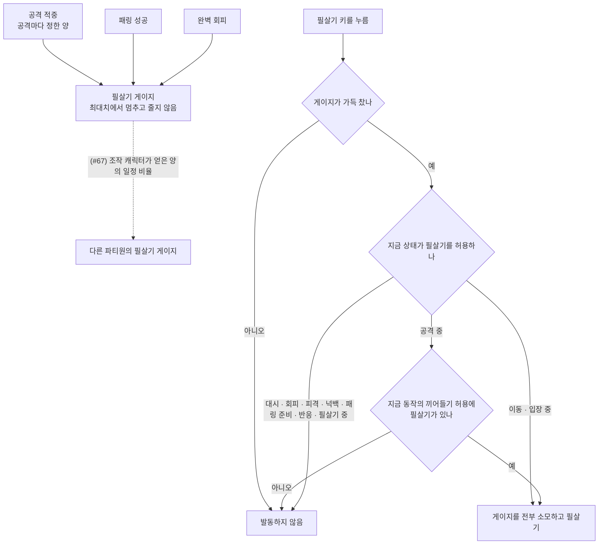
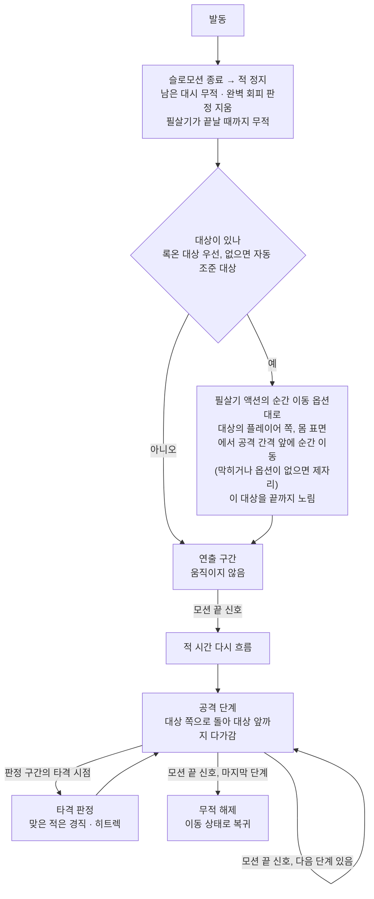
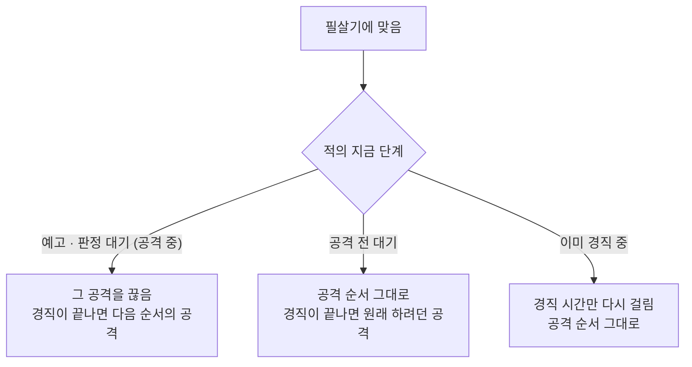

# 필살기

## 1. 개요

공격 적중 · 패링 성공 · 완벽 회피로 필살기 게이지를 모으고, 게이지가 가득 차면 필살기 키로 대상 앞에 순간 이동해 연출 뒤 연속 공격을 쓰는 기능이다. 필살기 중에는 무적이고 어떤 입력으로도 끊기지 않으며, 적은 연출 동안 멈췄다가 필살기에 맞으면 경직해 하던 공격이 끊긴다. 이후 캐릭터를 추가할 때 모션 개수가 다른 필살기도 같은 규칙으로 넣고, 연출 구간은 애니메이션 컷신 · 카메라 워크로 바꿀 자리로 쓴다.

## 2. 구성 요소

- PlayerActionTrigger : 필살기 입력과 발동 조건 검사, 대상 선택, 필살기 상태 보유 (패링 · 콤보 스킬과 함께 있는 특수 행동 시작 기능). 필살기 액션은 캐릭터 데이터에서, 대상 찾는 거리는 공통 설정에서 읽는다
- PlayerStatus : 필살기 게이지 보관 · 획득 · 소모. 게이지 최대치 · 패링 성공 · 완벽 회피 획득량은 캐릭터 데이터에서 읽는다 (필살기 관련 역할)
- PlayerUltimateState : 연출 → 공격 단계 → 이동 복귀 흐름, 무적, 연출 중 적 · 다른 파티원 정지, 단계별 대상 접근과 타격
- PlayerParty · PlayerStatus : 시전자를 뺀 파티원을 멈추고 다시 움직이는 기능, 캐릭터마다 정지 표시 (필살기 관련 역할)
- TeleportManager : 대상 앞 순간 이동 규칙, 바닥 높이 맞춤, 도착 지점 막힘 검사 (패링 · 콤보 스킬과 함께 씀)
- TeleportOption : 필살기 액션에 붙여 대상의 플레이어 쪽에 서게 하는 순간 이동 옵션
- PlayerState : 상태마다 필살기를 쓸 수 있는지 답하는 공통 틀 (필살기 관련 역할)
- PlayerLocomotionState · PlayerSwapInState · PlayerAttackState : 이동 상태와 입장 상태는 필살기를 허용하고, 공격 상태는 지금 동작의 끼어들기 허용에 따라 허용 (필살기 관련 역할)
- ActionData · ActionStep : 액션마다 적중 시 필살기 게이지 획득량을, 동작마다 필살기로 끊기 허용을 정하는 데이터. 필살기 자체도 동작 목록을 가진 액션 하나다 (필살기 관련 역할)
- PlayerAttackJudge : 적중한 적마다 게이지를 얻고, 필살기 타격이면 적을 경직시키는 판정 기능 (필살기 관련 역할)
- EnemyAttacker : 경직하면 공격 중이던 공격을 끊는 적 공격 기능 (필살기 관련 역할, 자세한 내용은 적 공격 문서)

## 3. 동작 원리

### 게이지와 발동 조건

- 게이지는 에너지와 별개다. 공격 적중은 공격마다 정한 양만큼, 패링 성공과 완벽 회피는 각각 정한 양만큼 쌓인다. 게이지는 캐릭터마다 따로 가지는 값이라 체력 · 에너지와 함께 상태 기능에 있다.
- (#67) 공격 적중으로 얻는 게이지는 적을 맞힌 판정마다 한 번이다. (공격 문서)
- (#67) 조작 중인 캐릭터가 게이지를 얻으면 다른 파티원도 공통 설정의 비율만큼 함께 얻는다. 나눠 받은 게이지는 다시 나눠 주지 않는다. (파티 문서의 `필살기 게이지 나눠 주기`)
- 게이지가 가득 찼을 때만 발동하고, 발동하면 게이지를 전부 소모한다.
- 상태마다 필살기를 쓸 수 있는지 스스로 답한다. 기본은 불가이고, 이동 상태 · 입장 상태 · 공격 상태만 허용한다.
    - 공격 상태는 지금 동작의 끼어들기 허용에 필살기가 있는지 따른다. 기본, 강공격, 스킬, 특수스킬, 대시 공격, 회피 반격, 패링 추격, 빠른 지원 모두 동작마다 정할 수 있다. (공격 문서의 `끼어들기 허용`)
    - 교체로 들어오는 입장 중에는 입력을 받지 않지만, 필살기만 입장을 끊고 바로 쓸 수 있다. (파티 문서)
    - 새 상태를 추가하면 따로 정하지 않아도 필살기가 막힌다.
    - 패링 준비 · 반응 중에는 패링 상태가 필살기를 허용하지 않는다. 패링 추격은 동작의 끼어들기 허용에서 필살기를 빼 두었다.
- 패링은 교체 키로 나온 캐릭터가 하므로, 필살기 키와 같은 키를 쓰지 않는다.
- 강공격 차지 중에 발동하면 차지는 초기화된다.

### 필살기 진행

- 연출 구간과 각 공격 단계는 모션 끝 신호를 받으면 다음 구간으로 넘어간다. 공격 단계는 공격 단계 설정의 개수만큼 이어지고, 마지막 단계가 끝나면 이전 상태가 아닌 이동 상태로 돌아간다.
- 순간 이동은 필살기 액션에 붙인 순간 이동 옵션을 따라 플레이어가 있던 쪽으로 선다. 공격하지 않는 적은 플레이어를 보고 있지 않을 수 있기 때문이다. 옵션을 떼면 순간 이동 없이 제자리에서 쓴다.
- 발동 때 고른 대상을 기억해, 공격 단계마다 같은 대상에게 다가간다. 도중에 록온을 바꾸거나 풀어도 대상은 바뀌지 않고, 카메라만 바뀐 록온 대상을 따라간다. 발동 때 대상이 없었으면 끝까지 바라보는 방향으로 공격한다.
- 공격 단계의 강타가 그로기 적에게 맞으면 필살기가 끝나고 콤보 스킬로 넘어간다. (콤보 스킬 문서 참고)
- 공격 단계마다 일반 공격처럼 단계의 전진 시간 동안 대상 앞 정지 거리(몸 표면 기준, 순간 이동과 같은 공격 간격)까지 다가간다. 대상이 없으면 정해진 전진 거리만큼 앞으로 간다.
- 필살기 중에는 입력을 읽지 않아 대시 · 공격 · 스킬로 끊기지 않는다. 휘두르는 동안 무적인 공격과 같은 무적을 써서, 패링 · 교체 키 입력도 무시된다.
- 히트렉으로 멈춘 순간 필살기를 눌러도 필살기는 원래 속도로 시작하고, 컷신이 끝난 뒤에도 원래 속도다. 필살기를 시작할 때 히트렉을 바로 끝내기 때문이다.
- 적은 연출 구간 동안만 멈추고, 공격 단계부터 다시 움직인다. 플레이어는 공격 단계 동안에도 무적이라 이 사이 적 공격에 맞지 않는다.
- 필드에 남아 있는 다른 파티원(지원 공격 · 퇴장 중인 캐릭터)도 적과 같은 규칙으로 연출 구간 동안 멈춘다. 캐릭터 시간 배율이 0 이 되어 모션 · 이동 · 시간이 모두 멈춘다.
    - 정지는 히트렉과 따로 표시한다. 히트렉이 끝나며 배율을 되돌려도 정지가 풀리지 않게 하기 위해서다.
    - 첫 공격 단계에 들어설 때와 필살기가 끝날 때 모두 풀어, 어떤 경우에도 멈춘 채 남지 않는다.
- 슬로모션 중 발동해도, 연출이 끝나면 적은 원래 속도로 돌아온다.

### 적 경직과 공격 취소

- 필살기에 맞은 적은 경직 레벨이 적의 경직 저항 레벨 이상이면 정해진 시간 동안 경직하고 피격 모션으로 멈춘다. 공격 중이던 적은 공격이 끊기고, 패링 가능 시간이 닫히며 예고 표시가 사라진다.
- 여러 번 맞는 필살기도 공격 순서가 한 번만 넘어간다.
- 필살기 범위 밖의 적은 경직하지 않고 공격을 이어간다.

## 4. 구현 과정

- 활용한 기능 :
    - Animation Event : 연출 · 공격 단계 모션의 끝과 타격 순간을 신호로 받아 다음 구간과 타격 시점을 정한다.
    - Animator 상태 직접 재생 : 단계 사이를 전이선 대신 코드가 다음 상태 이름으로 재생하고, 섞는 시간은 단계 설정의 값을 쓴다.
    - Animator Override Controller : 연출 · 공격 단계 상태 이름을 고정해 두어, 캐릭터마다 클립만 바꿔 끼울 수 있게 했다.
    - 액션 데이터(ScriptableObject) : 필살기를 액션 하나로 두고, 동작 목록으로 동작마다 모션 · 판정 범위 · 전진을 정한다. 위력 · 게이지는 액션 공통이다.
    - `CharacterController` · `Physics.CheckCapsule` · `Physics.Linecast` : 순간 이동할 자리에 몸이 들어가는지, 대상과 도착 지점 사이가 막혔는지 검사한다.
- 구현 과정 :
    1. 필살기 게이지를 별도 기능으로 만들고, 공격 적중 · 패링 성공 · 완벽 회피에서 게이지를 얻게 했다. 공격 적중 획득량은 공격 설정에 추가해 공격마다 정한다.
    2. 패링에 있던 순간 이동과 막힘 검사를 별도 기능으로 분리해, 패링과 필살기가 함께 쓰게 했다.
    3. 상태마다 필살기 허용 여부를 답하게 하고, 공격 상태는 공격 설정의 값을 답하게 했다.
    4. 필살기 모션을 처음에는 Animator 전이선으로 이어 만들었으나, 이벤트가 첫 상태의 것만 처리되어 다음 상태의 타격 · 모션 끝 신호가 버려졌다. 연출 · 공격 단계를 코드가 하나씩 재생하는 방식으로 바꿨다.
    5. 연출 구간의 끝은 Inspector 시간 대신 모션 끝 신호로 정했다. 공격 흐름과 같은 신호 하나로 모든 구간을 넘기기 위해서다.
    6. 필살기 중 무적과 적 정지를 넣었다. 처음에는 필살기 내내 적을 멈췄으나, 연출 동안만 멈추고 공격 단계부터는 시간이 흐르게 바꿨다.
    7. 필살기 동안 적이 멈춰 있다가 끝난 뒤 하던 공격이 그대로 들어오는 문제가 있어, 필살기에 맞은 적이 경직하며 공격을 끊게 했다.
    8. 경직할 때마다 적의 공격 순서가 넘어가 여러 번 맞으면 공격을 건너뛰는 문제가 있어, 공격 중일 때만 그 공격을 끊고 순서를 넘기도록 바꿨다.
    9. 처음에는 필살기를 제자리 공격으로 만들었으나, 공격 단계마다 대상 앞까지 다가가도록 바꿨다. 연출 중에는 움직이지 않는다.
    10. 도중에 록온을 바꾸면 새 록온 대상에게 다가가는 문제가 있어, 발동 때 대상을 끝까지 노리도록 바꿨다. 록온 입력을 막는 방법은 록온이 자동으로 풀리는 경우를 막지 못해 쓰지 않았다.
- 주요 결정과 이유 :
    - 필살기 허용 여부는 상태가 스스로 답하고, 공격은 공격마다 설정으로 정한다.
        - 대시 · 피격 · 패링처럼 막는 것이 게임 규칙인 상태는 바뀔 일이 적고, 공격 중 필살기로 끊을지는 조정할 일이 생기기 때문이다.
        - 휘두르는 중 대시로 끊기 허용 여부와 같은 형태라, 끊기 규칙을 공격 설정 한곳에서 볼 수 있다.
        - 기본값을 불가로 두어, 교체 · 콤보 스킬처럼 나중에 추가할 상태에서 필살기가 실수로 열리지 않게 했다.
    - 공격 단계는 기본 콤보처럼 설정 개수만큼 이어간다. 필살기 모션이 하나뿐인 캐릭터는 설정을 하나만 두면 되고, Animator 에는 가장 긴 캐릭터 기준으로 단계 상태를 만들어 둔다.
    - 필살기 무적은 휘두르는 동안 무적인 공격과 같은 무적을 쓴다. 이 무적 중에는 패링 입력을 이미 무시하고 있어, 패링 · 교체 키를 따로 막지 않아도 된다.
    - 발동하면 슬로모션을 먼저 끝내고 적을 멈춘다. 슬로모션은 끝날 때 적 배속을 원래대로 돌리기 때문이다.
    - 발동할 때 남은 대시 무적과 완벽 회피 판정을 지운다. 대시 공격 직후 발동하면 필살기 중 완벽 회피 슬로모션이 걸릴 수 있기 때문이다.
    - 적의 공격 취소는 공격 중일 때만 한다. 공격 전 대기 중에 맞았다고 다음 공격이 사라지지 않게 하기 위해서다.
    - 필살기 공격 단계 설정에서 하체 달리기 · 대시 캔슬 · 입력 버퍼 값은 쓰지 않는다.
- 레퍼런스 : 젠레스 존 제로의 궁극기

## 5. 기존 방식과 비교

- 필요하게 된 과정 : 기획서 코어 전투 4묶음의 첫 단계다. 에너지와 별개인 필살기 게이지로 스타일리시한 입력에 보상을 주고, 이후 캐릭터별 애니메이션 컷신 · 카메라 워크와 액션 데이터(ScriptableObject)를 붙일 자리를 마련하기 위해 만들었다.

- 구조 정리 (#31) : (자세한 내용은 플레이어 구성과 데이터 문서)
    - 기존 : 필살기 공격 단계마다 설정 묶음을 따로 두고, 단계 번호로 모션 이름을 만들었다. 순간 이동은 적 중심에서 정한 거리 · 적 높이로 섰다.
    - 변경 : 필살기는 동작 목록을 가진 액션 하나다. 동작마다 모션 · 판정 범위 · 전진이 있고, 위력 · 게이지는 공통이다. 순간 이동은 몸 표면 기준 거리와 바닥 높이를 쓴다. 게이지 최대치 · 획득량은 캐릭터 데이터에서 읽는다.

- 컴포넌트 병합 · 정리 (#33) : (자세한 내용은 플레이어 구성과 데이터 문서)
    - 기존 : 필살기 전용 기능이 게이지 · 입력 · 대상 선택 · 순간 이동을 모두 들고 있었다. 순간 이동은 캐릭터마다 붙은 기능이었고, 서는 방향은 코드가 정했다.
    - 변경 : 게이지는 상태 기능으로, 입력 · 대상 선택은 패링 · 콤보 스킬과 함께 특수 행동 시작 기능으로 옮겼다. 순간 이동은 공통 규칙이 되었고, 서는 방향은 필살기 액션의 순간 이동 옵션이 정한다. 대상 찾는 거리는 공통 설정에서 읽는다.

- 파티 전투 (#41) : (자세한 내용은 파티 문서)
    - 기존 : 공격마다 필살기로 끊기를 켜고 껐다. 같은 프레임의 패링 키 · 필살기 키는 패링을 먼저 봤다.
    - 변경 : 동작마다 끼어들기 허용에서 필살기로 끊기를 정한다. 입장 중에는 필살기만 쓸 수 있다. 필살기 연출 구간은 교체할 수 없고, 공격 단계는 동작의 교체 허용을 따른다. 패링은 교체 키로만 나와 필살기 키와 겹치지 않는다.

- 적 공격 데이터 작업(#52)에서 함께 바뀐 점 :
    - 기존 : 연출 구간 동안 적만 멈추고, 필드에 남은 다른 파티원은 계속 움직였다.
    - 변경 : 다른 파티원도 적과 같은 규칙으로 연출 구간 동안 멈춘다.
    - 이유 : 연출 중에는 시전자만 움직여야 연출에 집중된다.

- 카메라 워크 · 타격감 작업(#67)에서 달라진 점 :
    - 기존 : 게이지는 얻은 캐릭터만 찼고, 공격 적중 게이지는 동작당 한 번이었다(#58).
    - 변경 : 공격 적중 게이지는 판정마다 한 번이고, 조작 캐릭터가 얻은 게이지의 일정 비율을 다른 파티원도 받는다.
    - 이유 : 다단 히트 보상이 작아 필살기 게이지를 채우기 어려웠고, 대기 캐릭터도 교체해 들어와 필살기를 쓸 수 있게 하기 위해서다. (사용자 결정)

### 미검증 항목

- 연출 구간의 애니메이션 컷신 · 카메라 워크 (Timeline, 별도 작업. 카메라 구도는 필살기 상태가 읽지 않음)
- 일반 적 · 보스의 필살기 경직 (일반 적 · 보스 단계)
