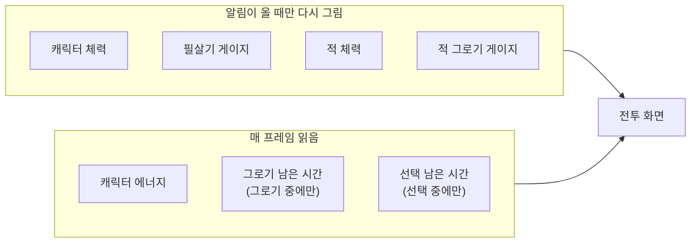
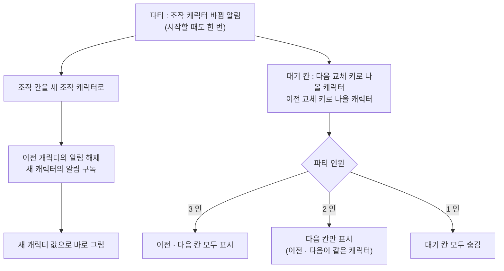

# 최소 전투 HUD

## 1. 개요

파티 전투를 플레이하면서 조작 캐릭터 · 대기 캐릭터 · 적의 상태를 화면에서 볼 수 있게 하는 최소 전투 화면이다. 조작 캐릭터의 체력 · 에너지 · 필살기 게이지, 교체 방향별 대기 캐릭터 칸, 일반 적 머리 위 바와 화면 위쪽 보스 바, 콤보 스킬 캐릭터 선택 화면으로 이루어진다. 화면은 값을 보여주기만 하고 입력은 받지 않으며, 값은 각 기능에서 읽는다.

## 2. 구성 요소

- PartyHud : 파티의 조작 캐릭터가 바뀌면 조작 캐릭터 칸과 이전 · 다음 대기 칸을 다시 채우고, 파티 인원에 따라 대기 칸을 숨긴다
- CharacterGauge : 캐릭터 칸 하나. 이름 · 체력 · 에너지 막대와 [선택] 필살기 게이지 숫자. 조작 칸과 대기 칸이 함께 쓴다
- EnemyGauge : 적 하나의 체력 · 그로기 막대. 일반 적 머리 위 바와 보스 바가 함께 쓴다
- FaceCamera : 월드 공간 UI(일반 적 머리 위 바)가 항상 카메라를 향하게 한다
- ComboSelectionView : 콤보 스킬 캐릭터 선택 화면. 이전 · 다음 캐릭터 이름, 남은 시간 숫자 · 막대, 캔슬 안내

## 3. 동작 원리

### 값 갱신 방식

- 맞거나 공격할 때만 바뀌는 값(체력 · 필살기 게이지 · 적 체력 · 그로기 게이지)은 값을 가진 기능이 바뀔 때 알리고, 화면은 그때만 다시 그린다.
- 시간이 지나며 계속 바뀌는 값(에너지 회복 · 그로기 남은 시간 · 선택 남은 시간)은 매 프레임 읽는다. 그로기 남은 시간과 선택 남은 시간은 해당 상태일 때만 읽는다.
- 막대는 모두 Slider 로 그린다. 적 바도 같은 방식이다.
- 필살기 게이지는 막대 대신 현재 값을 1 의 자리까지(소수점 아래는 버림) 숫자로 보여준다. 조작 캐릭터 칸에만 둔다.

### 교체할 때 칸 다시 채우기

- 칸이 맡은 캐릭터가 바뀌면 이전 캐릭터의 알림을 먼저 해제한다. 해제하지 않으면 다른 캐릭터의 값으로 칸이 그려진다.
- 대기 칸은 교체 키 방향과 맞춘다. 이전 칸은 이전 교체 키, 다음 칸은 다음 교체 키로 나올 캐릭터다.
- 필살기 숫자는 칸의 캐릭터가 파티의 조작 캐릭터일 때만 그린다. 교체되어 나가는 캐릭터가 필드에 남아 공격하면 그 캐릭터의 게이지가 차는데, 그 값으로 숫자를 덮어 그리지 않기 위해서다.

### 적 바

- 일반 적은 적 Prefab 의 자식으로 붙인 월드 공간 바가 머리 위에 뜬다. 대상을 따로 연결하지 않으면 부모에서 적을 찾는다. 바는 카메라와 같은 방향을 보게 해 글자 · 막대가 뒤집히지 않는다.
- 보스는 화면 위쪽 바에 씬의 보스를 연결한다.
- 그로기가 아닐 때 그로기 막대는 쌓인 게이지를, 그로기 중에는 남은 그로기 시간을 보여준다. 그로기 중에는 막대 채움 색을 그로기 색으로 덮고, 끝나면 원래 색으로 돌아간다.
- 적이 처치되면 바를 숨긴다.

### 콤보 스킬 선택 화면

- 선택 중에만 화면을 켜고, 선택 중에는 매 프레임 이전 · 다음 캐릭터 이름과 남은 시간을 그린다.
- 게임이 느려져도 남은 시간은 실제 시간으로 줄어드는 값을 그대로 보여준다.
- 캔슬 안내는 고정 글자로 둔다.

## 4. 구현 과정

- 활용한 기능 :
    - uGUI Canvas · Slider : 막대를 Slider 의 채움 영역 크기로 그린다. 채움 영역이 줄어드는 방식이라 막대 끝 장식(9-slice)이 줄어들어도 유지된다.
    - 월드 공간 Canvas : 일반 적 머리 위 바. 카메라 회전을 따라가게 해 항상 화면을 향한다. 카메라 이동이 끝난 뒤 맞추도록 프레임 마지막 단계에서 돈다.
    - TextMeshPro 대체 글꼴(Fallback) · Match Material Presets : 영문 · 숫자는 GUI Pro 글꼴, 한글은 대체 글꼴(빗썸고딕, 동적 에셋)의 글자 모양으로 표시하고, 외곽선 · 색 효과는 원래 글꼴 머티리얼과 맞춘다.
    - GUI Pro 스킨 : 캐릭터 칸 · 적 바 · 콤보 선택 화면의 이미지.
- 구현 과정 :
    1. 캐릭터 상태 기능과 적 기능에 화면이 읽을 값(최대값 · 현재값 · 그로기 남은 시간 비율)을 공개하고, 체력 · 필살기 게이지 · 그로기 게이지가 바뀔 때 알리게 했다.
    2. 캐릭터 데이터에 표시 이름 칸을 추가했다. 비어 있으면 에셋 이름을 보여준다.
    3. 캐릭터 칸 · 파티 HUD · 적 바 · 카메라 바라보기를 만들고, 콤보 선택 화면에 남은 시간 막대를 추가했다.
    4. 시작하자마자 막대가 비어 보이는 문제가 있었다. 화면이 켜질 때 그리는 시점이 값을 정하기 전일 수 있었기 때문이다. 다른 오브젝트를 참조하지 않는 값(체력 · 에너지 · 게이지)은 가장 이른 초기화 단계(Awake)에서 정하고, 화면은 모든 초기화가 끝난 뒤(Start) 한 번 더 그리게 했다.
    5. 교체되어 나간 캐릭터가 필드에 남아 공격하면 필살기 숫자가 그 캐릭터 값으로 덮어써졌다. 조작 캐릭터일 때만 숫자를 그리게 했다.
- 한글 글꼴은 무료 배포가 가능한 글꼴을 사용자가 골랐고, 라이선스를 확인했다.

### 참고 레퍼런스

- 젠레스 존 제로 (게임) : 전투 화면 배치 · 캐릭터 칸 · 적 바 · 콤보 선택 화면 구성을 최대한 비슷하게 유지했다.

## 5. 기존 방식과 비교

- 필요하게 된 과정 : 체력 · 에너지 · 필살기 게이지 · 그로기는 Inspector 에서만 볼 수 있어 플레이 중 상태를 알 수 없었다. 파티 전투(교체 · 지원 · 콤보 이어받기)를 플레이할 수 있게 최소한의 전투 화면이 필요했고, 콤보 선택 화면은 임시 글자만 있었으며 한글을 표시할 글꼴이 없었다.

### 미정 · 미검증 항목

- 대미지 숫자, 패링 예고 · 록온 · 슬로모션 임시 표시 교체 (연출 · 사운드 단계)
- 설정 UI (마우스 · 스틱 감도, 게임 흐름 · Esc 메뉴 작업)
- 웨이브로 생기는 일반 적의 머리 위 바 (Prefab 자식이라 그대로 뜰 것으로 예상, 게임 흐름 단계에서 확인)
