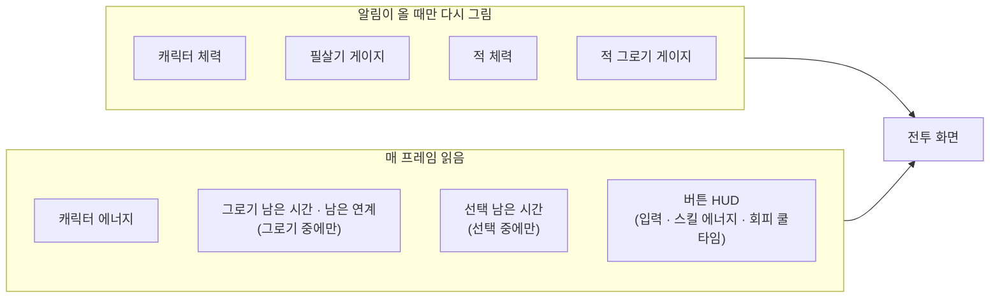
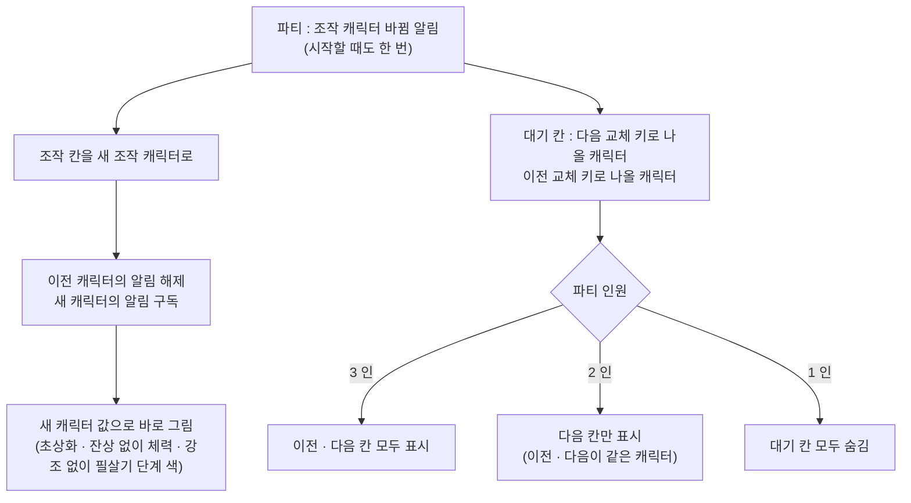
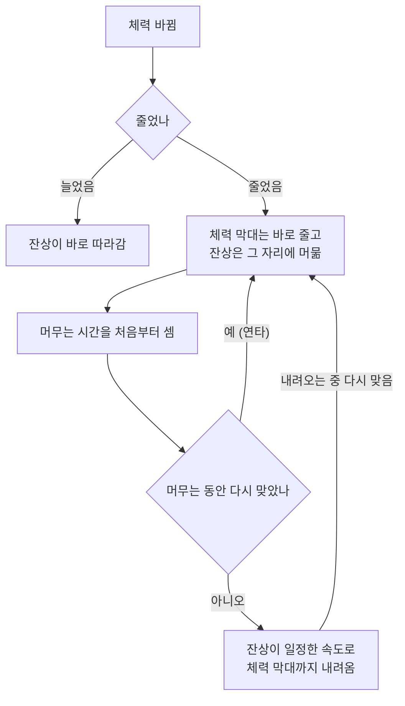
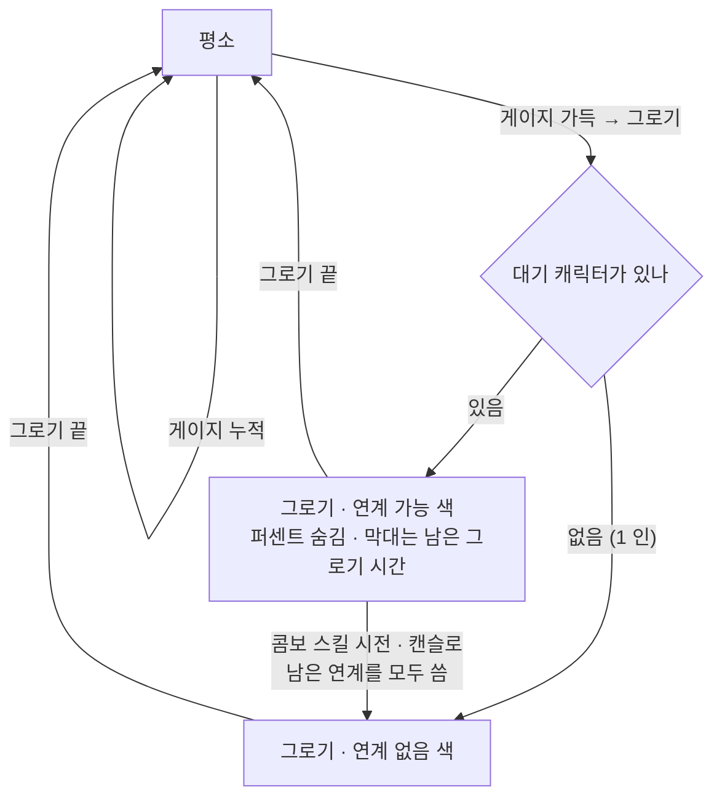
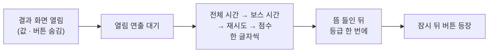
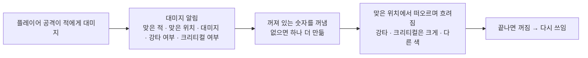
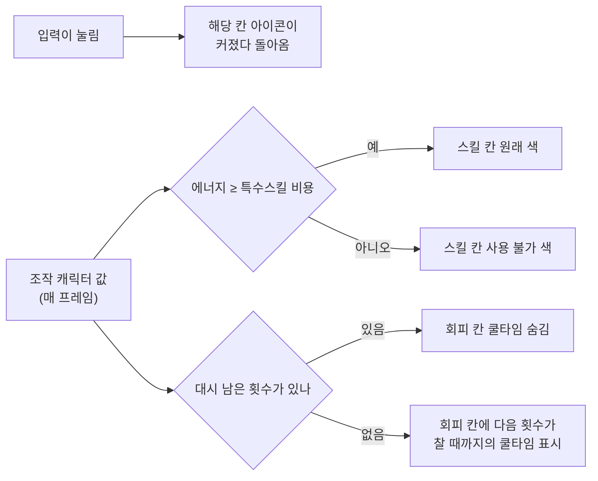
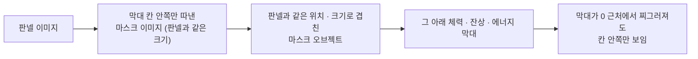

# 전투 HUD

## 1. 개요

파티 전투를 플레이하면서 조작 캐릭터 · 대기 캐릭터 · 적의 상태와 누를 수 있는 버튼을 화면에서 한눈에 읽을 수 있게 하는 전투 화면이다. 캐릭터 칸은 초상화 · 체력 · 에너지 · 필살기 게이지 숫자를, 적 바는 체력과 그로기 게이지 퍼센트 · 콤보 스킬 연계 가능 여부를 보여주고, 체력이 깎이면 깎인 만큼 잔상이 남았다 내려온다. 화면 아래 버튼 칸은 평타 · 회피 · 교체 · 스킬 · 필살기를 모두 보여주며 누를 때마다 반응하고, 스킬을 쓸 수 있는지와 회피 쿨타임을 알려준다. 화면은 값을 보여주기만 하고 행동을 일으키지 않으며, 값은 각 기능에서 읽는다.

## 2. 구성 요소

- PartyHud : 파티의 조작 캐릭터가 바뀌면 조작 캐릭터 칸과 이전 · 다음 대기 칸을 다시 채우고, 파티 인원에 따라 대기 칸을 숨긴다
- CharacterGauge : 캐릭터 칸 하나. 초상화 · 체력 막대와 잔상 · 에너지 막대(스킬 사용 가능 색 · [선택] 에너지 요구량 눈금)와 [선택] 필살기 게이지 숫자(단계별 색 · 단계 상승 강조). (#77) [선택] 이름 · 체력 숫자 · 에너지 숫자와 캐릭터 상징색으로 물들일 그래픽 목록. 조작 칸과 대기 칸이 함께 쓴다
- EnemyGauge : 적 하나의 체력 막대와 잔상 · 그로기 막대와 [선택] 그로기 퍼센트 숫자 · [선택] 초상화 · (#77) [선택] 이름 · 체력 숫자. 그로기 중에는 남은 연계 여부로 막대 색을 바꾼다. 일반 적 머리 위 바와 보스 바가 함께 쓰고, 적(EnemyController)이 등장할 때 Prefab 으로 만든다
- BattleHudVisibility : 전투 HUD 를 지금 보여줄지 알리는 공용 알림. 콤보 스킬 선택 중에 숨긴다
- GaugeTrail : 막대가 줄어든 만큼을 잠깐 남겼다가 내려오는 잔상 막대. 캐릭터 칸 · 적 바의 체력 막대 뒤에 겹쳐 둔다
- ActionButton : 버튼 칸 하나. 연결한 입력이 눌린 순간 아이콘이 커졌다 돌아오고, 사용 불가 색 · 쿨타임 표시를 켜고 끌 수 있다
- ActionButtonHud : 조작 캐릭터의 값으로 스킬 칸의 사용 가능 여부와 회피 칸의 쿨타임 표시를 정한다
- FaceCamera : 월드 공간 UI(일반 적 머리 위 바)가 항상 카메라를 향하게 한다
- ComboSelectionView : 콤보 스킬 캐릭터 선택 화면. 이전 · 다음 캐릭터 초상화, 남은 시간 숫자 · 막대, 캔슬 안내. (#77) 이전 · 다음 캐릭터 상징색으로 물들일 그래픽 목록
- BossTimerView : 보스전 제한 시간 표시. 시 : 분 : 초 글자와 줄어드는 막대
- FlowResultView : 웨이브 중 전멸 화면과 보스전 결과 화면. 전체 시간 · 보스 시간 · 재시도 · 점수 · 등급과 재시작 · 재도전 · 타이틀 버튼
- BestRecordView : 타이틀의 최고 기록 표시. 기록이 없으면 숨긴다
- RecordTimeText : 기록 시간을 분 : 초 . 1/100초 글자로 바꾼다 (결과 화면 · 최고 기록 공용)
- DamageTextSpawner : (#63) 대미지 알림을 받아 맞은 적 위에 대미지 숫자를 띄운다. 숫자를 미리 만들어 두고 다시 쓴다
- DamageText : 대미지 숫자 하나. 떠오르며 흐려지고 끝나면 꺼진다
- PauseMenuView : Esc 메뉴 화면. 게임 씬에 있다 (자세한 내용은 공용 UI 문서)

## 3. 동작 원리

### 값 갱신 방식

- 맞거나 공격할 때만 바뀌는 값(체력 · 필살기 게이지 · 적 체력 · 그로기 게이지)은 값을 가진 기능이 바뀔 때 알리고, 화면은 그때만 다시 그린다.
- 시간이 지나며 계속 바뀌는 값(에너지 회복 · 그로기 남은 시간 · 선택 남은 시간 · 회피 쿨타임)과 입력은 매 프레임 읽는다. 그로기 남은 시간과 선택 남은 시간은 해당 상태일 때만 읽는다.
- 남은 연계 수는 바뀌는 순간을 알리지 않으므로, 그로기 중 남은 시간을 읽을 때 함께 확인한다.
- 막대는 모두 Slider 로 그린다. 적 바도 같은 방식이다. (#77) 사선 막대가 0 근처에서 칸 밖으로 나가지 않게, 판넬의 막대 칸 모양 마스크 안에 막대를 둔다. (아래 `막대 칸 마스크`)
- (#77) 체력 · 에너지 숫자는 값이 바뀔 때만 쓰고, 숫자를 문자열로 바꾸지 않고 바로 넣어 맞을 때마다 문자열이 새로 생기지 않게 한다. 체력은 올림으로 보여, 조금이라도 남았으면 0 으로 보이지 않는다.
- 잔상 · 버튼 반응 · 필살기 단계 강조 같은 화면 연출은 실제 시간으로 흐른다. 히트렉 · 슬로모션 · 콤보 선택 중 느려진 게임 시간에 영향받지 않는다.

### 교체할 때 칸 다시 채우기

- 칸이 맡은 캐릭터가 바뀌면 이전 캐릭터의 알림을 먼저 해제한다. 해제하지 않으면 다른 캐릭터의 값으로 칸이 그려진다.
- 칸이 맡은 캐릭터가 바뀌는 순간에는 잔상과 단계 강조를 쓰지 않는다. 이전 캐릭터와의 값 차이가 맞은 것 · 게이지가 오른 것처럼 보이면 안 되기 때문이다.
- 대기 칸은 교체 키 방향과 맞춘다. 이전 칸은 이전 교체 키, 다음 칸은 다음 교체 키로 나올 캐릭터다.
- 캐릭터는 초상화로 구분한다. 초상화는 캐릭터 데이터에 둔다. (#77) 칸 모양 마스크 안에 상반신 초상화를 넣고, 세 캐릭터의 눈 위치를 이미지에서 미리 맞춰 두어 칸마다 같은 위치값을 쓴다.
- (#77) 칸이 맡은 캐릭터가 바뀌면 이름 글자와 캐릭터 상징색(판넬 · 이름표 등에 곱함)을 함께 바꾼다. 상징색은 캐릭터 데이터에 둔다.
- (#67) 쓰러진 캐릭터는 초상화에 회색을 곱해 어둡게 보여준다. 체력이 바뀔 때 함께 정해, 교체로 칸의 캐릭터가 바뀌어도 맞게 보인다. 색을 곱하는 방식이라 완전한 흑백은 아니고, 흑백이 필요하면 UI 용 흑백 Material 이 필요하다. 쓰러지면 에너지도 0 이 되어 막대가 빈다. (파티 문서)

### 체력 잔상

- 맞을 때마다 머무는 시간을 다시 센다. 연타 중에는 깎인 만큼 잔상이 쌓였다가, 연타가 끝나면 한 번에 내려와 콤보로 얼마나 깎았는지가 보인다.
- 잔상은 줄어든 부분만 보여주므로, 체력이 늘면 바로 따라간다.
- 처음 그릴 때와 칸이 맡은 캐릭터가 바뀔 때는 잔상 없이 바로 맞춘다.
- 캐릭터 칸과 적 바가 같은 잔상 막대 기능을 쓴다.

### 필살기 게이지 숫자

- 현재 값을 1 의 자리까지(소수점 아래는 버림) 숫자로 보여준다. 조작 캐릭터 칸에만 둔다.
- 필살기 숫자는 칸의 캐릭터가 파티의 조작 캐릭터일 때만 그린다. 교체되어 나가는 캐릭터가 필드에 남아 공격하면 그 캐릭터의 게이지가 차는데, 그 값으로 숫자를 덮어 그리지 않기 위해서다.
- 단계 목록을 두고, 게이지 값이 단계 기준을 넘을 때마다 숫자를 그 단계 색으로 칠한다. 기준은 화면에 보이는 숫자와 같은 게이지 값으로 정한다. 어느 단계에도 못 미치면 원래 글자 색이다.
- (#77) 단계 색은 위아래 그라데이션(TMP Color Gradient)이다. 필살기를 한 번 · 두 번 · 세 번 쓸 수 있는 세 단계를 청록 → 노랑 · 주황 → 분홍 · 빨강으로 점점 뜨거운 색으로 정했다. 대미지 숫자(일반 → 강타 → 크리티컬)와 같은 색 순서라 화면 전체가 같은 규칙으로 읽힌다. (사용자 결정)
- 단계가 오르는 순간에만 숫자가 잠깐 커졌다 돌아온다. 필살기를 써서 단계가 내려갈 때는 색만 바꾸고 강조하지 않는다.
- 단계 목록을 비워 두면 색을 바꾸지 않는다.

### 적 바

- 적 바는 적이 직접 띄운다. 모든 적은 등장할 때(지금은 오브젝트가 켜지는 순간) 자기 적 바 Prefab 을 연결한 HUD 아래에 만들고 자신을 대상으로 넘겨준다. 다시 켜져도 이미 만든 바를 그대로 쓴다.
    - 등급으로 나누지 않고, 어떤 HUD 를 연결했는지에 따라 보이는 방식이 정해진다. 보스는 화면 Canvas(보스 바), 일반 · 엘리트는 몸에 붙은 월드 공간 Canvas(머리 위 바)를 연결한다.
    - 머리 위 바는 카메라와 같은 방향을 보게 해 글자 · 막대가 뒤집히지 않는다.
    - 화면 Canvas 는 씬 오브젝트라 씬에 놓은 보스면 Inspector 에서 연결한다. 웨이브로 생성한 보스는 생성 기능이 화면 Canvas 를 넘겨주는 순간 바를 만든다. (게임 흐름 문서)
    - 대상은 넘겨받을 때만 정하고 그때 그린다. 막 만들어진 순간에는 자식(잔상 막대 등)이 아직 준비되지 않았을 수 있어, 그때 그리면 오류가 나기 때문이다.
    - 등장 연출 · 등장 공격이 생기면 등장 시점에 맞춰 다시 정한다.
- 초상화 칸을 연결한 바(보스 바)만 적 데이터의 초상화를 띄운다. 칸을 비워 둔 바(일반 적 머리 위 바)는 초상화 없이 동작한다. 캐릭터 칸과 같이 초상화는 데이터에 둔다.
- (#77) 이름 · 체력 숫자도 같은 방식이다. 보스 바만 연결해 이름과 현재 / 최대 체력을 보여준다. 정체를 숨길 보스는 데이터의 이름을 "???" 처럼 적는다. 일반 적 머리 위 바는 판넬 없이 체력 · 그로기 막대 두 칸만 보여준다.
- (#77) 그로기 막대 채움은 색만 바꾸므로, 9-slice 이미지 막대와 예전 막대 모두 쓸 수 있게 그래픽 종류를 가리지 않는다.
- 평소 그로기 막대는 쌓인 게이지를 보여주고, 퍼센트 숫자를 항상 두 자리로 함께 보여준다. 숫자는 소수점 아래를 버려, 가득 차기 전에 가득 찬 것처럼 보이지 않게 한다. 가득 차면 그로기가 되어 숫자를 숨긴다.
- 그로기 중에는 막대가 남은 그로기 시간을 보여주고, 막대 색으로 콤보 스킬 연계가 남았는지를 알려준다. 연계가 남아 있으면 연계 가능 색, 모두 썼거나 이어받을 대기 캐릭터가 없으면 연계 없음 색이다. 그로기가 끝나면 원래 색과 퍼센트 숫자로 돌아온다.
- 첫 콤보 스킬을 쓴 뒤에도 연계가 남아 있으면 연계 가능 색을 유지한다. 남은 연계는 적이 세고 있어 바가 적에게서 바로 읽는다. (적 공통 규칙 · 콤보 스킬 문서)
    - (#67) 연계 수가 남았어도 이어받을 후보가 더 없으면(쓰러진 파티원 등) 콤보 스킬 선택이 적의 연계를 없애, 그 순간 연계 없음 색으로 바뀐다.
- (#67) 콤보 선택이 열리면 그로기 막대가 다시 가득 찬 상태에서 시작해, 실제 남은 그로기 시간에 걸쳐 줄어든다. 실제 그로기 시간은 바뀌지 않는다. (콤보 스킬 문서)
- (#72) 그로기 게이지가 가득 차기 직전에는 막대가 원래 색과 흰색 사이로 깜빡인다. 그로기 중 연계가 남아 있으면 막대가 네온색과 흰색을 빠르게 오가며 바뀌고, 연계가 없으면 연계 없음 색이다. 둘 다 실제 시간으로 흐른다. (전투 이펙트 문서)
- 적이 처치되면 바를 숨긴다.

### 보스전 타이머 · 결과 화면 (#57 · #59)

- 보스전 타이머는 보스전이 시작될 때 켜지고, 남은 시간을 시 : 분 : 초 글자와 줄어드는 막대로 보여준다. 초는 올림으로 보여 시작할 때 제한 시간 그대로 보이고, 0 이 되는 순간 모두 0 이 된다. 글자는 보이는 초가 바뀔 때만 다시 쓴다.
- 결과 화면은 웨이브 중 전멸과 보스전 종료(처치 · 시간 초과 · 전멸)에 뜬다. 점수 · 등급 계산은 게임 흐름 문서에 적었다.
    - 웨이브 중 전멸 : 제목과 전체 시간만 보여주고 보스전 항목 묶음은 숨긴다. 재시작 · 타이틀(저장 없음). (#75) 재시작은 마지막으로 정리한 전투 구역 뒤에서 하고 재시도로 센다. (게임 흐름 문서)
    - 보스전 종료 : 전체 시간 · 보스 시간 · 재시도 · 점수 · 등급. 보스 시간은 처치면 걸린 시간, 시간 초과면 제한 시간, 전멸이면 실패다. 재도전 · 타이틀(최고 기록보다 높으면 저장)
    - 시간은 분 : 초 . 1/100초, 점수는 소수점 아래를 버린 정수로 보여준다.
- 타이틀의 최고 기록 표시는 다섯 항목을 결과 화면과 같은 형식으로 보여주고, 기록이 없으면 표시 자체를 숨긴다.
- 결과 화면이 뜨면 커서를 풀어 버튼을 누를 수 있게 한다. 버튼을 누르는 클릭이 공격으로 들어가지 않게 게임 흐름이 플레이어 입력을 잠근다.
- 두 화면 모두 숨길 표시 묶음을 기능이 붙은 오브젝트의 자식으로 둔다. 기능 오브젝트 자체를 끄면 게임 흐름의 알림을 받지 못하기 때문이다. 콤보 선택 중 숨김에서 겪은 문제와 같은 이유다.
- (#77) 결과 화면 보여주기 연출 : 열림 애니메이션(페이드)을 기다린 뒤, 전체 시간 → 보스 시간 → 재시도 → 점수를 한 줄씩 타이핑하듯 한 글자씩 드러낸다. 등급은 잠깐 뜸을 들인 뒤 한 번에 보여주고, 그 뒤 잠시 후 버튼이 나온다. 구역 전투 전멸은 전체 시간만 보여준다. 실제 시간으로 흘러 게임이 멈춰 있어도 같은 속도다.
    - 각 줄은 "총 클리어 시간 : 값" 처럼 문구와 값을 한 줄로 만든다. 문구는 Inspector 에서 고친다.
    - 시간은 분 : 초 : 1/100초 형식으로 바꿨다. 타이틀 최고 기록도 같은 형식이다.

- (#77) Esc 메뉴 · 결과 화면은 같은 판넬 · 버튼 이미지(Codex 로 생성)를 써서 통일했다. 버튼은 마우스를 올리면 강조 이미지로 바뀐다.
- 설정 화면 · Esc 메뉴는 공용 UI 문서에 적었다. 설정 화면은 씬이 바뀌어도 유지되는 공용 UI 에 있고, Esc 메뉴는 게임 흐름을 직접 쓰므로 전투 HUD 와 같이 게임 씬에 있다.

### 대미지 숫자 (#63)

- 플레이어가 적에게 준 대미지만 표시한다. 여러 적을 맞히면 적마다, 다단 히트는 타격마다 숫자가 뜬다.
- (#77) 위치는 적중 이펙트와 같은 맞은 점(공격한 캐릭터 쪽 적 표면)이다. 공격 판정이 맞은 점을 한 번만 구해 이펙트와 숫자가 함께 쓴다. 같은 순간 숫자끼리 겹치지 않게 조금씩 무작위로 비켜 놓는다.
- (#77) 합치기 : 같은 적이 짧은 시간 안에 다시 맞으면 새 숫자를 띄우지 않고 떠 있는 숫자에 더한 뒤 처음부터 다시 떠오른다. 다단 히트로 숫자가 쏟아지지 않게 하기 위해서다. 색 · 크기는 마지막 타격(일반 · 강타 · 크리티컬)을 따른다.
- (#77) 상한 : 동시에 떠 있는 숫자가 상한에 닿으면 가장 오래된 숫자를 거둬 다시 쓴다. 떠 있는 숫자는 숫자 표시 기능이 한 번에 갱신하고, 숫자 전용 Canvas 에 두어 숫자가 움직일 때 전투 HUD 전체가 다시 그려지지 않게 했다. 숫자는 로딩 중 미리 만든다. (씬 이동 · 전투 준비 문서)
- 맞은 순간의 자리에서 떠오른다. 적이 움직여도 숫자는 그 자리에 남는다.
- 화면 공간 Canvas 에 그리고, 매 프레임 월드 위치를 화면 좌표로 바꿔 따라간다. 거리와 상관없이 같은 크기로 읽히게 하기 위해서다. 카메라 뒤쪽 위치는 그리지 않는다.
- 게임 시간으로 움직여 일시정지 중에는 멈춘다. 숫자는 반올림한 정수다.
- (#67) 대미지가 캐릭터의 흔들림 · 크리티컬로 매번 달라져 숫자도 다양하게 나온다. (공격 문서)
- (#67) 숫자는 적이 실제로 받은 대미지라, 그로기 중이면 그로기 대미지 배율이 곱해진 값이 나온다. 처치된 적(시체)을 때리면 숫자가 나오지 않는다. (적 공통 규칙 문서)
- (#67) 크리티컬은 크리티컬 색으로 보이고 더 크게 뜬다. 강타이면서 크리티컬이면 크리티컬 색을 쓰고, 강타 · 크리티컬 크기 배율을 곱해 가장 크게 뜬다. 색 · 크기는 숫자 Prefab 에서 정한다.
- (#77) 색은 종류마다 위아래 그라데이션이다(일반 흰색 · 강타 노랑 → 주황 · 크리티컬 분홍 → 빨강). Codex 로 생성한 시안을 보고 글꼴 · 외곽선 · 그림자는 글꼴 머티리얼로 맞췄다. 흐려질 때는 투명도만 줄여 그라데이션도 함께 흐려진다.
- 숫자를 미리 만들어 두고 다시 쓴다(풀링). 다단 히트처럼 숫자가 많이 나올 때 매번 만들고 지우지 않기 위해서다.
- 콤보 선택 중 HUD 숨김에는 넣지 않았다. 콤보 중에도 대미지가 보이는 편이 낫다고 보았다.

### 에너지 막대

- 맡은 캐릭터의 에너지가 특수스킬 비용 이상이면 에너지 막대 채움 색을 스킬 사용 가능 색으로 덮는다. 버튼 HUD 스킬 칸과 같은 기준이다. 조작 칸과 대기 칸 모두 보여줘, 교체하면 바로 쓸 수 있는지 미리 알 수 있다.
- 에너지 요구량 눈금을 연결하면 맡은 캐릭터의 특수스킬 비용 위치(막대 비율)에 놓는다. 캐릭터마다 비용이 달라 맡은 캐릭터가 바뀔 때 다시 놓는다.

### 버튼 HUD

- 평타 · 회피 · 교체 · 스킬 · 필살기 다섯 칸을 모두 보여준다. 아이콘은 키보드 · 마우스 기준으로 고정한다.
- 각 칸은 입력을 직접 읽어, 누른 순간 아이콘이 잠깐 커졌다 돌아온다. 입력이 눌린 사실만 보여주므로, 공격 중 누른 회피처럼 실제 행동이 나가지 않은 입력에도 반응한다.
- 교체 칸은 아이콘 하나이고 이전 · 다음 교체 키 모두에 반응한다.
- 스킬 칸은 특수스킬을 쓸 에너지가 있으면 원래 색, 모자라면 사용 불가 색이다. 일반 스킬은 언제나 쓸 수 있어 아이콘은 바꾸지 않는다.
- 회피 칸은 남은 대시 횟수를 보여주지 않고, 횟수를 모두 써서 쓸 수 없을 때만 다음 횟수가 찰 때까지의 쿨타임을 보여준다.
- 필살기 칸은 다른 칸과 같게 눌림만 보여준다. 필살기를 쓸 수 있는지는 필살기 숫자의 단계 색으로 알린다.
- 교체하면 다음 프레임부터 새 조작 캐릭터의 에너지 · 대시 값을 읽는다.

### 콤보 스킬 선택 화면

- 선택 중에만 화면을 켜고, 선택 중에는 매 프레임 이전 · 다음 캐릭터 초상화와 남은 시간을 그린다.
- (#72) 남은 시간 막대는 양옆에서 가운데로 줄어든다. 서로 반대 방향으로 채우는 막대 두 개를 가운데에서 맞붙이고, 한쪽 값이 바뀌면 다른 쪽도 같은 값을 따르게 연결했다. 레퍼런스(젠레스 존 제로)의 선택 시간 막대를 따른 것이다.
- 게임이 느려져도 남은 시간은 실제 시간으로 줄어드는 값을 그대로 보여준다. 숫자는 "초 : 1/100 초 : 그 아래 두 자리"로 보여주고, 소수점 아래는 버려 남은 시간보다 많게 보이지 않게 한다.
- 캔슬 안내는 고정 글자로 둔다.
- (#77) 이전 · 다음 초상화는 원형 마스크 안에 넣고, 테두리 · 게이지 같은 그래픽을 목록으로 연결하면 그 칸 캐릭터의 상징색으로 물들인다.
- 선택이 시작되면 파티 · 버튼 HUD 와 적 바를 숨기고, 연계 대상을 고르거나 캔슬해 선택이 끝나면 다시 보여준다. 록온 · 패링 예고 표시는 숨기지 않는다.
    - 파티 · 버튼 HUD 는 CanvasGroup 투명도로 숨긴다. 오브젝트를 끄면 HUD 기능의 알림 구독이 풀려, 선택이 끝나는 순간의 교체를 놓칠 수 있기 때문이다.
    - 적 바는 실행 중에 생겨 연결할 수 없으므로, 공용 알림을 받아 스스로 숨는다. 이 알림은 바가 있는 동안 내내 받는다. 바 자신을 숨기면 켜짐 · 꺼짐에 묶은 구독이 풀려 다시 보여 달라는 알림을 받지 못하기 때문이다.

### 막대 칸 마스크 (#77)

- 막대 이미지는 끝이 사선인 9-slice 다. Slider 는 막대를 한쪽 끝 수직선을 향해 줄이므로, 값이 0 에 가까워지면 양 끝 장식이 겹치며 사선 칸 바깥의 빈 삼각형 쪽으로 모였다.
- 판넬 이미지에서 막대 칸 안쪽 흰 부분만 따낸 마스크 이미지를 판넬마다(조작 칸 · 대기 칸 · 보스 바 · 일반 적 바) 만들고, 막대들을 그 마스크 아래에 둔다.
- 마스크가 판넬과 같은 크기라 판넬과 같은 위치에 겹치기만 하면 칸 위치가 정확히 맞는다.
- 사선 기울기는 막대 이미지의 픽셀 배율(Pixels Per Unit Multiplier)을 높이로 맞춰, 작게 그려도 원본 각도가 유지되게 했다.

## 4. 구현 과정

- 활용한 기능 :
    - uGUI Canvas · Slider : 막대를 Slider 의 채움 영역 크기로 그린다. 잔상 막대도 체력 막대 뒤에 겹친 Slider 다. (#77) 사선 막대는 판넬 칸 모양 Mask 안에 둔다.
    - uGUI Mask : (#77) 초상화 칸 모양 · 원형 얼굴 · 막대 칸 모양으로 자른다.
    - uGUI Image (Filled) : 회피 칸의 쿨타임을 채움 비율로 그린다.
    - Input System Input Action Reference : 버튼 칸이 반응할 입력을 Inspector 에서 연결하고, 이번 프레임에 눌렸는지 읽는다.
    - 월드 공간 Canvas : 일반 적 머리 위 바. 카메라 회전을 따라가게 해 항상 화면을 향한다. 카메라 이동이 끝난 뒤 맞추도록 프레임 마지막 단계에서 돈다.
    - TextMeshPro 대체 글꼴(Fallback) · Match Material Presets : (#77) 영문 · 숫자는 카툰 손글씨 글꼴(Bangers), 한글은 대체 글꼴(Do Hyeon, 동적 에셋)로 표시하고, 외곽선 · 그림자 · 발광은 원래 글꼴의 머티리얼 프리셋 값을 한글 쪽에 맞춘다. 두 글꼴 모두 OFL 이다. Codex 에 화풍에 맞는 무료 글꼴을 추천받아 사용자가 골랐다. (이전 : GUI Pro 글꼴 + 빗썸고딕)
    - TextMeshPro 머티리얼 프리셋 : (#77) 기본(외곽선) · 그림자 · 네온 발광처럼 모양 종류마다 하나씩 두고, 글자 색은 글자마다 바꾼다. 발광 색이 다르면 프리셋이 따로 필요하기 때문이다.
    - TextMeshPro Color Gradient : (#77) 필살기 숫자 단계 · 대미지 숫자 종류별 그라데이션.
    - GUI Pro 스킨 : 캐릭터 칸 · 적 바 · 콤보 선택 화면의 이미지. (#77) 미국 카툰 화풍 조각 이미지로 바꿨다.
- 구현 과정 :
    1. 캐릭터 상태 기능과 적 기능에 화면이 읽을 값(최대값 · 현재값 · 그로기 남은 시간 비율)을 공개하고, 체력 · 필살기 게이지 · 그로기 게이지가 바뀔 때 알리게 했다.
    2. 캐릭터 데이터에 표시 이름 칸을 추가했다. 비어 있으면 에셋 이름을 보여준다.
    3. 캐릭터 칸 · 파티 HUD · 적 바 · 카메라 바라보기를 만들고, 콤보 선택 화면에 남은 시간 막대를 추가했다.
    4. 시작하자마자 막대가 비어 보이는 문제가 있었다. 화면이 켜질 때 그리는 시점이 값을 정하기 전일 수 있었기 때문이다. 다른 오브젝트를 참조하지 않는 값(체력 · 에너지 · 게이지)은 가장 이른 초기화 단계(Awake)에서 정하고, 화면은 모든 초기화가 끝난 뒤(Start) 한 번 더 그리게 했다.
    5. 교체되어 나간 캐릭터가 필드에 남아 공격하면 필살기 숫자가 그 캐릭터 값으로 덮어써졌다. 조작 캐릭터일 때만 숫자를 그리게 했다.
    6. 적 바에 그로기 퍼센트 숫자와 그로기 중 막대 색 두 가지를 추가했다. 처음에는 적의 "콤보 스킬 기회"로 색을 정했는데, 기회는 첫 연계를 시작할 때 사라져 연계가 남아 있어도 색이 바뀌었다. 남은 연계 수는 콤보 스킬 선택 기능만 세고 있어 적 바가 읽을 수 없었으므로, 최대 연계 수를 가진 적이 남은 연계 수도 세게 옮기고 콤보 스킬 선택은 적에게 연계를 쓰고 남았는지 묻게 바꿨다. 같은 값을 두 곳에서 세지 않게 하기 위해서다.
    7. 1 인 파티는 콤보 스킬을 이어받을 수 없으므로, 그로기에 들어가는 순간 그 그로기의 연계를 없애 처음부터 연계 없음 색으로 보이게 했다.
    8. 캐릭터 칸 · 적 바가 함께 쓰는 잔상 막대 기능을 만들었다. 칸이 맡은 캐릭터가 바뀔 때는 잔상이 생기지 않게 처음 그리기와 같은 방식으로 바로 맞춘다.
    9. 작업 중 에디터에 열려 있던 예전 내용이 다시 저장되며 적 바 기능이 고치기 전으로 되돌아가, 잔상 연결 칸이 보이지 않는 문제가 있었다. 승인된 변경을 다시 적용했다. 바깥에서 바뀐 파일은 에디터에서 다시 불러온 뒤 저장해야 한다.
    10. 캐릭터 칸 · 콤보 선택 화면의 이름 글자를 초상화로 바꾸고, 캐릭터 데이터에 초상화 칸을 추가했다. 표시 이름 칸은 결과 화면 등에서 쓸 수 있게 남겼다.
    11. 버튼 칸 기능과 버튼 HUD 를 만들고, 플레이어 기능에 대시 남은 횟수 여부 · 쿨타임 비율을 읽기 전용으로 공개했다.
    12. 필살기 숫자 단계를 추가했다. 처음에는 기준을 최대 게이지에 대한 비율로 두었으나, 화면에 보이는 숫자와 같은 기준으로 정하고 싶다는 요청에 따라 게이지 값 그대로로 바꿨다.
    13. (#51) 씬에 놓아 보스를 직접 연결하던 보스 바를 Prefab 으로 바꾸고, 보스 등급 적이 등장할 때 만들게 했다. 적 바의 대상을 적 상태 기능으로 바꿨다. (적 공통 규칙 문서)
    14. (#51) 적 데이터에 초상화 칸을 추가하고, 초상화 칸을 연결한 적 바만 초상화를 띄우게 했다.
    15. (#52) 일반 · 엘리트 적도 적 바를 직접 만들게 했다. 처음에는 등급으로 띄울 곳을 나눴으나, 적마다 HUD 를 연결하면 Canvas 종류에 따라 보이는 방식만 달라지므로 등급 구분을 없앴다.
    16. (#52) 머리 위 바가 시작할 때 오류를 낸 문제가 있었다. 만들어지는 순간 부모에서 적을 찾아 바로 그렸는데, 자식인 잔상 막대가 아직 준비되기 전이었다. 대상을 넘겨받을 때만 그리게 했다.
    17. (#52) 콤보 선택 중 HUD 숨기기를 만들었다. 머리 위 바가 다시 나타나지 않는 문제가 있었는데, 숨길 묶음이 바 자신이라 알림 구독까지 꺼진 것이 원인이었다. 숨김 알림은 바가 있는 동안 내내 받게 했다.
    18. (#52) 남은 시간 표시 형식, 스킬 사용 가능 에너지 색, 에너지 요구량 눈금을 추가했다.
    19. (#77) 전투 화면 이미지를 미국 카툰 화풍(붓 터치 · 망점 · 굵은 외곽선)으로 바꿨다. Codex 로 생성한 시안 시트에서 판넬 · 막대 · 버튼 · 아이콘을 조각으로 잘라내고, 막대 조각에 9-slice 좌우 테두리를 정했다. 초상화는 Codex 로 생성한 상반신 이미지를 칸 모양 마스크 안에 넣고 세 캐릭터의 눈 위치를 맞췄다.
    20. (#77) 캐릭터 데이터에 상징색 칸을, 캐릭터 칸에 이름 · 체력 · 에너지 숫자와 상징색 그래픽 목록을 추가했다. 적 데이터에 이름 칸을, 적 바에 이름 · 체력 숫자를 추가했다. 콤보 선택 화면에 상징색 그래픽 목록을 추가했다.
    21. (#77) 사선 막대가 0 근처에서 칸 밖으로 나가는 문제를 겪었다. 여백 조정, 채움 영역 마스크, 고정 이미지와 줄어드는 가리개 구조를 차례로 시도했으나 해결되지 않았고, 사용자 제안대로 판넬의 막대 칸 마스크 이미지를 만들어 해결했다. 에너지 막대 색을 바꿀 이미지는 구조가 바뀌어도 맞게 Inspector 에서 연결하도록 바꿨다.
    22. (#77) 그로기 막대 채움이 9-slice 이미지로 바뀌며 예전 막대 종류만 찾던 부분에서 오류가 났다. 색만 바꾸므로 그래픽 종류를 가리지 않고 찾게 했다.
    23. (#77) 대미지 숫자를 합치기 · 상한 · 미리 만들기로 최적화하고, 위치를 맞은 점으로 바꿨다.
- 한글 글꼴은 무료 배포가 가능한 글꼴을 사용자가 골랐고, 라이선스를 확인했다.

### 참고 레퍼런스

- 젠레스 존 제로 (게임) : 전투 화면 배치 · 캐릭터 칸 · 적 바 · 콤보 선택 화면 구성을 최대한 비슷하게 유지했다. 모든 버튼을 화면에 보여주고 누를 때 반응하는 버튼 HUD 와, 일정 수치를 넘을 때마다 글자 모양이 바뀌는 필살기 숫자를 참고했다.

## 5. 기존 방식과 비교

- 필요하게 된 과정 : 체력 · 에너지 · 필살기 게이지 · 그로기는 Inspector 에서만 볼 수 있어 플레이 중 상태를 알 수 없었다. 파티 전투(교체 · 지원 · 콤보 이어받기)를 플레이할 수 있게 최소한의 전투 화면을 먼저 만들었다. 이후 스킬 · 필살기를 쓸 수 있는지, 어떤 버튼을 눌렀는지, 적의 남은 그로기 수치와 콤보 연계 가능 여부, 체력이 얼마나 깎였는지를 화면에서 알 수 없어 세부 표시를 더했다.

| 항목 | 기존 | 현재 |
|---|---|---|
| 캐릭터 구분 | 이름 글자 | 초상화 |
| 그로기 게이지 | 막대만 | 막대 + 두 자리 퍼센트 숫자 |
| 그로기 중 막대 색 | 그로기 색 하나 | 남은 연계 여부에 따라 두 색 |
| 남은 연계 수 | 콤보 스킬 선택 기능이 셈 | 적이 셈 |
| 체력 감소 | 막대만 바로 줄어듦 | 깎인 만큼 잔상이 남았다 내려옴 |
| 필살기 숫자 | 숫자만 | 단계별 색 · 단계 상승 강조 |
| 버튼 표시 | 없음 | 다섯 칸 · 눌림 반응 · 스킬 사용 가능 · 회피 쿨타임 |
| 보스 바 연결 (#51) | 씬에 놓은 바에 씬의 보스를 직접 연결 | 보스 등급 적이 등장할 때 바를 만들고 자신을 넘겨줌 |
| 적 초상화 (#51) | 없음 | 초상화 칸을 연결한 바(보스 바)만 표시 |
| 적 바 생성 (#52) | 보스만 생성, 일반 적은 씬에서 직접 붙임 | 모든 적이 연결한 HUD 아래에 생성 |
| 콤보 선택 중 HUD (#52) | 그대로 보임 | 파티 · 버튼 HUD · 적 바 숨김, 끝나면 다시 보임 |
| 남은 시간 숫자 (#52) | 정수 초 | 초 : 1/100 초 : 그 아래 두 자리 |
| 에너지 막대 (#52) | 막대만 | 스킬 사용 가능 색 · 요구량 눈금 |
| 보스 바 연결 (#57) | 씬에 놓은 보스만 화면 Canvas 연결 | 웨이브로 생성한 보스에 생성 기능이 화면 Canvas 를 넘겨줌 |
| 보스전 타이머 · 결과 화면 (#57) | 없음 | 남은 시간 표시, 전멸 · 보스전 임시 결과 화면 |
| 결과 화면 (#59) | 기록 값을 글자 하나로 표시 | 항목별 표시 · 점수 · 등급, 타이틀 최고 기록 |
| 대미지 숫자 (#63) | 없음 | 맞은 적 위에 떠오르는 숫자, 강타 구분 |
| 크리티컬 숫자 (#67) | 같은 공격은 항상 같은 숫자, 강타만 구분 | 흔들림으로 숫자가 달라지고, 크리티컬은 다른 색 · 더 크게 |
| 화면 이미지 (#77) | GUI Pro 스킨 | 미국 카툰 화풍 조각 이미지 · 캐릭터 상징색 |
| 캐릭터 칸 글자 (#77) | 초상화만 | 초상화 + 이름 · 체력 · 에너지 숫자 |
| 보스 바 글자 (#77) | 초상화 · 그로기 퍼센트 | + 이름 · 체력 숫자 |
| 사선 막대 0 근처 (#77) | 9-slice 끝 장식이 칸 밖으로 나감 | 판넬 막대 칸 마스크 안에서만 보임 |
| 대미지 숫자 위치 (#77) | 적 록온 위치(머리 · 가슴) | 적중 이펙트와 같은 맞은 점 |
| 대미지 숫자 개수 (#77) | 타격마다 새 숫자, 개수 제한 없음 | 짧은 연타는 합침, 동시 표시 상한 |
| 글꼴 (#77) | GUI Pro 글꼴 + 빗썸고딕 | Bangers + Do Hyeon, 머티리얼 프리셋 |
| 필살기 · 대미지 색 (#77) | 단색 | 단계 · 종류별 그라데이션 |
| 결과 화면 (#77) | 값이 한 번에 표시, 시간 분 : 초 . 1/100초 | 한 줄씩 타이핑 → 등급 → 버튼, 시간 분 : 초 : 1/100초 |

### 미정 · 미검증 항목

- 슬로모션 임시 표시 교체 (연출 단계). 대미지 숫자는 #63, 패링 예고 · 록온 표시는 #72 에서 바꿨다
- 필살기 숫자의 크기 · 외곽선 · 발광 단계 (연출 단계)
- 사용 불가 아이콘의 흑백 처리. 지금은 어두운 색을 곱한다 (셰이더가 필요해 연출 단계에서 검토)
- 패드 · 조이콘 버튼 아이콘 전환 (연출 이후 시간이 남으면)
- 결과 화면 · 최고 기록 표시의 실제 동작 (#59 구현만, 확인은 밸런스 작업 뒤)
- 캐릭터마다 최대 필살기 게이지가 다를 때의 단계 기준 (지금은 모든 캐릭터가 같은 기준을 쓴다)
- (#77) 설정 화면을 카툰 화풍으로 바꾸는 작업 : 조각 이미지만 받아 두고 이번에는 넘어갔다 (미정)
