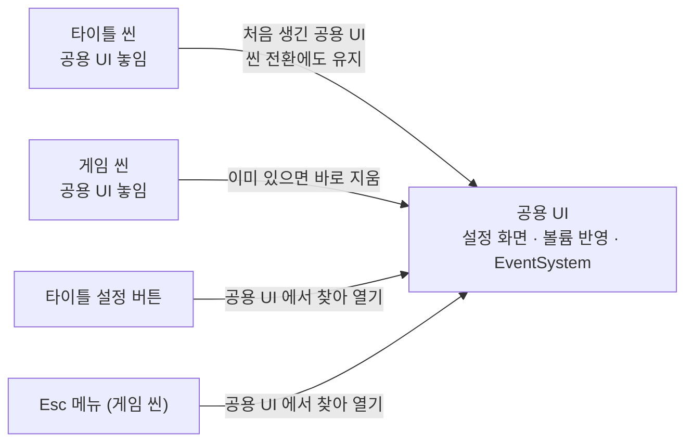
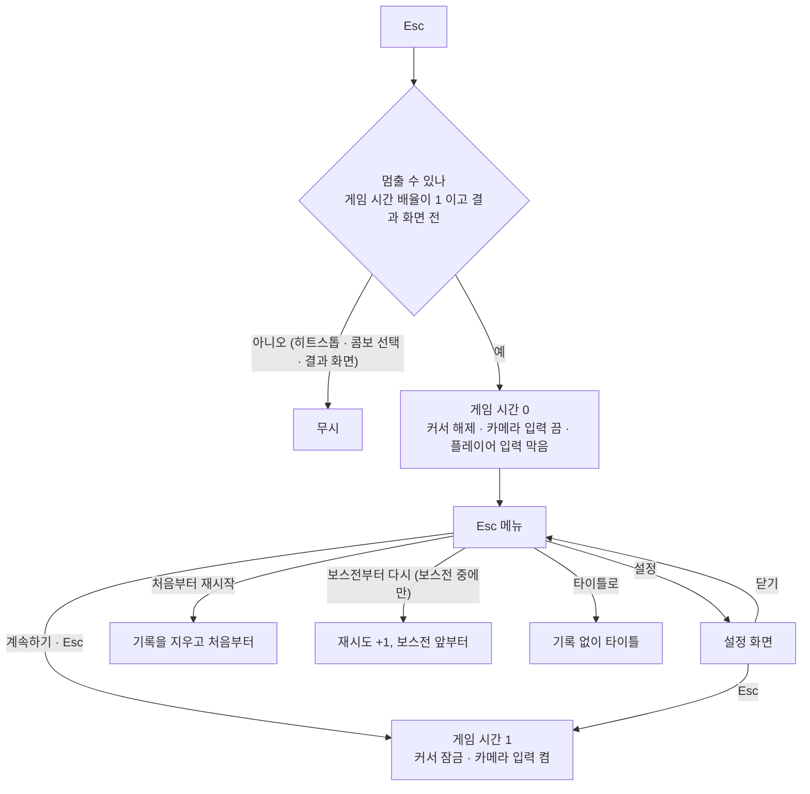
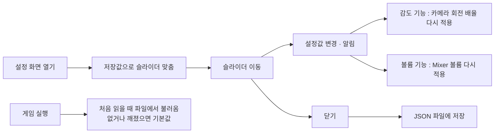

# 공용 UI (설정 화면 · Esc 메뉴 · 일시정지)

## 1. 개요

시연 중 게임을 멈추고 메뉴에서 다시 하기 · 설정을 고를 수 있게 한 UI 와, 어느 씬에서나 같은 설정 화면을 쓰도록 씬이 바뀌어도 유지되는 공용 UI 구조다. 마우스 감도와 전체 · 배경음 · 효과음 볼륨을 바꾸면 바로 반영되고, 파일에 저장해 다음 실행에도 쓴다. 휠로 카메라 거리를 바꾸는 기능도 함께 만들었다. 이후 로딩 화면처럼 씬과 상관없는 화면은 같은 공용 UI 에 더한다.

## 2. 구성 요소

- CommonUI : 씬이 바뀌어도 유지되는 공용 UI. 씬마다 놓인 것 중 처음 생긴 하나만 남기고, 다른 기능이 설정 화면을 찾을 수 있게 알려준다
- SettingsView : 설정 화면. 마우스 가로 · 세로 감도와 전체 · 배경음 · 효과음 볼륨 슬라이더. 열 때 저장값으로 맞추고 닫을 때 저장한다
- SliderValueText : 슬라이더 옆에 현재 값을 글자로 보여준다 (배율 · 숫자 형식 지정)
- SettingsOpenButton : 타이틀의 설정 버튼. 공용 UI 의 설정 화면을 연다
- SettingsData : 설정값 묶음
- SettingsStore : 설정값을 들고 JSON 파일로 불러오고 저장하며, 값이 바뀌면 알린다
- AudioVolume : 저장된 볼륨을 AudioMixer 의 노출 변수에 반영한다
- SfxPlayer · BgmPlayer : (#63) 효과음 · 배경음 재생. 공용 UI 에 두어 씬 전환에도 유지된다 (사운드 문서)
- GamePause : Esc 일시정지. 일시정지를 막는 조건, 게임 시간 배율, 커서, 카메라 입력을 맡는다 (게임 씬)
- PauseMenuView : Esc 메뉴 화면 (게임 씬)

## 3. 동작 원리

### 공용 UI 와 씬

- 공용 UI 프리팹을 타이틀 · 게임 씬에 모두 놓아 둔다. 처음 생긴 하나만 남아 씬 전환에도 유지되고, 다음 씬에 놓인 것은 생기자마자 꺼지고 지워진다. 어느 씬을 먼저 열고 플레이해도 공용 UI 가 있게 하기 위해서다.
- 씬에 놓인 복사본은 지워질 수 있으므로, 씬의 기능은 공용 UI 를 Inspector 로 연결하지 않고 실행 중에 찾는다. 공용 UI 는 다른 기능이 찾을 수 있도록 가장 먼저 준비된다.
- 공용 UI 에는 씬과 상관없는 화면만 둔다. Esc 메뉴 · 결과 화면 · 전투 HUD 는 게임 흐름 · 파티를 직접 쓰므로 게임 씬에 둔다.
- 화면 클릭을 처리하는 EventSystem 도 공용 UI 에 하나만 둔다. 씬마다 두면 여러 개가 함께 있어 경고가 난다.

### 일시정지와 Esc 메뉴

- 멈추면 게임 시간 배율을 0 으로 두고, 이어가면 1 로 되돌린다.
- **멈출 수 없는 때** : 게임 시간 배율이 1 이 아닐 때(히트스톱 · 콤보 선택 중)와 결과 화면이 뜬 뒤다.
    - 히트스톱 · 콤보 선택은 끝날 때 시간 배율을 되돌린다. 그 사이에 멈추면 메뉴가 열린 채 게임이 다시 움직이므로 Esc 를 무시한다.
    - 히트스톱은 아주 짧고 콤보 선택은 몇 초 안에 끝나 거의 느껴지지 않는다. 멈춘 동안에는 둘 다 새로 시작될 수 없다.
    - 완벽 회피 슬로모션은 적 전용 시간을 쓰므로 멈출 수 있고, 이어가면 남은 시간만큼 이어진다.
- **멈춘 동안 막는 것**
    - 플레이어 입력(이동 · 공격 · 교체 · 록온) : 메뉴 버튼을 누르는 클릭이 공격으로 들어가지 않게 한다.
    - 카메라 회전 · 확대 축소 : Cinemachine 이 게임 시간 배율을 무시하게 설정되어 있어, 멈춘 동안에도 마우스로 카메라가 움직이기 때문이다. 카메라 입력 컨트롤러를 통째로 끈다.
- **커서** : 게임 씬은 시작할 때 잠그고 숨긴다. 멈추면 풀고, 이어가면 다시 잠근다. 씬을 떠날 때 풀어 두어 어느 경로로 가든 타이틀에서는 커서가 보인다.
- 메뉴의 다시 하기 버튼은 결과 화면과 같은 규칙을 쓴다. 보스전부터 다시는 보스전 실패 후 재도전과 같아 재시도 횟수가 오른다. 지는 중에 메뉴로 다시 시작해 감점을 피하지 못하게 하기 위해서다. (게임 흐름 문서)

### 설정 저장과 반영

- 슬라이더를 움직이면 바로 반영하고, 파일에는 설정 화면을 닫을 때 한 번 쓴다. 움직일 때마다 파일에 쓰지 않기 위해서다.
- 저장 위치는 Unity 가 실행 환경마다 정해 주는 사용자 데이터 폴더다. 파일이 없거나 읽을 수 없으면 기본값으로 시작하고 경고를 남긴다.
- 설정값을 한 묶음으로 두어 항목이 늘어도 묶음에 칸만 더한다. 저장 파일에 없는 칸은 기본값을 쓴다.
- 마우스 감도는 카메라 회전 바인딩의 배율로 반영한다. (입력 문서)
- 볼륨은 AudioMixer 의 Master · BGM · SFX 그룹 볼륨을 노출 변수로 바꾼다. 0 ~ 1 값을 데시벨로 바꿔 넣는다. 사람이 듣는 크기가 로그에 가까워 슬라이더를 고르게 움직이면 소리도 고르게 줄게 하기 위해서다. 0 이면 들리지 않는 최저값으로 둔다. 실제 크기는 전체 볼륨과 그룹 볼륨이 곱해진 만큼이다.
- 슬라이더 옆 숫자는 감도는 소수 둘째 자리, 볼륨은 퍼센트로 보여준다. 화면이 켜질 때도 다시 써서, 열 때 맞춘 저장값이 바로 보인다.

### 휠 확대 · 축소

- 휠로 일반 카메라 거리를 바꾸는 기능은 코드 없이 설정으로 만들었다. 자세한 내용은 입력 문서에 적었다.

## 4. 구현 과정

- 활용한 기능 :
    - `DontDestroyOnLoad` : 공용 UI 를 씬 전환에도 유지한다.
    - `JsonUtility` · `Application.persistentDataPath` : 설정값을 사람이 읽을 수 있는 파일로 저장한다.
    - AudioMixer 노출 변수 : 그룹 볼륨을 코드에서 바꾼다.
    - `Time.timeScale` : 일시정지
    - Cinemachine `Input Axis Controller` : 멈춘 동안 컴포넌트를 꺼 카메라 입력을 막는다.
    - uGUI Slider · `Raycast Target`
- 구현 과정 :
    1. 설정값 묶음 · 저장 · 감도 · 볼륨 반영과 설정 화면을 만들었다. 설정을 바꿀 화면이 있어야 저장을 확인할 수 있어 설정 화면을 먼저 만들었다. 이후 사용자 요청으로 전체 볼륨과 슬라이더 값 표시를 더했다.
    2. 설정 화면의 슬라이더가 움직이지 않았다. 스킨의 슬라이더 이미지가 게이지 표시용이라 클릭을 받지 않게(`Raycast Target` 꺼짐) 되어 있었다. 배경 · 손잡이 이미지의 클릭 받기를 켰다.
    3. Esc 일시정지와 메뉴를 만들었다. 히트스톱 · 콤보 선택 코드를 고치는 대신 그 동안 Esc 를 무시하게 했다.
    4. 카메라 입력은 처음에 입력 동작을 끄려고 했으나, 입력 컨트롤러가 꺼진 동작을 스스로 다시 켤 수 있어 컨트롤러를 끄는 방식으로 바꿨다.
    5. 휠 확대 · 축소를 설정으로 연결했다.
    6. 사용자 요청으로, 씬마다 같은 프리팹을 두던 설정 화면을 씬 전환에도 유지되는 공용 UI 로 옮겼다.
- 주요 결정과 이유 :
    - 설정은 JSON 파일로 저장한다. 키 재설정 · 진동처럼 항목이 늘 예정이라, 묶음 하나를 파일 하나로 다루는 쪽이 관리하기 쉽다.
    - 일시정지를 막는 조건을 두었다. 시간 배율을 바꾸는 기능을 고치지 않아도 되고, 무시되는 시간이 짧아 플레이에 거의 영향이 없다.
    - 공용 UI 는 상주 방식으로 했다. UI 전용 씬을 함께 불러오는 방식도 비교했으나, 씬 사이 참조 · 불러오는 순서 · 에디터에서 한 씬만 열고 플레이할 때의 준비가 필요해 일정상 상주 방식을 골랐다. 로딩 화면 작업 때 다시 검토할 수 있다.

## 5. 기존 방식과 비교

- 필요하게 된 과정 : 기획서의 Esc 메뉴(설정 · 재시작 · 소리 조절)와, 시연 중 감도 · 소리를 조절할 수 있어야 한다는 요구에서 시작했다. 타이틀 · 게임 씬이 같은 설정 화면을 쓰도록 공용 UI 가 필요해졌다.
- 기존 방식 :
    - 마우스 감도는 Inspector 값이었고 저장되지 않았다.
    - 커서는 Esc 를 누를 때마다 잠금을 뒤집기만 했다. 게임은 멈추지 않았다.
    - 소리 조절이 없었다.
- 달라진 점 :
    - Esc 로 게임을 멈추고 메뉴에서 이어가기 · 설정 · 다시 하기를 고른다. 커서 잠금이 일시정지와 함께 움직인다. 테스트 씬은 기존 커서 잠금 기능을 그대로 쓴다.
    - 감도 · 볼륨을 설정 화면에서 바꾸고 다음 실행에도 남는다.
    - 설정 화면이 씬 전환에도 유지되는 공용 UI 하나에 있다.

### 미정 · 미검증 항목

- 스틱 감도 · 키 재설정 · 진동 설정 (기획서 Esc 메뉴, 일정상 미정)
- 로딩 화면을 공용 UI 에 넣는 작업과 UI 전용 씬 방식 재검토 (로딩 화면 작업 때)
- 게임패드로 메뉴 · 설정 화면 조작 (미검증)
